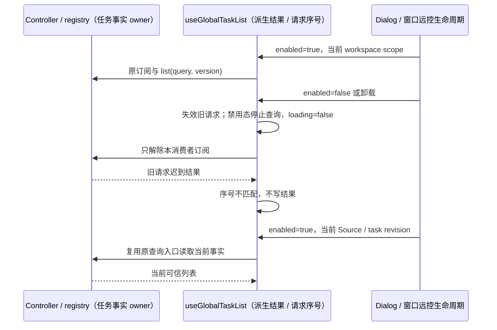

# main 构建与禁用态回归修复

## 范围与产品规则

本项修复 main 复核确认的 CLI SQLite 子路径打包阻塞、未适配当前异步迁移/模型状态契约的回归夹具和任务列表禁用态误报。不是官方版本升级，不恢复已删除模块，不修改 Provider、数据根、迁移账本、发行版本或安装包平台范围。

### CLI / Desktop Agent

- `resolveBuildAliases` 是 CLI、Desktop Agent 与 SEA 的单一 esbuild alias 来源。`@zcode/shared/sqlite-migrations` 必须精确指向共享模块公开 `index.ts`，不能被通用 `@zcode/shared` 前缀拼到 `src/index.ts` 后。
- 保留共享迁移模块原导出、事务/备份所有权及 Zod 身份校验；不复制 runner、不更改持久化 checksum，不新增依赖。
- 回归必须用真实 alias bundle SQLite 值导入并核对 esbuild inputs，不仅检查 package exports 或字符串声明。然后执行真实 Agent dependency build 与 Desktop Agent bundle；不在本机打包 exe/dmg。

### Automation 与 Bot 测试契约

- `prepareTasksIndexStorage` 仍是 Host tasks-index 初始化的唯一异步 owner。业务 Repo 的同步迁移入口只校验已完成账本，未准备的新数据库必须拒绝。
- Automation 生命周期夹具在构造业务操作前显式等待隔离数据库准备；之后仍用两个真实连接模拟暂停、派发和计数，不放回旧同步迁移、不削弱八项业务断言。扩大回归找到的 TaskAutoArchive 真实 SQLite / adapter 夹具同样等待该 owner，不改归档资格、毫秒边界、Controller 通知或手机恢复断言。
- Agent 全包复跑发现的两份工作流会话查询夹具使用内存数据库，也必须等待现有 `runSqliteSessionMigrationsAsync` 完成后再创建 journal。会话根/执行 cwd、同级会话隔离与未落库 run 的原断言保持；不为测试另建迁移入口。
- Bot Bridge 仍拥有偏好 revision 和 runtime cache。初始设置转换包括 `askUserQuestionAutoResolutionEnabled` 与默认 `toolSearchMode: "off"`；迟到的旧 revision 不得让 runtime 提前可用。
- Bot 回归将 ToolSearch 字段纳入真实初始和更新偏好断言，保持最新 revision、关闭、timer 释放及迟到响应防护。

### `useGlobalTaskList` 禁用态

- Controller / 共享 registry 仍是任务事实、查询 cache 和 cursor 的唯一所有者。hook 只持有已有派生列表与本次请求序号，不新增 accepted 队列、额外缓存或服务写入路径。
- `enabled=false` 时不注册本 hook 的 Controller 订阅、不发起列表查询、不因 registry 为 null 误报 channel 缺失。自动加载、手动 refresh 与任务/Source revision 更新使用同一禁用门禁。
- 空 scope 仍按既有行为清空派生结果；非空 scope 禁用时可保留最后可信列表，但 `loading=false`。启用后通过原查询参数/版本重新读取当前数据。
- 禁用、查询换代和卸载使旧请求序号失效，迟到结果不得覆盖新 scope 或卸载后的列表。共享 registry 的其他消费者不受影响。
- 普通 renderer 日志在 production 仍为 no-op；本修复不改变日志级别/落盘策略。未复现的瞬态旧手机 payload 不作为新增协议需求。

Desktop `desktop-continuous` 与手机 `web-remote-replayable` 仍消费同一任务 owner；这里只控制窗口列表观察者，不改变 stream、snapshot、重传、owner/lease、跨 Host 路由或 stale run admission。

## 验收场景与证据

1. 修改前 SQLite alias bundle 回归失败；修改后 bundle 成功且 metafile 包含共享 SQLite 公开入口。
2. 当前 Automation 原测试八项和 Bot Bridge lifecycle 原测试全部通过；前者通过唯一异步准备入口，后者覆盖 ToolSearch 初始值与 revision 更新。
3. 禁用且 workspace 非空时，无 registry/list/error；任务 revision、Source session 与手动 refresh 变化也不查询。
4. 已启用列表请求未完成时禁用/卸载，迟到成功或失败不能更新派生结果/日志；重新启用取当前结果。空 scope 清空保持。
5. 真实 React 窗口远控夹具在 idle / active / stop / restart 中验证订阅、列表查询、任务更新与 workspace 移除；通过现有平台/服务 Provider，不启动真实 Host/Agent 或模型。不依赖 logger 的 production no-op 隐藏错误分支。在途请求先确认被阻塞，任务写入基线与 `stop()` 同一次调用采样；随后等待本消费者的 Controller 订阅解除，再释放可区分的迟到结果，验证写入数不增加且迟到 payload 不出现。查询启动前的写入数不是停止边界，不能把此前正常的可信列表写入误判为迟到发布；不使用固定延迟代替 cleanup 信号。
6. 使用项目内固定 Node 24.14.0 / Corepack pnpm 10.33.2 执行 root typecheck、lint、fmt、architecture、受影响回归和真实 Agent bundle。

## 测试与提交边界

- 所有夹具、cache、日志、浏览器 profile/downloads 与子进程 HOME/TEMP/data 仅写当前项目树，执行前后检查路径和重解析点。链接测试不能通过全文件系统写白名单绕过安全约束。
- 浏览器 CI 安装目录显式位于项目内，并在安装与 smoke 步骤保持相同的 `PLAYWRIGHT_BROWSERS_PATH`；sandbox 重绑 HOME/XDG cache 后不能丢失已安装的只读浏览器入口。profile/downloads 仍各自隔离；不下载或安装系统浏览器。
- 已有 CLI 全包 lint 的 55 warnings / 79 errors 单独记录并与基线比较，不当作新回归，也不放宽规则或更新架构 baseline。
- 验证结果完成后记录在维护 spec，明确未跑浏览器/真机/真实 API 或环境受限项；不能写成全量无 bug。
- 用户已授权修复、验证后提交和推送。只推送 `origin = No-ni/ZCodium`，提交前展示中文文案；认证或网络阻塞不得伪报成功。当前请求只执行提交/推送，不自动触发构建。
