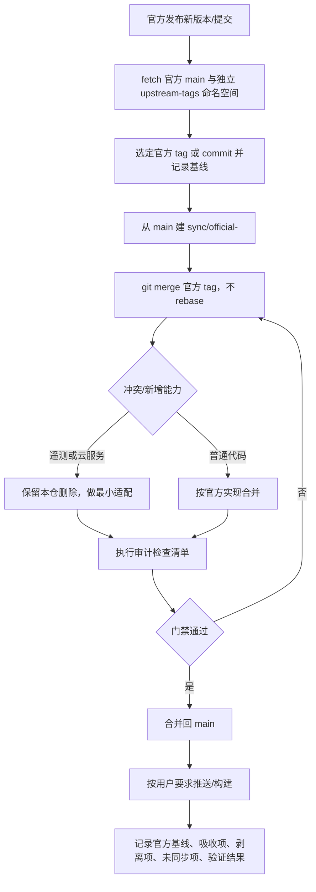

# 维护模型：官方源码 + 本仓审计

## 目的

本仓 ZCodium 是独立产品线，不再以任何第三方 fork 作为上游。只从官方开源仓库 `zai-org/ZCode` 吸收代码更新，并在每次同步中保留“去遥测、不依赖官方云服务”的审计边界。`ZCodium-project/ZCodium` 只作为审计原则和实现方式的参考，不作为合并来源。

## 来源与角色

| 角色      | 仓库                      | git remote  | 用法                              |
| --------- | ------------------------- | ----------- | --------------------------------- |
| 产品主线  | `No-ni/ZCodium`           | `origin`    | 唯一推送目标                      |
| 代码上游  | `zai-org/ZCode`           | `upstream`  | 唯一 merge 来源                   |
| 审计参考  | `ZCodium-project/ZCodium` | `reference` | 只读参考，不 merge                |
| 历史 fork | `axiom-desu/ZCodium`      | 已移除      | 只保留在 git 历史与历史 CHANGELOG |

约定：

- 不再把 `axiom-desu/ZCodium` 当作上游，也不把它的更新作为同步对象。
- `reference` 的文件可能同名但实现不同；判断差异以当前源码、入口和运行时行为为准，不以提交标题或文件 diff 为准。
- 历史 CHANGELOG、历史 spec 中出现旧上游链接属于记录，不改写；产品内新链接指向 `origin` 或本仓文档。

## 版本与发行

- 根 `package.json` 版本沿用官方 `3.x.y`，表示本次吸收的官方基线。
- 本仓自身修复不单独改版本号；需要发行时由用户确认版本。
- tag 使用 `v<version>`，安装包使用 `ZCodium-<version>-<platform>-<arch>.<ext>`。
- 不采用第三方 fork 的 `1.y.z` 版本线；需要区分时在 release notes 中注明对应的官方基线。
- 本地可能保留旧 fork 的 `v3.14.x` 等标签，且与官方同名标签指向不同提交。同步时以 `git ls-remote --tags upstream` 或官方 commit 为准，不要直接使用同名本地标签。

## 同步流程



先将官方标签抓到独立命名空间，避免覆盖同名历史 fork 标签；不使用 `--tags`、`--force`，不删除历史标签：

```sh
git ls-remote --tags upstream
git fetch --no-tags upstream "refs/heads/main:refs/remotes/upstream/main" "refs/tags/*:refs/upstream-tags/*"
git switch -c sync/official-<version> main
git merge refs/upstream-tags/v<version>
```

也可以 merge 已核验的官方 commit。命令中的版本是占位符，执行前须选定真实基线；本次维护清理不执行同步。

固定规则：

1. 只 merge 官方 tag/commit；不直接 merge `reference`。
2. 使用 merge，不使用 rebase，不改写已推送历史。
3. 每次同步单独开分支，冲突解决和审计剥离在同一个同步分支完成。
4. 未执行构建、E2E 或真机验证时，在同步记录中如实标注。
5. 构建只在用户明确要求时触发；不借构建绕过“不推送”要求。

## 审计边界

### 遥测

禁止引入：

- 官方上报 SDK、ARMS RUM、OTLP 自动上报、崩溃采集、设备归因、UI 埋点。
- 资源/网络采样的远端上报，以及自动模型请求/响应录制。

允许保留：

- 默认可用的安全本地技术日志；高频 debug 只用于开发且不记录原文。
- 后台资源/网络采样默认关闭，仅 `ZCODE_LOCAL_RESOURCE_MONITORING=1` 启用本地采样。
- 对外诊断导出默认关闭；仅用户显式开启并配置自建 OTLP 接收端才导出同一安全记录（见 `DIAGNOSTICS.md`）。
- 本地日志、本地性能计数和本地错误分类不得包含提示词、对话、文件内容、凭据、账号、完整 URL、原始错误文本或真实路径。
- 不得把默认地址回退到官方域名。

### 官方云服务

不依赖：

- 官方账号、登录、OAuth、购买、套餐、额度、权益领取。
- 官方分享、仓库快照上传、对话上传、官方 MCP 凭证。
- 官方插件市场的自动拉取、官方 client config/rollout、官方 relay、官方更新源。
- 官方强制更新控制面；未配置自有更新源时不检查、不回退。

允许：

- 用户自带 API Key 或自定义 Provider 时，调用该 Provider 的官方模型 API；这属于用户选择的 Provider，不算平台依赖。
- 需要保留的兼容入口必须有显式开关，默认关闭，并在设置页说明数据去向。

### 数据与更新

- 数据根为 `.zcodium`；旧数据迁移必须由用户决策，不自动迁移、不合并、不删除。
- 不向官方平台自动上传仓库快照、对话、文件或诊断，不保留自动上传队列。用户选择的模型 API、远程操作及显式自建 OTLP 导出遵守各自数据边界，不属于官方控制面。
- 更新只读自有更新源；`ZCODIUM_UPDATE_ORIGIN` 未配置时跳过更新检查，不回退官方地址。
- 工作区身份统一使用 `workspaceIdentity?.trim() || workspacePath`；远程链路同时传递 `workspaceIdentity` 与 `remoteSessionId`。

### 品牌与许可

- 保留 ZCodium 身份、现有 Apache-2.0 `LICENSE`、`NOTICE.md` 与第三方版权声明；许可证变更必须单独由用户确认。
- 安装包未获官方签名时，必须如实说明，不写成官方认证。
- 不恢复官方购买、分享、账号入口来“补齐”能力。

## 每次同步的检查清单

必须执行并记录真实结果：

- [ ] `pnpm typecheck`
- [ ] `pnpm lint`
- [ ] `pnpm fmt:check`
- [ ] `pnpm architecture:check --changed`
- [ ] 受影响包的测试（以目标包 `package.json` 和实际测试文件为准）
- [ ] 人工复核 `git diff <官方基线>...HEAD` 中新增的依赖、端点、设置项和 UI 入口
- [ ] 关键词扫描：`ARMS`、`OTLP`、`analytics`、`telemetry`、`crash`、`sampling`、`reportEvent`、`track`
- [ ] 端点扫描：新增的官方域名、`DEFAULT_ZCODE_ENDPOINT_ORIGIN`、`api.z.ai`、`bigmodel.cn`、`zcode.z.ai`
- [ ] 数据根、更新源、品牌、许可声明未被覆盖
- [ ] 同步记录已写明官方基线、吸收项、剥离项、未同步项、验证范围和已知限制

关键词和端点扫描是人工复核的入口，不是自动判定；命中项必须确认是本地能力、用户自选 Provider，还是需要剥离的官方服务。

## 冲突处理原则

- 官方重新引入已删除的遥测或云服务：保留本仓删除，不通过恢复模块来让测试变绿；必要时做最小适配层。
- 官方新增官方服务 UI：默认不接，或改接到本仓 Provider/设置；不新增官方依赖。
- 官方删除本仓仍在使用的模块：先确认产品边界，再决定保留本仓实现还是跟随删除。
- 官方新增第三方依赖：检查许可证、是否含遥测/分析、是否引入新的网络默认行为。
- 官方改动与本仓性能/架构优化冲突：以现有 owner、协议和状态边界为准，性能优化单独提交，不与同步混在一起。

## 欠账处理结果（2026-10-24）

| 项                         | 处理结果                                                                                                                                                             |
| -------------------------- | -------------------------------------------------------------------------------------------------------------------------------------------------------------------- |
| 官方账号/OAuth             | 删除内置 `account:*` / `zhipu-account` Provider 与模型规则；删除 OAuth 常量、环境注入、登录页死分支和对应文案。历史 Provider ID 与数据库迁移保留，仅用于读取旧数据。 |
| Coding Plan 订阅/购买/权益 | `coding-plan-subscription` 服务只保留动态工作流的本地判定，不再请求官方 client config；购买 webview、支付 RPC 残留和订阅/权益文案已删除。                            |
| BYO API Key 额度           | 保留 `codingPlanQuota` 与额度面板：它使用用户自己的 API Key 查询用户自己的 Provider 额度，属于用户自选 Provider API，不是官方平台依赖。                              |
| 官方 client config/rollout | 删除动态工作流远端请求；自动更新、强制升级和 manifest provider 只接受 `ZCODIUM_UPDATE_ORIGIN`，未配置时跳过，不再回退官方。                                          |
| 官方插件市场               | 市场目录本来就只来自随包本地 seed；默认启用集合已与 `official-plugin-definitions.ts` 对齐，并新增一致性守卫。                                                        |
| 资源/网络采样              | 后台资源/网络采样默认关闭，只有 `ZCODE_LOCAL_RESOURCE_MONITORING=1` 时启用；本地诊断、用户自建 OTLP 和资源管理器按需采样保留。                                       |
| 自动化审计守卫             | 新增 `scripts/ci/audit-boundaries.test.mjs`，覆盖官方控制面、OAuth、账号 Provider、购买残留、产品链接、插件默认集合和采样开关。                                      |
| 产品链接                   | `config/default.json`、构建元数据和文档链接已指向 `No-ni/ZCodium`；仓库 Issues 已开启，feedback 入口可用。                                                           |

仍保留的明确例外：

- `api.z.ai` / `bigmodel.cn` 的 quota API 只用于用户自带 Key 的额度查询，不读取官方账号凭据。
- 历史 `account:*` ID、`zhipu-account` 协议 schema 和数据库迁移保留，避免旧会话/旧配置无法解析；运行时继续 fail-closed，不恢复账号执行能力。
- `coding-plan-subscription` 是历史服务/channel 名称，当前不包含订阅、购买或权益逻辑。

## 补充清理（2026-10-25）

本次不是上游同步，不执行 fetch/merge、版本发行或数据迁移；根版本仍为 3.15.1。保留开始前的本地改动。

- 设置服务和 MCP 迁移在自身出口使用安全 logger，纯 HTTP 宿主不再输出配置、路径或原始错误。对抗回归先复现泄露再验证修复，锁、写队列、原子替换与离线迁移结果保持。
- 官方标签使用独立 `refs/upstream-tags/*`，避免历史同名 fork tag 冲突；旧 scoped-diff-only 规则和历史 parity 结果已明确退休/标记，不再作为当前执行指令。
- DOCX/PDF/XLSX 字体安装入口及轻量检查只读本地字体，不自动请求官方 CDN、创建目录、注册字体或要求整个清单；Windows、macOS 及通用 Linux CLI 的检查与缺失提示一致。
- 四个文档技能许可元数据修正为 Apache-2.0，保留原版权；随包版本同步为 documents/presentations/spreadsheets 0.1.9、pdf 0.2.1，未改变产品版本。
- AstrBot 产品按钮通过现有平台回调打开本仓文档，第三方 connector 来源仍如实标注；双语桌面/手机按钮回归不访问外部页面。
- release-it 默认禁止 push，显式 push 指向 origin，文案为中文；README 与实际手动四架构 Actions 工作流一致，不再声称自动 Release。
- AGENTS、README、NOTICE 与 DIAGNOSTICS 区分安全本地日志、默认关闭的采样、显式自建 OTLP 和正常用户模型/远程业务请求；自动 model-I/O recorder 仍删除，只读历史轨迹保留。
- 当前数据目录说明不再包含同名迁移矛盾；image-search 文档修正为必填完整用户 MCP URL、无默认服务器/官方 JWT，而非已退休的 8787 信任白名单。

### 验证记录

本轮在 Windows 上使用 PowerShell 7、`corepack pnpm` 和 Node 24.18.0；`mise.toml` 固定 Node 24.14.0，本机小版本不一致，不视为固定工具链或跨平台全量验收。

| 验证                                                      | 实际结果                                                                                                                                                                 |
| --------------------------------------------------------- | ------------------------------------------------------------------------------------------------------------------------------------------------------------------------ |
| 工作区 freshness                                          | 通过；开始时当前分支与 origin 同步，相对 origin/main ahead 31 / behind 0                                                                                                 |
| 根 `typecheck`                                            | 通过                                                                                                                                                                     |
| 根 `lint`                                                 | 最后复跑通过，0 警告、0 错误（3155 个文件）                                                                                                                              |
| 根 `fmt:check`                                            | 通过（3658 个文件）                                                                                                                                                      |
| `architecture:check --changed`                            | 通过，0 violations / 0 baseline / 0 new                                                                                                                                  |
| `git diff --check`                                        | 通过                                                                                                                                                                     |
| `node --test --test-isolation=none scripts/ci/*.test.mjs` | exit 0；613 项，604 通过、0 失败、0 取消、9 跳过，耗时 1250708.9886 ms（约 20.8 分钟）                                                                                   |
| 最终定向回归                                              | 审计 9 项、字体 15 项、服务日志 2 项、AstrBot 按钮 1 项，合计 27 项全部通过；MCP、自带 Key/历史设置和诊断隐私的补充回归也通过                                            |
| CLI 独立 `typecheck`                                      | 通过；执行的是现有源码检查入口，包含 TUI 构建，不是安装包打包                                                                                                            |
| CLI 聚合 `check`                                          | 未通过：Bash 命令注册表生成校验报 stale；独立生成比较的 707 个命令根与内容相同，只差源哈希注释和 `BASH_COMMAND_REGISTRY_HASH` 两行元数据。本轮未修改该生成文件或放宽检查 |
| CLI 全包 `lint`                                           | 未通过：56 个警告、79 个错误，位于本轮未修改的广泛 CLI 源码；本轮未执行 CLI 全包修改前基线，不能声称所有失败已通过前后对照证实为既有失败                                 |
| 本轮修改的 CLI seed 定义单文件 lint                       | 通过，0 警告、0 错误                                                                                                                                                     |

完整套件启动后又补充了三个字体轻量检查回归，并修正了 AstrBot 浏览器测试在非 Windows CI 上的启动配置及最后的文档描述；这些最终改动另行通过定向回归，不声称同一次完整套件覆盖最终树的全部变更。完整套件中的远端部署/上传等跳过项仍未执行，不以套件 exit 0 代替这些验收。

Windows/macOS 安装、注册表、Finder、真实字体渲染与外部 AstrBot connector 连通没有执行；没有本机或 GitHub 安装包构建、市场安装/发布、commit、push 或 GitHub Release 操作。

## 官方 3.16.2 择项吸收与项目内验证收口（2026-10-28）

> 本节保留此前不提交阶段的结果。随后用户已授权核验两工作树的全部有效未提交成果、本地提交并合入 main；最新 Git 状态、后续测试和限制以[未提交成果验证与主线整合](../../.agents/specs/uncommitted-validation-main-integration.md)为准。以下「未提交、原树只读、未跑」不再表示整合阶段现状。

本项是固定官方 `zai-org/ZCode@3c5b227649371507ddc4eb46ac5133afe6db1cab` 的择项适配，不是完整 3.16.2 parity。获准 worktree 为 `C:\vibecoding\zcodium-adopt-3.16.2`，detached HEAD `18cc72cef7bec53eaa543b515e0c9332bc9cd05b`；原树与官方快照只读。根版本仍为 3.15.1，CLI 顶层 0.16.9，未 merge、stage、commit、push、触发 Actions、打包、发行或安装服务。freshness 用 `--no-fetch` 只核对缓存引用，adoption 无 tracking branch，相对 origin/main ahead 31 / behind 0；不声称重新刷新远端。

完整当前状态、详细测试数量、项目内日志与未验收清单见 [实施收口记录](../../.agents/specs/official-3.16.2-adoption-results.md)，原方案见 [总交接](../../.agents/specs/official-3.16.2-adoption-handoff.md)。早期 spec 的开工缺口、OS-temp 清理和门禁结果只作历史，不覆盖本轮最终树。

### 吸收、适配与剥离

- 已落地源码包含工作流 stop/真限流分类、模型结束原因与失败 usage、Bash 输出准备、Radix hidden 测量、Windows 未读提示、MiMo 2.6 目录、默认 Off 的 ToolSearch、Source/Profile/连接与授权/provisioning v2/目标额度、唯一 Source 数据根、SQLite 异步迁移框架、窗口目录、模型/思考菜单、完整视图及 Office 阅读/分发接缝。不是本轮逐项真机验收；保留已有 Gemini 签名、个人 Key 额度、holes/journal、CommandInbox、owner/lease 与 continuous/replayable 分工。
- Office 当前 Desktop/prebuild/dev/SEA 公共接线已补齐，共用 shared build/资源合同；旧 spec 的“尚缺接线”是开工快照。本轮仅只读核对，没有执行 Office/SEA/安装包产品构建。
- 保留去官方账号、购买/套餐/额度控制面、分享/上传、model-I/O recorder、遥测、client config/rollout、官方 relay/更新 fallback 与无 Linux 发行资源边界，不恢复已删除模块让测试通过。
- Source alias 迁移框架不等于生产可接历史库：全根真实 writer lease、可信 committed snapshot 与 preview/confirm/execute/retry/report/restore 的 UI/channel 仍缺；history-present/unavailable、snapshot-unproven/snapshot-stale 继续 fail closed，可能保守阻断已有 Source 重连。

### 项目内安全边界与历史事故

用户报告上轮电脑数据丢失，附件还记录真实插件目录消失；历史系统 TEMP 全量运行器曾重定向 HOME 并递归清理。另有一次 Settings 红测试未隔离 bootstrap home，实际读写真实用户 setting。没有完整损失清单或可靠前像，不确证因果、不自动回滚或恢复，也不将事故缩写为只有 setting 写回。

本轮修改、合成数据、缓存与验证日志只写获准工作树。`project-test-sandbox.mjs` 是唯一环境 owner，fresh `.run-logs/project-only-validation` 运行根逐级检查真实路径/链接，绑定 home/temp/data/storage/cache 并禁用下载、compile cache 和遥测。Source/枚举/SQLite/RPC wrappers 先隔离，再装载业务；连接关闭后保留合成数据，不递归清理运行根。Node permission 是附加写白名单，不是任意 shell/native addon/所有业务写者的完整系统沙箱。旧 TEMP 运行器、真实用户 `.zcodium` 和历史事故目录不读取、不运行、不清理、不恢复；宿主工具自动会话记录不被冒充为已证明的系统外部零写。

### 本轮实际验证

Windows Node 24.18.0 / pnpm 10.33.2，仓库 pin Node 24.14.0；不安装/切换工具链。

| 验证                                     | 实际结果                                                                                                   |
| ---------------------------------------- | ---------------------------------------------------------------------------------------------------------- |
| 根 typecheck / lint                      | 均 exit 0；Lint 0 warnings / 0 errors，3308 files                                                          |
| 根 fmt:check                             | exit 0；文档落地前 3836、文档收口后 3837 matched files；只格式化本轮 owned 文件，没有全仓自动格式化        |
| changed architecture                     | exit 0，0 violations / 0 baseline / 0 new                                                                  |
| CLI typecheck / registry:check           | 均 exit 0；既有 TUI/类型库准备只写项目，不是安装包构建                                                     |
| CLI 全包 lint                            | **exit 1，55 warnings / 79 errors**；未放宽规则或更新 baseline，本轮未重做完整 HEAD 双树诊断对照           |
| 枚举/Source 测试严格 noEmit              | 两项配置均 exit 0                                                                                          |
| Sandbox / runner / baseline 更新参数拒绝 | 6 / 1 / 2 项通过；旧更新参数早拒绝，两份冻结 baseline 字节不变                                             |
| Source 内部真实回归                      | layout 4、组合 5、CLI 11、枚举 7，全部通过                                                                 |
| SQLite/RPC 内部真实回归                  | infrastructure 27、startup 20、baseline 2、loopback inspection 4，全部通过；另有 schema contract 11 项通过 |
| 已审查离线产品/审计组                    | 14 个入口全部 exit 0；child 目录 9/投影 5 的数量不与 wrapper 一项重复相加                                  |
| 既有无 IO runner 消费者                  | hidden-document-motion-pause 根 3、内部 3 项通过；其他含历史临时清理/独立子进程的消费者未全跑              |
| 功能图                                   | 67 nodes / 87 edges，路径/符号/端点/rank 无结构问题；24 个 seed 引用未跟踪，保留 drift/WIP，不 stage       |
| git diff --check / 原树保护指纹          | 通过；原树 tracked diff/status 指纹与此前一致，不等于所有未跟踪内容或整机数据证明                          |

本轮修复枚举 mock 的 `this` 类型与 5→7 精确计数，统一 child 成功/失败项目内留档。schema baseline 旧更新参数原先被 wrapper 静默忽略，现根/fixture 都明确拒绝 `SQLITE_SCHEMA_BASELINE_UPDATE_NOT_SUPPORTED`；验证入口只做只读比对，历史更新入口退休，没有修改 Host 3 条/CLI 23 条冻结 checksum 或 schema baseline。

未执行完整 root/CLI corpus、真实模型/workflow/Agent、真实 daemon/SSH/服务安装、GUI/E2E/手机设备、Windows DPI/taskbar、Office 编译/seed/SEA、发行/升级、真实用户库、历史 alias/WAL/Bash/Office OS-temp corpus、macOS 或固定 Node 小版本验收。CLI Lint 欠账与 Source 历史数据闭环保持未完成，不写成全门禁或完整产品验收通过。

## 未提交成果整合阶段（2026-10-28，后续授权）

用户随后授权核验两工作树的全部有效未提交成果、修复明确回归、本地提交并合入 main，允许最多三个并发子代理；不授权 push、Actions、发行、系统服务或真实数据操作。本阶段不以旧「未提交」快照否认已有吸收，也不将其升级为完整官方 3.16.2 merge/parity。根版本保持 3.15.1，CLI 顶层保持 0.16.9。

原性能树的 161 个有效路径已提交为 `23050742`；吸收树 695 路径精确提交为 `417ddfb9`，经性能分支普通merge `a548ab2e` 后合入本地main `8a81d55f`。126 原路径字节相同、8 个删除保留、27 为有意扩展，无丢失；8项冲突逐文件保全，合并整树与验收版本完全一致。主线实际目录根 typecheck/lint/fmt/architecture/registry复核通过，CLI typecheck、完整架构、56项UI/registry、89项Office与2场景真实UI合成交互在同提交完整依赖树再次通过；CLI全包Lint仍79 errors/55 warnings。后续仅文档记录再快进main/perf，不推送。日志、缓存、数据库、dist与两个未知shell残留均不提交。最新门禁、Lint基线对照、Source/SQLite/Office/UI证据、Git最终状态与安全偏离统一见[未提交成果验证与主线整合](../../.agents/specs/uncommitted-validation-main-integration.md)。

两项真实 UI 合成交互联合复跑通过，覆盖同一 Lexical 节点/草稿、完整视图往返与阻塞恢复、模型/思考选择、迟到事件和窄屏；Source alias92/admission25、Office 正常包测试89与四格式源码分发6等均实际执行。这些不替代安装版、真实 daemon、手机、Office 四格式 GUI 或完整 corpus 验收。Source 的真实停写租约、可信快照与历史迁移 UI/channel 仍未接通，保持 fail-closed。CLI 全包 Lint 仍失败，未放宽规则或更新 baseline。

本阶段有一次 Source 代理裸跑旧入口、在系统 TEMP 创建并删除自有合成 fixture 的安全偏离；两次结果不计入合规验收，已迁项目内 wrapper 并复跑。后续合规结果不能抹去该事实，不宣称本轮项目外零写；详情及历史事故保留在整合记录中。

## main 构建门禁修复与复核（2026-10-29）

本项按用户后续授权修复 main 的已确认问题，并在验证后本地提交、仅推送 `origin = No-ni/ZCodium`。修复基线为 `42165fae`，开工已刷新 origin；相对 `origin/main` ahead 36 / behind 0。根版本仍 3.15.1，不执行上游同步、版本升级、安装包打包或自动构建。具体规则见 [main 构建与禁用态修复](main-release-gates-fixes.md) 和 [模型选择夹具契约](model-selection-fixture-contract.md)。

### 修复内容

- CLI 的 SQLite 公开子路径补齐精确 esbuild alias，CLI、Desktop Agent 与 SEA 继续复用同一 alias / bundle 来源；不改迁移模块导出、账本、checksum 或 Zod 身份校验。
- `useGlobalTaskList` 禁用态统一停止自身订阅/查询，不将禁用导致的空 registry 误报为 channel 缺失；禁用、查询换代与卸载作废在途请求。Controller/registry 仍是任务事实和缓存唯一 owner，不改两种远控 delivery、owner/lease 或队列。
- Automation、TaskAutoArchive、CLI 工作流与模型选择数据库夹具等待现有唯一异步准备链；Bot 回归包含 ToolSearch 默认 Off 与最新 revision；模型选择回调夹具补齐 `modelSelectionState` 并验证非 ready 状态无副作用。未恢复旧同步迁移或削弱原业务断言。
- Desktop CI 纳入 hook 回归，并为浏览器安装/检查共用项目内 `PLAYWRIGHT_BROWSERS_PATH`，避免 sandbox 重绑 HOME/cache 后找不到安装入口。仍仅手动触发，不改 Windows/macOS 平台矩阵、打包并行规则或上传/发行行为。

### 已完成的实际验证

固定 Node 24.14.0 / Corepack pnpm 10.33.2；冻结、离线、禁 lifecycle 依赖准备已完成，lockfile 未改。所有验证脚本写入限定本工作树，HOME/TEMP/data/cache/profile 由中央 sandbox 绑定；不读取真实用户数据库或 profile，不清理历史目录。安装包与 GitHub Actions 未执行。

| 验证                                              | 实际结果与证据范围                                                                                                                                                                                               |
| ------------------------------------------------- | ---------------------------------------------------------------------------------------------------------------------------------------------------------------------------------------------------------------- |
| 根 typecheck / lint / fmt / 全模块及 changed 架构 | 最终源码、回归与 CI 接线收口后均 exit 0；Lint 3321 文件 0/0，架构 0 violations / 0 baseline / 0 new。                                                                                                            |
| CLI typecheck / registry                          | 均 exit 0。                                                                                                                                                                                                      |
| verify:pre-push                                   | 最后 exit 0（Lint 与 changed 架构）；首次隔离执行因 PATH 没有 pnpm shim 在检查前退出，项目内临时 shim 仅转发固定 Node/Corepack 后原入口通过，未改产品脚本或系统安装。                                            |
| CLI 全包 Lint                                     | **exit 1，79 errors / 55 warnings**。现有 Lint 的全部 src/debug/test 输入、配置、运行器和依赖锁与基线 `42165fae` 未变；本轮改动的 build script 与两份 bootstrap test 单独 Lint 0/0。未放宽规则或更新 baseline。  |
| SQLite alias 回归 / 真实构建                      | CJS/ESM 回归先 0/2 后 2/2；全部 Agent dependency build 与 production Desktop Agent bundle 均 exit 0，不是 exe/dmg/SEA 安装包构建。                                                                               |
| Desktop CI 的 12 组 Vitest                        | 945/945 通过。最终 hook 类型修正后另复跑 8/8；不重复加到 945 数字里。                                                                                                                                            |
| Agent 包级测试                                    | exit 0，444 项：439 通过、0 失败、5 跳过，其中 Office 正常包级 89/89；跳过为可选性能 benchmark，不是实际模型或设备验收。                                                                                         |
| 修复夹具回归                                      | Automation 8/8、Bot 21/21、TaskAutoArchive 12/12、模型选择 3/3 与持久化修复 2/2；各原 CI wrapper 最后复跑均 exit 0。                                                                                             |
| 工作区运行语义                                    | 会话工作区单元 63/63；真实 CLI 进程 E2E 28/28；Source alias 最后短顶层 sandbox 92/92、WAL 20/20。                                                                                                                |
| CI 注册守卫                                       | Desktop 平台/手动触发/安装目录与 hook 接线六项通过；不代替浏览器执行。                                                                                                                                           |
| 真实 React 窗口远控浏览器回归                     | 项目内 Windows Chromium Headless Shell revision 1217，完整场景连续两次 exit 0：idle 零查询、QR 往返、在途 stop/cleanup/迟到丢弃、restart 当前事实、workspace 移除/最终清空及停止后零写入；不是手机或安装版验收。 |

### 整批与环境失败的诚实口径

逐文件已审查 CI 扫描运行 128 个入口，首次 123 exit 0、5 exit 1；外层 TAP 为 682 项、665 通过、8 失败、9 跳过。四个失败入口已在修复后单独复跑通过；Source alias 的失败是外层 sandbox 再套 `children/source-tests` 导致 Windows 路径过深，短顶层同夹具最终 92/92 通过。三项悬空链接测试由验证用 guard 先误拒，guard 仅在项目内支持明确类型的断链后 63/63 通过；不改产品链接逻辑，也没有开放全文件系统写权限。最初短路径 alias 180s 只完成30项，被终止不计完整通过；足额预算最后约357s完成92项。不能把最终定向复跑描述为同一次整批全绿。

18 个入口被本次执行谓词暂缓，其中16个浏览器/UI入口及本地字体 shell、asar finalize 入口；未执行的其余浏览器、原生 shell/链接和真机场景不由静态/mock 通过替代。

系统 Edge 在隔离 HOME/TEMP/profile 下多次停在 CDP 握手，单次最小探针通过不能算完整验收；未操作真实 profile、安装/更新系统浏览器或加长产品超时。随后在项目内下载 Windows Chromium Headless Shell，实际场景首先揭示新增测试把查询前写入数误用为停止边界。合成时间线确认额外可信列表写入发生在 stop 前，释放前后数量不变且没有迟到标题；只修测试的 stop 原子取样与 active subscription cleanup 信号后，完整场景两次通过。根 UI 工程不包含 `test/`，该 TSX 夹具另按现有编译选项/project references 执行 noEmit，通过。

提交前再次 fetch origin 并执行 freshness，仍 ahead 36 / behind 0；仅提交本项 22 个源码/测试/spec/CI 路径，两个未知 shell 残片与所有日志、缓存、数据库、浏览器工具链及 dist 不提交。本轮非交互推送预检仍 exit 128（`fatal: unable to get password from user`）；`gh` 认证先前已报无效，不自动登录或导入凭据，不能写成远端已更新。当前仅执行用户授权的本地提交/main 快进与推送尝试，不触发 `desktop.yml`。

主要项目内证据为 `root-final-*-results.json`、`workflow-vitest-results.json`、`agent-tests-1793264985819-results.json`、`ci-final-1793266905044-results.json`、`a-VwLSSw/results.json` 及 `window-sync-direct-log-4Yy5Kq` / `window-sync-direct-log-jWKTAd` 下日志；全部位于 `.run-logs/project-only-validation/`，不是仓库内容。最终通过不改写首次整批失败、Edge 受限或其余未执行边界。

### 2026-10-30：当前工作树确定性 bug 审查

本轮只审查并修复当前工作树，不同步新的上游基线，不改版本号、产品身份、数据根、更新源或发布状态。保留无关本地改动，未提交、推送、打包或触发工作流。

- **Catalog 请求头**：认证默认头与用户头按名称大小写不敏感合并，最后的自定义名称和值胜出，输入不变；发现与 fallback 使用同一结果，端点、超时与持久化不变。
- **预览路径**：file URL 只解码一次，普通路径的百分号保持字面值；编码分隔符拒绝后不经其他提取分支复活。保留 UNC、盘符根及非 localhost 主机名，保护根段，区分本地与 UNC 命名空间。这里只保证候选路径的词法规范化和边界，不代表 realpath/符号链接授权或已证实的数据泄漏；ArtifactSource、Host 与 identity 契约未变。
- **RPC scope 与路由等待**：scope 先登记再订阅；握手前断开、同步重入关闭、迟到句柄和重复关闭统一终结。监听与通道只由同一资源列表释放，连接对象只是派生活跃视图；服务端初始化关闭后不再构造客户端。未路由等待取消、dispose、失败与正常移交统一 finish，正常移交不取消业务 token；标识结果按 ctx 选择，显式连接结果必须保持当前活跃对象身份。抛错的外部清理不阻断本方剩余清理。外部 protocol/socket 与忽略取消的 router 自建资源仍归原 owner，不改变 wire、事件路由、Host/lease、CommandInbox 或 continuous/replayable 业务语义。

实际验证：三项生产源码定向回归分别 26/26、33/33、31/31，共 90 项；三个永久入口与两项边界守卫共 18/18 外层测试，其中 15 项是审计/桌面平台边界，不把包装层再计入 90 项。现有 RPC 五文件 55/55；新增 RPC 两套测试与真实源码的独立严格 TypeScript 检查退出 0。另补双连接取消重入场景：旧逻辑取消后仍执行第二个筛选谓词、第二次 ctx getter，31 项中仅这 2 项失败；逐候选检查终态与仅读一次标识后通过。初始化关闭场景另以累计订阅暴露旧逻辑的 3 次订阅（期望 2 次），修复后通过，不能以最终监听归零掩盖额外构造。

根 typecheck、lint、fmt:check、architecture --changed 与 CLI registry 检查退出 0。整合 gates 仍退出 1：CLI lint 是既有 79 errors/55 warnings，134 条诊断按消息和源码位置归一化后与旧日志相同，仅输出顺序不同；未降低 lint/架构门槛或修改 CLI 来隐藏欠账。RPC 在现有策略中仍是 legacy 未纳管、owner 未分配，根架构门禁通过不表示补齐其长期模块治理。

所有显式测试、缓存与日志目标位于项目内隔离目录，启动前检查路径、链接/重解析点及子进程环境；未使用真实用户目录、真实业务数据根或系统临时目录作为测试目标。Node permission 不能单独证明 native addon/子进程完整隔离。当前验证为 Node 24.18.0、pnpm 10.33.2，未按仓库固定的 Node 24.14.0 复验；没有真实模型网络、实体手机、完整 Electron/安装版、真实远端/Socket 或全量语料验收，未执行未完成 IO 审查的文件引用集成测试。此前全量/固定版本的历史结果不能冒充本次验收。

永久回归入口（从仓库根执行）：

```sh
node --test scripts/ci/provider-model-catalog-regression.test.mjs
node --test scripts/ci/conversation-preview-path-regression.test.mjs
node --test scripts/ci/ipc-server-lifecycle-regression.test.mjs
```

### 2026-10-30：固定工具链复核与相邻缺陷修复

本轮继续审查当前工作树，不同步或改版本，不提交、推送、打包、安装、启动应用或触发工作流。使用项目内固定 Node 24.14.0 / pnpm 10.33.2；freshness 退出 0（ahead 0 / behind 0），补上上一节未固定 Node 版本的验证边界，保留无关工作树改动。

- HTTP 静态资源：复核词法与 realpath 双重包含边界，覆盖 Windows 不同盘符、合法点号前缀、目录与 SPA index；返回已校验的逻辑文件名以保留 MIME/缓存语义。未做物理 junction 或并发替换验收。
- 延迟 RPC：订阅按监听周期唯一归属，旧周期清理不能夺走新周期槽位或结束新 Event；保持惰性、call 拒绝和现有 wire。补充真实同步重入与外部 disposer 抛错场景；一条新增测试的旧时序安排错误已通过实跑确认并修正，没有为错误测试改产品。控制副本 15/15；分别移除两个 isCurrent 守卫的副本为 13/15、14/15，均被预期用例检出；真实源码未受变异影响。
- Workspace：必需 inventory 先同步，失败的可选 directory 投影不抛错、不发送、不消耗 generation；补证 legacy 路径 fallback、remoteSessionId 与 lastConnectionError 保留/投影剥离。Host 替换、postMessage 抛错与窗口关闭后的 generation 清理未验收。
- 自动化：成功回执与计数由 Repo 单事务结算，复核幂等、成功终态和旧轮次归属；新增实测发现旧轮次首个失败会改写新认领的退避/终态，19 项中 4 项失败，补定时轮次归属守卫后 19/19。失败事实仍由 scheduler 写 run 台账，manual、无 runId 的 legacy 路径及当前轮次退避不变。yearly 只校验最终规范化/重锚定的月日组合，保留 Feb 29 和 monthly 原语义。
- 测试写边界：三套自动化夹具统一经中央 owner 写前拒绝，生命周期旧夹具实测未拒绝未绑定执行，迁移后 3 个未绑定场景全部通过；其余两套旧缺陷仅依据源码写入顺序，未把推断写成旧代码红测。全部测试、SQLite、缓存、编译产物与日志位于项目工作树；未使用真实业务根或外部 TEMP，native/子进程隔离不只依赖 Node permission。

统一回归实测 **190 项通过**，不重复计入包装层：HTTP 35、延迟 RPC 15、workspace 4、结算 19、yearly 7、夹具隔离 3、IPC 生命周期 31、provider catalog 26、预览路径 33、自动化生命周期 8、审计边界 9。HTTP/RPC/三套自动化源码测试的 package-aligned noEmit 三组均退出 0；最初临时配置错误造成的失败已在按各包配置重建后消除，未通过放宽产品类型来绕过。

根 typecheck、lint、fmt:check、architecture --changed 与 CLI registry 均退出 0（`resume-gates-jnAoCQ`）。整合门禁仍退出 1：CLI lint 保留既有 **79 errors / 55 warnings**；完整读取新旧日志，按文件、行列、严重性和消息归一化的 134 条诊断完全相同，新增/移除均为 0，比较结果另存同沙箱。未修改 CLI 或下调检查规则来掩盖该欠账。

证据均保留在项目内忽略目录：统一回归 `resume-regressions-J2AA44`、noEmit `resume-types-jHRhB4`、失败回执红测 `resume-targeted-CUnvjo`、夹具红测 `resume-targeted-gWPoSV` 与绿测 `resume-targeted-GnWDQu`、RPC 副本变异 `dc-mutation-verify-0HL9Te`，根路径为 `.run-logs/project-only-validation/`。永久入口和细分验收见 [HTTP](http-static-resource-boundary.md)、[RPC](rpc-delayed-channel-subscription.md)、[自动化](automation-lifecycle-controls.md) 与 [窗口目录](../../.agents/specs/official-3.16.2-mobile-window-directory.md)。

仍未运行完整 Electron/手机/真实模型网络验收，也未覆盖物理 junction、并发文件替换、失败结算跨进程读写竞争或全部存量临时夹具。架构检查的零违规不等于 session/RPC 的 legacy 模块已完成治理，未刷新 baseline、降低门槛或宣称全项目无缺陷。

## 近期未提交修改复核与收口（2026-11-01）

用户授权整体复核最近修改、修复确定问题，验证后提交并只推送 `origin = No-ni/ZCodium`。本次基线为 `187232e2`，开工 freshness 显示 main 与 origin/main 同步。保留当前工作树已有的 RPC、自动化、文件搜索、存储扫描、UI 派生计算和远控修复，不同步上游、不改变版本或发行配置、不触发 Actions、不打包安装包。

本次重新执行各模块的源码回归，而非沿用历史绿灯。复现并修复历史导入与退役 ACP 夹具的四个异步启动遗漏，八项业务断言和按 services 配置的 noEmit 检查通过；数据库仍由 `prepareTasksIndexStorage` 唯一准备，未放松生产迁移守卫。测试目录统一经中央沙箱写前验证和清理前复核。RPC dispose 的两份集合快照保留，并说明同步外部回调重入时的用途。

CLI 独立 Lint 实际为 **79 errors / 55 warnings，exit 1**。本轮两个 CLI 源使用同一根 oxlint 二进制和 CLI 配置，对 HEAD 原文与当前文件逐项比较：runner-generate 均只有 max-lines 522 / 上限 400，runner-retry 均无诊断；其余 CLI Lint 输入、配置与 HEAD 没有改动。没有新增诊断类别，既有失败仍未解决，不放宽规则或更新架构 baseline。

本地验证使用项目内已有 Node 24.14.0、Corepack pnpm 10.33.2，HOME/TEMP/业务数据/缓存/日志/profile 均绑定当前工作树；不使用真实用户数据库或常驻浏览器。首次审计因本次 runner 漏掉 Git PATH 而失败，修正环境后九项守卫通过；环境失败不记为产品缺陷或验收通过。日志保存在 `.run-logs/project-only-validation/`，不提交测试数据、缓存、产物与根目录三个既有未知 shell 残留。

助手工作项投影的既有十四项性能回归中，两项预算失败揭示生产优化尚未落地。补齐调用内派生 helper 与接线，保留 CUA 自己的转换 owner、分类规则、行顺序和字段；同一十八行合成负载的 legacy 转换 36 → 18 次、身份解析 72 → 18 次，十四项输出等价及预算回归通过。详见 [助手工作项投影](performance-rescan-assistant-work-items.md)。IPv6 复核保留 builder 可构造的合法未指定地址 `::`，路径解析继续只判断必选段边界，实际地址由原连接入口验证；二十一项身份回归通过。

最终统一执行四十五个近期回归入口：四十七项包装层通过，内部 444 项 Node 源码测试与 122 项 Vitest 用例通过，三个未绑定夹具拒绝场景在包装层单独计数，不重复计入内部 566 项。另执行会话批量/Store/差分与手机协议八十九项、既有 RPC 五十五项及审计守卫九项，均通过。统一入口日志为 `review-recent-integration-5c5kqP/logs/command.log`，逐组计数为同沙箱 `inner-summary.json`，根路径均为 `.run-logs/project-only-validation/`。

最终根 typecheck、lint、fmt:check、changed 架构均 exit 0；Lint 为零警告零错误，架构 violations/baseline/new 均零。CLI typecheck 和历史夹具按 services 配置的 noEmit 检查通过，CLI 独立 Lint 的既有失败按上文保留。修复中的一次 root 类型检查与 Lint 捕获到派生 helper 接线尚未完整的中间状态；该失败不归为既有债，最终固定源码已重新检查通过。

项目内 Chromium 手机 UI + 真实 LAN/Channel RPC smoke 通过，覆盖断线重连、草稿保留、迟到/丢失 ACK、同 ID 重试、跨目标隔离与远端会话替换。日志为 `five-rounds-mobile-e2e-D1xsCe/logs/mobile-e2e.log`；WebKit 未安装，跳过其浏览器场景，未下载补齐。该证据不代表完整 Electron、真实 PTY、真实 Docker/SSH、实体手机或模型 API 验收；源码和回归提交仅推送本 fork，不自动构建。

## 例外

- 本地诊断：安全本地日志可用；后台采样和对外导出分别默认关闭，导出仅使用用户自建接收端，无官方默认地址。
- 用户自选 Provider 的官方模型 API：由用户配置 Key 和端点，不要求官方账号或订阅。
- 历史文档、历史 CHANGELOG、历史 spec 中的旧上游链接：只作为记录保留。

## 官方 v3.17.1 本地同步（2026-11-02）

基线 `4ea453673168542c0e3ebf051308fe85d780e2c9`，仅 merge 官方 `zai-org/ZCode@a60ba6a7e5a06742270ca605f5d2cc2766afa7e1`，同步分支 `sync/official-3.17.1`。产品 3.17.1、CLI 0.17.1；Electron 44.7.0、builder 26.17.0、updater 6.8.10、macOS 最低 13。用户授权展示中文文案后创建本地提交并合回 main；不推送、不触发 Actions、不打包或安装。

吸收 BYOK 目录/协议、Node/npm fallback、图片与文件动作、全局指令、YOLO 确认、设备范围和显式配置同步、项目移除/撤销/恢复、共享 CLI 与单任务重启、Office 共享进程、项目插件显式授权、预部署 Source 停止/重启与工具链升级。按用户最后选择保留旧 `@trycua/cua-driver`，不切换不可用官方 CUA 占位后端。

保留 ZCodium 身份、`.zcodium` 数据根、自有更新源、FIFO/owner/lease、手机 replayable 与桌面 continuous 语义。剥离官方账号/权益/云分享上传/MCP 凭据/插件市场自动拉取/client config/relay 默认值/遥测/ARMS/UI 埋点及 Linux 发行资源，不以恢复退休 stub 解决类型问题。Sites 产品与永久 purge、原生手机推送/预测继续不接入。显式 Provider capture 的 MITM 只为开发依赖和 loopback 隔离夹具，不进入生产依赖。

已确认修复真实 Worker 正常退出漏结算 dispose barrier，原 child exit 路径 finally 必达；Web 启动壳删除合并遗留的提前 style 关闭及第二份 head/body/root，回归先红后绿（`source-tests-OLGHkb` → `source-tests-omNYlT`）。连接等待、取消、释放、页面控制器配置和展示块提取保留同一状态 owner，没有新增队列或超时兜底。

本次固定官方双快照准入仅用于 400 个原样新增源码，本仓适配按具体职责登记，不 blanket 管理 packages/apps、不更新 baseline 或新增长度豁免。格式核对确认 1606 个待格式化文件仍与固定官方提交相同，336 个适配文件已格式化（`continue317-format-adapted-tBtblt/report.json`）；全仓格式与 Lint 失败必须单列，不能声称全部门禁通过。

验证和欠账以 [集成 spec](official-3.17.1-integration.md) 文末与领域矩阵最新证据为准。早期工作流 compile/analysis 95/95、内置插件 19/19、Source 21/21 和 flow/identity/tree/TTFT 24/24 保留为历史证据。最终主代理独立执行的根 typecheck 与 changed 架构均 exit 0，架构 violations/baseline/new 均 0；CLI core/bootstrap/cli/node-repl-host/dynamic-workflow 五包类型 0 错误。源码、接线、审计、平台、Source 生命周期和 Worker 释放回归 129/129，真实 Worker BYOK/持久化/冷恢复/附件顺序 1/1，浏览器 4/4（3 个真实组件场景与 1 个静态接线），CLI registry exit 0。Worker 运行中 meta_json 校验与退出退订警告未单独定位。

根 Lint 仍 exit 1（9 errors / 157 warnings），9 个错误均为与固定官方提交相同文件的 max-lines。CLI 独立 Lint 为 exit 1（89 errors / 80 warnings），89 个错误均为 max-lines；14 个文件与合并前 HEAD 相同、26 个与官方相同，其中 6 个重叠，其余 55 个为本仓适配文件，不能全称为官方原样欠账。最终 fmt:check 为 pnpm exit 2，1606 个待格式化文件全部与官方相同，本仓适配为 0；另有 4 个 Electron 示例 HTML 的官方原样解析错误。初次核对的 15 个适配已修，最终报告为 resume317-format-review-2i0OYJ/report.json。没有放宽门槛、刷新 baseline 或全仓重格式化。

锁文件静态核对 54/54 importer、104 个内部链接及 7 个补丁哈希一致，根 React overrides 和 UI 自动 peer 均符合声明；原锁文件未修改。复制工作区的离线 frozen install 两次因 Node 链接/fsync 权限限制 exit 1，未完成依赖安装验收。全部证据仍位于项目内 .run-logs/project-only-validation/，最终日志及细分分类见集成 spec。

浏览器证据保持 pending-review，不晋升 formal/CI；完整 Electron、macOS 原生、实体手机 LAN、真实 SSH/IM、原生 CUA 输入、发行安装与完整语料均未验收。Knip 历史 889 项未完成消债，不盲删导出。前期子代理有项目外写入的自报事件，其自报验证不采纳，已关闭并由主代理重做项目内核验；最终续接没有再次分派子代理。

最终暂存后 900 个未解决索引路径归零，79 个临时/未知文件均未入提交；审计守卫复跑 11/11，changed 架构仍零违规。清理两个本仓适配文件的 5 处空白后 AST 打印一致，根 typecheck 再跑 exit 0，根 Lint 再跑仍 9 errors / 157 warnings。git diff --cached --check 仍 exit 2，其 633 条空白诊断均来自 77 个官方原样文件，无本仓适配诊断或冲突标记；源码与具体证据见集成 spec 文末。

### 3.17.1 检查收口（2026-11-03）

本轮修复根门禁与检查契约，详见 [检查收口与 CLI 拆分清单](official-3.17.1-check-repair.md)。两个 Store 只拆静态类型，七个验收夹具按精确路径采用测试行数规则；生产源码仍为 400 行。格式继承例外绑定 1610 个固定模式/blob，暂存区与工作区同时匹配才排除，编辑即退出；没有全仓重排或豁免本仓适配。根 typecheck、Lint、changed 架构和架构工程测试通过，格式新入口通过；Lint 仍 157 warnings，CLI 仍 89 errors / 80 warnings。工程测试为 61 passed / 1 Windows skip，审计等 29 项有重叠，不汇总冒充全量验收。未提交、推送、构建、安装；真实设备、冻结安装与全量 corpus 保持未验收。

### Windows 界面回归修复（2026-11-03）

基于当前 main 修复重复顶部工具条、设置导航与内容分支遗漏，以及 Root 旧缓存与 ProjectDirectory 权威树双写系统角标。恢复已有个性化/项目/归档页面；个性化使用本机服务。旧远程设备菜单隐藏并映射到唯一 Source 设置页，未装配的独立同步菜单隐藏，保留已有显式同步能力。角标仅由常驻 ProjectDirectory 按共同未读集合、完整 Host/workspace/task 身份发送；关闭通知发送空快照，Web 不发送本机角标。删除确认无调用的旧未读 hook/helper，不恢复退休远程页或官方云模块。

验证与产品边界见 [桌面界面回归修复](windows-ui-regressions.md)。真实组件浏览器 WINUI01–05 外层 1/1、Main helper 与审计守卫 15/15 通过；固定 Node 24.14.0 根 typecheck、fmt:check 和差异空白检查通过，根 Lint 0 errors / 157 warnings，changed 架构零违规。测试、浏览器 profile/cache/temp 和证据全部位于项目内隔离目录。完整 Electron/原生 Windows Shell、实体手机、真远端和安装版尚未验收；本轮未提交、推送、打包、安装或触发 Actions。

### Windows 界面第二轮扫描（2026-11-03）

修复当前远端 context 污染本机常规设置、快捷键与底部标签的读写目标；前进跳过失效历史时保留有效后继，导航及删除/归档清理仅影响完整 workspace 身份；模型重启门禁按当前身份读取并订阅按钮状态；折叠的新建按钮设为 inert，消除不可见的键盘入口。继续复用 base Host、现有导航 store 和门禁合同，不改 Host 组织事实、远控传输或退休功能边界。

生产 callback、历史 helper 与相邻回归 48/48，扩展真实组件浏览器 WINUI01–09 外层 1/1 通过。旧逻辑已实际检出常规回调错写远端、历史跳项/错身份锁、隐藏焦点与快捷键错写；详细红绿记录和项目内证据见 [桌面界面回归修复](windows-ui-regressions.md)。固定 Node 24.14.0 根 typecheck 通过，根 Lint 0 errors / 157 既有 warnings，changed 架构零违规；不宣称全项目无缺陷或 legacy 模块已完成治理。完整 Electron/原生 Windows Shell、实体手机、真实远端及安装版仍未验收；未提交、推送、打包、安装或触发 Actions。

### Windows 界面第三轮扫描（2026-11-03）

修复共享快捷键消费方仍随远端 workspace context 读取配置的问题，统一从 base Host 设置快照读取，覆盖全局按键、输入框命令与标签。设置保存成功、CAS 冲突和平台变更通知必须等待旧在途读取结束，再启动/合并新的读取，避免用保存前快照确认新提交；普通刷新保持单飞，服务隔离及原持久化 owner 不变。另修复快捷键绑定行进入录制状态时丢失 React 列表 key 的警告。

定向及相邻回归 64/64、真实组件浏览器 WINUI01–11 外层 1/1 通过，既有工具条/设置/通知/导航场景均重跑，录制 key 警告归零。固定 Node 24.14.0 根 typecheck 和浏览器夹具 noEmit 通过，根 Lint 0 errors / 157 既有 warnings，changed 架构零违规，根 fmt:check 和差异空白检查通过；红绿细节与项目内证据见 [桌面界面回归修复](windows-ui-regressions.md)。不宣称全项目无缺陷；完整 Electron/原生 Windows Shell、实体手机、真实远端及安装版仍未验收。未提交、推送、打包、安装或触发 Actions。

### Windows 界面第四轮扫描（2026-11-03）

常规设置不再单独读取已提交设置覆盖共享快照，普通字段统一使用 base Host 的共享保存/刷新入口，并完整投影跨窗口设置变更；数据目录迁移保留专用命令。修复无列表缓存时原生任务通知把 workspace identity 当作真实目录的问题，复用 tab 与 shared 身份解析工具，保留 metadata 优先及本地 fallback。原生事件订阅响应当前语言、门禁和动作，Root 打开目录适配回调保持稳定；相关技术日志不携带目录、任务 ID 或原始错误。不改 Host/CLI 业务事实、未读 CAS、远控交付或原生通知协议。

定向及相邻回归 77/77、真实组件浏览器 WINUI01–14 外层 1/1 通过，覆盖模拟跨窗口设置通知、迟到读取、通知导航和语言/门禁/回调变化；前几轮场景全部重跑。根 typecheck、Lint、changed 架构及夹具独立 noEmit 最终通过，Lint 0 errors / 157 既有 warnings，架构零违规，根 fmt:check 与差异空白检查通过；中间的新增未使用导入警告和夹具重复字段错误已修正。红绿与项目内证据见 [桌面界面回归修复](windows-ui-regressions.md)。组件浏览器原生事件由平台契约注入，不代表完整 Electron/Windows Shell、安装版、真实 SSH/WSL 或实体手机验收。未提交、推送、打包、安装或触发 Actions。

### Windows 界面第五轮扫描（2026-11-03）

修复正式版未配置自有更新源时仍显示检查更新的问题，帮助菜单、原生应用菜单、Windows 托盘及常规设置的更新偏好统一读取 shared 的正式身份 + 自有源可用性。隐藏无效入口，不清除保存的偏好，不配置或请求官方源。帮助菜单的文档、反馈、社区、资源管理器、关于和更新动作统一通过现有动作工厂观察平台拒绝，显示当前语言提示并净化日志，避免无反馈的未处理 Promise 拒绝。更新事实和设置写入 owner 不变。

定向及相邻回归最终 89/89、组件浏览器 3/3 通过，覆盖空源/有源的 Windows/macOS/Web 入口和设置偏好、中英文失败重试，以及此前 WINUI01–14。根 typecheck、Lint、changed 架构、fmt:check 和夹具独立 noEmit 均通过；Lint 0 errors / 157 既有 warnings，架构零违规。新增夹具的行数错误已通过拆分修复，没有放宽门禁；红绿证据与验证范围见 [桌面界面回归修复](windows-ui-regressions.md)。原生菜单和托盘使用生产模板/契约替身，未验收完整 Electron/Windows Shell、安装版、真实远端或实体手机。未提交、推送、打包、安装或触发 Actions。

### Windows 界面第六轮扫描（2026-11-04）

快捷键恢复默认逐个预检全部默认键，阻止命令中心第二默认键已被抢绑时重新引入冲突；不自动抢回键位，释放占用后可恢复双默认。录制恢复/保存与 toast 从 React updater 移到原 keydown，严格模式无渲染副作用、一次成功动作只保存一次；原物理等价、作用域与 IME 录制规则保持。Main 激活已登记项目时先恢复最小化、显示隐藏窗口，再聚焦与发送原 FocusTab，解决另一个窗口打开已关闭到托盘项目却看不到原窗口的问题。复用原窗口、Host、映射及设置 owner；相关保存失败日志不携带原始错误。

定向及相邻回归 98/98、组件浏览器 4/4 通过，覆盖严格模式录制/抢绑/恢复、Windows 中英文、macOS 键位、窄屏 Web 与此前 WINUI01–16。根 typecheck、Lint、changed 架构、fmt:check 与浏览器夹具 noEmit 均通过；Lint 0 errors / 157 既有 warnings，架构零违规。红绿证据和边界见 [桌面界面回归修复](windows-ui-regressions.md)。Windows 隐藏窗口验证使用生产函数与原生契约替身，完整 Electron/Windows Shell、安装版、真远端与实体手机仍未验收；浏览器证据 pending-review。本轮未提交、推送、打包、安装或触发 Actions。

### Windows 界面第七轮扫描（2026-11-04）

修复历史批量删除重复失效任务导致前进漏选、后退选回当前任务的问题：清理前沿原方向越过同一完整身份的重复记录，保留有效目标和游标。清理继续复用现有 scoped helper；同 ID 跨 workspace、自动化及插件市场记录保持。导航门禁、远端断线和未读失败日志只保留静态事件及安全 stage，不记录目录、taskId 或原始错误，未读 CAS/回滚顺序不变。

生产 callback 红测 12/20、修复后 20/20；定向及相邻回归 109/109、真实组件浏览器 WINUI01–14/20 外层 1/1 通过。最终前进场景以生产入栈 API 构造同一身份的路径别名，不依赖会被去重的相同相邻记录。根 typecheck、Lint、changed 架构、Desktop E2E 类型、浏览器夹具 noEmit、fmt:check 和差异空白检查均通过；Lint 0 errors / 157 既有 warnings，架构零违规。首次夹具游标类型错误及嵌套 pnpm 工具链错误已修正并重跑。证据、合成数据边界与未验证范围见 [桌面界面回归修复](windows-ui-regressions.md)。浏览器覆盖 Windows/macOS/Web 导航行为，完整 Electron/Windows Shell、真 Host/远端、安装版和实体手机未验收；证据 pending-review，未提交、推送、打包、安装或触发 Actions。

### 界面修复提交前检查（2026-11-04）

用户授权检查后提交、推送 origin 并手动启动 desktop.yml。提交前发现受影响工程测试 6 项失败：Provider/默认草稿夹具仍用旧 `.zcode` 数据根，SSH 目录夹具把当前公开 snapshot 的 directory.profiles 放在顶层。只修正四份工程夹具并保留原断言，重跑选中的 31 个规格为 150 passed / 1 skipped。另将 CI 的浏览器准备提前到 Release corpus 前，并显式注入现有项目内执行文件路径；Release 改为逐文件子进程隔离、串行执行，保留完整文件发现与失败传播，避免环境租约和累计堆跨文件污染。

固定 Node 24.14.0 根 typecheck、Desktop E2E 类型与浏览器夹具 noEmit 通过；Lint 为 0 errors / 157 既有 warnings，changed 架构零违规。定向/相邻回归 109 passed、schema 22 passed、架构工程测试 63 passed / 1 Windows skip。按新 Release 隔离入口实跑发行契约、浏览器 owner 和四项 WINUI 浏览器检查，27 passed；这些数字有重叠，不汇总为全量验收。最终组件截图复核包括 Windows 项目页和窄屏快捷键页；不代表完整 Electron/原生 Shell、安装版、真实远端或实体手机验收。

新证据位于 `.run-logs/project-only-validation/`：`release-push-affected-run-Bnng1y/`、`release-push-ci-windows-NIfGu8/`、`winui-seventh-regression-6iHgkF/`、`release-push-schema-YnDZkG/`、`release-push-architecture-tests-b4RUuF/`。上一轮 [Actions 41612629147](https://github.com/No-ni/ZCodium/actions/runs/41612629147) 四个平台打包成功，但完整 Checks 有 Agent/Vitest 失败及 Release 堆内存耗尽；本次没有在本机执行全量 corpus，CI 其它既有失败仍须以新运行结果复核，不宣称完整 CI 已通过。版本保持官方基线 3.17.1，不在本机打包或保存下载产物。

### 三路代码审查与失败路径修复（2026-11-04）

用户授权主代理与两个子代理并行审查并修复。起始 `main` 工作树干净、freshness 通过；重点核查 Host/远端生命周期、CLI 模型异步等待与桌面构建审计边界，没有上游同步、版本修改、提交、推送或安装包构建。

- workspace 准备失败改为复用 Registry 的 `disposeSession`，补齐 Server handle 释放与 WSL idle TTL，同时保留 sibling owner、SSH cache 和 Docker dedicated 行为。
- sessions-index observer 的 subscribe/resync 失败续体补齐 generation / subscriptionId 校验，阻止旧失败拆掉新订阅、将已恢复 runtime 标为 dormant 或在 dispose 后发布错误。两项规格与事件顺序见 [Host 异步生命周期失败收口](host-async-lifecycle-regression.md)。
- 模型流禁用 idle timer 时仍观察取消；预先取消优先于已经结算的 `next()`，同步抛错进入受观察的 Promise，防止覆盖取消与未处理拒绝。见 [模型流取消规则](model-stream-disabled-timeout-cancellation.md)。
- 外置运行时闭包遇到缺失的根依赖或必需传递依赖直接失败，afterPack 与 bundle 不再将其当作可选依赖跳过；未安装的 optional dependency 仍可跳过。见 [桌面构建规格](../../.agents/specs/official-3.17.1-build.md)。当前工作区两份闭包分别解析 77 / 76 项，没有缺失的必需依赖；这不代表实际安装包的所有模块均已验收。

四类问题均先有失败回归再做最小修复。最终使用项目内已有 Node 24.14.0 与 corepack pnpm 10.33.2，按固定工具链复跑根 typecheck、Lint、fmt:check、changed 架构与新增回归；初次检查使用系统 Node 24.18.0，最终结论以固定版本复跑为准。

| 验证                                       | 结果                                                                                                   |
| ------------------------------------------ | ------------------------------------------------------------------------------------------------------ |
| 根 typecheck / CLI adapters noEmit         | 均 exit 0                                                                                              |
| 根 Lint                                    | exit 0，0 errors / 157 warnings，未清理警告欠账                                                        |
| 根 fmt:check / CLI 改动文件格式检查        | 均通过；根保留 1608 个已核验继承文件                                                                   |
| changed 架构 / diff 空白                   | 零 violations / baseline / new；空白检查通过                                                           |
| 新增回归                                   | 闭包 4、Registry 5、Observer 5、模型流 14，共 28 个场景通过                                            |
| 定向审计、更新源、准备顺序与构建规格       | 与新增回归合跑外层 46/46，0 skipped；其中三个 wrapper 各执行 14 / 5 / 5 个源测试，不重复汇总为全量测试 |
| 模型 generate abort / retry sleep 相邻回归 | 子代理项目隔离源测试共 15/15，通过                                                                     |

固定工具链门禁日志位于 `.run-logs/project-only-validation/review-pinned-final-f19NAW/logs/`。回归使用项目内隔离目录、合成包或真实源码内存 fixture；没有访问真实 `.zcodium`、连接真实 Provider/SSH/WSL、启动 Electron、操作实体手机或下载发行产物。未执行完整业务语料、真机 E2E、跨平台安装或 GitHub Checks；这些定向证据不能替代上述验收。

### 根 Lint 警告清理（2026-11-04）

在上一轮未提交修复上继续三路清理，根 Lint 从 0 errors / 157 warnings 降至 0 errors / 0 warnings，固定 Node 24.14.0 实际检查 5574 个文件。清理 144 条未使用绑定、6 条多余转义和 7 条数组/对象简化告警；保留 IO/初始化、React hooks、模块加载与集合快照，不更改 Lint 规则、忽略范围、行数上限或公开服务接口。首次修改的官方继承 `output-style` 目录补齐 managed 模块清单与既有合同，不改变产品行为。

根 typecheck、fmt:check、changed 架构和差异空白检查通过，架构零违规。定向合跑外层 40/40、UI 相邻回归 69/69；Docker 生命周期夹具从退役 boolean 探测 mock 对齐当前 `probeDockerDaemon`，原 14 个场景及断言保持并通过。CLI 录制夹具的单行数组替换通过 AST 等价核对与对应 smoke 用例，但其独立整文件格式检查仍有历史排版欠账；整文件格式化会超过现有行数门禁，因此未保留该格式整理，也未放宽门禁。细分证据、wrapper 计数与未验收范围见 [根 Lint 警告清理](lint-warning-cleanup.md)。

没有执行完整 Electron/原生平台 E2E、真实远端/Provider、实体手机、全量业务语料或安装包验收；未提交、推送、构建或触发 Actions。上述 0 warnings 仅指当前根 Lint 的既有覆盖范围，不代表 CLI 全部独立检查或全仓运行时已无缺陷。

### 定制功能合并回归复查（2026-11-05）

按用户授权核对现有 spec，修复七处确认的入口回归：顶部复制 Markdown、共享 CLI 对话根标记、任务文件树执行 cwd、内置 Provider 配置目标、fork 总结偏好继承、常驻恢复目录保活、同 ID 历史导入重放。保留普通创建防重、workspace 身份隔离、生命周期 owner、Windows/macOS 桌面与去官方云/遥测边界；同步修正过时测试接口及双语孤立键。配置菜单 spec 的早期远端禁用和编辑器描述按合并前实际环境级行为校正，不引入远端配置体系。

固定 Node 24.14.0 下根 typecheck、bootstrap typecheck、Lint、fmt:check 与 changed 架构均通过；定制与审计 source 208/208、生命周期 16/16、真实 CLI 4/4，以及项目内 Electron React 夹具 Markdown 44 组、配置菜单 64 组及文件树竞态场景通过。证据、所有者/时序及验证边界见 [定制功能合并回归修复](custom-feature-merge-regressions.md)。没有上游同步、版本修改、提交、推送或构建；未做打包桌面、实体手机、真实远端及完整业务语料验收，不将定向检查写为全仓无遗漏。

### 定制功能后续复查与归档收口（2026-11-05）

继续保留 `main@12e77221` 的既有未提交修复，先确认其他定制回归，再修复归档三处问题：合并后两套计时器并行，官方纯时间规则绕过未读/completed 保护；独立任务及虚拟项目的关闭目录缺席旧 recent/open 范围；上轮 completed 镜像仍可能让当前活动会话被归档。保留 fork maintenance 单一调度入口，通过 tasks-index 只读去重本地 scope，adapter 提供 syncer 当前活动查询，Repo 在最后一个 await 后读取并加入同条条件 UPDATE。默认关闭 / 7 天及已有天数不改写，远端精确路由和 continuous/replayable 边界不变。

归档 CI 入口改用现有项目内 source runner，SQLite 夹具统一创建/清理前验证；AMT02 的官方纯时间断言对齐本 fork 未读保护，catalog/matrix 明确历史 E2E 不计当前验收。没有 schema、协议或新的 UI/归档命令。规格、事件图、CFA01–05 及日志见 [后续复查](custom-feature-followup-audit.md)。

固定 Node 24.14.0 / corepack pnpm 10.33.2，最终定制 source 外层 233/233；归档外层 2/2、内层 16/16，计数不相加。根 typecheck、Lint（0 warnings / 0 errors）、fmt:check、changed 架构均通过，services 回归 noEmit、Desktop E2E 类型与归档 fixture 检查通过。首次根 typecheck 因 scheduler 声明产物缺失出现 TS6305，项目内只重生成声明后复跑 exit 0；一次格式批量写入失败，单文件/逐文件及根复查通过。原始触发原因尚未确认，失败日志与最终日志均保留，不把中间失败改写为始终通过。

未运行完整 Electron、实体手机、真实 SSH/WSL、真实模型/跨 Host 活动窗口、CLI 全包独立 Lint、全量语料、安装包或 macOS/Windows 发行验收；SQLite/adapter/Controller 证据不等价真机。改动留在本地，未上游同步、改版本、提交、推送或触发 Actions。

### 定制模型目录与工作流复查（2026-11-05）

继续保留 `main@12e77221` 的既有未提交改动，修复模型目录部分成功后误勾选排除项、同一同步栈重复确认和原始异常透传。Dialog 仅拥有用户排除项，确认入口同步取得在途资格并在 finally 释放；沿用现有 Provider 保存 owner 与串行路径。workflow actor 改为只读绑定表自有键，原型成员不作为已审批模型；工作流回归显式使用当前 journal 选项、resolver 第三参数和 actor 错误类型，保留原子提交、零副作用及冷恢复断言。

固定 Node 24.14.0 / corepack pnpm 10.33.2：目录 callback 8、真实组件 DOM 4、工作流 37 项通过；按 Release 同入口复验外层 2/2，内部 12/37，不重复汇总。根与 bootstrap 类型、根 Lint（0 warnings / 0 errors）、根格式、六份 CLI 文件格式、目标 actor Lint、changed 架构和差异空白均通过。红绿证据、夹具中间失败与验证边界见 [模型目录与工作流复查](custom-feature-catalog-workflow-audit.md)。

本地分支记录中没有其他待合并定制分支，未重新查询远端。Chrome/Edge 在项目隔离目录的调试连接受限，浏览器复验入口已准备，但没有浏览器/Electron/完整布局、实体手机、真实 Provider/远端、全量语料、CLI 全包独立 Lint、安装包或完整 CI 验收。没有同步上游、改版本、提交、推送或构建。

### 全仓模块检查与本地修复（2026-11-06）

按用户授权审查当前全部 105 个登记模块/205 roots，并登记 CLI38包、未登记工具包、空目录、Android 与根工程入口。结构扫描和模块契约/关键路径阅读分别记录，不宣称全叶文件逐行或全平台运行验收。修复 RPC 重放、HTTP 连接 owner/释放和 attachment share 准入、多处文件清理/静态链接边界、输入预测与 REPL 取消、SQLite 启动/备份、插件 marker 清理/递归 authority、Web/workflow/图表及开发工具回归。保留身份、数据根、显式 API/远程边界，不恢复退役云/遥测模块使旧测试通过。

固定 Node 24.14.0 / corepack pnpm：根及 CLI typecheck 通过，根 Lint 0/0；CLI Lint 89个既有max-lines错误/76警告，无新增诊断。全量架构0，增量架构仍5个修改后失去snapshot豁免的legacy未纳管文件，未放宽门槛。Node255、root Vitest186、CUA mock70、SQLite20及10场隔离真实React/Chart.js交互等实际通过；包装层、内层和重跑不重复汇总。旧恢复插件仍unavailable，Android端点产品决策待用户裁决；无完整产品/真机/macOS/Android/真实Provider远端/安装包验收。

所有显式测试及输出只在获准工作树的项目沙箱；没有真实用户数据迁移、发行构建、版本变更、提交、推送或Actions触发。具体红绿证据、覆盖和未验证边界统一查 [全仓代码检查与修复](full-code-audit.md) 及四份分区报告。

### 全仓第二轮复核与提交收口（2026-11-06）

用户随后授权再检查一轮、修复后提交并推送。继续独立分区及交叉复核，修复 HTTP 关闭被迟到握手阻塞、storage 打开后祖先替换、插件合法 authority 崩溃恢复遗漏、预测日志泄漏、relay 启动失败及半开 WS 释放、stdio 与 stream 交叉读取和初始选择、Chart null 采样等问题。失败回归先于修复；因职责拆分引入的初始默认选择小回归也实际复现并修复。

正式纳管五个开发工具模块，增量架构从第一轮5失败收口为0；原104模块/global不变，不刷新snapshot/baseline或抬阈值。最终110模块/212roots缺口0，当前库存6793源码与合同文件，AST6698源码无解析/重复literal case诊断；这不等同于逐叶人工审查或全平台验收。精简覆盖证据入库，完整机械扫描和本机runner留在忽略目录。

最终冻结源码的根typecheck、Lint、全量/changed架构均通过，Lint0/0。CLI正式类型通过，独立Lint仍89个既有max-lines错误/76警告，二轮未增加诊断。后端20、relay生命周期3、root合同186、工程85通过/1平台skip、UI21+CEL2及18场真实React浏览器回归等实际通过，不重复累计包装层、内层及重跑；格式与正常pre-push执行结果查总报告。截图受限、旧恢复unavailable、Android端点待裁决、完整native/真实远端/Provider/安装包未验收照实保留。

本次提交包含当前已复核的源码、测试和文档，推送仅限`origin = No-ni/ZCodium`的main；不触发发行构建、不改版本、不提PR/issue、不同步上游。所有测试数据、缓存和验证输出仍在获准项目工作树，不操作真实`.zcodium`。

### QA-2026-11-07 缺陷修复（2026-11-08）

基线 `main@34de6db5`。按 [Bug 报告](../testing/qa-2026-11-07/bug-report.md) 修复 4 个未修复缺陷，
证据与验收边界见 [修复报告](../testing/qa-2026-11-07/fix-report.md)。未提交、推送、
改版本、打包或触发 Actions，未读取真实用户数据或访问公网。

- QA-BUG-001（P2）：删除合并上游时误引入的 `/login`→`name: "workflow"` 别名，并把退役账号
  命令判定提前到 workflowMode 门禁之前；新增 [路由优先级 spec](cli-retired-account-command-routing.md)。
  正式契约 6/6 通过（新增 enabled 模式覆盖）；CLI 单测 29→28 失败，仅解析用例转绿。
- QA-BUG-002（P2）：Hook timeout 明确为「空白→默认 60；其余有限正数，小数截断且 ≥ 1」；
  UI Save 门禁 + 就地提示，写入 owner 写盘前用共享 schema 校验（user/project 先统一校验再写）。
  规则写入 [hooks-runtime-contract.md](../hooks-runtime-contract.md)「设置页契约」，新增回归 10/10。
- QA-BUG-003（P2）：Main 原生出口分流落在 `desktopMainIpcHelpers`：`file:` 解码后走
  `shell.openPath`（host 仅空/localhost，UNC fail-closed），`http(s)` 走 `openExternal`，
  其他协议零出口；渲染层与 `IPlatformService` 契约未改。新增 Main 单测 13/13；wdio E2E 未运行。
- QA-BUG-004（P1）：插件图标补齐默认只读本地缓存、严格 0 次请求；外部增强仅限显式自建来源且
  fail-closed，官方图标域按未配置处理。规则见 [图标来源门禁](plugin-icon-source-boundary.md)；
  source 回归 6/6、audit-boundaries 11/11、bundled marketplace 9/9。

根 `pnpm typecheck`、CLI typecheck、根 Lint（0 errors / 46 warnings，与修前一致）、改动文件格式与
`architecture:check --changed`（0 violations）通过；首次根类型检查的 TS6305 仍来自 desktop
scheduler 陈旧增量产物，`tsc -b --force` 重建声明后通过。CLI 独立 Lint 仍 89 个既有
`max-lines` 错误，根 `fmt:check` 全仓仍有 707 个历史文件不合规；两项均与本次改动文件无关，
未放宽门槛或刷新 baseline。Windows 真实 Electron UI、wdio E2E、macOS/手机/远端/真实 Provider/
公网/安装包均未验收。
