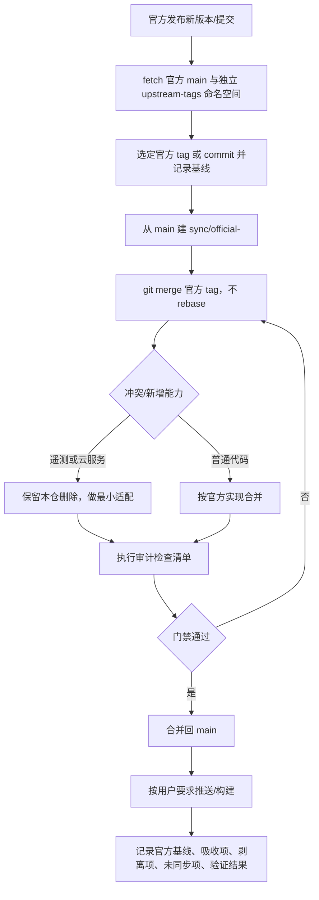

# 维护模型：官方源码 + 本仓审计

## 目的

本仓 ZCodium 是独立产品线，不再以任何第三方 fork 作为上游。只从官方开源仓库 `zai-org/ZCode` 吸收代码更新，并在每次同步中保留“去遥测、不依赖官方云服务”的审计边界。`ZCodium-project/ZCodium` 只作为审计原则和实现方式的参考，不作为合并来源。

## 来源与角色

| 角色      | 仓库                      | git remote  | 用法                              |
| --------- | ------------------------- | ----------- | --------------------------------- |
| 产品主线  | `No-ni/ZCodium`           | `origin`    | 唯一推送目标                      |
| 代码上游  | `zai-org/ZCode`           | `upstream`  | 唯一 merge 来源                   |
| 审计参考  | `ZCodium-project/ZCodium` | `reference` | 只读参考，不 merge                |
| 历史 fork | `axiom-desu/ZCodium`      | 已移除      | 只保留在 git 历史与历史 CHANGELOG |

约定：

- 不再把 `axiom-desu/ZCodium` 当作上游，也不把它的更新作为同步对象。
- `reference` 的文件可能同名但实现不同；判断差异以当前源码、入口和运行时行为为准，不以提交标题或文件 diff 为准。
- 历史 CHANGELOG、历史 spec 中出现旧上游链接属于记录，不改写；产品内新链接指向 `origin` 或本仓文档。

## 版本与发行

- 根 `package.json` 版本沿用官方 `3.x.y`，表示本次吸收的官方基线。
- 本仓自身修复不单独改版本号；需要发行时由用户确认版本。
- tag 使用 `v<version>`，安装包使用 `ZCodium-<version>-<platform>-<arch>.<ext>`。
- 不采用第三方 fork 的 `1.y.z` 版本线；需要区分时在 release notes 中注明对应的官方基线。
- 本地可能保留旧 fork 的 `v3.14.x` 等标签，且与官方同名标签指向不同提交。同步时以 `git ls-remote --tags upstream` 或官方 commit 为准，不要直接使用同名本地标签。

## 同步流程



先将官方标签抓到独立命名空间，避免覆盖同名历史 fork 标签；不使用 `--tags`、`--force`，不删除历史标签：

```sh
git ls-remote --tags upstream
git fetch --no-tags upstream "refs/heads/main:refs/remotes/upstream/main" "refs/tags/*:refs/upstream-tags/*"
git switch -c sync/official-<version> main
git merge refs/upstream-tags/v<version>
```

也可以 merge 已核验的官方 commit。命令中的版本是占位符，执行前须选定真实基线；本次维护清理不执行同步。

固定规则：

1. 只 merge 官方 tag/commit；不直接 merge `reference`。
2. 使用 merge，不使用 rebase，不改写已推送历史。
3. 每次同步单独开分支，冲突解决和审计剥离在同一个同步分支完成。
4. 未执行构建、E2E 或真机验证时，在同步记录中如实标注。
5. 构建只在用户明确要求时触发；不借构建绕过“不推送”要求。

## 审计边界

### 遥测

禁止引入：

- 官方上报 SDK、ARMS RUM、OTLP 自动上报、崩溃采集、设备归因、UI 埋点。
- 资源/网络采样的远端上报，以及自动模型请求/响应录制。

允许保留：

- 默认可用的安全本地技术日志；高频 debug 只用于开发且不记录原文。
- 后台资源/网络采样默认关闭，仅 `ZCODE_LOCAL_RESOURCE_MONITORING=1` 启用本地采样。
- 对外诊断导出默认关闭；仅用户显式开启并配置自建 OTLP 接收端才导出同一安全记录（见 `DIAGNOSTICS.md`）。
- 本地日志、本地性能计数和本地错误分类不得包含提示词、对话、文件内容、凭据、账号、完整 URL、原始错误文本或真实路径。
- 不得把默认地址回退到官方域名。

### 官方云服务

不依赖：

- 官方账号、登录、OAuth、购买、套餐、额度、权益领取。
- 官方分享、仓库快照上传、对话上传、官方 MCP 凭证。
- 官方插件市场的自动拉取、官方 client config/rollout、官方 relay、官方更新源。
- 官方强制更新控制面；未配置自有更新源时不检查、不回退。

允许：

- 用户自带 API Key 或自定义 Provider 时，调用该 Provider 的官方模型 API；这属于用户选择的 Provider，不算平台依赖。
- 需要保留的兼容入口必须有显式开关，默认关闭，并在设置页说明数据去向。

### 数据与更新

- 数据根为 `.zcodium`；旧数据迁移必须由用户决策，不自动迁移、不合并、不删除。
- 不向官方平台自动上传仓库快照、对话、文件或诊断，不保留自动上传队列。用户选择的模型 API、远程操作及显式自建 OTLP 导出遵守各自数据边界，不属于官方控制面。
- 更新只读自有更新源；`ZCODIUM_UPDATE_ORIGIN` 未配置时跳过更新检查，不回退官方地址。
- 工作区身份统一使用 `workspaceIdentity?.trim() || workspacePath`；远程链路同时传递 `workspaceIdentity` 与 `remoteSessionId`。

### 品牌与许可

- 保留 ZCodium 身份、现有 Apache-2.0 `LICENSE`、`NOTICE.md` 与第三方版权声明；许可证变更必须单独由用户确认。
- 安装包未获官方签名时，必须如实说明，不写成官方认证。
- 不恢复官方购买、分享、账号入口来“补齐”能力。

## 每次同步的检查清单

必须执行并记录真实结果：

- [ ] `pnpm typecheck`
- [ ] `pnpm lint`
- [ ] `pnpm fmt:check`
- [ ] `pnpm architecture:check --changed`
- [ ] 受影响包的测试（以目标包 `package.json` 和实际测试文件为准）
- [ ] 人工复核 `git diff <官方基线>...HEAD` 中新增的依赖、端点、设置项和 UI 入口
- [ ] 关键词扫描：`ARMS`、`OTLP`、`analytics`、`telemetry`、`crash`、`sampling`、`reportEvent`、`track`
- [ ] 端点扫描：新增的官方域名、`DEFAULT_ZCODE_ENDPOINT_ORIGIN`、`api.z.ai`、`bigmodel.cn`、`zcode.z.ai`
- [ ] 数据根、更新源、品牌、许可声明未被覆盖
- [ ] 同步记录已写明官方基线、吸收项、剥离项、未同步项、验证范围和已知限制

关键词和端点扫描是人工复核的入口，不是自动判定；命中项必须确认是本地能力、用户自选 Provider，还是需要剥离的官方服务。

## 冲突处理原则

- 官方重新引入已删除的遥测或云服务：保留本仓删除，不通过恢复模块来让测试变绿；必要时做最小适配层。
- 官方新增官方服务 UI：默认不接，或改接到本仓 Provider/设置；不新增官方依赖。
- 官方删除本仓仍在使用的模块：先确认产品边界，再决定保留本仓实现还是跟随删除。
- 官方新增第三方依赖：检查许可证、是否含遥测/分析、是否引入新的网络默认行为。
- 官方改动与本仓性能/架构优化冲突：以现有 owner、协议和状态边界为准，性能优化单独提交，不与同步混在一起。

## 欠账处理结果（2026-10-24）

| 项                         | 处理结果                                                                                                                                                             |
| -------------------------- | -------------------------------------------------------------------------------------------------------------------------------------------------------------------- |
| 官方账号/OAuth             | 删除内置 `account:*` / `zhipu-account` Provider 与模型规则；删除 OAuth 常量、环境注入、登录页死分支和对应文案。历史 Provider ID 与数据库迁移保留，仅用于读取旧数据。 |
| Coding Plan 订阅/购买/权益 | `coding-plan-subscription` 服务只保留动态工作流的本地判定，不再请求官方 client config；购买 webview、支付 RPC 残留和订阅/权益文案已删除。                            |
| BYO API Key 额度           | 保留 `codingPlanQuota` 与额度面板：它使用用户自己的 API Key 查询用户自己的 Provider 额度，属于用户自选 Provider API，不是官方平台依赖。                              |
| 官方 client config/rollout | 删除动态工作流远端请求；自动更新、强制升级和 manifest provider 只接受 `ZCODIUM_UPDATE_ORIGIN`，未配置时跳过，不再回退官方。                                          |
| 官方插件市场               | 市场目录本来就只来自随包本地 seed；默认启用集合已与 `official-plugin-definitions.ts` 对齐，并新增一致性守卫。                                                        |
| 资源/网络采样              | 后台资源/网络采样默认关闭，只有 `ZCODE_LOCAL_RESOURCE_MONITORING=1` 时启用；本地诊断、用户自建 OTLP 和资源管理器按需采样保留。                                       |
| 自动化审计守卫             | 新增 `scripts/ci/audit-boundaries.test.mjs`，覆盖官方控制面、OAuth、账号 Provider、购买残留、产品链接、插件默认集合和采样开关。                                      |
| 产品链接                   | `config/default.json`、构建元数据和文档链接已指向 `No-ni/ZCodium`；仓库 Issues 已开启，feedback 入口可用。                                                           |

仍保留的明确例外：

- `api.z.ai` / `bigmodel.cn` 的 quota API 只用于用户自带 Key 的额度查询，不读取官方账号凭据。
- 历史 `account:*` ID、`zhipu-account` 协议 schema 和数据库迁移保留，避免旧会话/旧配置无法解析；运行时继续 fail-closed，不恢复账号执行能力。
- `coding-plan-subscription` 是历史服务/channel 名称，当前不包含订阅、购买或权益逻辑。

## 补充清理（2026-10-25）

本次不是上游同步，不执行 fetch/merge、版本发行或数据迁移；根版本仍为 3.15.1。保留开始前的本地改动。

- 设置服务和 MCP 迁移在自身出口使用安全 logger，纯 HTTP 宿主不再输出配置、路径或原始错误。对抗回归先复现泄露再验证修复，锁、写队列、原子替换与离线迁移结果保持。
- 官方标签使用独立 `refs/upstream-tags/*`，避免历史同名 fork tag 冲突；旧 scoped-diff-only 规则和历史 parity 结果已明确退休/标记，不再作为当前执行指令。
- DOCX/PDF/XLSX 字体安装入口及轻量检查只读本地字体，不自动请求官方 CDN、创建目录、注册字体或要求整个清单；Windows、macOS 及通用 Linux CLI 的检查与缺失提示一致。
- 四个文档技能许可元数据修正为 Apache-2.0，保留原版权；随包版本同步为 documents/presentations/spreadsheets 0.1.9、pdf 0.2.1，未改变产品版本。
- AstrBot 产品按钮通过现有平台回调打开本仓文档，第三方 connector 来源仍如实标注；双语桌面/手机按钮回归不访问外部页面。
- release-it 默认禁止 push，显式 push 指向 origin，文案为中文；README 与实际手动四架构 Actions 工作流一致，不再声称自动 Release。
- AGENTS、README、NOTICE 与 DIAGNOSTICS 区分安全本地日志、默认关闭的采样、显式自建 OTLP 和正常用户模型/远程业务请求；自动 model-I/O recorder 仍删除，只读历史轨迹保留。
- 当前数据目录说明不再包含同名迁移矛盾；image-search 文档修正为必填完整用户 MCP URL、无默认服务器/官方 JWT，而非已退休的 8787 信任白名单。

### 验证记录

本轮在 Windows 上使用 PowerShell 7、`corepack pnpm` 和 Node 24.18.0；`mise.toml` 固定 Node 24.14.0，本机小版本不一致，不视为固定工具链或跨平台全量验收。

| 验证                                                      | 实际结果                                                                                                                                                                 |
| --------------------------------------------------------- | ------------------------------------------------------------------------------------------------------------------------------------------------------------------------ |
| 工作区 freshness                                          | 通过；开始时当前分支与 origin 同步，相对 origin/main ahead 31 / behind 0                                                                                                 |
| 根 `typecheck`                                            | 通过                                                                                                                                                                     |
| 根 `lint`                                                 | 最后复跑通过，0 警告、0 错误（3155 个文件）                                                                                                                              |
| 根 `fmt:check`                                            | 通过（3658 个文件）                                                                                                                                                      |
| `architecture:check --changed`                            | 通过，0 violations / 0 baseline / 0 new                                                                                                                                  |
| `git diff --check`                                        | 通过                                                                                                                                                                     |
| `node --test --test-isolation=none scripts/ci/*.test.mjs` | exit 0；613 项，604 通过、0 失败、0 取消、9 跳过，耗时 1250708.9886 ms（约 20.8 分钟）                                                                                   |
| 最终定向回归                                              | 审计 9 项、字体 15 项、服务日志 2 项、AstrBot 按钮 1 项，合计 27 项全部通过；MCP、自带 Key/历史设置和诊断隐私的补充回归也通过                                            |
| CLI 独立 `typecheck`                                      | 通过；执行的是现有源码检查入口，包含 TUI 构建，不是安装包打包                                                                                                            |
| CLI 聚合 `check`                                          | 未通过：Bash 命令注册表生成校验报 stale；独立生成比较的 707 个命令根与内容相同，只差源哈希注释和 `BASH_COMMAND_REGISTRY_HASH` 两行元数据。本轮未修改该生成文件或放宽检查 |
| CLI 全包 `lint`                                           | 未通过：56 个警告、79 个错误，位于本轮未修改的广泛 CLI 源码；本轮未执行 CLI 全包修改前基线，不能声称所有失败已通过前后对照证实为既有失败                                 |
| 本轮修改的 CLI seed 定义单文件 lint                       | 通过，0 警告、0 错误                                                                                                                                                     |

完整套件启动后又补充了三个字体轻量检查回归，并修正了 AstrBot 浏览器测试在非 Windows CI 上的启动配置及最后的文档描述；这些最终改动另行通过定向回归，不声称同一次完整套件覆盖最终树的全部变更。完整套件中的远端部署/上传等跳过项仍未执行，不以套件 exit 0 代替这些验收。

Windows/macOS 安装、注册表、Finder、真实字体渲染与外部 AstrBot connector 连通没有执行；没有本机或 GitHub 安装包构建、市场安装/发布、commit、push 或 GitHub Release 操作。

## 官方 3.16.2 择项吸收与项目内验证收口（2026-10-28）

> 本节保留此前不提交阶段的结果。随后用户已授权核验两工作树的全部有效未提交成果、本地提交并合入 main；最新 Git 状态、后续测试和限制以[未提交成果验证与主线整合](../../.agents/specs/uncommitted-validation-main-integration.md)为准。以下「未提交、原树只读、未跑」不再表示整合阶段现状。

本项是固定官方 `zai-org/ZCode@3c5b227649371507ddc4eb46ac5133afe6db1cab` 的择项适配，不是完整 3.16.2 parity。获准 worktree 为 `C:\vibecoding\zcodium-adopt-3.16.2`，detached HEAD `18cc72cef7bec53eaa543b515e0c9332bc9cd05b`；原树与官方快照只读。根版本仍为 3.15.1，CLI 顶层 0.16.9，未 merge、stage、commit、push、触发 Actions、打包、发行或安装服务。freshness 用 `--no-fetch` 只核对缓存引用，adoption 无 tracking branch，相对 origin/main ahead 31 / behind 0；不声称重新刷新远端。

完整当前状态、详细测试数量、项目内日志与未验收清单见 [实施收口记录](../../.agents/specs/official-3.16.2-adoption-results.md)，原方案见 [总交接](../../.agents/specs/official-3.16.2-adoption-handoff.md)。早期 spec 的开工缺口、OS-temp 清理和门禁结果只作历史，不覆盖本轮最终树。

### 吸收、适配与剥离

- 已落地源码包含工作流 stop/真限流分类、模型结束原因与失败 usage、Bash 输出准备、Radix hidden 测量、Windows 未读提示、MiMo 2.6 目录、默认 Off 的 ToolSearch、Source/Profile/连接与授权/provisioning v2/目标额度、唯一 Source 数据根、SQLite 异步迁移框架、窗口目录、模型/思考菜单、完整视图及 Office 阅读/分发接缝。不是本轮逐项真机验收；保留已有 Gemini 签名、个人 Key 额度、holes/journal、CommandInbox、owner/lease 与 continuous/replayable 分工。
- Office 当前 Desktop/prebuild/dev/SEA 公共接线已补齐，共用 shared build/资源合同；旧 spec 的“尚缺接线”是开工快照。本轮仅只读核对，没有执行 Office/SEA/安装包产品构建。
- 保留去官方账号、购买/套餐/额度控制面、分享/上传、model-I/O recorder、遥测、client config/rollout、官方 relay/更新 fallback 与无 Linux 发行资源边界，不恢复已删除模块让测试通过。
- Source alias 迁移框架不等于生产可接历史库：全根真实 writer lease、可信 committed snapshot 与 preview/confirm/execute/retry/report/restore 的 UI/channel 仍缺；history-present/unavailable、snapshot-unproven/snapshot-stale 继续 fail closed，可能保守阻断已有 Source 重连。

### 项目内安全边界与历史事故

用户报告上轮电脑数据丢失，附件还记录真实插件目录消失；历史系统 TEMP 全量运行器曾重定向 HOME 并递归清理。另有一次 Settings 红测试未隔离 bootstrap home，实际读写真实用户 setting。没有完整损失清单或可靠前像，不确证因果、不自动回滚或恢复，也不将事故缩写为只有 setting 写回。

本轮修改、合成数据、缓存与验证日志只写获准工作树。`project-test-sandbox.mjs` 是唯一环境 owner，fresh `.run-logs/project-only-validation` 运行根逐级检查真实路径/链接，绑定 home/temp/data/storage/cache 并禁用下载、compile cache 和遥测。Source/枚举/SQLite/RPC wrappers 先隔离，再装载业务；连接关闭后保留合成数据，不递归清理运行根。Node permission 是附加写白名单，不是任意 shell/native addon/所有业务写者的完整系统沙箱。旧 TEMP 运行器、真实用户 `.zcodium` 和历史事故目录不读取、不运行、不清理、不恢复；宿主工具自动会话记录不被冒充为已证明的系统外部零写。

### 本轮实际验证

Windows Node 24.18.0 / pnpm 10.33.2，仓库 pin Node 24.14.0；不安装/切换工具链。

| 验证                                     | 实际结果                                                                                                   |
| ---------------------------------------- | ---------------------------------------------------------------------------------------------------------- |
| 根 typecheck / lint                      | 均 exit 0；Lint 0 warnings / 0 errors，3308 files                                                          |
| 根 fmt:check                             | exit 0；文档落地前 3836、文档收口后 3837 matched files；只格式化本轮 owned 文件，没有全仓自动格式化        |
| changed architecture                     | exit 0，0 violations / 0 baseline / 0 new                                                                  |
| CLI typecheck / registry:check           | 均 exit 0；既有 TUI/类型库准备只写项目，不是安装包构建                                                     |
| CLI 全包 lint                            | **exit 1，55 warnings / 79 errors**；未放宽规则或更新 baseline，本轮未重做完整 HEAD 双树诊断对照           |
| 枚举/Source 测试严格 noEmit              | 两项配置均 exit 0                                                                                          |
| Sandbox / runner / baseline 更新参数拒绝 | 6 / 1 / 2 项通过；旧更新参数早拒绝，两份冻结 baseline 字节不变                                             |
| Source 内部真实回归                      | layout 4、组合 5、CLI 11、枚举 7，全部通过                                                                 |
| SQLite/RPC 内部真实回归                  | infrastructure 27、startup 20、baseline 2、loopback inspection 4，全部通过；另有 schema contract 11 项通过 |
| 已审查离线产品/审计组                    | 14 个入口全部 exit 0；child 目录 9/投影 5 的数量不与 wrapper 一项重复相加                                  |
| 既有无 IO runner 消费者                  | hidden-document-motion-pause 根 3、内部 3 项通过；其他含历史临时清理/独立子进程的消费者未全跑              |
| 功能图                                   | 67 nodes / 87 edges，路径/符号/端点/rank 无结构问题；24 个 seed 引用未跟踪，保留 drift/WIP，不 stage       |
| git diff --check / 原树保护指纹          | 通过；原树 tracked diff/status 指纹与此前一致，不等于所有未跟踪内容或整机数据证明                          |

本轮修复枚举 mock 的 `this` 类型与 5→7 精确计数，统一 child 成功/失败项目内留档。schema baseline 旧更新参数原先被 wrapper 静默忽略，现根/fixture 都明确拒绝 `SQLITE_SCHEMA_BASELINE_UPDATE_NOT_SUPPORTED`；验证入口只做只读比对，历史更新入口退休，没有修改 Host 3 条/CLI 23 条冻结 checksum 或 schema baseline。

未执行完整 root/CLI corpus、真实模型/workflow/Agent、真实 daemon/SSH/服务安装、GUI/E2E/手机设备、Windows DPI/taskbar、Office 编译/seed/SEA、发行/升级、真实用户库、历史 alias/WAL/Bash/Office OS-temp corpus、macOS 或固定 Node 小版本验收。CLI Lint 欠账与 Source 历史数据闭环保持未完成，不写成全门禁或完整产品验收通过。

## 未提交成果整合阶段（2026-10-28，后续授权）

用户随后授权核验两工作树的全部有效未提交成果、修复明确回归、本地提交并合入 main，允许最多三个并发子代理；不授权 push、Actions、发行、系统服务或真实数据操作。本阶段不以旧「未提交」快照否认已有吸收，也不将其升级为完整官方 3.16.2 merge/parity。根版本保持 3.15.1，CLI 顶层保持 0.16.9。

原性能树的 161 个有效路径已提交为 `23050742`；吸收树 695 路径精确提交为 `417ddfb9`，经性能分支普通merge `a548ab2e` 后合入本地main `8a81d55f`。126 原路径字节相同、8 个删除保留、27 为有意扩展，无丢失；8项冲突逐文件保全，合并整树与验收版本完全一致。主线实际目录根 typecheck/lint/fmt/architecture/registry复核通过，CLI typecheck、完整架构、56项UI/registry、89项Office与2场景真实UI合成交互在同提交完整依赖树再次通过；CLI全包Lint仍79 errors/55 warnings。后续仅文档记录再快进main/perf，不推送。日志、缓存、数据库、dist与两个未知shell残留均不提交。最新门禁、Lint基线对照、Source/SQLite/Office/UI证据、Git最终状态与安全偏离统一见[未提交成果验证与主线整合](../../.agents/specs/uncommitted-validation-main-integration.md)。

两项真实 UI 合成交互联合复跑通过，覆盖同一 Lexical 节点/草稿、完整视图往返与阻塞恢复、模型/思考选择、迟到事件和窄屏；Source alias92/admission25、Office 正常包测试89与四格式源码分发6等均实际执行。这些不替代安装版、真实 daemon、手机、Office 四格式 GUI 或完整 corpus 验收。Source 的真实停写租约、可信快照与历史迁移 UI/channel 仍未接通，保持 fail-closed。CLI 全包 Lint 仍失败，未放宽规则或更新 baseline。

本阶段有一次 Source 代理裸跑旧入口、在系统 TEMP 创建并删除自有合成 fixture 的安全偏离；两次结果不计入合规验收，已迁项目内 wrapper 并复跑。后续合规结果不能抹去该事实，不宣称本轮项目外零写；详情及历史事故保留在整合记录中。

## 例外

- 本地诊断：安全本地日志可用；后台采样和对外导出分别默认关闭，导出仅使用用户自建接收端，无官方默认地址。
- 用户自选 Provider 的官方模型 API：由用户配置 Key 和端点，不要求官方账号或订阅。
- 历史文档、历史 CHANGELOG、历史 spec 中的旧上游链接：只作为记录保留。
