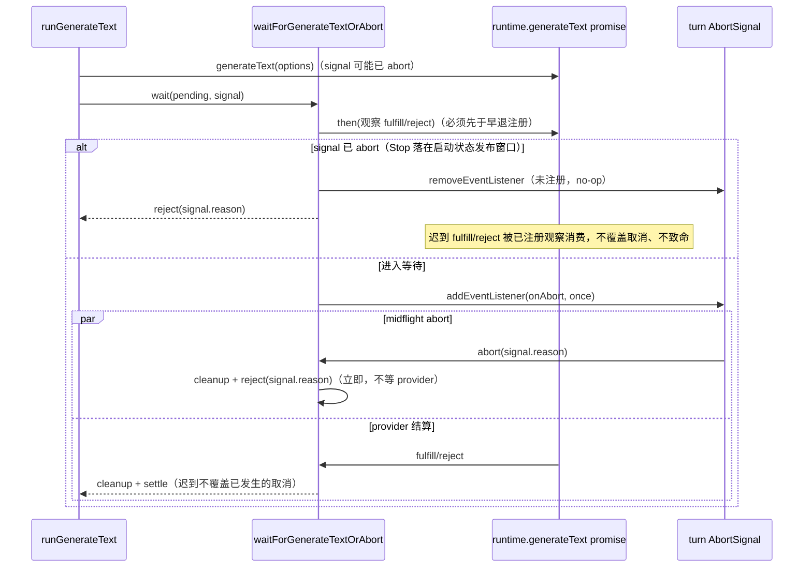

# generateText 取消的结算观察

## 行为与所有者

`waitForGenerateTextOrAbort(pending, abortSignal)`（apps/zcode-cli/packages/adapters/src/model/runner-generate.ts）是 generateText 路径的本地取消契约边界：abort 一旦发生立即以 `signal.reason` 拒绝外层 Promise，不等待 provider 自然返回。

底层 provider promise（`input.runtime.generateText(options)` 的返回，真实装配下即 AI SDK generateText）的终结观察与本次调用的 abort 监听同归该调用持有；`pending.then` 的注册必须先于 pre-aborted 早退分支，保证任何时序下 Promise 终结都有人观察。

`abortSignal` 的所有者是 runtime（turn 级 `state.turnAbortSignal`）；本函数只注册/移除自己这一次的监听与观察。

## 不变式

1. `pending.then` 注册先于任何早退：迟到 fulfill/reject 始终被观察，不产生 unhandledRejection。历史缺陷：旧实现先判断 `signal.aborted` 再注册 `pending.then`，已 aborted 的早退分支直接 return，底层 promise 零 handler；用户 Stop 落在 `model_request_started` 状态发布的 await 窗口时，其迟到拒绝成为 unhandledRejection，而 CLI 进程级边界（packages/cli/src/process-errors.ts）把 unhandledRejection 当致命错误（reportFatal → onFatal 有界关闭），一次本应 benign 的取消升级为进程诊断与关闭。
2. 迟到 fulfill 不覆盖已发生的取消：外层 Promise 已单向终结，迟到 `resolve`/`reject` 均为 no-op。
3. midflight abort（注册后、provider 结算前）立即以 `signal.reason` 拒绝，不等待 provider。
4. 无 `abortSignal`：直通 `pending`，语义不变。
5. 不新增 `await` + `throwIfAborted`，不改变 runtime 是否被调用的既有行为（旧实现同样先调用 `generateText` 再发现已 abort）；不动 logger、失败分类、重试策略、CommandInbox 与所有权。

## 时序

## 验收场景

由 apps/zcode-cli/packages/adapters/test/model-generate-abort-settlement.test.ts 对真实 `runGenerateText` 与 fixture runtime 断言，共 6 项，子进程在 Node 默认严格拒绝模式下运行（handler-less rejection 即 uncaughtException）：

1. 取消落在 `model_request_started` 状态发布窗口 + provider 迟到拒绝：归类为取消（ModelRequestCancelled）、不重试、子进程不致命（旧实现因此项无 handler 而红）。
2. pre-abort + provider 迟到 fulfill：取消不被覆盖。
3. midflight abort：有界事件 turn 内立即终结，迟到拒绝被观察。
4. 无 signal：成功语义不变。
5. 无 signal：失败语义不变（归类、不重试）。
6. signal 在场但从未 abort：成功语义不变。

CI 回归入口：scripts/ci/model-generate-abort-settlement-regression.test.mjs（runSourceTests 隔离子进程，断言 6 项）。

## 边界

- 仅重排 `pending.then` 注册顺序（约 8 行，含中文原因注释）；不提取旧函数、不改文件其他部分。
- 不覆盖流式路径（stream 的 iterator 观察由 readNextWithStreamIdleTimeout 的 Promise.race 与 closeStreamIteratorBestEffort 负责）；不覆盖真实 AI SDK 行为（fixture runtime 模拟迟到结算）。
