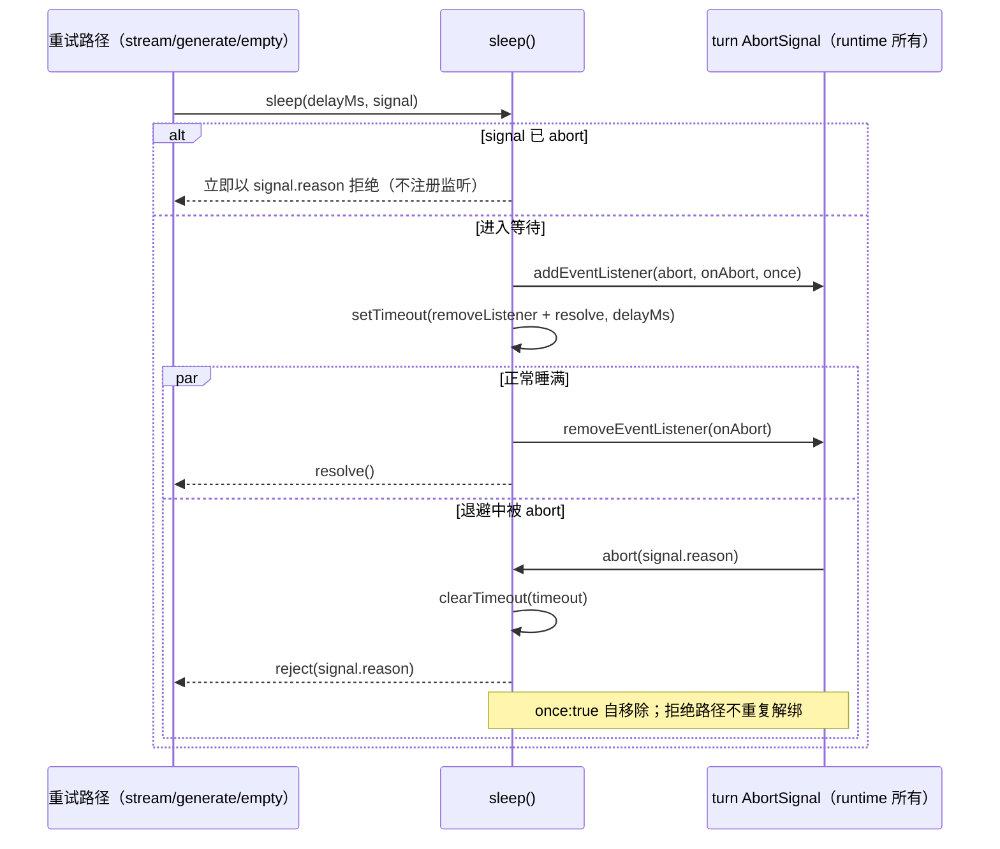

# 模型退避 sleep 的 abort 监听生命周期

## 行为与所有者

`sleep(delayMs, abortSignal?)`（apps/zcode-cli/packages/adapters/src/model/runner-retry.ts）是模型重试退避的唯一等待原语，被 runner-stream（可重试流失败与 SSE error-chunk 退避）、runner-generate（generateText 退避）与 empty-completion-retry（空完成重试退避）共用。

一次 `sleep` 调用的 timer 与 abort 监听同归该调用持有：进入等待时注册，settle 前必须成对解除。`abortSignal` 的所有者是 runtime——core turn-model-step 把 `state.turnAbortSignal` 传给同一轮 turn 的每个 model step，轮内多个 step 与多次重试复用同一 signal；`sleep` 不得假设 signal 的生命周期短于自己，只允许注册和移除自己这一次的监听。

不改变：退避时长计算（`calculateRetryDelay`）、`createAbortError` 与 `signal.reason` 语义、重试预算与准入票据时序、调用点签名。

## 不变式

1. 正常睡满：`resolve` 之前 `removeEventListener`，同一 signal 上不残留本次监听（历史缺陷：只 `setTimeout(resolve)`，`{once:true}` 只在 abort 真实触发时自移除，导致轮内单调累积）。
2. 退避中被 abort：立即以 `signal.reason` 拒绝（reason 为 Error 时是同一对象，否则 `AbortError` 形状的新 Error），并 `clearTimeout` 未决 timer。
3. 调用前已 abort：不注册监听，立即以上同规则拒绝。
4. `delayMs <= 0`：不注册监听；未 abort 立即返回，已 abort 立即拒绝。
5. 无 `abortSignal`：只走 timer 路径，无监听注册。

与本包既有正确范式一致：stream-idle-timeout.ts 的 `readNextWithStreamIdleTimeout`（finally 移除）与 mcp/oauth-interactive.ts 的本地 `sleep`（timer 回调先移除再 resolve）。

## 时序

## 验收场景

由 apps/zcode-cli/packages/adapters/test/model-retry-sleep-listener-lifecycle.test.ts 直接对生产 `sleep` 与真实 `runGenerateText` 空完成重试路径断言，共 9 项：

1. 同一 signal 连续 12 次正常睡满后监听归零（轮内多次退避不累积）。
2. 退避中 abort 以 `signal.reason` 同一对象立即拒绝且监听归零。
3. 退避中 abort 清除未决 timer（spy `clearTimeout`）。
4. 调用前已 abort 以 `signal.reason` 立即拒绝。
5. 无 `abortSignal` 正常结束。
6. `delayMs` 为 0/负值立即返回。
7. `delayMs <= 0` 且已 abort 仍以 `signal.reason` 拒绝。
8. `signal.reason` 非 Error 时拒绝 `AbortError` 形状错误。
9. `runGenerateText` 空完成重试（真实 1ms 退避）结束后请求 signal 监听归零。

CI 回归入口：scripts/ci/model-retry-sleep-listener-regression.test.mjs（经 source-test-runner 隔离子进程执行，断言 9 项）。

## 边界

- 不新增超时兜底、不改 wire 协议、不动其他调用点；`sleep` 签名与全部现有行为（除监听清理外）逐字保留。
- 仅覆盖 adapters 模型退避等待；provider-node 与 rpc/client 的等待原语不在本规格范围。
