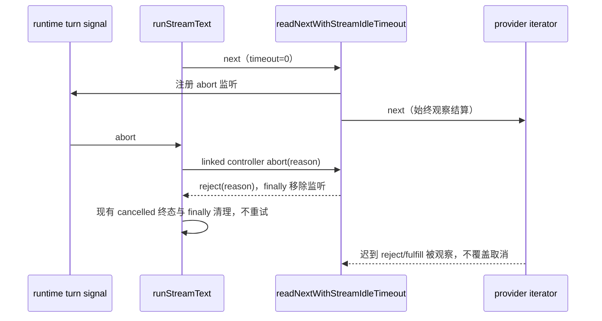

# 禁用模型流空闲计时后的取消

## 规则与所有者

公开 `AiSdkModelRunnerOptions.streamIdleTimeoutMs` 允许传入 `0` 禁用 SSE 空闲计时；`resolveModelStreamIdleTimeoutMs` 保留该值。文件配置 schema 仍要求正数，本修复不修改配置入口。

`readNextWithStreamIdleTimeout` 只持有一次 `iterator.next()` 等待的 timer 与 abort 监听。turn AbortSignal 仍由 runtime 拥有，runner 用现有 linked AbortController 传递取消。禁用空闲计时只能移除 timer，不能移除取消边界：底层 Provider 忽略 abort 或迟迟不结算时，外层等待仍必须立即以 `signal.reason` 拒绝。

历史缺陷是 helper 对非正数/非有限 timeout 直接返回 `iterator.next()`，使禁用计时的公开 runner 调用没有主动取消路径。修复复用原来的 Promise.race 和 finally 清理，只按 timeout 是否有效决定创建 timer；不新增重试、状态、所有者或超时兜底。

取消优先级同样属于该等待边界：调用前 signal 已 abort 时，即使 `next()` 已立即成功/失败，外层仍必须以原取消原因拒绝。`next()` 同步调用的结算观察归本次等待持有，同步抛错转成受观察的 Promise 拒绝，不遮蔽已经发生的取消，也不使预先拒绝的 abort Promise 失去 handler。

## 事件顺序

同一 helper 同时用于 Desktop 连续流与手机 replayable 连接复用的 CLI 模型执行；此处只终止 provider 等待，不修改下游流交付、snapshot、queue、Host lease 或恢复规则。

## 验收

`apps/zcode-cli/packages/adapters/test/model-stream-disabled-timeout-cancellation.test.ts` 使用内存 iterator 与 fixture runtime，共 14 项，验证 `0`、负值、NaN、Infinity 的等待取消；调用前已取消；禁用/启用计时下 pre-abort 优先于已成功的 next 与同步抛错；禁用计时正常成功/失败；正值计时的取消与 timeout 保持不变；真实 `runStreamText` 禁用计时时的取消终态、不重试、准入释放、iterator 清理。测试不访问网络、真实配置或用户数据，统一由 `runSourceTests` 启动在项目树内的隔离子进程。

仅覆盖源级 helper 与 runner；未执行真实 provider、桌面 Stop 或手机远控验收。
