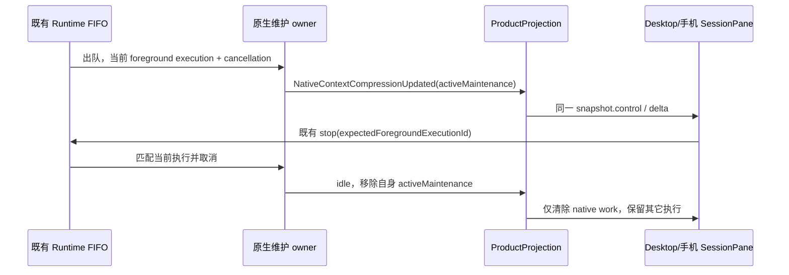
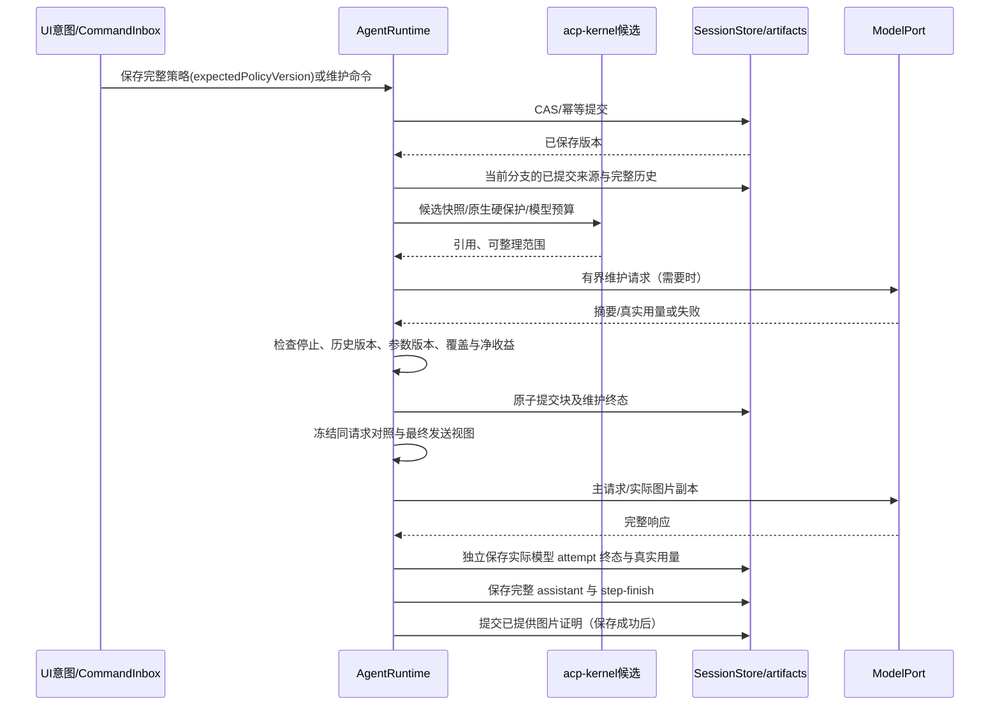
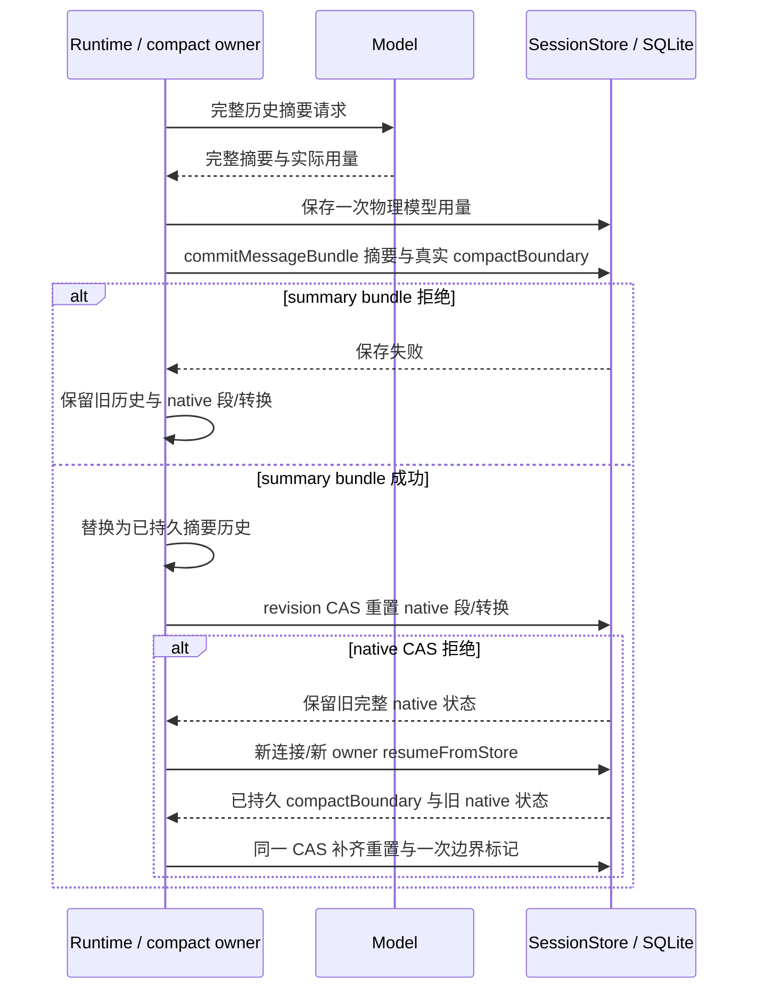
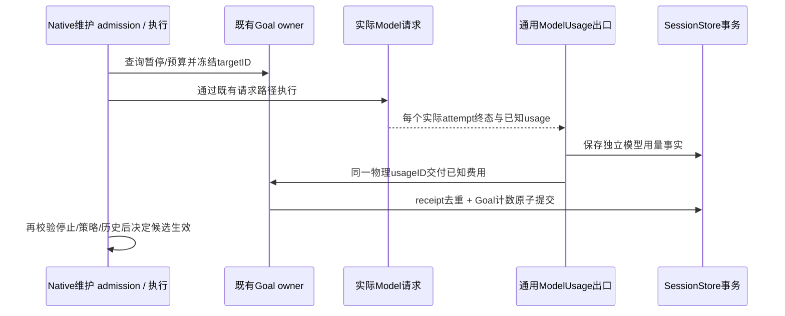
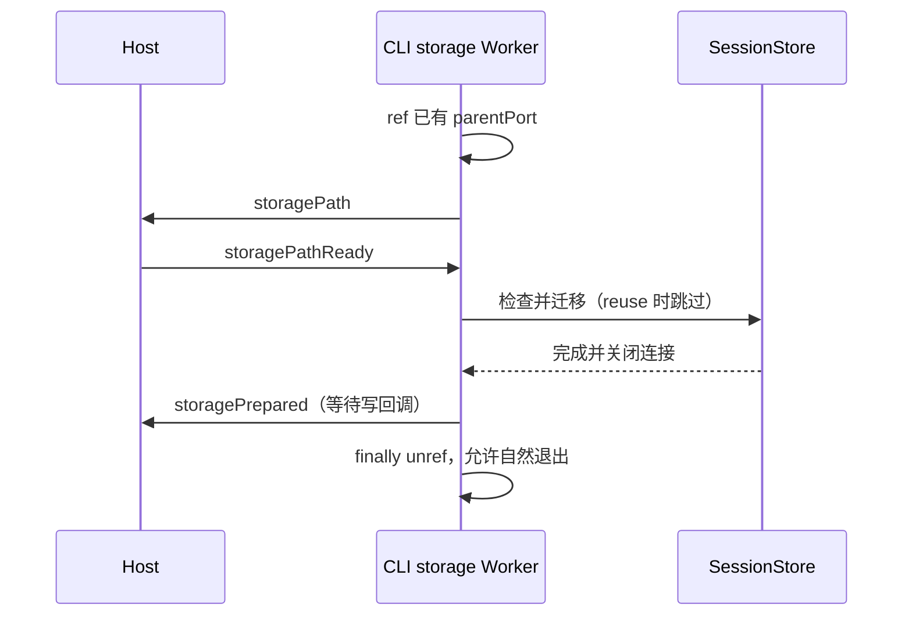
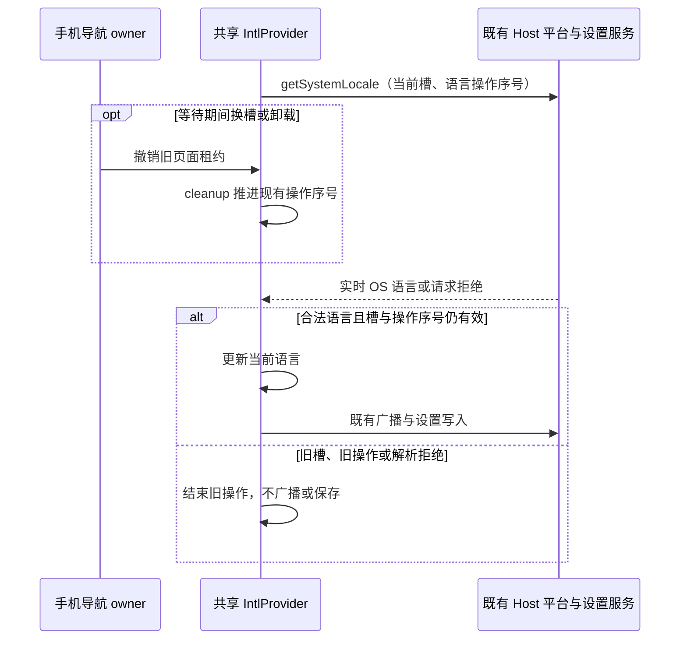
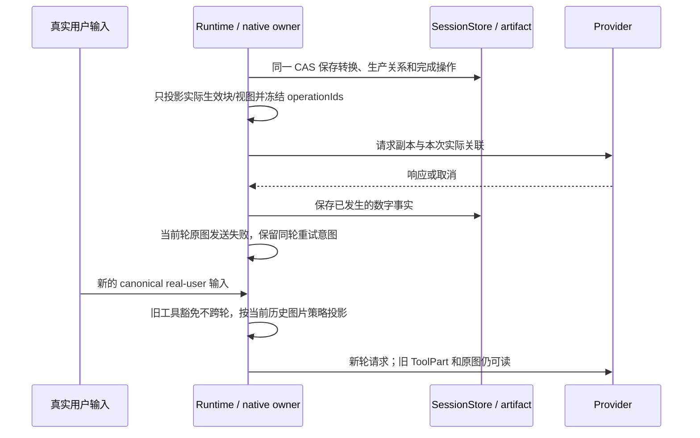

# 原生上下文压缩实施契约

2026-11-12。状态：实现已落地，最新四场重点产品回放全部通过；两端大账本此前在六场回放通过。完整验收记录和未验边界见 [验收覆盖](../testing/native-context-compression-e2e-coverage.md)。按用户要求最多两名子代理协助，未授权提交、推送、发布或安装包构建。

本文件收口 [产品方案](native-context-compression.md)、[参数目录](native-context-compression-parameters.md) 与 [趋势方案](native-context-compression-trends.md) 的实现选择。用户要求测试共用进程，先汇集问题，再统一修复并复测。三份设计的保护区、未知用量、完整覆盖、原图留存、策略冲突和分支隔离均为首版验收规则。

## 状态与入口

| 状态                       | 唯一写者                    | 落点                              | 读者                        |
| -------------------------- | --------------------------- | --------------------------------- | --------------------------- |
| 新任务默认配置             | 既有本地配置服务            | AppSettings 的版本化完整快照      | 创建意图与通用参数表单      |
| 当前任务参数、内核引用及块 | AgentRuntime                | CLI SessionStore 原子提交         | 产品 query 与只读概览       |
| 收到的原图                 | 既有 artifact port          | 当前会话持有的 immutable artifact | 图片处理器、原图 query/工具 |
| 请求观察及维护操作         | AgentRuntime 的请求终态出口 | CLI 数字观察记录                  | 三张趋势图与操作记录        |
| 未保存表单/JSON、图表选择  | UI                          | 页面局部草稿                      | 当前任务/默认两个独立作用域 |

共享纯 schema 位于 `packages/shared/src/native-context-compression`。配置使用 `{schemaVersion:1, mode:'auto'|'manual', parameters}`；任务持久策略加单调 `policyVersion`。完整提交使用 `expectedPolicyVersion`；冲突拒绝，不合并、不覆盖。字段清单同时产生推荐值、表单和严格校验；未知字段与非法依赖拒绝。默认 auto，旧任务首次读取按 manual 初始化，fork 捕获父任务稳定边界的完整快照。

2026-11-12 集中回归补充：没有 compact part、没有 native 字段的旧任务，首次恢复初始化 manual 和真实 `initial` 段，不生成历史请求、维护操作或费用。首次初始化可合法推进持久 revision；之后同一历史的重复读取、关闭数据库后用新连接与新 owner 恢复，配置、边界、请求高水位和 canonical 原文均保持一致，不再次初始化。

新能力使用原生的 `context_compress`、`context_search`、`context_read` 与 `context_read_image`。工具执行上下文固定 session/workspace；参数不能指定其它任务、任意路径或 Provider。维护模型沿用已有 ModelFactory/ModelPort，不创建子代理，普通 `/compact` 保留现有深度整理语义。

手动维护使用既有 RuntimeCommandQueue 的 `native-context-maintenance` 命令，普通 FIFO 优先级为 later，冻结入队分支世代；入队即发布 compressing，commandId 幂等。执行时重读当前完整历史，不复用入队前范围。停止、shutdown 和 rewind 取消同一个执行域，过时命令明确结束并释放 phase。模型工具的 context_compress 在完整工具批次内只提交合法候选，不把工具 handler 再排入正在等待它的前台队列。

验收补充：真实 ToolPart/工具批次仍未完成时，手动命令应及时返回同一个 preparing receipt；重复 commandId 不增加队列或付费请求。批次全部完成并持久化后，由现有 FIFO drain 执行维护，候选按完成后的历史冻结；后续普通输入保持既有顺序。该组合必须经过真实 Runtime 工具执行与结算，受控 prompt 的等待不能替代未完成工具批次证明。

手动记录的 `preparing` 表示已经接收命令；仅在首次 `preparing→running` 时，按出队事实一次性冻结 `historyVersion`、`policyVersion`、`segmentId`、`anchorMessageId` 和 `anchorRequestSeq`。操作 ID、命令 ID、分支世代、种类、触发源、创建时间与来源不可改变。进入 running 后执行边界不再改变；排队中取消或拒绝直接结算原接收边界。SQLite 的段索引同步更新，避免排队期间深度整理后记录仍落在旧段。

维护开始后的可停止性与普通任务共用 canonical `snapshot.control`。Runtime 只在本次原生维护已持有 cancellation 且已有 foreground execution 时，投影可选瞬态 `activeMaintenance={foregroundExecutionId,startedAt}`；入队的 preparing receipt、已结束操作和冷恢复的持久记录不具备执行证明。该字段不落入操作或存储表。ProductProjection 把它映射为 `activeWorks.kind=nativeContextCompression`，通过原 `controlPatch` 同时更新 canStop、stopState、stopTargetKind、availability 与 inputRouting；不伪造 assistant turn、不在 UI 维护第二份可停止状态。维护结束只移除自身 work，自动维护结束不得清除同一 primaryTurn/goalContinuation。种子与实时状态使用同一 revision/generation/history 围栏；种子改变控制状态时同步物化行 actions。桌面 continuous 与手机 replayable 均读取同一 control，Stop 沿现有命令携带 execution id，迟到请求由 Runtime 原有匹配检查拒绝。

模型工具参数有界：context_compress 接收至多 20 个 startRef/endRef/summary 范围；context_search 接收关键词与可选 maxHits；context_read 接收当前 ref、offset、limitTokens；context_read_image 接收当前 ref。原文分页与检索只读。原图回取创建一次请求豁免，不改变全局图片策略；最终请求超过硬预算时明确容量失败。图片省略与安全推理省略使用已提交 latch，关闭 auto 后不新增转换。回滚保留引用与请求序号高水位，compact 清图片接收凭据。

## 运行时顺序

关闭 auto 停止新的自动转换；已提交块仍生效，原文读取持续可用。每个安全点最多一次有界维护批次；停止或版本变化废弃未提交候选，已发生成本保留。内核 emergency truncate、外部规则 owner、外部存储和代理 Web UI 不启用。支持原生存储的会话由本功能独占轻量投影，manual 模式也不让旧 `microcompact` 新增裁剪。深度 compact 的容量判断使用当前原生发送视图，实际摘要仍读取完整历史；`/compact` 和 Provider 超窗恢复沿用既有契约。深度 compact 推进 `compactBoundaryId` 分段，`generation` 仅跟随会话分支世代；回退过滤被丢弃的未来，fork 事务内只复制完整边界内的引用/块/观察，父任务维护不计入子任务成本。

生命周期恢复先读取完整 active conversation branch，再应用 provider 的 compact scope。来源和原图持有按完整分支判断，不能因为请求历史只剩 summary 就删除 compact 前仍合法的原文。回退使用旧 native generation 的内部恢复读取，按真实 `anchorMessageId`、完整来源 message/part 与互相关联记录裁掉未来，然后在一个 revision CAS 内重挂所有保留记录；冻结的请求 generation、historyVersion、模型和估算不改写。缺少可验证边界的记录不按时间或正文推断。

编辑沿现有 rewind-before-target 再提交新 message 的路径：即使前 200 字符一致，正文后段变化也必须得到新的 canonical 身份与完整正文 hash。被裁掉的旧来源和摘要不能被新消息借用，旧正文仍保留在持久历史中；旧版本查询拒绝。分叉按真实 child FilePart 持有原图 URI，父会话软删除后仍能按 child 来源读取同 SHA-256 原字节，不凭父仍在线才允许回取。

compact summary 落盘后才替换 Runtime 历史并清空旧 active blocks/views 和图片已提供证明，保留当前分支来源、原 ref、时间和 token stamp。冷恢复比较已持久 compaction part 的 boundaryId，可补齐 summary 已写入而 native 尚未重置的中断；已有主请求点保持冻结，不补造一个请求。原生状态已存在时可写一条独立 `compact-boundary` 标记，数值和模型用量未知保持 null；旧任务第一次打开只初始化 manual 和实际历史边界，不回填过去的压缩记录。

2026-11-12 完整 `/compact` 持久故障回归补充：以真实 manual admission/FIFO 已提交的有效摘要视图为起点，执行公开 Runtime `/compact`，分别验证 summary bundle 和后续 native reset 的保存边界。summary bundle 拒绝时，不能把未保存摘要替换进 Runtime 历史，不能推进原生 compact 段或产生完成边界记录；既有块、发送视图、生产关联、原文/ref 和冻结观察保持不变。正常失败 timeline 仍可记录，已完成的 compact 物理模型请求及真实已知用量仍保存一次，不能因正文事务失败清零或归类为模型响应失败。

summary bundle 已保存而 native reset 的 revision CAS 拒绝时，真实 canonical compaction part 和新 Runtime 摘要历史已经成立，原生库仍保留上一次完整提交的旧段与旧转换，不能半写清理或边界记录。关闭数据库后以新连接、新 Runtime owner 调用公开 `resumeFromStore()`，必须根据已持久 compaction part 的实际 boundaryId 补齐重置：推进 compact 段而不伪增 branch generation，清 active blocks/views 与生产关联，保留完整合法分支内的原文/ref、请求高水位和冻结数字。恢复最多写一个独立 `compact-boundary` 标记，缺少模型和估算时保持 null；重复恢复不得重复边界记录、费用或补造主请求。故障回归不可用直接调用 reset/recover 或旧逐 part 假 store 代替完整事务链。

ref 分配及主请求序号保存高水位，回退删除未来引用后也不重复分配旧编号。fork 在既有 `commitForkBundle` 中原子写入 child、真实 child-local message/part/tool 身份及 native bundle；只继承完整边界内的块、数字与响应证明，`origin=inherited`，实际 Provider usage 与 command 出处继续作为祖先事实。子会话不复制在途候选，恢复或继承的未结算记录转为 obsolete，未知用量不补零。

旧 conversation fork 入口也复用完整 fork 事务，当前 Goal 状态按前缀内 verifier 事实推导后一并复制，不在 child 创建后另事务补写原生状态。图片发送副本视图按 ref、推理省略按真实 rawId 保留和映射；compact 清空两者的有效视图与省略标记，原图来源仍按完整分支保留。边界同步清运行中命令回执和原图回取意图，父任务策略命令幂等表保留，child 不继承该表。成功的原子写入先切换分支统计头，再发一次同 revision 状态，避免短暂展示已回退的未来点。

### Goal 门禁与独立维护计费

维护在进入 FIFO 时及真正发模型请求前读取既有 Goal owner；paused/budget_limited 不接受新的付费维护，排队后状态改变也不得绕过。没有 Goal 的任务仍可维护；不得隐式恢复或替换 Goal。每次决策/摘要请求开始前冻结所属 targetID，后续暂停、参数失效、取消和候选提交失败只影响结果生效，不抹掉已发生费用，不把费用归到后建 Goal。

主轮次的 start/finish accounting 继续只结算主轮次事件。维护使用通用 ModelUsage 归一化出口逐个实际 requestId/attempt 保存已知用量，再通过同一 SessionStore `accountTargetUsage` 路径交给 Goal owner。新增可选 usageID 是稳定物理请求计费键；SessionStore 用追加的持久 receipt 与 Goal 计数在同一事务去重，不能只靠 Renderer、内存 Set 或维护候选成功与否。receipt 属于 Goal 存储，数字账本裁剪、同 command 重放、迟到重复终态均不得再次收费；fork 不复制 receipt，不把父维护再次计入子成本。未知部分继续留在模型账本为 null，Goal 只加实际报告的已知部分；不假造维护用户消息、Goal 轮次或 activeInputId。

## 请求与记录契约

运行时 entry 的 `canonical` 只来自已持久化的 message/part：`messageId`、可选 `partId`、同消息展开的 `entryIndex`、真实 `createdAt` 与有持久来源时的 `turnNumber`。`rawId=messageId#e<entryIndex>`；实时提交与 hydration 共用展开顺序，用户/assistant 的同消息分片按整组保护。图片 `imagePartIds` 按实际 image block 顺序绑定真实 FilePart，非图片不占位；无来源时缺席，不按内容 hash 或当前 latest ID 猜身份。

工具结果仍在任何异步收尾前整批同步进入 Runtime 历史与本轮投影。实际媒体附件成功持久化后，Runtime 按 `messageId/entryIndex/partId` 补来源元数据并更新本轮投影，不追加结果、不改正文或用量。失败时没有原图持久证明；服务端工具只在 ToolPart 保存成功后回填真实 part ID。请求内 Continue 没有持久 message，不产生 canonical 压缩来源。

观察身份复用 ModelUsageRecord 的 logical request/attempt 身份。每点冻结模型、输入预算、世代、历史 hash、计数方法及 policyVersion。`beforeEstimate` 与 `afterEstimate` 属于同一个真实主请求，包含本功能引用/说明开销；Provider 归一化实际 `inputTokens` 独立保存，不能使用 input+output 的窗口水位。未知为 null，真实零保持零；负差值显示输入增加。维护操作独立 operationId，记录失败、取消、无收益和策略作废，不补造主请求点。

有真实网络身份的用量按 Provider 的 `requestId` 与从零开始的 `attemptIndex=attempt-1` 逐次记录，统一形成 `usage_model_<querySource>_<requestId>_<attemptIndex>`。同 requestId 的失败重试保留每次明确报告的数字，stream 到 HTTP 的新 requestId 单独归属；canonical assistantMessageID 仍作为响应锚点。网络终态的用量属于本次尝试，result 只补最后明确对应的成功尝试，不另写聚合行。重复同尝试的终态只计一次；未知字段不借别的尝试补零，技术写入失败只记稳定诊断字段。完全缺少网络身份的旧 Model 继续使用原 logical call 用量入口，不补造主请求观察点。

已开始但缺少网络终态的最后一次尝试，按本次调用实际结束时间和真实流式增量窗口结算；不把 started 当作 completed 制造 0ms，也不为仅 scheduled 的下一次尝试补造记录。失败、取消和真实终态的模型及用量保持各次请求事实；尚无终态的前序尝试保持未结算。

通用模型用量归属由受管 `runtime/model-usage-observability` 模块维护，原 methods 用量入口只重导出公开方法。原生请求 tracker 复用其真实 request/attempt 键，不建立第二条用量写入路径。请求对照冻结完整 policy，阈值、模型预算和估算在发送前固定；策略更新不重新计算旧请求的数字。只有实际 started 后才建立观察，维护观察单独挂 operation；已成功的网络终态仍保存其数字，后续调用收尾失败时不产生图片 receipt。

主请求先物化既有媒体路径，再准备原生图片副本，最后统一经过模型模态与 40MiB 聚合媒体预算；对照使用相同路径、模态和预算规则。若原图对照因当前上传超过聚合预算而不可发送，但压缩副本可发送，实际请求继续执行，完整 before 估算和 before 图片字节保持 null，独立文本估算仍可用；不能以空数组冒充零成本。最终 gate 删除的图片不能产生已提供回执或缩图计数；已证明的原图回取被模态或容量 gate 删除时明确失败。完整 assistant 与 step-finish 保存后才尝试提交图片视图，迟到策略/分支冲突丢弃候选；图片状态写入失败保留已经保存的回复并记录稳定技术诊断。

图片回执提交同时写入一条 `image` 记录，来源只包含本次最终发送的图片和具备成功证明的省略引用。记录锚点是实际响应 assistant，来源仍使用各自用户/工具 message、part 与 ref，二者不能混同。若同一 Runtime 已有该 assistant、logicalRequestId、分支与策略匹配的 completed 主观察，同一事务补全双向 operation/observation 关联，保留冻结用量和图片计量；观察写入失败时不补造用量。失败、取消、过期候选或 CAS 拒绝不得留下已完成图片记录，重复提交不能重复生成记录。

图片记录页从关联主观察按需读取实际模型、主请求输入/输出和图片前后字节、处理数量，不能把该主请求显示成额外维护费用；缺少观察保持未知。原图尺寸及字节由原图查询展示，预览不会重新提交模型请求。

实际输入预算取得后统一验证混合单位关系：target 必须小于 start，opportunistic 不大于 start，start 不超过 capacity。已绑定模型的完整策略保存先验证再 CAS；未来默认/未选模型的草稿只做 schema 验证，执行时再次按当前模型验证。没有可用输入预算时不付费维护，不虚构 1 token 的预算。简化后的结果优先参与已启用且达到条件的模型提炼，reference 只处理未进入提炼候选的结果；已提交 reference 不反复付费重提炼。

高压历史全部落在保护区时，即使实际发送估算达到自动触发水位且模型预算可用，自动检查及手动 admission/FIFO 执行也不得调用决策或摘要模型。没有任何合法 range/output candidate 的同版本检查只保留一次 `no-benefit/no-range` 结果，不追加观察或费用，不改变 canonical 原文和发送视图；手动命令终态释放队列/phase，同 commandId 重放保持幂等。

深度整理的 Provider 用量基线只取同模型、同分支世代、同整理段的已完成主请求；新增文本按当前原生发送视图估算。缺少这样的真实样本时，容量判断使用本地投影估算，不把估算标成 `provider_usage`，也不借用原始未压缩历史的旧用量。维护提示只为批次中真实存在的二级、三级候选分别加入对应指导；一级候选不消费二级或三级参数。

携图工具结果的提炼请求必须同时提供有界原文与该结果实际拥有的图片，并在图片旁标明对应 output ref。所选维护模型须支持图片；源不可验证或图片无法通过单图/聚合预算时，本批次明确不执行该视觉提炼，不能悄悄只发送文字却称已看图。图片从 immutable 来源生成同策略的发送副本，不应用主请求 omitSeen/foldHistory，也不签发主请求图片已提供证明。图片字节只记录模态事实，不换算视觉 token；摘要仍须通过正文净收益和原文可回取验证，文本摘要不会直接删除原图。

每个维护批次最多 20 个 offered output、200 张实际图片；超过数量即拒绝该批次，不能只截前若干图片继续提炼。单图复用既有 Read 图片的 3.75MiB 原始字节、5MiB base64、2000px 最长边硬预算。全部批次图片连同 output ref 标记放在最后一条维护 user 消息，按当前输入附件保护规则逐图检查同一 40MiB 聚合媒体预算，达到上限立即停止后续图片读取与准备；不以内核已有已提供状态删除图片。携带视频或没有可用文本的文件时明确拒绝当前不支持的维护模态。纯文本批次保持原消息引用，图片来源、能力、容量、取消与冻结版本失败均使用稳定 Runtime 错误，不把这些失败伪装为有效视觉摘要。

携图提炼组合回归使用真实 AgentRuntime 与 SQLite SessionStore、持久 completed ToolPart 和原图 metadata，从手动 admission 经媒体准备、实际 Model invocation/statusSink、Goal receipt 到摘要候选原子提交。断言同 output ref 的文本与图片确实同请求携带，维护费用一次归到冻结 Goal，成功 view 与 producer operation 同 CAS 落盘，canonical 工具及 immutable 原图不变；重放命令与冷读不再次付费。注入模型/编码端口只证明运行时组合，不记作真实视觉模型或真实编解码验收。

只读 query 返回有界分页、明确 observation revision 与 branch generation；迟到分页按版本丢弃，不混合两个历史视图。最近 50/200、分段完整浏览、三图联动和 operationId→记录→返回共用同一数字事实。记录详情与原文按需读取，snapshot 只承载小型策略/状态摘要，不广播原文、图片或完整内核对象。

记录详情每页最多 100 个来源、40,000 字符摘要，使用 `sourceCursor/sourceLimit`、`summaryOffset/summaryLimitChars`；返回总量与后续游标。详情的 `viewGeneration/viewHistoryVersion/revision` 是当前查询版本，记录本身的世代仍是请求时的冻结事实。原文按 token 有界读取；原图每页最多 512KiB decoded 字节，整张 Blob 只在 UI 本地组合。

模型 attempt 的 completed 表示实际模型响应完成，用量在同一 attempt 终态保存；它不等于对话回复已经持久化。回复保存失败仍保留模型实际成本，但没有图片已提供证明。图片状态写入失败不回滚已保存的回复，也不改写已经冻结的请求用量。

E2E 的 Provider capture 由既有 replay request owner 和唯一串行 artifact writer 管理。真实 turn 成功与 capture 文件完成写入是两个独立完成边界；验收成功续聊时，先确认新 user/turn 的权威终态，再有界等待同一 index 范围内 capture 离开 pending，最后严格核对唯一 fixture、complete/200、模型、用量及原图字节。等待只读文件，不重发请求、不改 capture owner，也不能把 error 改为 complete 或按预期 fixture 过滤掉其它请求。

维护候选最终持久化失败时，记录应显示 `storage-error`，不把已完成的模型响应归类为 `model-error`；generation/history/策略过期和取消仍按已有优先级裁定。失败后保留旧压缩视图、已发生的独立模型成本和原文，冷恢复不能把未提交候选提升为完成。错误原因采用既有有限枚举，不保存底层异常原文。

内核固定为 `ranxianglei/billion-context@dc041dd1ab1a014efa352ba47a6f31fc47f55284` 的 `acp-kernel@0.0.195`。完整 LICENSE 为 MIT 正文及产品出处标注附加条款；保留全文并在详情与默认参数页面显示可见署名和上游链接，不用 npm 的 MIT 元数据代替完整条款。仅打包库入口及可达声明，不包含 host/proxy/panel/wire/persist 入口；本仓 SessionStore 是存储唯一落点。可复现归档为 `vendor/acp-kernel-0.0.195.tgz`，完整性见同目录 `.integrity`，生成脚本不执行第三方构建脚本。

2026-11-12 端到端启动回归要求内核可同时由 Node ESM 与桌面 CommonJS CLI 装载。上游 tokenizer 在模块求值时以 `createRequire(import.meta.url)` 初始化；CommonJS 编译会清空 `import.meta`，导致尚未进入 storage 准备即退出。本仓只补该加载锚点：CommonJS 用 `__filename`，ESM 保持 `import.meta.url`；不改变估算公式、BPE 可选依赖或压缩算法。生成脚本严格匹配固定源片段，归档 provenance 与第三方库存记录这个本地补丁。验收包含实际编译后的 CommonJS 入口计量/可选 tokenizer fallback 与现有单 Worker storage 握手。

同日单 Worker 对照确认第二个启动缺陷：确认路径后关闭 readline，未被引用的 Worker transport 无法保证后续异步控制帧和迁移完成；原样源码与只延后 readline.close 的两项对照均在 checking 后自然退出。存储准备入口负责这次任务的 transport 生命周期：进入时显式 ref 已有 parentPort，迁移完成、数据库关闭且 storagePrepared 写回调结束后，在 finally unref；失败路径也在失败帧与关闭完成后释放。child-process 的 parentPort 为 null，保持原有 stdio 行为；Host 仍负责取消和终止，不关闭端口或创建第二个调度者，不增加延时、重试或超时。验收须使用真实 prepareProtocolStartupStorage 和 SQLite，覆盖首次准备、reuse、失败不伪报 prepared、自然退出以及 child-process 对照。

桌面 `desktop-continuous` 复用现有 live projection，手机 `web-remote-replayable` 复用 snapshot/缺口修复。两类 delivery 的 owner/lease/sequence、workspaceIdentity 和 remoteSessionId 保持现有契约；query 与 commands 都走已拥有的 workspace attachment。

手机共享 Root 的 bridge owner 在挂载前通过既有 `registerBaseWorkspaceServices` 同步登记同代 accessor；远端还须登记并绑定真实 remoteSessionId。base 注册的公开函数与同一 Zustand action 接受 `IServiceAccessor | null`，失效时仅在当前注册实例仍等于旧 accessor 的情况下通过这条路径清退。旧 Root 的迟到清理不得撤销新代注册，不从外部直接改写 store；业务状态仍归既有 Host/Runtime，浏览器入口只持导航恢复意图。

Root 的兜底 base 登记同样复用初始导航的 `isCurrent` 租约。bridge owner 已同步清退后，旧 Root 尚未执行的 passive effect 不得重新登记失效 accessor，也不得覆盖新槽已经登记的 base；有效槽与未携带手机租约的普通入口仍沿原注册路径工作。注册 owner 和条件清退路径保持唯一，不能用卸载时序或延时保证正确性。

手机交接的 `initialTaskDraft` 沿公开 `CreateTaskOptions` 完成约定：Root 在实际 `startDraftInWorkspace` 同步提交目标草稿及附件后，才调用 `onComplete`，同次初始化只通知一次。仅发布连接槽、选择已有任务、仍在恢复门禁或草稿提交失败都不算新草稿就绪。发起方租约在交接准入前复检并同步消费，之后的回调绑定当前 accessor、导航序号和目标槽租约；合法交接导致旧组件卸载不取消目标初始化，旧 Root 的迟到回调不得完成新代导航。不自动发送草稿。

初始导航也必须沿同一个 `isCurrent` 租约检查，而非只保护完成通知。手机的空草稿与已有任务槽均传递同代租约；Root 在写 tab、选择任务或初始化草稿前复检，失效时只结束自身启动遮盖，不写任何导航/草稿状态或通知成功。已选择任务的优先级保留，有效任务槽不创建草稿；每次 Root 初始化仍只消费一次。

语言仍由共享 `ZCodeIntlProvider` 唯一管理。手机初始显示采用同 Host 的设置事实，显式选择 system 时沿现有平台接口读取桌面实时系统语言；resolver 前后复检当前导航槽租约。存在真实 Host resolver 时，初始化与重挂均保留 Host 的 system 偏好，不将其降为固定语言；已持久化的有效 locale 只给既有 systemLocale 提供加载显示，仍须等待实时 OS 结果，加载值不触发写回。未提供 Host resolver 的既有 prefer-setting 入口保持原 resolved-locale 兼容行为。Provider 卸载或其设置、广播、resolver 依赖换代时，复用既有语言操作序号撤销未完成的选择，旧系统语言结果不得再广播或保存。初始读取、系统解析与广播的 Promise 拒绝在该 owner 收口，不以手机浏览器语言替代失败的 Host 解析，也不产生永久等待；后续有效选择仍可执行。广播失败不阻止当前有效选择沿既有设置写入路径尝试保存；同值连续广播按 payload 实例清理自己的忽略标记，旧发送完成不能清掉新轮标记。

手机入口通过 `@zcode/ui` 公共入口取得现有 UI logger，只记录安全连接错误分类；不跨包引用私有日志文件，不记录配对参数、原始异常、正文或路径。logger 的实现、生产默认值和落盘边界沿用现有契约。

## 图片契约

收到字节先通过现有 artifact port 持久化，再由唯一 ImageProcessorPort/Jimp 生成发送副本。引用绑定 message/part/imageIndex；记录原 hash、来源种类、尺寸/字节与副本 hash。动画及不可靠格式保持原有兼容行为；旧记录只有副本时如实显示，不能省略为可回取原图。

处理器接收完整图片策略：边长、质量下限、PNG/透明度、尺寸/字节 gate、最低收益、目标字节。发送副本缓存包括原 hash、完整策略 hash、处理器版本及目标能力。成功完成且响应提交后才产生已提供证明；失败、取消和在途请求不授权省略。真实最新上传与未完成轮始终保护；原图工具结果带一次请求的结构化豁免，回取覆盖省略后以最终图片集合计算发送/省略数量与字节。字节不换算 vision token。

第四轮真实容量拒绝后的新消息回归补充：原图发送豁免只属于其真实 `context_read_image` 工具结果所在的用户轮次。最终投影以 canonical 历史中 distinct real-user 的边界校验工具结果；synthetic user carrier 和工具消息不能创建新轮。失败、取消或回复 CAS 失败时，同一轮重试仍保留原字节要求，不能以降采样绕过硬预算；出现后续真实用户输入后，旧工具结果作为历史图片按当前有效策略处理，不再继承该轮的发送豁免。原图、已成功的 ToolPart、回取记录及已有图片回执保持不变，准备请求时不签发或消费已提供证明。验收包含容量/模态失败后真实新 turn 成功、旧工具和原图不变，以及同轮重试仍明确失败。

主观察的 `operationIds` 冻结本次实际发送投影中生效摘要块/工具视图的生产操作及既有一次性 pending 操作。生产关系作为 kernel 附加映射，与对应转换候选及 completed operation 在同一 revision CAS 提交；只有实际插入的 active block 或确实改变内容的 view 参与关联，不关联全部历史记录。T2/T3 替代后只关联当前发送块的生产操作。冷恢复复用持久关系，缺少旧关系时不按时间或正文猜补；rewind 过滤失效 block/raw 和被裁掉的操作，compact 清生效关系并保留历史数字，fork 只继承完整边界内的关系并按原 bundle 重映射 child inherited operationId。去重后遵守既有 100 项上限，不永久保留 pending、不新增请求或费用、不改写已冻结观察。

## 验收与测试环境

2026-11-12 首轮真实界面回归补充：创建前的精简趋势仍须挂载其空态，缺少 Runtime status 时不查询 ledger。当前任务与未来默认的参数编辑器共用唯一草稿 controller；全部普通字段、折叠高级字段和完整 JSON 位于编辑器自身的可缩滚动区域，保存状态与按钮位于其同级底栏，按实际换行高度占据布局，不覆盖可编辑内容。两类弹窗及 320/390px 窄屏须用真实鼠标、键盘展开和命中位置断言验证，不能直接设置 details.open 或用 JS click 绕过遮挡。

第三轮布局回归补充：上下文详情页签栏为其四个至少 44px 高的按钮及上下内边距完整占位，按钮矩形均处于 tablist 内，正文从 tablist 下边界之后开始。仅在本页覆盖 TabsList 的 horizontal 高度 variant，不改变共享 Tabs primitive。完整 JSON 的加载、恢复、导出动作允许文字换行，限制在当前编辑器宽度内并保留至少 44px 命中高度；不得通过横向滚动或隐藏文字规避 320px 英文布局。任务/默认两作用域、四宽度、中英文与浅深主题继续复用真实 E2E 几何、鼠标和键盘断言。

同轮手机准备发现设置隔离回归：完整设置读取负责补默认 `lan`，普通 patch 只覆盖显式字段。保存压缩默认值、语言或其它偏好不得把用户已配置的 `custom` 端点重置为 `lan`；沿用唯一 SettingService 写锁及完整默认策略版本比较。验收先用真实文件服务复现 patch 隔离，再由共享 E2E 复用已配置的自托管端点配对；远控正文保留已有稳定测试标记，配对链接和 secret 只在内存转交。

NCTX-01..60 中三份设计已确定的 guard/effect 作为 accepted 规则，缺的只是实现/测试证据；延后 blockOps、整块恢复/长期 pin、第三方 Provider fallback 和货币回本仍为 pruned。先补用例目录及 native 覆盖表，再编写 pending/manual-review E2E；实际通过 artifact 才能登记 covered，不做未经人审的 promotion。

测试使用工作树内 HOME、TEMP、data、cache、logs 及合成 Provider/图片。一个 pending suite 复用 Electron、Host、CLI、Vite 和本地 relay，批量执行兼容场景。冷恢复/升级路径才重启，并记录原因；首轮收集全部缺陷后集中修复、定向复测。必做 typecheck、lint、架构检查、CLI 来源/覆盖/事务/图片验证与桌面/手机 E2E。记录实际执行边界，确定性夹具不冒充真实模型摘要质量或 macOS 真机验收。
