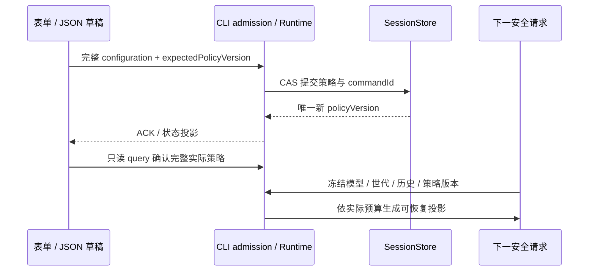

# 原生上下文压缩：参数实现映射

2026-11-12。关联[参数目录](native-context-compression-parameters.md)、[实施契约](native-context-compression-implementation.md)。这是当前工作树的有限静态追踪，覆盖公开 descriptor 的 90 个路径；不会以保存成功或静态检查代替参数效果、模型质量或 E2E 验收。

## 所有者与读取时机

完整参数的唯一事实由 CLI Runtime / SessionStore 保存。UI 的同一 descriptor 表单和 JSON 编辑器只管理草稿；两个保存目标分别使用任务的 `expectedPolicyVersion` 和 Local Host 默认的 CAS 版本。下面的路径均相对于 `parameters`，同名 `enabled` 字段只控制自己的子功能。条件性字段在父开关、对应编码格式或 tier 生效时才被使用，不能因此误报为无效字段。

源码位置缩写：

- `Runtime`：[native-context-compression](../../apps/zcode-cli/packages/core/src/runtime/native-context-compression/)。
- `Image`：[唯一图片处理器扩展](../../apps/zcode-cli/packages/adapters/src/image/native-context-compression/)。
- `Shared`：[公开参数 schema / descriptors](../../packages/shared/src/native-context-compression/parameters.ts)。

## 逐字段映射与验证

下表记录已落盘的实际消费者与必要验证。来源定位只证明字段进入当前实现，不证明维护质量、所有平台交互或全部条件分支已通过。尚未收口的语义差异在文末单列，不能以保存成功隐藏。

| 路径                                                | 实际消费者                                                          | 必要行为与验证                                                                             |
| --------------------------------------------------- | ------------------------------------------------------------------- | ------------------------------------------------------------------------------------------ |
| `trigger.start`                                     | Runtime `safe-point.ts` / `kernel-config.ts`                        | 使用冻结模型的输入预算解析压力阈值；混合 token/percent 在 Runtime 比较。                   |
| `trigger.target`                                    | Runtime `maintenance.ts` / `maintenance-prompts.ts`                 | 冻结预算后用于有界批次的候选规模及模型目标；一次维护不保证最终达到目标，不突破保护区。     |
| `trigger.growthTokens`                              | Runtime `kernel-config.ts`                                          | constant 模式的增长门槛；压力/容量触发不能被增长门槛吞掉。                                 |
| `trigger.checkIntervalRounds`                       | Runtime `safe-point.ts`                                             | 机会性检查的轮次间隔；同一历史不重复检查。                                                 |
| `trigger.opportunisticPercent`                      | Runtime `safe-point.ts`                                             | 只在达到机会性用量且满足周期或增长/间隔时进入维护。                                        |
| `trigger.capacityPercent`                           | Runtime `safe-point.ts`                                             | 容量压力优先于估算等待；仍不得压缩硬保护内容。                                             |
| `trigger.growthMode`                                | Runtime `kernel-config.ts`                                          | constant/adaptive 使用不同计算规则，显式 tier 覆盖优先。                                   |
| `trigger.tierGrowthTokens.t1`                       | Runtime `kernel-config.ts`                                          | 显式 T1 门槛替代派生值。                                                                   |
| `trigger.tierGrowthTokens.t2`                       | Runtime `kernel-config.ts`                                          | 显式 T2 门槛替代派生值，只在该 tier 候选存在时参与检查。                                   |
| `trigger.tierGrowthTokens.t3`                       | Runtime `kernel-config.ts`                                          | 显式 T3 门槛替代派生值，只在该 tier 候选存在时参与检查。                                   |
| `trigger.minBenefitTokens`                          | Runtime `kernel-config.ts` / `candidates.ts`                        | 完整摘要候选的总 token 收益下限；auto 由实际输入预算派生。                                 |
| `trigger.periodicCheckRounds`                       | Runtime `safe-point.ts`                                             | 0 关闭周期检查，非零使用已维护后实际历史推进轮数。                                         |
| `trigger.waitForUsageSample`                        | Runtime `safe-point.ts`                                             | 没有同模型/同分段实际计量时，可有界等待估算；容量压力仍进入检查。                          |
| `trigger.estimateHoldRounds`                        | Runtime `safe-point.ts`                                             | 限制估算等待次数；成功实际样本复位等待计数。                                               |
| `trigger.modelDecides`                              | Runtime `maintenance.ts` / `maintenance-prompts.ts`                 | 只用于机会性询问；主请求/维护/决策分别保留实际用量。                                       |
| `trigger.decisionMaxOutputTokens`                   | Runtime `maintenance-model.ts`                                      | 决策请求显式输出上限受实际目标模型输出与同一 execution 预算约束。                          |
| `trigger.adaptive.ratioPercent`                     | Runtime `kernel-config.ts`                                          | 输入预算比例决定 adaptive 基础增长门槛。                                                   |
| `trigger.adaptive.floorTokens`                      | Runtime `kernel-config.ts`                                          | adaptive 门槛下界，不大于 cap。                                                            |
| `trigger.adaptive.capTokens`                        | Runtime `kernel-config.ts`                                          | adaptive 基础门槛上界；核对与最小增长规则的优先级。                                        |
| `trigger.adaptive.minGrowthFloorTokens`             | Runtime `kernel-config.ts`                                          | adaptive 的最小固定增长参与派生，不能只展示不计算。                                        |
| `trigger.adaptive.minGrowthRatioPercent`            | Runtime `kernel-config.ts`                                          | adaptive 的最小预算比例参与派生。                                                          |
| `trigger.adaptive.tierMultiplier`                   | Runtime `kernel-config.ts`                                          | 按 tier 对基础门槛递乘；显式 tier 覆盖优先。                                               |
| `history.preserveTurns`                             | Runtime `guards.ts`                                                 | 软近期真实用户轮保护，扩展整条持久消息与工具配对；最新轮始终硬保护。                       |
| `history.preserveMessages`                          | Runtime `guards.ts`                                                 | 按持久 messageId 计数，不能按拆分 entry/图片 part 计数。                                   |
| `history.preserveTokens`                            | Runtime `guards.ts`                                                 | 从历史尾部累计文本 token 形成软近期区。                                                    |
| `history.protectedTools`                            | Runtime `guards.ts` / `soft-protection.ts` / `tool-views.ts`        | 所有匹配实例及完整配对受保护；有效工具表复用同一模式匹配器。                               |
| `history.protectedLatestTools`                      | Runtime `guards.ts` / `soft-protection.ts` / `tool-views.ts`        | 每个实际工具名称只保护最后完整实例；同一消息的其他配对随之扩展。                           |
| `history.earlyFoldTools`                            | Runtime `soft-protection.ts` / `guards.ts`                          | `addRecent` 仅豁免已完成工具组的软近期保护，最新用户轮、未完成轮和配对硬保护先行。         |
| `history.preserveRecentTools`                       | Runtime `soft-protection.ts` / `guards.ts`                          | 从 earlyFold 的有效集合中减去；两者交集及同消息不可拆组仍保留。                            |
| `summary.minChars`                                  | Runtime `candidates.ts` / `kernel-config.ts`                        | trim 后按字符校验；过短候选整体拒绝。                                                      |
| `summary.maxChars`                                  | Runtime `candidates.ts` / `kernel-config.ts`                        | 0 不设字符上限；非零上限仍独立于 token 收益。                                              |
| `summary.minRangeChars`                             | Runtime `guards.ts` / `range-batches.ts` / `kernel-config.ts`       | 合法历史范围的最小字符数；有界分批只能在完整消息组和完整工具配对之间切分。                 |
| `summary.minReductionPercent`                       | Runtime `candidates.ts`                                             | 摘要 token 收益比独立校验；重复/重叠范围整体拒绝。                                         |
| `summary.tiersEnabled`                              | Runtime `candidates.ts` / `kernel-config.ts`                        | 关闭后仅保留 T1 新摘要；不展开已有高阶摘要。                                               |
| `summary.tier2BlockCount`                           | Runtime `candidates.ts` / `kernel-config.ts`                        | 满足 survivals 的 T1 活跃块数量达到门槛才产生 T2 候选。                                    |
| `summary.tier3BlockCount`                           | Runtime `candidates.ts` / `kernel-config.ts`                        | 满足 survivals 的 T2 活跃块数量达到门槛才产生 T3 候选。                                    |
| `summary.promotionSurvivals`                        | Runtime `candidates.ts` / `kernel-config.ts`                        | 仅真实历史推进增加 survival，不由 UI 读取或趋势翻页推进。                                  |
| `reasoning.completedMode`                           | Runtime `tool-views.ts` / `projection.ts`                           | provider-safe-omit 仅省略可证明安全的已完成 reasoning；签名/Provider 专有块不被删改。      |
| `reasoning.thresholdChars`                          | Runtime `tool-views.ts` / `projection.ts`                           | 按字符识别可省略块；阈值变化不改 canonical reasoning。                                     |
| `tools.reference.enabled`                           | Runtime `tool-views.ts`                                             | 只对可恢复工具原文构造引用视图，策略改变不反复改写已提交前缀。                             |
| `tools.reference.minTokens`                         | Runtime `tool-views.ts`                                             | 按原文 token 判断是否引用。                                                                |
| `tools.reference.headChars`                         | Runtime `tool-views.ts`                                             | 按字符保留头部；加入来源指针后仍须严格节省 token。                                         |
| `tools.reference.excludeTools`                      | Runtime `tool-views.ts`                                             | 匹配工具不引用；保护工具规则先行。                                                         |
| `tools.reference.inlineReadTokens`                  | Runtime `tools.ts`                                                  | 模型 context_read 无显式 limit 时的有界缺省，不改变 UI 文本翻页长度。                      |
| `tools.distill.enabled`                             | Runtime `tool-views.ts` / `maintenance.ts` / `maintenance-model.ts` | 控制立即模型摘要候选及有界维护请求；携图结果通过真实媒体准备，不能与主文本摘要混报费用。   |
| `tools.distill.minTokens`                           | Runtime `tool-views.ts`                                             | mediaOnly=false 时的工具文本 token 下限。                                                  |
| `tools.distill.minContextPercent`                   | Runtime `tool-views.ts`                                             | 以当前上下文输入占用 / 输入预算检查启用门槛；不是单个工具输出的占比。                      |
| `tools.distill.mediaOnly`                           | Runtime `tool-views.ts` / `maintenance-media.ts`                    | 开启后只选含实际图片的工具输出；维护请求携带其持久原图的副本，缺来源、模态或容量明确拒绝。 |
| `tools.distill.excludeTools`                        | Runtime `tool-views.ts`                                             | 排除匹配工具；最新/固定保护优先。                                                          |
| `tools.simplify.enabled`                            | Runtime `tool-views.ts`                                             | 复用 crushText 候选 primitive；完整配置校验要求 distill 开启。                             |
| `tools.simplify.minReductionPercent`                | Runtime `tool-views.ts`                                             | crushText 候选满足指定比例；加入原文指针后另检查严格 token 收益，不声称仍满足同比例。      |
| `tools.simplify.strategies.json-fold.enabled`       | Runtime `tool-views.ts`                                             | 选择 jsonFoldPlugin，不另起第二简化 owner。                                                |
| `tools.simplify.strategies.json-fold.excludeTools`  | Runtime `tool-views.ts`                                             | JSON 策略的独立排除集合。                                                                  |
| `tools.simplify.strategies.code-trim.enabled`       | Runtime `tool-views.ts`                                             | 选择 codeTrimPlugin。                                                                      |
| `tools.simplify.strategies.code-trim.excludeTools`  | Runtime `tool-views.ts`                                             | code 策略的独立排除集合。                                                                  |
| `tools.simplify.strategies.log-select.enabled`      | Runtime `tool-views.ts`                                             | 选择 logSelectPlugin。                                                                     |
| `tools.simplify.strategies.log-select.excludeTools` | Runtime `tool-views.ts`                                             | log 策略的独立排除集合。                                                                   |
| `retrieval.planAware`                               | Runtime `search.ts` / 既有 `plan-file-continuity.ts`                | 只读批准计划 owner；query 必须先命中，计划只增加重排权重，不扩大搜索词命中范围。           |
| `retrieval.maxHits`                                 | Runtime `search.ts` / `tools.ts`                                    | 限制原文/摘要检索结果，调用者不能突破已保存上限；有界搜索明确返回截断范围。                |
| `retrieval.textPageTokens`                          | Runtime `read.ts` / UI source hook                                  | UI 文本来源 query 的 token 页长；仍受字符和协议容量边界约束。                              |
| `images.rescale`                                    | Image `image-policy.ts` / `index.ts`                                | 只控制性能 gate；关闭仍执行目标模型的硬容量检查。                                          |
| `images.foldWithHistory`                            | Runtime `images.ts` / `image-receipts.ts`                           | 新折叠要求合法摘要覆盖、原图可恢复与有效发送证明；已有省略的 latch 规则待核对开关语义。    |
| `images.omitSeen`                                   | Runtime `images.ts` / `image-receipts.ts`                           | 新省略仅由成功响应提交证明授权；已有省略在关闭或换模型后的重判语义待收口。                 |
| `images.keepRecentUserTurns`                        | Runtime `images.ts` / `image-identity.ts`                           | 扩大新 omitSeen 的用户轮保留区；按稳定 message/part 判断，已有 latch 仍需核对。            |
| `images.convention.enabled`                         | Runtime `request-guidance.ts`                                       | 有图片时独立控制 request-only 稳定指导段；不依赖 visibilityMarkers，不关闭来源证明。       |
| `images.convention.text`                            | Runtime `request-guidance.ts`                                       | trim 后空值使用内置看图/结论/原图回取指导；显式文本不替换硬容量、原图或发送证明规则。      |
| `images.maxEdge`                                    | Image `image-policy.ts` / `index.ts`                                | 性能 gate 的最长边，仅缩小，不突破目标模型尺寸上限。                                       |
| `images.jpegQuality`                                | Image `image-codec.ts`                                              | JPEG 首个质量候选；PNG 保留模式不因此强制转换。                                            |
| `images.minJpegQuality`                             | Image `image-codec.ts`                                              | 后续 JPEG 档位不能低于已保存下限。                                                         |
| `images.minEdge`                                    | Image `index.ts` / `image-candidates.ts`                            | 后续尺寸不能低于下限，小原图不放大；达到下限仍超硬预算返回明确结果。                       |
| `images.minReductionPercent`                        | Image `image-policy.ts` / `image-candidates.ts`                     | 采用发送副本前检查实际字节收益；零仍要求严格变小，不等价于视觉 token 收益。                |
| `images.triggerMode`                                | Image `image-policy.ts`                                             | edge 与 edge-or-bytes 分别控制 gate。                                                      |
| `images.byteTriggerKiB`                             | Image `image-policy.ts`                                             | edge-or-bytes 下按原图解码字节比较，不按 base64 字符比较。                                 |
| `images.pngMode`                                    | Image `image-codec.ts`                                              | preserve 保留 PNG；jpeg-if-opaque 只在候选不透明时允许 JPEG。                              |
| `images.alphaMode`                                  | Image `image-codec.ts`                                              | 只有 flatten 显式合成底色；preserve 不丢 alpha。                                           |
| `images.flattenColor`                               | Image `image-codec.ts`                                              | 固定 RGB 值参与合成和缓存，不随 UI 主题变化。                                              |
| `images.targetRawKiB`                               | Image `image-policy.ts` / `image-candidates.ts`                     | auto 派生真实硬预算；显式目标不能超过硬预算，核对候选退回规则。                            |
| `images.sourceKinds`                                | Image `image-policy.ts`                                             | gate 只处理选择的模型图片来源；硬限制与原图保留独立。                                      |
| `images.cacheMaxEntries`                            | Image `copy-cache.ts`                                               | 与字节限制共同执行 LRU；0 不保留副本缓存。                                                 |
| `images.cacheMaxMiB`                                | Image `copy-cache.ts`                                               | 按实际缓存发送副本字节计数；不会删原图和压缩记录。                                         |
| `maintenance.model`                                 | Runtime `maintenance-model.ts`                                      | follow-current 冻结当前 execution/手动点击模型，显式引用只解析目标环境现有模型。           |
| `maintenance.stream`                                | Runtime `maintenance-model.ts`                                      | always 选择原生完整流维护入口，auto 沿用现有流策略；不完整响应不可提交。                   |
| `maintenance.maxOutputTokens`                       | Runtime `maintenance-model.ts`                                      | auto 使用实际输出与执行预算；显式值超目标模型上限拒绝，随后按实际输入预算限制。            |
| `prompts.pack`                                      | Runtime `maintenance-prompts.ts`                                    | default/lean 来自内置包，不按文件路径加载任意内容。                                        |
| `prompts.compressPhilosophy`                        | Runtime `maintenance-prompts.ts`                                    | 空值用内置；仅替换策略指导段。                                                             |
| `prompts.howToCompressRules`                        | Runtime `maintenance-prompts.ts`                                    | 自定义指导不替代消息完整范围/配对校验。                                                    |
| `prompts.tier2DistillRules`                         | Runtime `maintenance-prompts.ts`                                    | 只在本批次实际含 T2 候选时加入二级提炼指导，不注入无关层级。                               |
| `prompts.tier3CondenseRules`                        | Runtime `maintenance-prompts.ts`                                    | 只在本批次实际含 T3 候选时加入三级凝练指导，不注入无关层级。                               |
| `prompts.visibilityMarkers`                         | Runtime `projection.ts` / `request-guidance.ts`                     | 控制 Provider 视图的来源说明，不隐藏 UI 审计/回取记录；图片指导开关独立。                  |
| `prompts.messageTimestamps`                         | Runtime `projection.ts` / `candidates.ts`                           | 使用持久首见时间，不因重建、主题或重连重新打时间。                                         |

## 静态发现与完成边界

1. 工具保护表由当前 Runtime registry 和已保存策略解析；UI 不用草稿自行匹配。`nativeProtectedToolGroups` 已接工具视图与摘要 guards，按实际名称仅保护最后实例并扩展配对。`nativeEarlyFoldGroups` 已进入 `addRecent`，只豁免软近期保护；必须在真实请求中验证最新轮、未完成工具与完整消息组仍被保护。
2. `planAware` 已复用 `readApprovedPlanFileReferenceEntry`，query 先命中、计划后加排序权重；不以最新用户文本冒充计划。搜索受来源数、字符数、页长与停止信号限制，截断状态必须保留。
3. 模型决策、摘要目标、维护模型/流式/输出限制、自定义提示包、图片成功发送证明与请求投影均有消费者。`maintenance-prompts.ts` 已分别按真实 T2/T3 候选选择指导；`images.ts` 只有 manual 延续已提交省略，auto 每次按冻结策略、实际模型与表示重判。携图提炼由 `maintenance-media.ts` 验证持久 completed ToolPart 和 immutable 原图，生成带 output ref 的图片发送副本；不使用主请求 omitSeen/foldHistory，也不签发主请求看图回执。20 个结果、200 张图片、单图与 40MiB 聚合预算均整批检查，源、模态、容量、取消与冻结边界失败不能伪装成视觉摘要。对应源码测试与真实模型 E2E 的执行边界分别记录，不将静态接线称为产品验证通过。
4. 参数页的只读来源、摘要、图表和原图分块查询分别按 revision / generation / historyVersion 防止迟到覆盖。真实零与未知用量分开；维护无模型请求才允许显示实际零。
5. 静态检查、源码回归与产品回放分别登记。Windows 同 Host 产品回放已执行摘要/图片模型请求、窄屏、fork、冷恢复及桌面趋势代表场景；手机恢复/设置/账本的修复复测仍由本轮重点运行完成，真实模型质量、实体触摸、macOS 与独立生产跨 Host 仍待人工验证。准确范围见[验收覆盖](../testing/native-context-compression-e2e-coverage.md)，不推定 90 字段的全部行为分支已验。

`native-context-maintenance-media.test.ts` 已用准确 Node 24.14.0 执行 27 项源码回归，全部通过；scoped noEmit、lint、format 与改后 architecture check 均通过。合成持久 ToolPart / artifact fixture 验证来源、原字节与回执不变、20/200 数量边界、单图与逐图 40MiB 硬门禁、取消与冻结变化；合成编码头和 ImageProcessorPort fixture 不证明真实编解码器或模型视觉质量。证据为 `.run-logs/project-only-validation/native-context-media-final-tests-Zq6ObJ/children/source-tests-wTuzC1/results.json`，产品 E2E 仍待执行。
