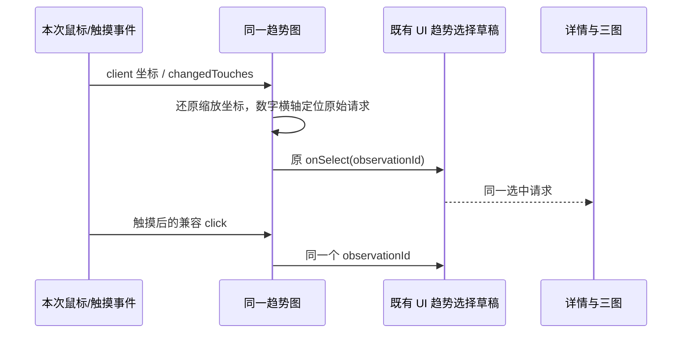
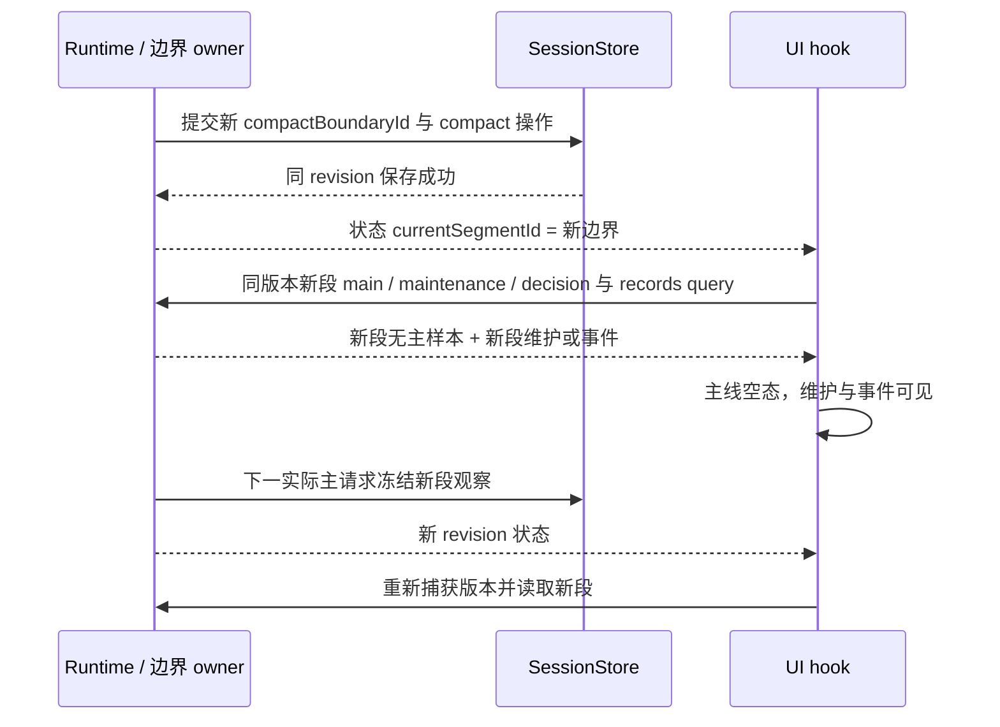
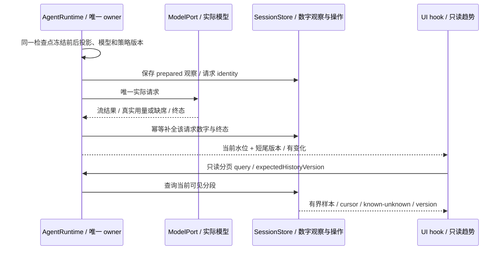
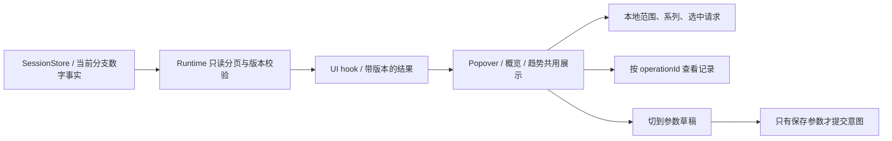
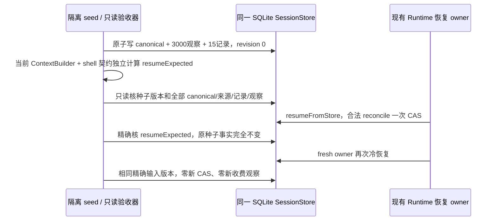

# 原生上下文压缩：趋势与统计页面

状态：2026-11-12 Runtime、协议、持久化及正式 UI 已落地，最新四场重点产品回放通过；此前六场两端 3000 条账本通过记录独立保留。契约见 [实施说明](native-context-compression-implementation.md)，实际验证边界见 [验收覆盖](../testing/native-context-compression-e2e-coverage.md)。

用户已要求增加类似 bili 自带页面的压缩趋势图。本文补充 [产品方案](native-context-compression.md)，完整参数仍见 [参数目录](native-context-compression-parameters.md)，验收范围见 [影响规划](../testing/native-context-compression-plan.md)。入口、排布、统计字段与初值按本稿实施；下方保留设计阶段的上游对照，当前执行结果以第 9 节与 [验收覆盖](../testing/native-context-compression-e2e-coverage.md) 为准。

## 1. 借鉴范围与实现成本

bili 已有「上下文轨迹」与「缓存命中率」两张图，按请求排列，压缩和缓存变化事件可对照查看；任一图框选后，两张图共用缩放区间。[上游图表](https://github.com/ranxianglei/billion-context/blob/dc041dd1ab1a014efa352ba47a6f31fc47f55284/src/web/client.ts#L2057-L2352)

用户补丁的图片能力提供参数卡、尺寸/字节结果与 folded/shrunk 计数；目前没有把图片字节写入独立趋势账本。因此图片趋势是本仓新增需求，不能称为复制一个已存在的图片仪表盘。[图片结果](https://github.com/No-ni/billion-context-patched/blob/6dbd99dc0affe9b365191ee66d53965a9ef1891c/patches/image-retention.block.js#L307-L316)、[图片卡片说明](https://github.com/No-ni/billion-context-patched/blob/6dbd99dc0affe9b365191ee66d53965a9ef1891c/MAINTENANCE.md#L33-L39)

本仓已有 Recharts 与 [共享图表 primitives](../../packages/ui/src/components/ui/chart.tsx)，[现有用量趋势](../../packages/ui/src/settings/usage-stats/AppUsageDailyModelTrendChart.tsx) 可作为主题、Tooltip 与 accessibilityLayer 的实现参考。首版复用这些组件与现有 Dialog，不增加图表依赖、独立 Web 服务或顶级导航。主要新增成本在请求级测量、持久化和恢复契约。

## 2. 入口与信息层级

| 位置                    | 呈现                                                         | 动作与边界                                                                 |
| ----------------------- | ------------------------------------------------------------ | -------------------------------------------------------------------------- |
| Composer 上下文 Popover | 保留当前用量、自动开关、立即压缩；下方一条最近请求的精简走势 | 「查看趋势」关闭 Popover，打开当前任务详情的趋势页；不把整张仪表盘塞进浮层 |
| 详情 · 概览             | 当前策略、窗口、有效段、近期走势与最后一次维护结果           | 小图只展示发送视图估算，标明口径；点击进入完整趋势                         |
| 详情 · 趋势             | 共享范围、数字摘要、输入主图、缓存/图片次图、选中请求详情    | 查看与筛选只读；不会触发摘要、模型请求、参数保存或原文展开                 |
| 详情 · 压缩记录         | 原有摘要、原文/原图、来源与状态                              | 接收 operationId 定位；返回趋势保留范围、分段和选中请求                    |
| 详情 · 参数             | 原有分组表单与完整配置                                       | 未保存表单和未校验 JSON 均按任务/默认两个作用域保留，切趋势不丢草稿        |
| 常规 · 新任务默认       | 开关、默认摘要、参数编辑                                     | 只编辑未来默认；没有当前任务图表，避免混用保存 owner                       |

详情统一采用「概览 / 趋势 / 压缩记录 / 参数」四页签。桌面四页使用相同最大宽度，建议 max-w-3xl 附近；头部与页签保持可见，正文使用已有 Dialog 的滚动区域。手机保持同一页签与操作，正文单列。设计预览随内容增长，正式产品的高度与焦点循环仍复用现有 Dialog。

趋势页顺序：

```text
上下文                                  [关闭]
概览      趋势      压缩记录      参数

[实际模型 / 分段]             [显示范围]
最新请求约减少（估算）  /  本段维护输入与输出  /  当前有效压缩段

请求输入与压缩趋势
  未应用本功能（估算） · 发送视图（估算） · Provider 实际输入
  [输入主图：同一请求横轴，预算/触发参考线，压缩事件]

缓存命中率                           图片发送字节
  [百分比图]                           [字节图]

选中的第 N 次请求 · 时间 · 来源与状态
前后估算、实际 input/cache、图片数量/字节、对应维护用量与耗时
[查看对应压缩记录]                    [调整参数]
```

三个数字摘要只解释当前页面：最新请求配对差值、所选范围内维护实际 input/output、当前世代有效段。若查看旧分段，有效段明确标为「当前有效」，不能把历史操作数代替它。数字均带估算/实际/未知的来源标记。

## 3. 主图：请求输入与压缩趋势

- 横轴使用主模型请求序号，每次实际尝试一个位置；同一用户轮可能包含多个请求。重试按 logicalRequestId + attemptIndex 分别保留，工具调用次数不冒充请求数。详情提供时间与请求状态，时间回拨不重排样本。
- 「未应用本功能」与「发送视图」来自同一个准备检查点、实际模型、历史边界、系统/工具集合和估算方法。前者关闭本次原生压缩投影作本地对照，保留已有硬限制和既有 compact 边界；后者是实际发送投影。对照不发模型请求，也不把已越过深度 compact 的所有历史重新相加。
- 两条估算线用不同线型；Provider 实际输入用独立点标记。实际 input 只来自该主请求的用量，包含已归一化的缓存输入；不得把 contextWindow.usedTokens 或摘要维护请求的 total 当作发送后 input。
- Provider 实际输入圆点的填充色与该系列图例一致，在浅色与深色主题下均可辨认；点系列不绘制连接线。显式圆点填充不改变请求数值、未知缺口、零值位置或其它系列的绘制属性。
- 预算与触发参考线取该请求冻结的实际 Model 输入预算和 policyVersion。展示「可用输入预算」，不把模型总窗口当作增量触发分母；历史参数变化以事件标记与分段参考线保留。
- 本地估算无法覆盖图片等模态时，完整输入对照留空，详情可另列「文本估算，图片用量未知」。不对 base64 字符数作 vision token 计数，也不把文本对照称作完整窗口节省。Provider 总输入已知时仍保留实际点。
- 估算缺席保持请求位置和断线；真实用量迟到只补同一请求的实际点，不重新生成历史估算。失败/取消请求可显示发送前估算及已发生用量，不能以维护失败制造一次成功下降。

## 4. 次图与选中详情

### 4.1 缓存命中率

按归一化后的 cacheReadInput / actualTotalInput × 100% 显示，固定 0–100%。缓存创建与缓存读取分开；分母已经包含缓存输入时不能再相加。需要 Provider 明确提供且满足 0 ≤ cacheReadInput ≤ actualTotalInput；无返回、输入为零、字段口径不明或数字不合法时显示「未提供/不可计算」并断线，不能截值成 0% 或 100%。

适配层必须保留原始用量字段的存在性。当前 SDK 会把 Anthropic、Gemini、OpenAI Chat/Responses 缺少的缓存读取字段补成 `0`，其 `totalUsage` 汇总还会丢失 `raw`。因此按本次实际 Provider 协议读取每个 SDK step 的原始缓存字段：缺少、`null` 或非有限数字保持 `undefined`，由现有观察出口写为 `null`；明确返回的 `0` 仍是实际零。Anthropic 的缓存创建与读取分别取自己的字段，OpenAI 与 Gemini 不套用 Anthropic 字段；输入总量继续取 SDK 已归一化且包含缓存的输入，不能再次相加。没有 step/raw 的旧自定义模型保留既有归一化接口，不把 SDK 汇总数字当作原始字段存在的证明。

同一请求含多个 SDK step 时，在适配层先恢复每个 step 的字段存在性，再逐字段汇总；只有所有 step 都明确提供该字段时才给出完整合计。任一 step 的缓存用量未知，整个请求的对应缓存合计仍未知，不能把其它 step 的已知部分画成完整命中率。流式完成事件、成功/失败网络终态和非流式返回复用这一个归一化出口，不从最后一步或已丢失 `raw` 的汇总重新猜值；已收到 step 用量后流失败，仍保留其真实已知费用。

缓存命中与上下文减少独立。一次压缩可能改变前缀并短暂降低命中率；显示实际变化及「策略变化」「深度整理」等已知事实，不仅根据比例下降就断言缓存被破坏。复用 cache key 不是命中证明。

### 4.2 图片发送字节

使用原字节/解码后的图片 payload 字节，单位 KiB/MiB；不使用 base64 长度或 HTTP gzip/Brotli 后字节。同一请求先冻结参与本次图片策略的稳定 sourcePart 集合，再分别计数处理前与实际发送后，不能用整段会话所有原图作分母。

| 字段/状态              | 展示规则                                                                                     |
| ---------------------- | -------------------------------------------------------------------------------------------- |
| 处理前图片字节         | 来源已冻结且本次图片优化前会参与同一请求的字节；来源不完整则总数未知，可列已知部分和覆盖数量 |
| 实际发送图片字节       | 该请求实际包含的图像 payload 合计，和发送数量一起展示                                        |
| 降采样/省略/随历史折叠 | 用事件与数量区分原因；省略必须仍满足成功提供证明、保护区和可回取来源                         |
| 没有图片               | 展示「未包含图片」；该请求 byte 总量可为已知 0，但没有可计算的图片降幅                       |
| 全部合格图片被省略     | 发送字节可为真实 0，明确「省略 N 张」；不把未知数据画成这个状态                              |
| 原图回取               | 用独立事件标记，字节可能上升；详情说明本次发送原字节，不作为压缩失败                         |
| vision 用量            | 只有 Provider 明确返回分项才展示；否则「未提供」，不从字节降幅换算                           |

发送数量、省略数量和字节按最终发送集合对账；原图回取覆盖本次省略后，不能仍把该图同时计作已省略。图片详情链接到已有记录和原图 query，点击图表不会立即加载大图片。首版不新增自动图片质量评分。

### 4.3 维护用量与耗时

范围内实际摘要维护的 input/output、cache read/create 按其自己的 request identity 归集；失败、取消及策略变更导致候选作废时，已发生的用量仍计入。无模型调用的工具引用/缩图记录「无需模型请求」，不能伪称一次零用量摘要。已发请求但用量未知显示已知部分与「N 次未提供」；如果全部未知，总数为未知。

维护耗时在选中操作详情显示实际 elapsedMs；整个操作的等待时间另标 wallDuration，不用重叠请求耗时相加冒充墙钟耗时。不同摘要模型的用量分别标模型，不能用其 token 差推断主模型成本。首版不做货币回本图或自动费用承诺。

每次维护使用独立 operation/request identity。连续手动维护保留各次已发生用量，下一次待提交、失败或取消不能替换上一次成功记录。操作发生在最近主请求之后时只挂事件与维护摘要，不改写该主请求冻结的前后估算；有效段可以先更新，输入曲线等待下一主请求。尚无主请求趋势的旧任务也显示已记录维护用量与操作入口，曲线继续留空。

### 4.4 数值刻度与零值事实

tokens、原始 bytes 和图片张数使用整数轴刻度。全部样本为已知零、只有一个样本或最大值很小时，也不能生成分数刻度，再通过整数格式化显示成重复的「0 B / 1 B」或相同 token/张数。全零数据的轴范围可扩展到可读的整数范围，但曲线仍落在真实零点；byte 刻度换算成 KiB/MiB 后可以保留单位格式化的小数，不能改变原始字节。

百分比图保持固定 0–100% 和现有小数显示规则，轴标签与 tooltip 最多保留一位小数，不因整数轴修复将 0.5% 改成 1% 或 0%。轴刻度只影响展示，不改写 observation、估算差值、请求选择、来源覆盖或已发生用量。

真实无图请求的处理前/发送后字节为已知 0 时，图上保留零值线，选中详情和对应请求 tooltip 均显示「0 B」；缺席或来源覆盖不完整继续显示未知，不能为了让坐标轴可读而补零。没有图片仍没有可计算的图片降幅。

## 5. 交互、窄屏与可访问性

- 默认查看 Runtime 状态 `currentSegmentId` 指定的当前历史分段最近 50 次请求；可选最近 200 次与当前分段。该字段直接投影 owner 的 `compactBoundaryId`，不能从最近主请求推断。范围控件是三图共同的缩放机制，选择最近更小范围后横轴、事件、统计与详情一起更新。「完整分段」恢复区间。桌面框选是后续可加的同状态快捷方式，首版不以鼠标拖拽作为唯一入口。
- 实际模型、总窗口、可用输入预算、估算器、分支 generation 和深度 compact 边界变化会断开可比较曲线；继承与本任务样本保持各自线型。普通请求追加造成的 `historyVersion` 变化只用于查询迟到围栏，不能制造曲线断点。用户在 Composer 点选尚未执行的新模型，不改变已发生样本。政策版本变化留标记，参考线按样本变化，不单独断线。
- compact 提交后即使尚无新主请求，当前段仍切到 owner 的新边界；主曲线为空，新段维护和 compact 事件按同一版本展示。历史分段选项也可包含只有操作或维护的段，无主请求时用历史边界标签，不把维护模型当作该段主模型。
- 图上点击/触摸选中请求，跨图共用选中位置；压缩事件先展示对应操作，再允许「查看压缩记录」。原型提供请求 select 作为键盘与触摸等价入口。点开记录后「返回趋势」还原窗口与位置。
- 点击与无移动触摸按本次指针坐标定位，不能使用 Tooltip 的旧 hover/keyboard 索引。沿当前图的数字横轴域与唯一绘图区尺寸选最近的原始请求，按实际承载事件的 HTML 图表容器矩形与布局尺寸还原缩放并保留浮点精度，避免大账本在整数像素取整后跳到相邻请求；无法取得该容器的布局尺寸时不改变选择。触摸结束取 `changedTouches`，触摸后的兼容 click 仍定位同一请求。图外或非有限坐标、无结束触点及同时多触点不改变选择。采样仅减绘制点、空分隔行仅断线，不改写指针对应的原始请求序号；Tooltip 悬停继续独立工作。
- 图表键盘验收先通过真实 Tab/Shift+Tab 取得目标图的可聚焦 group 或其 SVG 子树焦点，再执行 Home/End/左右键；容器点击成功不等于键盘焦点已转移。每次等待以一次只读 DOM 查询同时捕获详情、三图选中 observationId 和 activeElement 的结构信息，保留 owner 首尾请求、共同范围和四处一致性断言；失败记录实际焦点与四个 ID，不能把未送达的键盘动作归为三图分裂。



- 同一请求可关联多次维护，事件按 operationId 单独选中；记录同步呈现该操作的状态、摘要范围、正文与原文来源。组合维护同时呈现摘要与工具引用，原图回取呈现本次最终发送表示；失败/取消操作展示已发生用量，不冒充有效摘要。
- 图例可按系列显示/隐藏，估算线、实际点与详情同时响应；图例保持线型/点型标签。未知缺口和事件不因某条系列隐藏而消失。窄屏最多四个横轴刻度，字体保持 UI token，不缩小整张固定 viewBox。
- 宽屏缓存与图片次图并列，窄屏依次单列；图例、范围与详情换行，320/390/736/1024px 均保留关闭、参数和记录入口。图表有单位轴、读屏摘要与选中详情；不用颜色作为唯一区分。
- 关闭/Escape 只关闭当前浮层；从趋势切入参数、切回趋势、查看记录均保留本地范围与未保存表单/JSON。图表内选择不会改变自动开关、全局默认或输入草稿。

预览只有 24 次合成请求，额外提供「最近 8 次（缩放示例）」演示共同区间；正式选项仍包含最近 50/200 次与当前完整分段。

## 6. 分叉、回退、旧记录与远程恢复

| 场景               | 页面与统计                                                                                                                                    |
| ------------------ | --------------------------------------------------------------------------------------------------------------------------------------------- |
| 新任务/没有样本    | 清晰空态；未计算与已知零分开；仍能进入参数                                                                                                    |
| 有请求、尚未压缩   | 可比前后线重合，最新差值为已知 0；有效段为 0                                                                                                  |
| 旧任务只有当前水位 | 标「从启用记录后开始统计」，不从当前水位或 AppUsage 日聚合补造历史曲线；若先发生手动维护，独立展示其用量与记录入口                            |
| fork               | 边界前样本若展示则标「继承」；只复制完整边界内数字和来源，子成本不重复计父维护；子新请求自有身份，父未来不流入                                |
| 回退/编辑          | 默认曲线只含当前有效分支；被丢弃未来样本不参与当前图或省量；旧事件仍受已有可见历史规则约束                                                    |
| 深度 compact       | owner 立即发布新 currentSegmentId；没有新主请求时曲线留空，新段操作/维护仍显示；旧事件可查但不计当前有效段                                    |
| 离线               | 保留最近一次完整读取的样本与「截至…，连接离线」；已缓存数据可筛选，修改动作仍禁用                                                             |
| 重连/迟到分页      | 用 revision、historyVersion、generation、cursor 与请求 owner 验证；过期结果丢弃或提示重载，不拼接两个版本；点级 historyVersion 不决定曲线分段 |
| 大任务             | 默认有界分页；概览只用短尾。长范围聚合保留 min/max、首尾、未知缺口与事件，详情读原始点，聚合不改变计数与差值口径                              |

## 7. 数据所有者与接口草案

Runtime 是唯一统计 owner。复用现有 ModelUsageRecord 的请求身份和 Provider 测量出口；新增数字观察记录保存在当前 session 的持久态，不以 Renderer 收到多少流事件来累计。现有 [用量 repository](../../apps/zcode-cli/packages/adapters/src/storage/session-store/repositories/usage.ts) 的 30 天保留与缺席归零逻辑不适合作为长期趋势的唯一来源；AppUsage 的相邻输入增量也不是未压缩对照。

状态 query 与 snapshot 必须携带 `currentSegmentId: string`。UI 捕获同一状态版本的当前段，对主请求、维护和决策分别做有界分页；历史主请求短尾只用于目录，不参与确定当前段。页响应的 revision/generation/historyVersion 表示当前可见视图围栏，观察记录里的历史版本则是当时冻结的事实，两者职责独立。



每条观察只存数字、有限枚举和内部身份，不存 prompt、摘要正文、base64、凭据、完整 URL 或真实路径。下列字段为接口草案，实现前补严格类型与 runtime schema：

| 字段组    | 建议内容                                                                                             |
| --------- | ---------------------------------------------------------------------------------------------------- |
| 身份      | observationId、executionId、logicalRequestId、attemptIndex、purpose、requestSeq、对应 usageRecordRef |
| 版本      | schemaVersion、historyVersion、generation、policyVersion、estimatorVersion、measurementScope         |
| 实际模型  | 已固定 ModelSelection 引用、当时 contextWindow/inputBudget、模态与缓存测量能力                       |
| 对照      | beforeEstimate/afterEstimate 各自 known/unknown、方法与可比证明；引用/提示开销包含在同一投影         |
| 实际用量  | totalInput/output/cacheRead/cacheCreate 的 known/unknown 与来源，不把缺席字段归零                    |
| 图片      | 同一 sourcePart 集合的覆盖数量、处理前/发送字节与数量、缩图/省略/回取计数、策略版本                  |
| 事件/终态 | operationId、触发来源、范围引用、准备/已发/成功/失败/取消、实际 elapsedMs、候选是否生效              |
| 来源      | own/inherited、稳定分叉边界引用；可见性继续固定在 workspaceIdentity/session/branch 范围              |

估算在模型 I/O 前冻结为 prepared 观察；成功发送或失败/取消以同一 identity 更新状态，Provider 实际用量从现有测量出口一次写入该观察。重复回执只是同一记录的幂等补全。维护的 active 块、来源与成功终态仍按产品方案原子提交；候选失败只记录失败和已经发生的用量，不能发布成功块。AppUsage 聚合是既有独立投影，不能反过来覆盖此 session 观察的 known/unknown。



UI 通过 packages/ui/src/hooks 的只读服务调用 listContextObservations 概念接口；Host/Main 继续只路由，RPC/stdio 与 V4 校验在实现阶段同步。概览短尾与完整趋势来自同一数字观察，不新增 UI localStorage 账本。完整历史、压缩正文和原图不放进每个实时 snapshot。



## 8. 数字准入与上游差异

当前请求差值 = beforeEstimate − afterEstimate，只在可比证明完整且 before ≥ after 时作为「约减少」展示；负差值显示「输入约增加」，不截零掩盖一次扩大。无效/未知为未知。不会相加多级摘要块的原文 token；分段、范围缩放与模型选择只读冻结数字。

首版不复刻 bili 的累计回本指标。其 savedSoFar 是后续覆盖请求乘以估算减少量，再扣除重读与摘要估算；宿主摘要 σ 还使用 ceil(summary.length / 4)，属于反事实估算，不能称 API 确认的省量。[ledger 摘要估算](https://github.com/ranxianglei/billion-context/blob/dc041dd1ab1a014efa352ba47a6f31fc47f55284/src/cache-ledger.ts#L1275-L1288)、[上游报告公式](https://github.com/ranxianglei/billion-context/blob/dc041dd1ab1a014efa352ba47a6f31fc47f55284/kernel/src/cache-report.ts#L145-L199)

上游图表会过滤 unk 样本，旧 ledger 缺覆盖证明时仍延续历史计数；本仓保留缺口、缺证明即未知。上游 session stats 与 ledger 取 MAX 防重叠，本仓沿同一 Runtime identity 归集，不复制两份账本再猜较大值。[未知样本过滤](https://github.com/ranxianglei/billion-context/blob/dc041dd1ab1a014efa352ba47a6f31fc47f55284/src/cache-ledger.ts#L2188-L2190)、[覆盖计算](https://github.com/ranxianglei/billion-context/blob/dc041dd1ab1a014efa352ba47a6f31fc47f55284/src/cache-ledger.ts#L1480-L1511)、[上游合并统计](https://github.com/ranxianglei/billion-context/blob/dc041dd1ab1a014efa352ba47a6f31fc47f55284/src/web/sessions-data.ts#L796-L835)

本仓现有 snapshot.usage 只有当前水位与累计值；[水位投影](../../apps/zcode-cli/packages/bootstrap/src/zcode-protocol-v4/product-projection.ts)、[getModelUsageContextTokens](../../apps/zcode-cli/packages/contracts/src/model/index.ts) 含 input/output，不能从它重建 inputAfter；[compact-active](../../apps/zcode-cli/packages/core/src/runtime/methods/compact-active.ts) 的整理后历史估算与摘要维护 Provider total 也必须分开。本轮仅静态核对，没有把这些现有字段直接当作新增趋势。

预览全部使用合成数据。原型交互检查不证明真实压缩质量、图表测量、模型费用或桌面/手机产品 E2E；验证状态记录在影响规划中。

## 9. 本轮趋势修复的 accepted 场景

最新重点收口：`0t3rov` 使用触摸修复后的新编译执行六场，5 通过、1 失败；桌面与手机的 3000 条账本、三宽手机触摸、在途重载/隐藏恢复均通过，唯一失败为 system 重载后的测试导航前置。仅修复验收 helper 后，`JJskJz` 同编译所选四场全部通过、0 跳过，详见 [报告](../../.run-logs/project-only-validation/native-context-desktop-e2e-JJskJz/artifacts/summary.md)与 [手机修复验收](native-context-mobile-entry.md)。以下第六轮及分组源码证据保留各自历史含义，不把不同轮累加为完整 32 场通过。

状态：实现和 E2E helpers 已完成，共享 suite 第六轮实际执行 32 个组合场景，28 通过、4 失败、0 跳过。连续 SVG 折线、三图键盘联动、真实零值、未知缓存缺口、浅深主题实际输入点颜色、真实深度整理后的当前空段已在相应产品场通过；桌面大账本在 seed/resume 物理事实对账通过后被查询页版本断言阻断，手机三场被共享 Shell 未挂载阻断，后续断言不计 covered。分页修复的实际收集函数回归 4/4 通过，手机接线修复及第七轮共享产品复测继续登记在验收覆盖。准确 Node 24.14.0 下，当前段初始化/真实 compact/旧主点保留/旧页拒绝的既有源码回归 2/2 与下方缓存回归继续有效，不将源码通过写成产品通过。实际窗口/预算切换仍待专门回放，不把条件断言或静态分段规则算作该行为已覆盖。

| 场景                                                | 验收证据                                                                                                                                                                                                                                                                                                                                                        |
| --------------------------------------------------- | --------------------------------------------------------------------------------------------------------------------------------------------------------------------------------------------------------------------------------------------------------------------------------------------------------------------------------------------------------------- |
| NCTX-TREND-SVG 连续主请求                           | 真实 query 中至少三个连续已知点具有同一模型/窗口/预算/估算器/分支/compact 边界，historyVersion 随普通追加变化；读取实际发送视图 SVG path，存在正长度的连续折线，不能用请求数或独立圆点代替                                                                                                                                                                      |
| NCTX-TREND-GAPS 可比较边界和未知缺口                | 模型、窗口、预算、估算器、分支或 compact 真变化保留断线；缓存已知→未知→已知保留缺口；迟到查询仍由 owner 和页版本拒绝                                                                                                                                                                                                                                            |
| NCTX-TREND-ZERO-TICKS 已知零图片与整数刻度          | 在共享 suite 早期设置趋势页的真实无图主请求上，对账同版本 ledger 和实际 SVG：byte 轴标签为不重复的整数刻度，零值线仍在零刻度；真实鼠标悬停对应请求，tooltip 和选中详情的前后字节均为 0 B，三图/详情保持同一 observationId。实际 TSX/Recharts 源码 probe 另验证 tokens/张数整数轴及百分比小数保留，不作为产品浏览器验收                                          |
| NCTX-TREND-LEDGER-DOTS 大账本实际用量圆点           | NCTX-58 的实际输入系列使用 Recharts 3 portal 圆点；只读探针通过该系列真实 SVG 的绘制属性关联圆点，不能依赖旧系列父子层级或把其它系列圆点算作 actual。峰值与真实零值仍按 owner 原始数据和实际轴坐标核对；未知区间仍检查完整实际系列圆点集合，不能按已知顶点过滤后使未知断言自动通过。实际 TSX/Recharts 源码红绿回归先验证探针，完整产品证据由同一共享 suite 提供 |
| NCTX-TREND-ACTUAL-COLOR 实际用量点与图例颜色        | 实际 TSX/Recharts 圆点填充等于 actual 系列色，点系列连接线保持透明且原绘制属性不变；共享产品 suite 在浅色和深色输入图上核对实际圆点与图例。保留零值轴/tooltip 和大账本峰值、缺口强断言，源码渲染不能替代真实浏览器截图                                                                                                                                          |
| NCTX-TREND-CACHE-PRESENCE 原始缓存字段存在性        | 真实 SDK 配合内存 transport，分别验证 Anthropic、Gemini、OpenAI Chat/Responses 和 compatible 的流式/非流式缺字段、null、真实零和非零；多 step 含未知时合计不补零，已知合计不丢前步，流失败保留已报告的费用。共享 E2E 的 native-unknown-cache-main 不修改期望，必须读取真实 ledger 的 null 并保留图表缺口                                                        |
| NCTX-TREND-CURRENT-COMPACT（共享 suite 第 19 场景） | 在既有冷恢复和首个主请求图片对账验收之后，通过既有 deep compact command 完成真实整理；等待新 compact-boundary 操作和 owner currentSegmentId，确认没有新 main，默认当前段主曲线为空、当前事件可见、旧段维护不参与；不清库、不重启、不写 DB                                                                                                                       |

### 9.1 缓存字段修复的实际证据

以下验证使用准确 Node 24.14.0，所有数据、缓存及日志均在当前工作树 sandbox。SDK 回归通过内存 transport 实际执行公开模型入口，未启动产品、Provider 服务或真实网络请求。修复前 45 场为 22 通过、23 失败：缺失/null 被补零、多 step 的未知被已知部分覆盖，以及收到 step 用量后失败丢失费用均有实际失败断言。[修复前日志](../../.run-logs/project-only-validation/native-cache-usage-red-no7KOF/children/source-tests-tjjNUl/logs/source-tests.log)

| 验证                   | 实际结果与边界                                                                                                                                                             | 证据                                                                                                                                                        |
| ---------------------- | -------------------------------------------------------------------------------------------------------------------------------------------------------------------------- | ----------------------------------------------------------------------------------------------------------------------------------------------------------- |
| 真实 SDK 缓存回归      | 48/48：五种协议各自的 stream/generate × missing/null/0/37 共 40 场，真实两 step 共 4 场，step 之后 throw/error-chunk 保留已知费用共 4 场；输入总量不重复加 cache           | [日志](../../.run-logs/project-only-validation/native-cache-usage-green-final-8fV5rL/children/source-tests-pHoKso/logs/source-tests.log)                    |
| 原有兼容回归           | 10/10：empty-finish-reasons 4 场及 model-generate-abort-settlement 6 场；格式化后执行                                                                                      | [日志](../../.run-logs/project-only-validation/native-cache-usage-legacy-uZq8Pi/children/source-tests-hSBacO/logs/source-tests.log)                         |
| 专用严格 source noEmit | tsconfig.model-cache-usage.json，exit 0；无诊断输出                                                                                                                        | [日志](../../.run-logs/project-only-validation/native-cache-usage-source-tsc-final-XplvIs/logs/validation.log)                                              |
| 实际 CLI lint          | 自身配置及 --no-ignore，生产 4 个与测试 2 个 TS 文件，exit 1：2 errors/2 warnings；generate/stream 的 max-lines 为 544/1455，两项原有 warning 仍在，不能标为 scoped 全通过 | [当前日志](../../.run-logs/project-only-validation/native-cache-usage-lint-final-03VZub/logs/validation.log)                                                |
| 同配置 HEAD lint 基线  | 4 个生产文件，exit 1：相同 2 errors/2 warnings；generate/stream 原 max-lines 为 535/1440，本轮没有新增诊断种类，既有超长文件有所增长                                       | [基线日志](../../.run-logs/project-only-validation/native-cache-usage-head-baseline-onavj4/children/native-cache-usage-head-lint-ZO9ALZ/logs/head-lint.log) |
| 实际 CLI 格式          | 显式 CLI 配置与空 ignore，--check 实际处理生产 4 个、测试 2 个和专用 tsconfig，共 7 个文件，exit 0；不使用根 formatter 忽略 CLI 的结果替代                                 | [日志](../../.run-logs/project-only-validation/native-cache-usage-cli-format-final-5A9ZuK/logs/validation.log)                                              |
| changed 架构检查       | exit 0，violations/baseline/new 均为 0                                                                                                                                     | [日志](../../.run-logs/project-only-validation/native-cache-usage-architecture-final-xtLGGM/logs/validation.log)                                            |

完整仓库 typecheck/lint 及共享产品 suite 的复测由主代理统一执行，本组不重复启动产品。native-unknown-cache-main 的 ledger null、真实零和图表缺口仍按原 E2E 断言验收，不修改 fixture 期望来替代缓存存在性修复。

### 9.2 第三轮键盘入口回归

第三轮 GvVZ0R 的三图场在缓存图容器点击后按 End 失败：此前输入图 Home/ArrowRight 已分别把详情和三图同步到 owner 的第 1/2 条请求，失败期详情停在第 2 条。旧 helper 在详情不符时提前返回，没有读取其它三图或键盘焦点，因此这份日志不能证明产品三图状态分裂。修复只调整测试的真实键盘入口与诊断，不改变图表、Recharts、query 围栏、请求范围或 Provider fixture。

accepted 源码回归执行实际 helper 的键盘操作段、DOM 读取与等待函数，并执行当前图表的键盘 handler：覆盖点击未取得目标焦点、真实按键驱动的正反焦点遍历、SVG 子树 containment、四个 ID 的同次读取和失败诊断。JSDOM 的键盘驱动仅用于验证 helper 契约，不代表真实浏览器焦点行为；完整产品断言仍由同一共享 suite 第四轮执行，未执行部分不记 covered。

准确 Node 24.14.0、工作树 sandbox 下，旧 helper 的前三项回归为 0/3：未取得缓存图焦点时 End 不能到达目标，以及详情/单图不符时缺失完整诊断均真实失败。[修复前日志](../../.run-logs/project-only-validation/nctx-trend-keyboard-red-Wwpqgx/logs/validation.log)。修复后补齐边界场景，实际源码回归 8/8、0 跳过；[回归日志](../../.run-logs/project-only-validation/nctx-trend-keyboard-green-final-6x7ofg/logs/validation.log)。趋势 E2E source noEmit exit 0、根配置 scoped lint 两文件 0 warnings/0 errors，分别见[类型日志](../../.run-logs/project-only-validation/nctx-trend-keyboard-source-noemit-rMZxen/logs/validation.log)与[lint 日志](../../.run-logs/project-only-validation/nctx-trend-keyboard-scoped-lint-UNEznZ/logs/validation.log)。全库类型/lint 与产品第四轮由主代理统一执行，本组没有启动产品或新建浏览器。

### 9.3 NCTX-58 离线种子与真实恢复版本

离线合成账本的 `revision=0` 和 `historyVersion` 只描述种子 canonical 消息。真实恢复由现有 Runtime 初始化系统前缀、hydrate canonical 历史，并按真实 Bash shell 恢复契约补环境提醒；完整输入的 hash 会因此变化。来源归属仍只取 canonical，系统前缀和 shell 提醒不会变成合成来源、收费观察或压缩记录。

manifest 保留原种子版本，并增加在恢复之前独立计算的 `resumeExpected`。计算使用当前源码的 ContextBuilder、独立 Skill 发现结果、Host 提供的 Gen UI 根与实际 shell resolver；不从实际 status 复制预期，也不接受 revision 0/1 的宽松集合。合成夹具先通过公开设置读验证 Memory 关闭及自动 shell 的前置条件，任何未满足的配置明确拒绝夹具准入。



accepted 验收：首次真实恢复仅发生一次 native CAS，revision 精确为 1；generation、policyVersion、initial segment 不变；完整输入 hash 与独立计算严格相等。原 canonical、来源、内核有效视图、3000 条观察和 15 条操作逐项或全量内容 hash 对账；再次 fresh-owner 恢复不新增 CAS、记录、来源或观察。Desktop E2E 继续由同一 Host/CLI 公开 `resumeTask` 完成并校验该精确版本，分页和实际图表强断言保持原样。源码恢复和 SQLite 回归不能替代真实产品回放。

第六轮已确认 seed 与 resume 的独立版本及全量物理事实对账通过，随后分页检查仍误用种子版本。查询页的 envelope 必须严格匹配已独立验证的 `resumeExpected`（revision 1 与完整输入 hash）；页内观察和操作继续保留各自冻结的种子版本，不能改写成当前版本。所有用途、操作关联、记录分页均沿同一个 query 围栏；旧 seed envelope、迟到 hash 或未来 revision 均拒绝。修复只调整 E2E 验收器的版本输入，不放宽版本断言、不修改 Runtime 或持久化事实。
