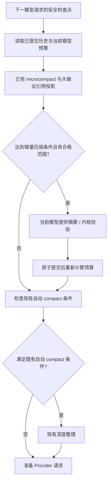
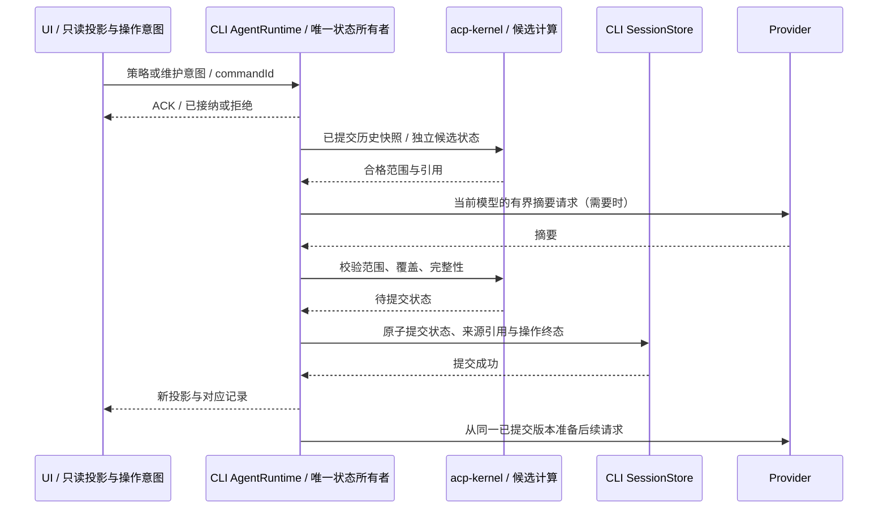
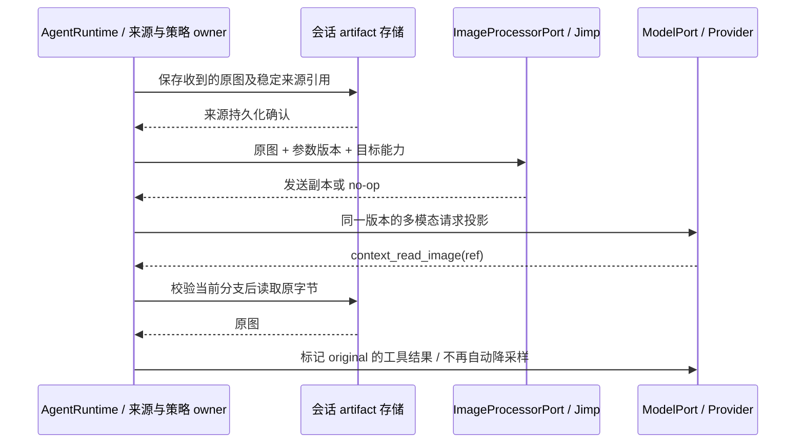
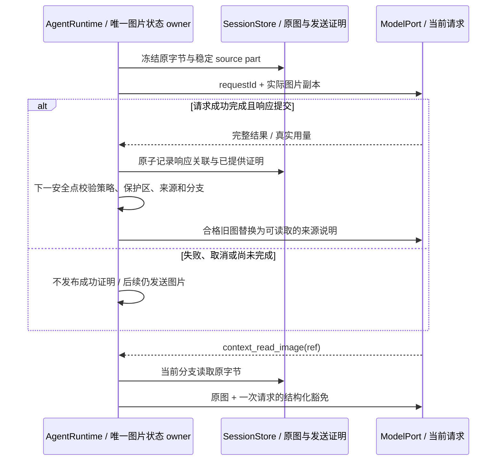

# 原生上下文压缩产品方案

状态：已授权实施，开发已落地，端到端缺陷修复与验收中。2026-11-12。

已确认的方向：在 ZCodium 的 AgentRuntime 内复用 acp-kernel；不增加独立代理进程或子任务；新任务默认自动压缩；适用的压缩参数必须可调整。用户已授权按本方案开发，并要求完成后全面端到端测试、共用测试进程、集中修复问题。页面布局、初值和图片规则按本稿实施；具体接口见 [实施契约](native-context-compression-implementation.md)。

相关材料：[参数目录与上游映射](native-context-compression-parameters.md)、[趋势与统计页面](native-context-compression-trends.md)、[影响范围与验收规划](../testing/native-context-compression-plan.md)、[现有上下文窗口状态](../context-window-usage-state.md)、[现有 compact 产品规则](../conversation-product-state-space.md)。

压缩详情和新任务默认参数弹窗的帮助位置显示简洁的中英署名，三个入口均指向 [本仓产品文档](https://github.com/No-ni/ZCodium/blob/main/docs/specs/native-context-compression.md)：功能说明打开本文，两个署名链接分别定位下方 `acp-kernel`、`billion-context` 章节。产品文档显著保留作者与上游出处链接，满足内核的产品文档署名约定；产品内新增外链遵守本仓入口规则。原文材料和实际归档哈希登记在第三方清单中。

### acp-kernel

ZCodium 的原生上下文压缩使用 ranxianglei 的 [acp-kernel](https://github.com/ranxianglei/acp-kernel)，固定版本 `0.0.195`。完整 LICENSE 为 MIT 正文加「产品出处标注」附加条款，随包保留，不能只用 npm 的 MIT 标识替代。完整原文见 [第三方声明](../../THIRD-PARTY-NOTICES.md)。

### billion-context

ZCodium 使用 ranxianglei 的 [billion-context](https://github.com/ranxianglei/billion-context) 中的内核和压缩设计，内核源码固定在 `dc041dd1ab1a014efa352ba47a6f31fc47f55284` 提交；本仓另吸收 [用户补丁仓库](https://github.com/No-ni/billion-context-patched) 中适用的修复与图片策略。原生适配与统计口径以本文和本仓实施契约为准。

## 1. 用户得到什么

长任务继续进行时，较早的已完成内容自动变成摘要，大段工具输出改为按需读取；图片可以发送较小副本，较早图片随合格历史折叠。用户仍然能在对话和记录中查看已保留的原文、原图；模型需要细节时，从当前会话按引用读取。

产品名称用「上下文压缩」，任务级开关用「自动压缩」。不以「十亿上下文」作为容量承诺。模型的真实窗口上限继续按当前模型显示。

常用入口显示当前窗口占用、自动状态和原文去向。详情增加请求输入、压缩事件、缓存命中与图片字节的趋势图，可以从事件追查记录。参数页提供触发、保护范围、分层摘要、工具输出、图片与高级配置；稳定引用编号、内部事务和缓存路由仍由 Runtime 管理。

## 2. 首版融合方式

| 现有能力                 | 融合后的职责                                                           |
| ------------------------ | ---------------------------------------------------------------------- |
| 输入框上下文用量入口     | 保留容量显示，加入自动压缩状态、任务开关和详情入口                     |
| 大输出与工具结果历史     | 已完成且完整持久化的大文本输出可改为引用；对话展示仍使用原文           |
| 新增原生增量压缩         | 只整理较早、已完成且可覆盖的历史段；保留最近交互与正在执行的工作       |
| 现有图片处理器与附件来源 | 复用 ImageProcessorPort/Jimp；补齐收到的原字节保存、策略参数和原图回取 |
| 现有 microcompact        | 保留已有确定性整理；同一内容只能由一套明确的投影规则处理，禁止重复折叠 |
| 现有自动 compact         | 继续承担接近容量上限时的后备整理；与增量压缩由同一 Runtime 调度        |
| 输入框 /compact          | 保留原有命令和提交模型规则，执行现有深度整理；不静默改成增量压缩       |
| 长期记忆                 | 继续管理跨会话记忆；本功能只管理当前会话的请求视图与可回查历史         |
| Provider 的 gzip/Brotli  | 继续减少网络传输字节；设置与上下文压缩独立                             |

首版采用三种互补动作：

1. **大输出按需读取**：对已完成的长文本工具输出保存引用，向模型发送类型、结果状态、有限预览和读取入口。此动作不需要模型生成摘要。
2. **旧历史摘要压缩**：Runtime 选出完整的历史范围，请当前模型生成摘要，由内核校验并提交。模型需要原始细节时，使用会话内检索与读取工具。
3. **图片请求副本**：保留收到的原图，在模型请求投影中按参数降采样；合格的旧图片随历史折叠，并留下原图读取引用。另提供「已提供图片减少重复携带」，让有成功发送证明的旧图不必等到文本摘要才可换成说明。降采样、历史折叠与重复携带策略分别可调。

这些动作只改变模型请求投影，不删除对话原文或改变页面消息位置。「原文/原图保留」仅指实际收到并完整持久化的内容；上游工具已裁剪的输出、历史中只有处理后副本的图片不伪称可恢复。

## 3. 页面在哪里呈现

### 3.1 输入框：复用上下文入口

位置沿用输入框底部工具栏的上下文用量按钮，不新增常驻侧栏或独立顶级页面。

| 状态               | 紧凑入口                         | 点击后的反馈                                         |
| ------------------ | -------------------------------- | ---------------------------------------------------- |
| 新任务，还没有用量 | 上下文图标；用量显示「尚未计算」 | 可以查看默认策略；没有可压缩范围时按钮禁用并说明原因 |
| 自动开启、正常运行 | 保留现有百分比                   | 面板显示「自动压缩 · 已开启」                        |
| 压缩正在进行       | 百分比旁短暂显示进度图标         | 显示「正在压缩上下文」及当前操作，防止重复提交       |
| 已产生压缩         | 百分比维持容量语义               | 面板显示有效压缩段数量、约减少的输入量和记录入口     |
| 自动关闭           | 仍显示真实百分比                 | 面板显示「手动模式」；已提交的压缩段继续有效         |
| 不可用或连接离线   | 保留已有可读用量                 | 显示具体原因；修改动作禁用，历史仍可查看             |

现有 Context 使用悬停信息面板。由于新增可操作开关，建议把完整面板改为点击打开的 Popover；悬停只保留简短用量提示，避免操作时面板消失。手机通过点击打开，操作不依赖 hover。

用量未知时不显示误导性的 0%。入口也不因没有用量而消失，否则用户无法在新任务首次发送前调整策略。

### 3.2 上下文 Popover：保持紧凑

内容按下面顺序呈现：

```text
上下文窗口                   3.2万 / 12.8万 · 25%
[当前请求占用进度条]
对话 / 系统上下文 / 工具定义等现有明细

自动压缩                                   [开启]
旧内容按需整理，原文保留在当前任务中

有效压缩 3 段              当前请求约少 5.8万 token

[最近请求的小趋势]                        查看趋势 →
[立即压缩]                           查看压缩记录 →
压缩参数 →                         新任务默认设置 →
```

数字是布局示例，不是性能承诺。缓存命中率继续遵循现有真实用量口径，不与压缩比例混为一个指标。

「立即压缩」执行同一增量策略，允许在未达到自动阈值时整理已有合格范围。没有合格范围、模型选择未就绪、已有压缩操作、连接离线或恢复未完成时禁用并给出原因。此入口不复用当前已失去实际接线的旧压缩按钮参数来冒充新能力。

「查看趋势」「查看压缩记录」与「压缩参数」先关闭 Popover，再打开详情弹窗的对应页签。「新任务默认设置」跳转常规设置；所有入口复用同一参数表单，跳转前关闭浮层。

### 3.3 上下文详情：对话内弹窗

桌面使用相同最大宽度的 Dialog，建议 max-w-3xl 附近，以容纳趋势图；切页不改变宽度，正文复用已有滚动区域。手机使用同一内容的自适应全宽 Dialog，图表次图改为单列。首版不新增 Side Pane tab 类型，减少路由、面板恢复与窄屏布局成本。

弹窗包含「概览」「趋势」「压缩记录」「参数」四个页签：

| 页面     | 内容与动作                                                                                             |
| -------- | ------------------------------------------------------------------------------------------------------ |
| 概览     | 当前策略、模型窗口、当前请求占用、有效压缩段和按需读取输出数量；最近请求小趋势与完整趋势入口           |
| 趋势     | 同请求前后估算与实际输入主图、独立缓存命中率/图片字节图、维护实际用量、分段/范围与事件记录联动         |
| 压缩记录 | 按操作列出范围、主题、时间、压缩前后估算和状态；展开记录查看摘要及原文入口                             |
| 记录原文 | 点击后按页加载对应原文，明确原消息位置；可选择文本并「引用片段」到当前输入草稿                         |
| 参数     | 编辑当前任务的完整策略；分组表单、单位与校验、推荐值恢复、完整高级编辑；保存后从下一安全请求检查点使用 |

图片记录明确区分「发送副本降采样」「已提供后省略」「历史折叠」「工具结果摘要」。显示原图与发送副本的尺寸、字节、可恢复状态及省略依据；点击「查看原图」只读当前任务持有的来源。界面预览的缩略图大小不作为模型发送尺寸。

查看原文是只读操作，不把原文重新放回模型上下文、不生成模型请求、不自动开启压缩。引用片段只修改未提交草稿，由用户下一次发送时明确带入。

记录状态至少区分「生效中」「已被后续摘要合并」「已越过深度整理边界」「原文暂不可用」。历史操作与当前有效段分开计算，不能把多级摘要累计当成多个独立省量。

趋势与概览的短尾来自同一 Runtime 数字观察，UI 只保存范围与选中请求。模型、历史、策略与计数方法按实际样本冻结；未知用量保留缺口，缓存命中不作为压缩节省，图片字节不换算为 vision token。点击事件先查看操作，再定位压缩记录；返回保留范围。布局、指标公式、分页与两类恢复规则见 [趋势页面方案](native-context-compression-trends.md)。

首版不提供「一键恢复全部原文到模型上下文」。模型按需读取和用户引用片段已覆盖取回细节的主要场景。长期固定原文、整块解压与重新压缩可在后续版本设计，它们会新增预算、保护区和 fork 继承规则。

### 3.4 对话流：沿用维护事件行

自动压缩时在当前工作段显示一条紧凑维护事件：「正在压缩上下文…」→「上下文已压缩 · 约减少 1.8万 token」。点击终态事件打开对应记录。

不生成新的用户消息气泡或子任务卡。自动操作属于当前执行中的维护步骤；手动空闲操作使用独立维护阶段，但不冒充真实用户 query。压缩终态不得错误结束仍在运行的主任务或 Goal。

重复的细粒度更新只更新同一事件；正常完成不另外弹成功 Toast。需要用户处理的失败在现有错误区域呈现，记录提供简短失败原因与可用动作。

### 3.5 设置：常规 → 上下文

在常规设置中新增「上下文」小节，与现有工具搜索等智能功能处于同一级，不放在插件商店、模型 Provider 编码选项或长期记忆页面。

提供「新任务默认自动压缩」开关，默认开启；其下显示当前默认摘要，如「70% 触发 · 50% 目标 · 保留 4 轮 · 图片最长边 1600 px」，并提供「调整默认参数」。辅助文字：「只影响之后创建的任务；已有任务可在输入框的上下文面板单独调整。」

全局设置保存完整、带 schema 版本的参数快照，不批量修改现有任务，也不立即启动模型请求。任务创建时捕获默认快照和模型选择引用，在目标环境固化；运行期间只读自身持久策略，不持续追随全局变化。

旧任务没有原生策略字段时进入手动模式；继续保留已有自动 compact 行为，用户可以主动开启新能力。这样打开旧历史不会直接触发新摘要费用。fork 继承父任务在分叉边界的策略，不重新套用最新全局默认。

### 3.6 参数编辑与生效规则

参数表单顶部固定显示作用范围：「当前任务」或「新任务默认」。首选「推荐参数」，任何修改进入「自定义」。普通字段直接编辑；低频字段放在所属组的高级展开区；「完整配置」使用同一 schema 的 JSON 编辑、校验与导入/导出文本，不通过环境变量制造第二套覆盖。

| 参数组       | 页面内容                                                                                              |
| ------------ | ----------------------------------------------------------------------------------------------------- |
| 触发与节奏   | 触发/目标比例、增长门槛、最低收益、检查间隔、估算读数等待、模型自决及其输出预算                       |
| 历史与摘要   | 最近轮/消息/token、工具保护、摘要范围和字符上下限、多层触发、推理块保留规则                           |
| 工具输出     | 原文引用门槛、预览和读取上限、排除工具、可选即时摘要与确定性简化策略                                  |
| 图片         | 发送降采样、历史折叠、已提供图片省略、保留最近用户图片、最长边、质量/收益、PNG/透明度、图像指导与来源 |
| 模型与提示词 | 跟随当前或指定已有模型、流式选择、摘要输出预算、提示词包及四类自定义摘要提示、检索重排                |
| 完整配置     | 上述字段的同源编辑、导入预检、文本导出、未知/移除/不支持字段报告；不提供任意内部对象透传              |

完整字段、初值、范围、依赖、上游 75 个配置条目的分类及补丁 0.6.4 的独立图片参数映射见 [参数目录](native-context-compression-parameters.md)。不把已撤销参数显示成可保存开关；参数表单与高级编辑必须来自同一字段定义，新增可用字段必须同步出现在两者与验收清单。

编辑只改变表单草稿。切换参数组、趋势或记录保留草稿，完整配置中尚未校验的 JSON 文本也按作用域单独保留；取消恢复上次已保存值；关闭或 Escape 保留本次未保存草稿供再次打开，在销毁页面后可丢弃，不能暗中提交。每字段可恢复推荐值，整组/全部恢复也只修改草稿。「采用当前全局默认」先把完整默认快照加载到当前任务草稿，由用户点保存才提交。

保存发送完整候选策略及 expectedPolicyVersion，经唯一 CLI admission 校验并原子提交。版本冲突显示已变化并提供重新加载，不静默覆盖另一窗口/手机的修改。ACK 仅表示接纳；保存中、已生效和失败以权威回执区分。作用于目标模型或图片格式的能力限制同时由 Runtime 校验，UI 禁用字段必须说明原因。

正在生成摘要时，参数更新在维护提交前的控制检查点按命令顺序接纳。任何参数版本变化使未提交的旧候选失效；已经发生的用量照实归属原 execution。不得把新参数套到旧摘要后继续提交，也不得依赖超时解决命令时序。下一模型请求读取新版本；已提交摘要保留原策略版本，不自动重新摘要或展开原文。

缩放参数修改使相应发送副本缓存失效。下一请求从保留的原图生成新副本；引用与原图不变。前缀字节可能变化，界面说明「修改图片或提示词参数可能影响后续缓存复用」，不承诺继续命中。

## 4. 自动压缩何时发生

以下为可编辑的首版建议初值，不是当前已有行为；对应字段及校验以参数目录为准：

| 项目           | 建议规则                                                                                    |
| -------------- | ------------------------------------------------------------------------------------------- |
| 输入预算       | 复用当前 Model 实例的输入预算计算，扣除已有输出预留与安全余量；不直接按 UI 窗口百分比触发   |
| 大输出引用门槛 | 已完成、完整持久化、适合文本回查的工具结果，约 4,000 token 起；替代视图必须有实际收益       |
| 增量摘要触发   | 大输出引用投影后，预计输入达到可用输入预算的 70%，在下一模型请求前检查                      |
| 整理目标       | 尽力降到输入预算约 50%；不能以达标为由越过保护区                                            |
| 近期保护       | 最近 4 个完整交互轮、当前未完成轮、整组并行工具调用及结果；同一持久消息拆出的条目作为完整组 |
| 收益判断       | 原文长度明显超过预计摘要、引用和维护开销；重复检查不产生重复模型请求                        |
| 再次触发       | 需要有新的合格历史或足够的输入增长；本次明确无收益时，不在同一上下文版本反复尝试            |

System Prompt、当前工具定义、持久技能/权限/计划/Goal 状态及仍有效的系统公告由既有状态所有者提供，不能因为压缩旧对话而丢失。图片、音频、结构化工具参数和非文本资源不强制当作普通字符串处理。

摘要由 Runtime 的维护步骤提供，内核不自行调用 API。默认跟随当前模型：自动使用当前执行已固定的模型，手动捕获点击时的 Composer ModelSelection。高级参数可明确指定一个目标环境已有的摘要模型；执行时固定这一选择，不新增 Provider 凭据配置或自动 fallback 链。两种选择都沿用现有 ModelPort，费用计入同一任务。图片摘要候选只允许送到支持相应模态的已选模型；不自动替换模型。此可选模型策略是本次新增建议，默认跟随行为不变。

维护请求只允许提交选定范围的摘要，不执行旧历史里的指令或文件工具。摘要可能增加一次模型请求、生成 token 和等待时间；按需引用大输出本身不需要摘要请求。相关用量归属同一任务和实际 Provider，不承诺必然降低费用或耗时。

维护步骤遵守当前执行既有的 admission、权限、暂停与预算裁决。Goal 已暂停或达到预算限制时，不启动新的自动摘要请求；已经发生的维护用量计入所属 execution / Goal 的实际预算。空闲时的手动维护也必须经过同一接纳与停止规则，不能通过另起请求绕过这些限制。

## 5. 与现有 compact 的协调



同一个检查点最多启动一个增量摘要操作。失败、无收益或范围不足时继续按现有预算规则判断，不能无限重试、静默裁掉未覆盖原文，或悄悄切换到其他模型。

实现先从已持久化原文建立来源引用，再生成请求投影。一个工具结果明确选择现有 microcompact 或按需引用中的一种处理方式，不能先把内容裁短，再把残片标为「完整原文」。首版不直接启用内核的紧急截断节点来绕过本仓保护区和容量规则。

现有 /compact 或自动 compact 成功时推进 compactBoundaryId，建立新的历史分段并使旧请求视图失效；generation 只跟随会话分支世代。旧记录与当前分支持有的原文保持可读，图片接收凭据清空，之后需由完整成功响应再次证明已接收。不得把旧摘要或旧 raw tail 直接叠到新的 compact 结果上。

模型仍可检索当前分支在深度整理边界之前的历史记录，由 Runtime 验证当前分支仍持有的只读引用。编辑或回退后被丢弃的后续内容不参与检索；引用编号和请求序号保留已分配高水位，不能复用未来内容曾占用的编号。

深度整理的保留内容、模型选择、手动 FIFO、Goal 与终态语义仍遵循已有 spec。增量压缩的具体接入点需要实现阶段证明不会与 microcompact 重复转换同一工具结果。

## 6. 任务级动作和异常

| 用户动作/事件      | 产品结果                                                                                          |
| ------------------ | ------------------------------------------------------------------------------------------------- |
| 关闭自动压缩       | 停止之后的自动增量摘要、新增大输出引用、图片省略和性能降采样；已提交视图有效，仍可回查原文原图    |
| 摘要生成期间关闭   | 意图经 CLI 串行接纳；在提交前的安全检查点重新核验策略，未提交的自动候选取消，费用如已发生如实记账 |
| 运行中点立即压缩   | 按现有维护意图入 CLI FIFO，不打断工具调用；实际执行时重新校验合格范围与模型预算                   |
| 重复点击/ACK 丢失  | 按 commandId 幂等查询已有结果，不产生第二次摘要或状态提交                                         |
| 点停止             | 停止所属前台执行及未提交维护候选；已经提交的原文和压缩状态保持完整                                |
| 模型返回不可用摘要 | 整次候选不生效；记录失败，不删除原文、不发布成功用量                                              |
| 存储提交失败       | 不切换 active 请求视图，展示失败；不得假装已压缩后继续发送不完整请求                              |
| 切换到更小窗口模型 | 在下一请求前按新的 Model 预算校验；保护区不足以适配时走既有深度整理/明确容量错误                  |
| 模型或环境暂不支持 | 显示原因；不自动转用其他 Provider；已有历史及记录仍可读                                           |
| Goal 暂停/预算受限 | 保留已提交状态；新的自动摘要等待既有恢复或预算裁决，维护用量计入所属执行                          |
| 手机离线/重连      | 离线只读缓存状态；重连通过既有 snapshot/command query 恢复真实策略与操作结果                      |

开关回执到达前显示待保存状态。用户可以继续操作，但最新意图由同一命令串行接纳；UI 不先制造权威已开启/已关闭事实。

## 7. 数字口径

| 展示项           | 唯一口径                                                                                                                      |
| ---------------- | ----------------------------------------------------------------------------------------------------------------------------- |
| 当前窗口占用     | 继续消费 Runtime 发布的 contextWindow；使用实际返回用量或现有估算来源，标清未计算/估算                                        |
| 当前请求输入变化 | 同一模型、同一历史边界和同一估算方法下，未应用本功能减去应用后的估算，包含引用/提示开销；负值明确显示增加，缺可比证明显示未知 |
| 有效压缩段       | 当前世代中未被后续摘要替代的生效段；历史维护次数单独统计                                                                      |
| 原文保留         | 存储确认完整来源可读后才显示；记录失效不等于原文被删除                                                                        |
| 最近维护用量     | 实际维护请求的 token 返回；缺席时显示不可用，不推算钱数                                                                       |
| 缓存命中         | 继续按现有 Provider 实际统计，不由继承 cache key 推导                                                                         |
| 趋势真实输入     | 同一主请求归一化的 Provider total input，含缓存输入；不使用包含 output 的窗口水位或维护请求 total                             |
| 图片字节趋势     | 同请求稳定图片集合的处理前/实际发送 payload 字节；来源覆盖与 known/unknown 单独保留，不换算 token                             |

不把压缩前后的不同模型估算比较，不把所有历史请求中重复省下的 token 累加成「本轮节省」，不把 gzip 压缩率展示为上下文压缩收益。

## 8. 状态、持久化与分叉

AgentRuntime 是唯一运行态所有者，CLI SessionStore 是权威持久化落点。Host 负责路由和 attachment，Main 负责进程及消息转发，UI 只持有草稿、待提交 overlay 和权威投影。



新增状态包括任务策略、压缩世代、稳定消息/part/条目引用、有效块及覆盖关系、首见时间与 token 快照、按需读取来源、维护操作及数字口径。请求级数字观察复用现有 ModelUsageRecord 的身份与测量出口，保留完整输入估算/实际输入/维护/图片的不同来源，经有界只读 query 提供趋势；字段/表名在实现 spec 中收口，不能先在 Renderer localStorage 再存一份业务状态。

原文尽量引用已有 canonical message/part，不另建代理数据库复制整个 transcript。若某类大输出无法通过已有存储完整读取，必须把原文存入同一 SessionStore 管理的范围后才允许替换投影。数据根保持 .zcodium。

新增压缩提交要求 SessionStore 提供原子入口。缺少该能力时不使用逐条写入再尽力回滚的方式启用新压缩；明确报告不可用，保留该环境原有 compact 行为。

fork 在用户选定的稳定边界复制策略和压缩状态，并建立子会话自己的来源、覆盖和工具 ID 映射。仅完整落在该边界内的块可以直接继承；跨界块需要按边界重新投影或让所需原文重新可见，不能引用边界之后的父内容。子会话不读取父会话后续变化，不复制在途维护和排队意图。

模型可见的 ACP 引用、首见时间和 token 快照应稳定。数据库 ID 的子会话隔离继续保留，不能为争取缓存命中而取消现有工具调用 ID 隔离。缓存 key 仅在 Provider 明确支持且前缀兼容时适配，继承 key 不保证命中。

任务策略采用一个带版本的完整快照；运行态、持久态和 UI 展示不得各自重新合并全局默认。fork 复制边界时的参数版本和原图来源，并为子会话建立自己的引用/来源所有权；共享内容 blob 可以按现有 artifact 存储契约去重，父任务删除或回退不得导致子任务原图悬空。未提交表单、候选、编码 promise 不参与继承。

图片成功发送证明只随准确分叉边界内的已提交响应迁移，校验对应稳定 source part 与实际副本；不复制在途的「即将发送」标记。模型或编码策略不同的证明不授权省略新表示。回退移除未来响应及其证明，其他分支不受影响。

编辑、回退或深度整理改变历史分支时，必须更新世代/历史版本并校验每个块的实际覆盖；旧摘要失效后原文仍按当前有效分支规则回查，不能泄露被回退掉的后续消息。重启后从持久状态恢复，不依赖进程内 pin 表。

## 9. 从补丁吸收哪些保障

| 来源                 | 原生实现要求                                                                  |
| -------------------- | ----------------------------------------------------------------------------- |
| B10 完整前缀         | 若复用请求视图，校验完整内容或等价历史版本；不能只比较消息数量或前 200 字符   |
| B10 摘要有效性       | 请求中的每个摘要必须仍属于当前有效世代和生效块                                |
| B10 缺块覆盖         | 不允许未被有效摘要覆盖、也未出现在实际 raw tail 中的消息静默消失              |
| B4/B6/B7 fork 稳定性 | 复制准确边界，重映射引用，保留首见时间和前缀快照；按 Provider 能力处理 key    |
| B8/B9 存储竞态       | 用候选计算、原子提交、发布顺序避免双状态；缺来源时不批准折叠                  |
| B1 编码              | 复用现有 Provider request-compression；不引入第二次 HTTP 编码                 |
| 上游图片原图回取     | 先保存实际来源、再生成发送副本；原图回取走结构化原生标识，免于再次降采样      |
| 上游图片/占位锚点    | 媒体占位仍属于原消息/part；不重铸为尾部 user 消息，不抢占真实最新用户请求     |
| 最新摘要与时间修复   | 保留非空与完整覆盖；按最终 batch 规则校验最小长度；resume/fork 不重打首见时间 |

最新上游已移除实验性 compressAtFoldPoint 与 ClearThinking 变体（#6132），原因涉及重复压缩循环及作者误判。用户补丁基线仍包含旧实验逻辑，原生方案不移植摘要载体挪位，也不提供对应设置。压缩记录及提示保留真实角色与顺序。

新增会话工具建议为 context_compress（维护摘要提交）、context_search（当前任务内检索）、context_read（有界原文读取）、context_read_image（按图片引用读取原图）。名称在协议实现前检查冲突。模型参数不允许指定任意 sessionId、文件路径或其他 workspace；目标会话由执行上下文固定。读取结果保持原来的低信任内容层级，不把历史工具输出提升为 System Prompt。工具名、引用规则、完整覆盖和原子提交属于固定接口，不是用户可关闭的压缩参数。

### 9.1 图片如何吸收，代价在哪里

2026-11-11 调查确认，上游 src/image-rescale.ts 实现发送副本降采样，src/image-restore.ts 实现折叠图片回取。降采样在宿主层，文件明确不改 kernel；只引入 acp-kernel 不会自动得到这项能力。补丁锁定的 406193b 与本轮初查 e3220ad 的 image-rescale 文件 Git blob 均为 8fedd121a54614f92c5d09bc9ebb3c242908c53e；刷新至 dc041dd 的差异也未修改该文件。这部分早已在用户补丁的 vendor 基线中，但不代表其 DSH 上游 Jimp 链实际启用。

刷新用户补丁 main 至 6dbd99d / 0.6.4 后，确认今天发布了另一层图片能力：B12/B15 首次成功转发后减少重复图片携带，B13 使用宿主编码器按 1200 px 或 100 KiB 门槛尝试发送副本，B14 追加图像使用指导，B16/B17 提供配置键及 bili Web UI 图片设置卡片，B18 把缺省增长门槛改成 80000。vendor 源码基线仍为 406193b；这些是补丁自己的新增能力。维护文档说明其可选 Jimp 没有安装，故新增宿主编码链承担实际缩放；本轮未现场验证用户 DSH 安装。

上游普通发送路径默认开启、最长边 1600 px；支持 PNG/JPEG/BMP，使用可选 Jimp 1.6.1，GIF/WebP/未知格式透传。100 KiB 字节 gate、20% 最低节省与 JPEG 质量 80 是源码常量，最长边主要由环境变量调节。普通 doRescale 对无需缩尺寸的图片返回 no-op，不能把 >100 KiB 描述成必然同尺寸重编码。旧 compress.imageCompression 与 stripImages 系列已撤销；它们不代表当前缩放能力。

ZCodium 的 ImageProcessorPort 与 Jimp 依赖已经存在；附件、Read/Bash 图片、MCP/Node REPL 图片都使用现有处理器。代价较小的适配是扩展这一个 port 的策略参数，复用现有 artifact 存储和标准多模态请求投影，并补齐原图来源。无需引入第二套图片库、代理数据库或 native 图片依赖。

当前附件 resolver 的部分路径先 prepareImageDataUrl，再保存 prepared.dataUrl；已有 artifact URI 的路径可能保留原始 artifact。Read/Bash 通常返回处理后的字节，MCP 部分分支已保存原字节。不能把所有现有图片都标为「原图完整保留」。原生设计必须在处理前保存实际收到的字节并绑定稳定 part；只指向可变本地路径也不算冻结的原图来源。旧历史没有原字节时显示「仅有历史副本」，不补造原图。



首版图片规则：

- 只处理模型会实际收到的图片，包括附件与工具结果中的多图；浏览器轮末仅用于 UI 展示的截图保持自身显示预算，不因本设置回灌模型。
- 原图与副本分开计数并绑定稳定 message/part/imageIndex。不能只按图片内容 hash 在多个消息间猜引用，也不创建新的 user 消息承载尺寸说明。
- 图片降采样、旧图随摘要折叠、已提供后的重复携带省略分别可开关。历史折叠仍须完整范围；独立图片省略必须有成功发送证明与原图引用，仍保护最新真实用户上传、未完成轮和配对组，不使用仅按条数剥图的滑动窗口。
- 副本不放大图片，不从旧副本继续转码。透明 PNG 默认保留透明度；动画 GIF/WebP 及不能可靠处理的格式维持现有兼容路径。目标 API 不支持时报告能力原因，不静默转成文字或漏掉图片。
- 参数包含最长边、目标/最低质量、最小长边、尺寸/字节 gate、PNG 处理、最低字节收益、来源范围和发送目标字节；Provider/协议硬限制仍由原 owner 裁决。现有 Jimp 的质量/尺寸尝试必须接收这些参数，到达下限仍超预算时明确反馈，不能静默继续降质。关闭性能降采样不等于关闭既有容量校验。
- 缓存 key 至少覆盖原字节 hash、完整图片策略 hash、处理器版本与相关目标能力。上游普通缓存只按原内容 hash 取 key；原生支持即时参数修改时必须补齐策略维度。取消不能让拒绝 promise 长驻缓存。
- 原图读取用 Runtime 结构化来源标记绕过降采样，不能只依赖工具文本中的 receipt。原图超过当前 API 硬限制时，工具明确报告不可内联并提供当前任务内的只读原图入口；不把再次降质的结果称作原图。
- 原图持久化失败遵守既有 attachment-artifacts 的失败边界，不以吞错透传制造无法冷恢复的成功历史。缺来源的旧图片不可批准为可恢复折叠。

降采样通常减少传输字节；是否减少 vision token 取决于尺寸与模型协议。字节、像素尺寸、本地估算和实际 Provider 用量分别展示，不按 base64 长度/4 推算图片计费，也不宣称 20% 字节减少就是 20% token 减少。

### 9.1 吸收补丁的图片重复携带策略

提供可调的 images.omitSeen、images.keepRecentUserTurns 和 images.convention.enabled/text。建议首版 omitSeen 默认关闭、历史折叠默认开启，用户可选更积极的重复携带省略；这一初值未整体接受。图像指导强调必要时看图并记录结论，不允许借节省成本跳过用户要求的视觉验收。首次仍发送合格副本，后续只有离开保护区且原图可回取的图片才可使用稳定来源说明。



并入时必须补齐的适配边界：

- 补丁的已提供状态和缩图缓存主要按内容 hash（缓存另含 MIME），缓存 key 不含修改后的 maxDim；原生使用请求/来源证明及完整编码策略，防止参数变更仍返回旧尺寸。
- 补丁按最后一个 wire 条目判断最新上传；工具消息追加后不能据此保护真实最新用户图。原生使用 canonical user 身份与稳定 message/part。
- 补丁的新 pass 包含原图读取结果，并可能命中已有 hash 后立即再次折叠，或再次缩小；原生对读取结果提供结构化的一次请求豁免，先确保模型真的收到所取原图。
- 找不到可恢复来源时不能省略；发送证明绑定 request/execution 与已提交响应，不复制 session 级 pending map 或把 HTTP 转发成功等同于完成模型请求。
- 原生不复制 sips/PowerShell/ImageMagick 的平台编码链，继续扩展唯一 ImageProcessorPort/Jimp；透明度、动画、最低质量与预算由同一策略控制。

关闭 omitSeen 可以让尚未被文本摘要覆盖且可用的图片在下一安全点重新参与请求；先重算输入预算，不展开文本摘要。保护区可能延后省略，因此页面不承诺「每张图片永远只上传一次」。

### 9.2 最新内核的其他变化

dc041dd / kernel 0.0.195 新增 compress.blockOps，提供摘要块停用、恢复和外部改写，默认关闭，关闭时不注入额外工具。其内容管理与预算/回退语义超出本轮图片与参数补齐，列为后续待审阅产品候选；首版不提供无效开关，不自动注入新工具。参数目录明确列出这两个新增参考条目与导入处置。

## 10. 桌面、Web 与手机

共享 UI、同一套动作和状态文字。桌面采用现有 desktop-continuous，手机/远控采用 web-remote-replayable；缺口通过各自现有恢复机制处理。

本地或远程任务都由所在环境的 CLI 持有压缩状态。设置中的新任务默认由创建意图传到目标环境，不把本机 General 设置直接写入远端配置；手机操作复用桌面已有 Host attachment，不另启 Agent。

隔离 key 使用 workspaceIdentity?.trim() || workspacePath，并贯穿 sessionId、remoteSessionId 和 owner/lease 关联。原文详情按页查询，不把整份原文、内核映射或记录正文塞入每个实时 snapshot。

沿用 DESIGN.md 的文字角色、semantic colors、按钮和 Dialog/Popover 密度；覆盖 Windows/macOS、窄屏 Web、浅/深主题、中英文、键盘及触摸操作。当前 fork 不引入 Linux 桌面资源。

## 11. 首版实施顺序与审阅点

| 阶段           | 交付                                                              | 准入条件                                                |
| -------------- | ----------------------------------------------------------------- | ------------------------------------------------------- |
| 内核与状态适配 | 稳定引用、历史保护区、大输出读取、候选/提交、fork/回退/冷恢复     | 完整性、工具配对、事务故障与隔离证据成立                |
| Runtime 与协议 | 自动/手动维护、现有 compact 协调、真实用量、会话内搜索读取、投影  | 摘要与请求预算正确，命令幂等与两种实时语义可恢复        |
| 图片与完整参数 | 原字节来源、同一 port 的策略、原图回取、图片缓存、完整字段 schema | 原图可恢复、无二次降质、参数版本与能力校验成立          |
| 页面融合       | 上下文入口、概览/趋势/记录/参数、原文原图、全局默认与完整编辑     | 请求配对统计、事件联动、桌面/手机和未知用量通过候选验收 |
| 首版启用       | 新建任务默认自动；旧任务主动选择；保留既有 compact 后备           | 全链路用例通过，再开启正式默认；本轮不触发构建          |

设计审阅重点：四页签与图表排布、参数是否易找、完整编辑与分组是否够用、原图与发送副本是否容易区分、指定摘要模型是否需要首版提供，以及 70%/50%/最近 4 轮/1600 px 的初值。实现准入包含趋势统计、完整参数和图片来源规则，不能只实现开关后称首版完整。

## 12. 事实来源与验证边界

- 当前页面种子：[ChatContextUsage](../../packages/ui/src/chat-input-toolbar/contextUsage.tsx)、[V4ComposerToolbar](../../packages/ui/src/v4/composer/V4ComposerToolbar.tsx)、[ConversationRowView](../../packages/ui/src/v4/ConversationRowView.tsx)、[常规设置组件](../../packages/ui/src/settingsPageHelpers.tsx)。
- 状态种子：[compact 持久化](../../apps/zcode-cli/packages/core/src/runtime/methods/compact-persistence.ts)、[SQLite 事务入口](../../apps/zcode-cli/packages/adapters/src/storage/session-store/sqlite-session-store.ts)、[fork](../../apps/zcode-cli/packages/core/src/runtime/methods/session-fork.ts)、[fork 克隆](../../apps/zcode-cli/packages/core/src/runtime/helpers/steering.ts)。
- 上游基线：[billion-context 406193b 的 kernel README](https://github.com/ranxianglei/billion-context/blob/406193b202c13248241f25201e1c6bbda747c99b/kernel/README.md)、[kernel package.json](https://github.com/ranxianglei/billion-context/blob/406193b202c13248241f25201e1c6bbda747c99b/kernel/package.json)。模型提供摘要、宿主负责状态持久化是其明确接口。
- 最新候选基线：上游 [dc041dd / kernel 0.0.195](https://github.com/ranxianglei/billion-context/blob/dc041dd1ab1a014efa352ba47a6f31fc47f55284/kernel/package.json)、[参数参考](https://github.com/ranxianglei/billion-context/blob/dc041dd1ab1a014efa352ba47a6f31fc47f55284/website/config-reference/compress.yaml)、[发送降采样](https://github.com/ranxianglei/billion-context/blob/dc041dd1ab1a014efa352ba47a6f31fc47f55284/src/image-rescale.ts)、[原图回取](https://github.com/ranxianglei/billion-context/blob/dc041dd1ab1a014efa352ba47a6f31fc47f55284/src/image-restore.ts)、[#6021 锚点回归](https://github.com/ranxianglei/billion-context/blob/dc041dd1ab1a014efa352ba47a6f31fc47f55284/tests/issue6021-image-offload-anchor.test.ts)、[#6132 实验移除](https://github.com/ranxianglei/billion-context/pull/6150)、[新增摘要块操作](https://github.com/ranxianglei/billion-context/blob/dc041dd1ab1a014efa352ba47a6f31fc47f55284/kernel/src/block-ops.ts)。这是适配候选，不声明已升级依赖或整体 merge。
- 当前图片源码：[ImageProcessorPort](../../apps/zcode-cli/packages/contracts/src/interfaces/image-processor.port.ts)、[Jimp adapter](../../apps/zcode-cli/packages/adapters/src/image/index.ts)、[附件 resolver](../../apps/zcode-cli/packages/core/src/runtime/helpers/attachment-media-resolver.ts)、[artifact 边界](../../apps/zcode-cli/packages/core/src/runtime/helpers/attachment-artifacts.ts)、[Read 图片](../../apps/zcode-cli/packages/core/src/tool/handlers/read-image.ts)、[MCP 图片](../../apps/zcode-cli/packages/core/src/mcp/image-normalization.ts)。
- 补丁基线：[billion-context-patched 0.6.4 / 6dbd99d 清单](https://github.com/No-ni/billion-context-patched/blob/6dbd99dc0affe9b365191ee66d53965a9ef1891c/MAINTENANCE.md)、[view-safety](https://github.com/No-ni/billion-context-patched/blob/6dbd99dc0affe9b365191ee66d53965a9ef1891c/patches/view-safety.block.js)、[新增图片省略与编码](https://github.com/No-ni/billion-context-patched/blob/6dbd99dc0affe9b365191ee66d53965a9ef1891c/patches/image-retention.block.js)、[图像指导](https://github.com/No-ni/billion-context-patched/blob/6dbd99dc0affe9b365191ee66d53965a9ef1891c/patches/image-convention.block.js)、[图片参数卡片](https://github.com/No-ni/billion-context-patched/blob/6dbd99dc0affe9b365191ee66d53965a9ef1891c/patches/image-card.script.block.js)。

设计阶段历史证据：当时仅完成静态源码对照和合成原型检查。90 个参数字段与趋势联动的 8 组 DOM 检查通过，包含三图范围/选择、具体操作记录、未校验 JSON 保留、重复/失败维护、旧任务无主请求样本、模型/compact 分段和分叉成本。该阶段的 typecheck/lint 和设计文件检查只覆盖原型；模拟 320/390/736/1024px 容器宽度也只证明按宽度重绘。历史原型证据不算产品验收，详情见 [影响规划中的原型检查说明](../testing/native-context-compression-plan.md)。

当前实施状态：已接入固定的 `acp-kernel@0.0.195`、原生 Runtime 维护、协议与持久化迁移；完整参数、三图趋势、记录/原文、图片发送副本和原图回取已落到产品。真实主请求、自动安全点、图片 receipt、持久化失败与真实工具批次边界已有源码回归证据。桌面与手机共享环境的 32 个组合场景已完整执行第六轮，28 通过、4 失败、0 跳过；账本分页的查询版本修复及手机入口接线修复等待第七轮实际产品验收。逐场断言、历史失败、源码证据和手工待验项统一登记在 [验收覆盖](../testing/native-context-compression-e2e-coverage.md)。源码回归与固定 Provider 回放不证明真实模型摘要质量、压缩性能、macOS 真机或实体手机体验。
