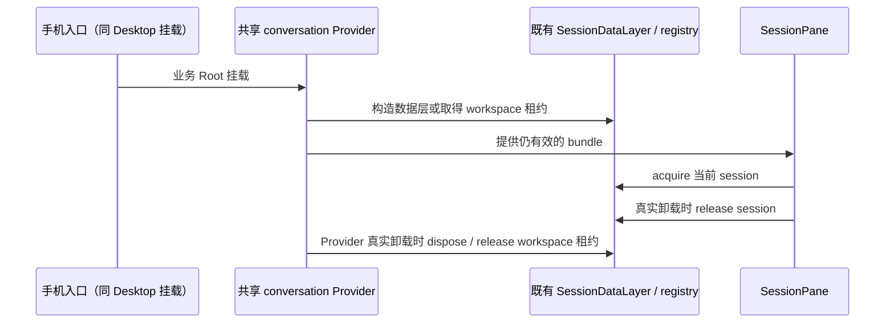
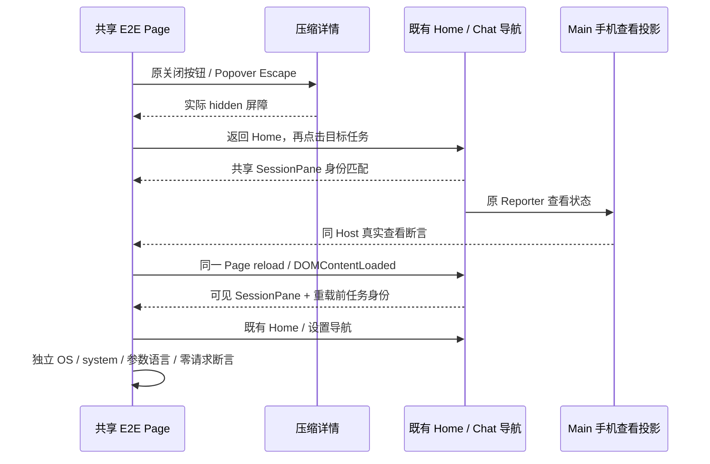
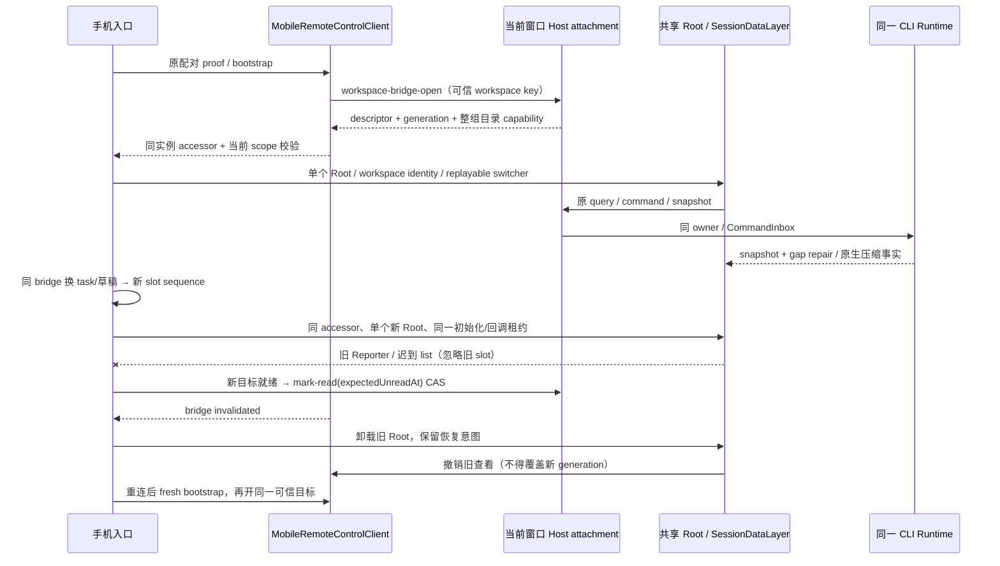
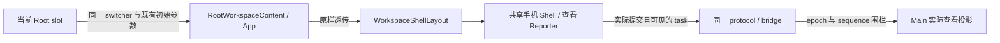
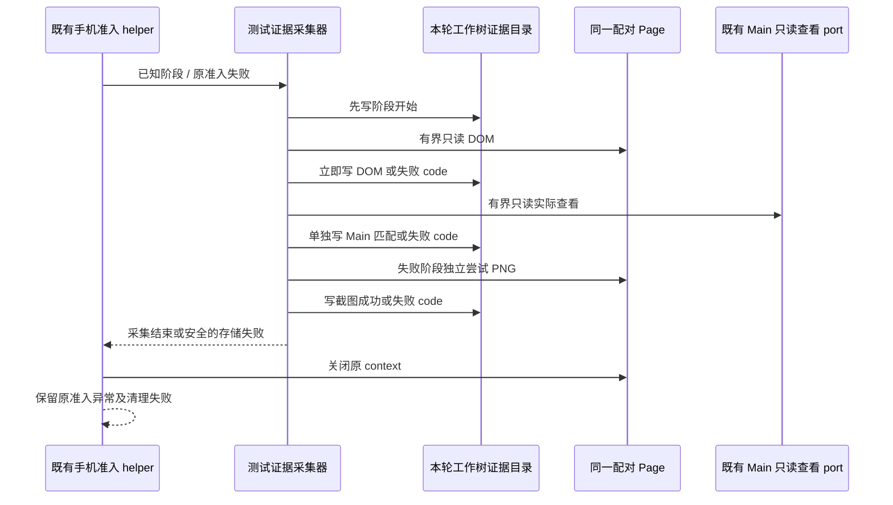
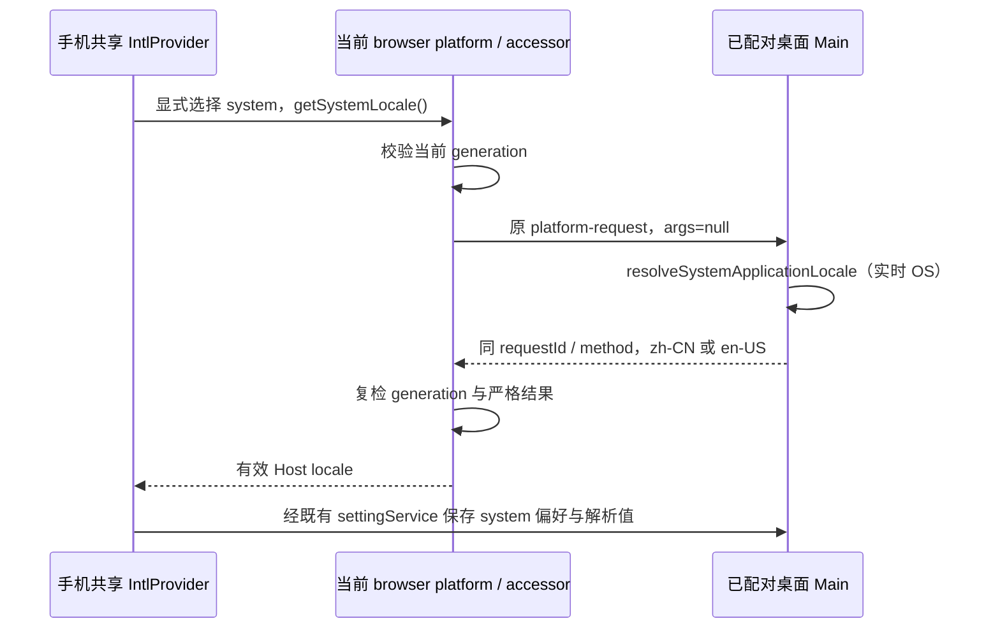

# 原生上下文压缩：手机共享入口接线修复

状态：已实现。2026-11-12 最新四场重点产品回放全部通过；此前六场的桌面/手机大账本通过记录独立保留。完整验收边界见 [验收覆盖](../testing/native-context-compression-e2e-coverage.md)。

2026-11-12 第八轮补充：手机已通过首页和首启屏障，点击任务进入聊天时，真实错误边界显示 `SessionDataLayer 已释放，不能再 acquire`。手机入口仍包裹 `StrictMode`，而共享 conversation Provider 按桌面入口的单次挂载契约在 render 中取得稳定 bundle，并在卸载 cleanup 释放。StrictMode 的开发期 effect 重放会在同一 memo bundle 仍被使用时释放其数据层，后续会话 acquire 被正确拒绝。

手机业务 Root 的挂载必须与现有 Desktop 相同，不在共享业务树外追加 StrictMode 的模拟卸载。数据层仍由原 Provider / workspace connection registry 持有，Home/chat 真正切换和断线恢复沿用既有租约、generation 与 keep-warm；不改变 Main、Host 或 CLI 的会话事实。先执行实际手机入口 render 表达式、实际 Provider 和 SessionDataLayer 的回归，证明旧入口重放导致失效与修复后真实卸载仍释放资源；随后只定向复测手机恢复、设置与账本。

依据：`native-context-compression.md` 的共享桌面/手机界面要求，以及
`native-context-compression-implementation.md` 的同 Host、replayable 交付边界。
2026-11-12 的隔离产品运行实际加载 `mobile.html → MobileApp`：配对和任务清单成功，
但独立聊天 Shell 没有共享 SessionPane、Composer、参数与图表。修改等待选择器不足以恢复功能。

## 所有者与唯一入口

### 手机 E2E 页面函数与关闭屏障（2026-11-12）

`24LYLb` 的手机已通过同 Host 准入和真实任务查看，图表读取却因 `readTrendGeometry` 的内部命名函数被测试转译器包装为模块级 `__name` 而失败。Playwright 序列化单个函数时不会携带模块 helper；这是测试执行缺陷，不能记作产品图表或手机 bootstrap 故障。页面函数必须只使用浏览器上下文和显式参数，内部几何计算使用匿名回调一次采集真实 DOM 数字，不向页面安装全局 `__name`。

同轮后两场在返回 Home 时等待 sidebar 超时。失败的布局测试未关闭压缩详情，背景导航被模态层移出可交互树。手机复用 Page 必须经原详情关闭按钮和真实隐藏屏障，再导航 Home；布局的失败清理也执行此路径，完成后才恢复原 viewport。只关闭本功能的详情/Popover，不刷新页面或新建浏览器来隐藏残留状态。既有 CLI、bridge、Reporter 和同 Host 查看强断言保持。

`9zSF2H` 已执行全部六个重点场景，手机账本整场通过。手机趋势的第一估算点与后绘制的发送估算点在同一请求的横坐标重叠，普通触摸被后者拦截。测试须在实际滚动位置枚举 SVG 圆点，用 `elementFromPoint` 确认圆点中心真实可命中，再选择一个不同于 End 的请求。请求 index 仍由实际横轴、圆点坐标和原始点数推导；触摸后详情及三图必须共同切换，并保留跨页签返回的选择。不使用强制点击、样式注入或下拉选择代替触摸；不存在可命中点时保存有界数字诊断并失败。

同轮手机设置已通过参数页、两宽度、浅深主题与中英文，随后首次 system 选择未通过 Host 解析值对账。失败前应独立保存当前阶段、测试读取的 Electron 系统语言枚举、Host 偏好/解析枚举、手机 UI 的偏好枚举与语言探针；重载前后分别采样。只保存固定枚举和 boolean，不导出完整设置、正文、路径或原始异常。失败证据必须在恢复原偏好前保存，不能用清理后的 `setting.json` 解释当时值；采样不写入状态或放宽 system 与同 Host 的强断言。

`l1tS3u` 的四场已完整结束（2 通过、2 失败）。新增枚举采样确认 system 测试的 Electron 期望为 `undefined`，Host 偏好与手机偏好均为 system，解析语言均为中文；本轮在选择前已失败，未执行 selected/reloaded。WDIO Electron service 会移除回调首参，只在 Main 暴露 `electron`；解构首参 `({ app })` 因此失去绑定。测试必须用 `(electron) => electron.app...` 从同一 Main 读取真实系统语言，继续校验固定枚举及 Host/UI 一致性，不用 Host 当前值替代 OS 期望。先显式选中与系统语言不同的固定语言，再改回 system，避免原偏好已经是 system 时只验证重复选择。

同轮趋势触摸已命中圆点，但详情和三图的选中值等待超时。当前 Recharts 的无移动 tap 不更新轴 hover，兼容 click 更新独立 click 状态；默认 hover Tooltip 提供的 `activeTooltipIndex` 不能直接当作点击/触摸目标。按既有趋势规则补充源码红绿证据：没有先前 hover、先前 hover 在另一请求、触摸后合成 click、采样及分段下都须选中本次动作对应的原始请求。选中仍只交给原 `onSelect` 与 UI 趋势草稿，四处投影保持一致；hover Tooltip 和键盘语义保持。

`0t3rov` 使用最终图表源码重新编译一次，六个重点场景完整结束（5 通过、1 失败）。手机 320/390/736px 的普通 tap 已把详情和三图同步到相同原始请求，真实在途请求 reload 与 tab 隐藏/恢复已执行并通过；桌面和手机 3000 条账本也通过。system 选择阶段已从显式英文切回 system，OS 期望、Host 解析和手机页面均为中文，`selected-converged` 与参数页截图已保存。随后 `page.reload({waitUntil:'domcontentloaded'})` 立即发起设置导航，等待 sidebar 超时；失败截图显示正确恢复的聊天页，尚未执行 reloaded 语言主断言，不能登记为重载后的语言错误。

重载验收须先等待共享 SessionPane 实际可见且 `data-session-id` 严格匹配重载前任务，再使用既有返回首页与设置导航读取语言。该屏障只验证实际恢复，不写导航或业务状态、不增加固定等待；无法恢复仍失败。system 偏好、独立 OS 期望、参数页语言、零新增 Provider 请求及策略/revision 不变的原断言全部保留。测试 helper 变化后复用本轮已验证编译与驱动，仅回放恢复和设置所需前置；不重复启动编译。

`5bDGL4` 复用 `0t3rov` 编译，四个重点场景完整结束（3 通过、1 失败）。system 的 selected/reloaded 偏好、独立 OS 解析、参数页面语言、完整默认配置、任务策略/revision 和零新增请求均已通过；其六个语言阶段枚举已保存。手机在途恢复在真实 hide/reload/show 后的 `openTask→showMobileTaskHome` 再次等待 sidebar 超时，后续完成观察主断言未执行，保留该轮失败。

共同导航 helper 应先等待真实可见的首页 sidebar 或返回首页按钮之一出现，再决定是否点击返回并等待实际 sidebar。读取不可见按钮的一次结果不构成重载后的导航准入。该等待沿 Playwright Locator 的可见性语义，仍使用普通按钮输入，不伪造 DOM/导航/Reporter/Root 状态；两者持续缺席时明确失败。system 的精确任务身份屏障继续验证恢复到重载前任务，不能以通用导航就绪替代。修复前后通过实际 helper 源码和受控 DOM 端口回归重载前无导航、随后恢复到 chat/home、已有 chat/home 和永久未就绪，再复用同编译执行四场重点产品验收。

修复后的 [JJskJz 报告](../../.run-logs/project-only-validation/native-context-desktop-e2e-JJskJz/artifacts/summary.md)、[逐场记录](../../.run-logs/project-only-validation/native-context-desktop-e2e-JJskJz/artifacts/test-results.ndjson)及[退出收据](../../.run-logs/project-only-validation/native-context-desktop-e2e-JJskJz/completion.json)一致：所选四场全部通过，0 失败、0 跳过，另 28 场未选，exit 0，耗时 146827ms。真实 Read/默认 auto、PNG 发送缩图与原图预览、手机三宽触摸及在途 reload/hide-show、手机参数主题和 selected/reloaded system 语言均完成原断言。成功运行的隔离 HOME 已由既有清理流程删除，阶段 JSON 与截图不另称归档；前述失败轮的保留数字和截图仍属于各自运行。

触摸 [源码冻结](../../.run-logs/project-only-validation/nctx-trend-pointer-and-pages-green-oIfuJJ/freeze-index.md)保留合并 20/20 与最终类型守卫后仅 pointer 5/5 复验；[导航源码冻结](../../.run-logs/project-only-validation/nctx-mobile-home-ready-source-green-CVbnnQ/freeze-index.md)保留同五场旧源 4/5→修后 5/5，不累计为更多唯一场景。JJskJz 复用 `0t3rov` 编译；[运行中核对](../../.run-logs/project-only-validation/nctx-build-reuse-proof-DiNreR/reuse-proof.json)证明实际 staged app 无缺失/变化，[运行后核对](../../.run-logs/project-only-validation/nctx-build-reuse-proof-bBNCKz/reuse-proof.json)证明源码/out/CLI 相对回放前快照稳定。原 reporter 的 `unverified-reused-build` 保持，CLI 原构建未采指纹不补称已核验。完整 32 场的最新历史结果仍为第六轮 28/4，不以这四场补齐全量通过；实体手机、macOS、真模型质量和剩余组合不在本轮证据内。

源码回归执行真实 keepNames 转译后的函数与受控 DOM，证明独立序列化可执行；它不代替手机的真实 SVG、触摸选择、reload 或 tab 隐藏恢复。产品源码变化时集中重编译一次并复用驱动；仅测试 helper 变化时复用已验证编译，单独核对源码/产物指纹并如实登记复用证据。

| 状态                                          | 唯一所有者                                       | 手机入口职责                                                 |
| --------------------------------------------- | ------------------------------------------------ | ------------------------------------------------------------ |
| 配对、socket、bridge generation、RPC accessor | MobileRemoteControlClient                        | 经已有严格信封请求与就绪 scope 读取 accessor                 |
| 窗口项目/远端目录与任务组织态                 | 已有 Window Host / Root.ProjectDirectoryProvider | bootstrap 只选择已有可信 workspace，不另存目录或 task 事实   |
| 任务导航、未提交草稿、conversation snapshot   | 共享 Root / SessionDataLayer                     | 仅保留跨 bridge 恢复意图，不运行旧 TaskConversationLifecycle |
| accepted input、queue、压缩策略与账本         | 同一 CLI Runtime / CommandInbox                  | 共享 Composer/hook 发既有命令；不另建队列、CLI 或 Host       |
| 实际手机查看状态                              | 共享 WebRemoteControlTaskViewReporter → Main     | Home、遮盖、后台及旧 bridge 立即撤销查看                     |

## 接入与恢复规则

- `MobileApp` 保留配对与 bootstrap 编排，挂载现有 `Root.webRemoteControlWorkspaceSwitcher`。
  共享 `WebRemoteControlMobileShell` 渲染首页与任务页，Composer 提供同一原生压缩入口、
  参数、三图、记录、原文/原图与常规设置。不连接普通 Web `/ws` Server。
- accessor 由协议按 socket/bridge 记忆化；暴露前必须完成握手、能力准备和 scope 校验。
  bridge 失效同步撤销旧引用，在途返回不能挂到新 workspace。旧 Root 回调也不得改写新桥。
  首次 Root render 前同步登记该实例；旧实例清理只撤销自身登记。窗口控制身份换代会取消在途
  接入并重置恢复意图；同窗口的普通清单刷新不重复挂载 Root。路径、identity、kind、远端
  session 和 bridge generation 必须一致，不能以相同路径复用不同目标。
- 同 workspace/remote session 切换 task 或草稿只替换 Root slot，不另开 bridge。
  每个 slot 的初始化与 switcher 共享同一租约：导航 sequence、slot/access 实例、配对窗口
  与 bridge 当前性必须同时成立。旧 Reporter 的 view/清理、清单订阅静默忽略；旧 slot 的
  list、导航、项目准备、mark-read 和 reconnect 用户动作明确拒绝。读取前后均复检，迟到
  清单不得改写新 bootstrap 或调用新页面监听者。成功重连允许原 bridge 已被替换，但仍须
  属于原配对窗口与尚未被新 task/草稿替换的导航意图；该例外不恢复旧 slot 的其它回调。
- 已发送的正文和 queue 始终由现有 Runtime 结算；重连只读取 snapshot/缺口，入口不重发输入。
  关闭旧独立 conversation lifecycle、草稿与 pending command 实现的生产调用。
- 导航恢复只消费同配对 bootstrap 的 `mobileViewState`/`initialViewState` 和共享 Reporter 的
  已提交导航；任务必须属于当前可信 workspace。共享手机浏览器 history 继续决定 Home/chat。
- 新任务仍使用公开 Host 项目准备与当前窗口 workspace admission。不能以客户端 cwd、
  新建副本清单或另一 Agent 绕过尚未开放的工作区边界。
  发起方租约在准备前后及最后一次交接前校验；同步准入导航后消费该租约，再撤下旧 Root。
  发起组件因交接而卸载不取消已准入操作，新 Root 不再要求旧组件继续 mounted/alive。
  准备期间的显式取消仍拒绝，交接后的新导航、配对窗口/目标或 bridge 失效仍由新租约取消。
  调用共享入口前的归属/准备错误仍由原 Root 反馈。进入 `openProjectDraft` 后，controller
  仅在本次 source/导航仍有效时一次通知 `onError` 并发布失败状态；已准入交接的失败不再借
  旧组件 mounted/alive 判断。旧 sequence、用户取消、窗口或目标失效不通知旧调用方。
  原 Root 在手机专属 await 分支消费共享入口的拒绝并结束，不再经外层 catch 重复通知。
  交接后的通知由新 Root 在真实草稿初始化完成后触发，
  入口仅按当前 accessor、导航代际与已挂载目标一次转发 `onComplete`，发布 slot 不算完成。
  所有 slot 都交接初始化租约，包含无草稿和已有 task；Root 在 addTab、选中 task 或写草稿
  前检查该租约。失效的旧 Root 只结束自身启动遮盖，不导航；已有 task 仍优先且不造草稿。
  强制导航的失败必须拒绝调用，不返回假成功。重连响应可以替换同窗口旧 bridge，清单刷新
  仍校验同配对窗口及请求目标，不能因此要求已经失效的旧 accessor继续有效。
- 跨 workspace 打开未读任务保留 `markTaskReadExpectedUnreadAt`，新目标 descriptor/Host
  就绪后，以新 slot 的真实 `windowControllerService.mutateTask` 和目标完整地址执行
  `mark-read(expectedUnreadAt)`。旧 slot 不代发，CAS 不变为无条件已读，实际查看上报也不能
  替代未读命令。命令失败不撤销已打开的任务；迟到或已失效的新目标不继续写入。
  共享项目树任务行的 `remoteSessionId` 可缺省；路径与 identity 必须严格匹配当前 descriptor，
  只有显式携带而不匹配的 session ID 才拒绝。实际 mutation 一律使用当前可信 descriptor
  的 session ID，缺省字段不授权其它连接，也不能让远程身份退回本地路径。
- 浏览器平台复用文件选择、剪贴板及下载 primitive；允许的 Host 平台调用继续使用原严格
  `platform-request`。不加入官方登录、遥测、云配置或官方端点。
  手机复用 IntlProvider 的 `preferSettingServiceLocale`，跟随桌面已解析语言。Host 的 system
  偏好或中文事实不能在挂载时被手机 navigator 或浏览器残留的英文偏好反写。
  显式 system 的 Host resolver 在调用前后复检同 slot 初始化租约；同桥的新 task/草稿
  已替换旧页面时，迟到解析不能继续广播或写 Host 设置，失败不以手机语言冒充系统结果。
- 手机 `web-remote-replayable` 与桌面 `desktop-continuous` 保持各自交付语义；
  共享 UI 不代表另建共享业务状态。Root 只在当前有效桥内挂载一次。

### 共享 Root 到 Shell 的调用契约（2026-11-12）

- 第六轮产品证据显示，390×844 的可见页面已经挂载交互工作区与会话 pane，但仍渲染桌面
  侧栏，Home/chat 标记均不存在。当前 `App` 接收了远控 switcher，却在调用
  `WorkspaceShellLayout` 时遗漏透传；窄屏 media 命中不能单独启用手机 Shell。
- `RootWorkspaceContent → App → WorkspaceShellLayout` 必须原样传递同一个
  `webRemoteControlWorkspaceSwitcher`，以及既有 `initialSidebarFileTreeOpen`、
  `initialWebRemoteControlMobileNavigationIntent`、`webRemoteControlTerminalTransportState`。
  中间层不复制 switcher、导航状态、transport 状态、队列或目录事实。
- 远控 switcher 存在时复用既有 `WebRemoteControlMobileShell`：767px 以下继续显示真实
  Home/chat；宽屏显示原工作台并保留同一个实际查看 Reporter。普通桌面入口没有 switcher
  时仍走原工作台。初始 chat 意图、文件入口和 transport 提示由原 Shell owner 消费。
- 实际查看仍沿 `WebRemoteControlTaskViewReporter → switcher.updateMobileTaskView →
MobileRemoteControlClient → Main`，保留 navigation committed、文档可见性与原
  slot/bridge/epoch/sequence 围栏。Home、草稿或未提交导航不能仅因 pane/session 元素存在
  就上报正在查看。当前缺少 Reporter 挂载解释本轮空查看，不据此放宽 Main 的准入或身份判断。
- 正式 source 回归执行当前 `App` 的真实参数绑定与 Shell JSX 调用、当前 Shell 的远控分支
  及共享手机 Shell/Reporter，验证四项透传、窄屏 Home/chat 与真实查看回调。它不启动浏览器，
  不计作手机产品覆盖；既有真实 Home/chat、同 Host session、Main 查看、后台/reload 和布局
  产品断言继续由统一 suite 执行。

## 验证与证据

- 手机 suite 的 Desktop 配对准备须完成真实弹窗关闭后才启动外部 Chromium：一次 Escape 后
  等待已有 Dialog 的退出动画及 DOM 隐藏，不在出场动画期间再次发送 Escape。2026-11-12
  两次定位日志确认首个按键回包后 11–12ms 内仍能看到退出中的弹窗，原 helper 会重复关闭。
  该项修复测试时序，不改变配对、bootstrap、Host 或 CLI；是否解释 Main 卡住须由实际回放证明。

- 源码回归验证公开 accessor 同实例、scope/generation、失效及旧回调拒绝；这不是手机产品覆盖。
  同桥换 slot 后旧 view/mark/list/reconnect 不影响新目标；跨工作区的已读请求核对真实
  ChannelRPC 地址、CAS 时间戳及失败/失效边界。已有 task 与无草稿也必须带初始化租约。
  草稿回归沿实际 `prepareSession`/清单/bridge RPC 验证：交接前取消无新导航；旧 Root 因接收
  交接而卸载后，新 Root 仍可初始化并一次通知；新导航或目标失效禁止旧完成。远程项目行缺省
  session ID 的成功与显式错误 ID 的拒绝仅为 source 边界，不冒称本地产品 suite 的远程覆盖。
  失败回归分别保持 sender alive 与因交接卸载，核对当前失败一次通知、旧 sequence/目标失效
  零通知；实际 Root 手机 await 分支不得双通知或因旧 lease 导致等待 Promise 永久悬空。
- 既有共享产品 suite 使用同一手机 context、Host、CLI、Provider。入口等待共享 Home 或 chat，
  打开真实 task 后校验主 pane 的 `data-session-id`，再核对 Main 实际查看和原生压缩入口。
- 保留现有 32 场的配置/账本/Provider 单请求、tab 隐藏/reload/恢复及手机参数布局断言。
  本轮由主代理统一编译并启动；未执行的产品场景不得登记通过。

## 产品测试的真实前置与查看事实

- 隔离环境的职业偏好引导沿已有三步跳过保存；迁移引导是独立的首启提示。
  手机 attachment 仅开放 `ISettingsSyncService.getFirstRunPromptState` 与
  `markFirstRunPromptHandled` 两个既有首启生命周期方法，读写同一个 Host 设置 owner。
  设置发现、导入、Agents 文件复制、其它同步与未来方法仍返回 `feature_disabled`；
  此授权不开放 source-settings attachment 或另建首启状态。
  手机测试通过真实 `onboarding-wizard-cancel` 取消本次迁移，沿已有 UI owner 持久化 handled；
  不调用写状态的测试 port、不隐藏遮盖、不触发真实历史导入。取消后只读核对当前 Host 的
  `getFirstRunPromptState`，同一配对 Page reload 后必须就绪且不再次显示迁移提示。
  已经 handled 且未显示提示时不人为重置 owner，只验证同 Page 重载不再遮挡；
  证据明确保留 `handledBefore`/`cancelled`，未点击取消的产品轮不能计作 Cancel 写入覆盖。
- 打开任务先完成共享 Home 的真实行交互，核对 `data-mobile-page="chat"`、主 pane 的真实
  session 身份和可见文档，再读取 Main `mobileTaskView`。该字段是瞬时实际查看事实，仍属于
  已有 Reporter → protocol → Main owner；不能改读最后导航来使查看断言通过。
  若查看未收敛，保留当前聊天页/遮盖/可见性、真实 scope 与报告边界的结构化证据，分别识别
  测试前置失败与生产缺陷，不凭配对成功或 pane 壳单独宣布恢复完成。

### 手机准入失败的独立证据（2026-11-12）

- 同一配对 Page 的 reload 前、reload 完成后和共享 Home/chat 就绪后分别记录有限阶段。
  阶段开始先落盘，再读取页面；不能等 Main 查看事实返回后才保存已读 DOM。
- 页面读取仅保存已知页面/启动门禁枚举、可见性/焦点/遮盖/身份匹配的 boolean 和有界视口
  数字，不保存 URL、配对 proof、session ID、路径、正文或原始异常。未知阶段归为 `unknown`。
  DOM 与 Main 的诊断读取各自最多 5 秒；拒绝、无效结果或挂起分别记录有限失败 code。
  诊断超时不改变现有页面准入、真实 Main 查看、同 Host session 和可见性强断言，
  不用诊断结果宣称产品就绪，也不重试业务操作或改变手机连接状态。
- 阶段、DOM、Main 和截图尝试分行独立保存到本轮工作树内的证据目录。DOM 读取失败仍尝试
  Main 和截图；Main 读取失败或超时仍保留已读 DOM，并在关闭 context 前独立尝试截图。
  截图最多 5 秒，不等待无法返回的截图阻塞回收；失败 code 单独保存，不替换准入错误。
  存储失败继续尝试其余证据，最后报告安全的采集失败 code；原始准入异常始终在异常链首位。
  context 只在采集和截图尝试结束后关闭，关闭失败与原异常一同传播。
- 源码回归执行实际 E2E helper，注入只读 DOM/Main 故障端口，验证分步落盘、永久 pending
  边界、截图独立尝试和关闭顺序。这些回归不启动浏览器，不计作手机产品覆盖。

## 共享设置的系统语言

- 手机共享设置显式选择 `system` 时，通过当前 `IPlatformService.getSystemLocale` 实时读取
  已配对桌面的系统语言。Main 使用既有 `resolveSystemApplicationLocale`，优先读取系统首选
  语言，再使用 Electron locale；结果只能是 `zh-CN` 或 `en-US`。不以 `settings.locale`
  代替实时系统语言，不把手机 navigator 或浏览器语言偏好写回 Host。
- `platform-request` 的严格白名单仅新增现成的 `getSystemLocale`。手机通过同一个 transport
  发送无参请求，调用前后复检 accessor generation；响应必须匹配类型、requestId、method
  和 locale 枚举。失效、失败或无效结果安全拒绝，不能用于新 Root 的语言或设置写入。
- 共享 Root 将平台 getter 注入 IntlProvider 的系统语言 resolver，并保留
  `preferSettingServiceLocale` 的初次读取规则。没有桌面 attachment 的普通 Web 不提供 Host
  getter；既有 external proxy 使用同一白名单能力。此能力不新增 Host、Agent、语言缓存或
  设置事实所有者。

- 源码回归覆盖白名单恰为原八项加这一项、合法两种 locale、重复调用实时读取、无效结果、
  调用前失效及在途换代。实际手机验收需在统一产品 suite 中将手机语言与桌面 OS 设为不同，
  通过共享设置选择 `system`，核对桌面和手机解析为同一 Host locale，且旧请求不得反写。
