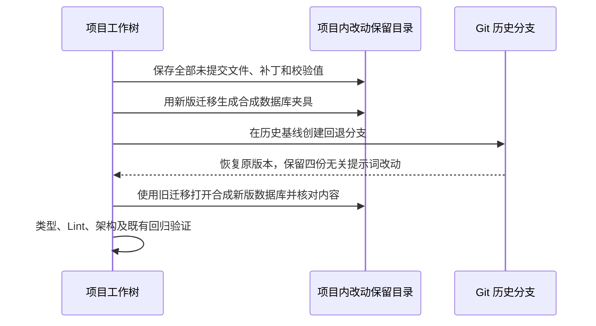

# 原生上下文压缩版本回退

## 产品规则与基线（2026-11-20）

用户选择恢复 `03f5d4e5`：撤回随后引入的原生上下文压缩、原图回取、趋势与维护记录、手机端管理；保留既有渠道级请求压缩及其保存、降级修复。恢复整个历史版本，因此随后独立提交的 Windows 托盘图标修复也不在回退版本内。版本号沿用该基线，不发行新版本。

使用本地 `codex/rollback-before-native-context` 分支检出历史基线，原 `main@9146382a` 与后续提交保持可查。本轮不提交、推送、打包或触发 Actions。

## 状态所有者与执行顺序

恢复原版本的 CLI Runtime、SessionStore、Host 与 UI 契约，不添加替代压缩实现。CLI 持有会话事实，Host 持有组织态；桌面 continuous 与手机 replayable 继续使用已有 attachment 和同一个 Runtime。渠道请求压缩仍归 Provider adapter，不改写会话正文。

原生压缩相关未提交改动完整保存在当前工作树 `.run-logs/project-only-validation/` 下；四份既有提示词与测试改动继续留在活动工作区。所有验证数据、HOME、TEMP、缓存和日志仅使用项目隔离目录。不得打开、迁移、清理真实 `.zcodium`。

## 验收场景与边界

- Git HEAD 为 `03f5d4e5`，除保留的四份本地改动和本回退记录外，跟踪文件与该基线一致。
- 原生压缩模块、原图回取新增入口、手机端管理及 `acp-kernel` 新增依赖回到引入前状态；渠道级请求压缩仍存在。
- 全部原始未提交文件的副本哈希一致，四份无关改动的活动文件字节保持不变。
- 合成新版 CLI 数据库由真实新版迁移初始化，旧版本的真实启动迁移应无新增迁移、无删除表或内容改写；验证旧会话标题与软删除写入能够执行。
- 执行根与 CLI 类型检查、Lint、changed 架构及针对恢复版本的现有回归。分别记录通过、已有失败和环境限制。

这次操作仅回退源码，不安装应用。源码与隔离数据库证据不代表真实桌面、实体手机、真实 Provider/远端或安装包验收。

## 实际执行结果

已在本地创建并切换到 `codex/rollback-before-native-context`，HEAD 为 `03f5d4e56c581b11ac59c85fbec3ed0583496f66`。`main` 仍保留 `9146382a8b875dadd37238698d9815412b93dd90`。全部跟踪文件与目标基线一致，只有任务开始前的四份提示词及测试改动继续作为本地差异保留；新增文档仅为本回退记录。源码扫描确认原生压缩接口、模块与新增内核依赖已回到引入前状态。

12 份原始未提交文件、完整二进制补丁、单独的四文件补丁及 SHA-256 清单保存在 `.run-logs/project-only-validation/rollback-native-context-UmDqeO/`。保存文件与四份活动文件的字节校验全部通过。

| 验证               | 实际结果                                                                                                                                                                  |
| ------------------ | ------------------------------------------------------------------------------------------------------------------------------------------------------------------------- |
| 根 Lint            | exit 0，5699 个文件，0 errors / 0 warnings                                                                                                                                |
| CLI Lint           | exit 1，89 个既有 `max-lines` 错误、76 个警告；不计作通过                                                                                                                 |
| changed 架构       | exit 0，0 violations / baseline / new                                                                                                                                     |
| 审计与 SQLite 回归 | 外层 25/25 通过，SQLite 包装器另执行内层场景，计数不重复汇总                                                                                                              |
| 渠道请求压缩       | 既有 Vitest 文件 8/8 通过，使用 mock fetch，没有真实 Provider 请求                                                                                                        |
| 保留提示词改动     | 既有 source 测试 10/10 通过                                                                                                                                               |
| 新版数据库降级     | **失败**：旧迁移 owner 拒绝新版 ledger 中的 `0024_native_context_compression` / `0025_native_context_goal_usage_receipt`；报 `schema_incompatible`，标题/软删除验收未执行 |
| 失败后数据完整性   | 29 张表逐表内容 SHA-256 与 schema 均保持，`foreign_key_check` 无错误；没有删除迁移记录或表来绕过启动门禁                                                                  |
| 根 / CLI 类型检查  | 均 exit 0；根与 CLI 正式类型入口均实际通过                                                                                                                                |
| 差异空白           | `git diff --check` 通过                                                                                                                                                   |

降级限制已向用户说明。该历史版本不能直接运行于已经完成上述新增迁移的数据库；本轮仅恢复指定源码，不修改旧启动门禁、不迁移真实用户数据库，也不把这项失败写成兼容验收通过。后续若需运行已升级的数据，须先确定数据兼容方案。

验证使用项目内 Node `24.14.0` 与 Corepack pnpm `10.33.2`。首轮类型检查因隔离 Corepack 忽略项目声明而尝试选择 `10.28.1`，网络禁用导致命令未启动；验证脚本随后显式启用项目工具链声明重跑。渠道压缩首次 Vitest 启动配置路径重复，未执行用例；修正为绝对配置路径后 8 项实际通过。数据库完整性夹具曾因 SQLite 行对象的 null prototype 与 JSON 清单普通对象不等而在结构断言中止；规范化比较表示后验证结构、全部表内容保持，实际启动仍按同一 `schema_incompatible` 拒绝。

日志位于上述保留目录的 `children/rollback-*` 子目录，数据库结果为 `new-database/downgrade-result.json`。没有执行桌面/手机 E2E、真实 SSH/WSL/Provider、安装包或真实用户数据降级验收。没有提交、推送、下载构建产物、打包或触发 Actions。
