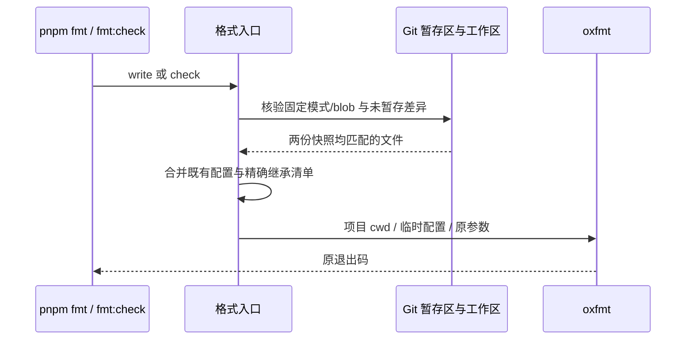

# 官方 3.17.1 检查收口

本轮以本地 main 的合并结果为起点，处理检查契约错误和根门禁失败；不提交、推送、构建或安装。此前集成证据保留，最终结果另记，不将 Lint 或格式通过写成真机验收。

## 规则与范围

- 生产源码继续使用 400 个非空、非注释行的上限，不增加生产路径豁免。插件管理和子智能体 Store 只拆出类型，公开类型原入口保留；Zustand 实例、服务权威、请求代际、操作账本与订阅仍由原文件持有。
- 根 Lint 的七个超限测试夹具/辅助文件属于已有测试用途，按精确文件路径采用与 test/spec 相同的行数规则；其他诊断继续检查，不扩大到整个 scripts/test 目录。
- 行数策略工程测试核对 400/401 边界、空行/注释、测试后缀与 CLI 配置；不再预期旧的 800 行阈值或特定生产文件降级。
- Git 枚举失败测试的空目录使用无效的局部 `.git` 标记，阻止向上发现真实项目仓库；只验证错误传播，不修改宿主 Git 环境。
- 格式检查与格式写入复用同一入口。沿用格式 spec 的官方逐字节继承例外，固定本次已核验的 1606 个格式差异和 4 个 HTML 解析错误文件的 Git 模式与 blob；暂存区和工作区都一致才排除。任何修改、删除或模式变化均退出例外，新文件不自动入清单。继承 HTML 不作为本仓页面修复。
- CLI 的 89 个超限生产文件继续作为独立重构欠账，分类审查优先处理本仓适配和状态/协议 owner；不能提高阈值、压缩语句、刷新 baseline 或原样豁免适配文件来消除错误。本轮根门禁修复不宣称 CLI 全绿。
- 所有检查、缓存、合成 Git 仓库和日志使用项目内 sandbox，不清理历史目录或真实用户数据。

## 所有者与顺序

Store 拆分只移动静态契约：调用方 → 原 Store → 原服务 → 原 set/get 与请求代际。没有新状态 owner、写入路径、计时器或远端事件。

## 验收

1. 根 lint、fmt:check、typecheck 与 changed 架构实际执行并记录。
2. 格式例外覆盖原样、已暂存修改、未暂存修改、暂存后恢复工作区、已提交修改、模式变化和未登记文件；格式入口真实运行证明适配文件仍阻断。
3. 行数策略在根与 CLI 配置均验证严格边界；测试夹具例外不得覆盖相邻生产文件。
4. Store 类型拆分通过类型检查；不改交互，无新交互 E2E 场景。
5. CLI 失败、未执行的检查及真机范围分别报告。

## 本轮结果（2026-11-03）

使用项目内 Node 24.14.0 / Corepack pnpm 10.33.2，所有缓存、日志和合成数据均留在 `.run-logs/project-only-validation/`。以下是实际执行结果，未推送到 GitHub。

| 检查                             | 结果                                                                        | 证据目录                         |
| -------------------------------- | --------------------------------------------------------------------------- | -------------------------------- |
| 根 typecheck                     | exit 0；执行前审查 18 个 TypeScript 配置及输入/输出路径                     | check-repair-typecheck-HVJjlI    |
| 根 Lint                          | exit 0，0 errors / 157 warnings；本轮文件无新增警告                         | check-repair-lint-NKK6Zk         |
| changed 架构                     | exit 0，violations / baseline / new 均 0                                    | check-repair-architecture-q79DDq |
| 架构工程测试                     | exit 0，62 项中 61 passed / 1 Windows skip / 0 failed；含格式和行数回归     | check-repair-engineering-uI2XLD  |
| 审计、插件操作及检查规则定向回归 | 29 passed / 0 failed；与工程测试有 12 项重叠，不累加成独立 90 项            | check-repair-node-MpVV4Z         |
| CLI 独立 Lint                    | exit 1，89 errors / 80 warnings；错误文件逐项对上此前分类，未重构或降级规则 | check-repair-cli-lint-TwauT2     |

格式检查已在新入口通过；固定清单包含 1610 项，仍沿原样双快照例外，而不是 1610 项全部改为符合格式。Store 仅移动静态类型，转译后的运行时代码与 HEAD 完全相同，证据 check-repair-store-equivalence-SGrY2o。最终格式、差分及文件保护核验见本节后续收口记录。

中间失败没有删除：最初临时配置相对路径及显式文件忽略行为不符合预期，回归捕获后修复；完整架构测试最初 60 passed / 1 failed / 1 skipped，非 Git 夹具错误被确认并修复后复跑通过。一次 oxfmt 写入进程报写入失败，未以重试成功掩盖； owned 文件随后用 oxfmt API 异步写入并校验，最终真实 CLI write 对两个修改文件也成功。

根全量 Lint 的警告保留逐项后续审查；包括迭代中修改集合需要快照的情况，不能直接自动删掉 spread。未执行完整 verify:pre-push（当前保留既有未跟踪文件）、全量业务/CLI corpus、冻结安装或 GitHub CI，不声称全门禁/全产品通过。完整 Electron、macOS、实体手机、原生 CUA 与安装包仍未验收；版本与旧 CUA 后端保持不变。

## CLI 超限文件的后续修复清单

本轮重新执行独立 Lint，仍为 89 errors / 80 warnings，全部错误为 max-lines。下面的路径与旧分类逐个对上；「旧基线」指合并前 HEAD，不是当前 HEAD。14 个与旧基线相同、26 个与官方相同，6 个重叠；55 个两边都不同。不能用格式继承清单豁免这些适配文件。网关/投影、模型执行、插件/MCP、存储与工具执行分别拆分，先确认现有 owner 和定向回归，再移动纯 helper 或类型。

| 文件                                                                                        | 有效行数 | 来源分类         |
| ------------------------------------------------------------------------------------------- | -------: | ---------------- |
| `apps/zcode-cli/packages/bootstrap/src/zcode-protocol-v4/product-projection.ts`             |     5149 | 本仓适配         |
| `apps/zcode-cli/packages/bootstrap/src/zcode-protocol-v4/v4-gateway.ts`                     |     3194 | 本仓适配         |
| `apps/zcode-cli/packages/adapters/src/plugins/marketplace.ts`                               |     2619 | 本仓适配         |
| `apps/zcode-cli/packages/adapters/src/mcp/index.ts`                                         |     1930 | 本仓适配         |
| `apps/zcode-cli/packages/bootstrap/src/zcode-protocol/v4-bridge.ts`                         |     1858 | 本仓适配         |
| `apps/zcode-cli/packages/adapters/src/fs/index.ts`                                          |     1644 | 旧基线与官方原样 |
| `apps/zcode-cli/packages/adapters/src/model/runner-stream.ts`                               |     1440 | 本仓适配         |
| `apps/zcode-cli/packages/core/src/runtime/methods/session-fork.ts`                          |     1392 | 官方原样         |
| `apps/zcode-cli/packages/bootstrap/src/zcode-protocol/session-mapper.ts`                    |     1384 | 本仓适配         |
| `apps/zcode-cli/packages/debug/server/analyzer.ts`                                          |     1368 | 官方原样         |
| `apps/zcode-cli/packages/bootstrap/src/app/create-app.ts`                                   |     1355 | 本仓适配         |
| `apps/zcode-cli/packages/core/src/runtime/methods/steering.ts`                              |     1323 | 本仓适配         |
| `apps/zcode-cli/packages/bootstrap/src/plugins.ts`                                          |     1300 | 本仓适配         |
| `apps/zcode-cli/packages/contracts/src/interfaces/session-store.port.ts`                    |     1099 | 官方原样         |
| `apps/zcode-cli/packages/debug/src/App.tsx`                                                 |     1086 | 旧基线原样       |
| `apps/zcode-cli/packages/core/src/runtime/methods/turn.ts`                                  |     1029 | 本仓适配         |
| `apps/zcode-cli/packages/bootstrap/src/zcode-protocol/server.ts`                            |     1007 | 本仓适配         |
| `apps/zcode-cli/packages/bootstrap/src/zcode-protocol-v4/conversation-topic-publisher.ts`   |      998 | 本仓适配         |
| `apps/zcode-cli/packages/adapters/src/storage/session-store/sqlite-session-store.ts`        |      958 | 本仓适配         |
| `apps/zcode-cli/packages/contracts/src/model/index.ts`                                      |      933 | 本仓适配         |
| `apps/zcode-cli/packages/adapters/src/storage/session-store/migrations.ts`                  |      885 | 本仓适配         |
| `apps/zcode-cli/packages/bootstrap/src/app/session-facade.ts`                               |      878 | 本仓适配         |
| `apps/zcode-cli/packages/adapters/src/plugins/index.ts`                                     |      845 | 本仓适配         |
| `apps/zcode-cli/packages/core/src/runtime/methods/turn-model-step.ts`                       |      835 | 本仓适配         |
| `apps/zcode-cli/packages/bootstrap/src/zcode-protocol-v4/cold-event-merge.ts`               |      796 | 本仓适配         |
| `apps/zcode-cli/packages/core/src/tool/executor/background-tasks.ts`                        |      776 | 本仓适配         |
| `apps/zcode-cli/packages/contracts/src/workflow/index.ts`                                   |      772 | 旧基线原样       |
| `apps/zcode-cli/packages/bootstrap/src/zcode-protocol/interaction-broker.ts`                |      719 | 官方原样         |
| `apps/zcode-cli/packages/core/src/tool/executor/call-runner.ts`                             |      707 | 本仓适配         |
| `apps/zcode-cli/packages/core/src/runtime/methods/compact-active.ts`                        |      705 | 本仓适配         |
| `apps/zcode-cli/packages/adapters/src/storage/session-store/repositories/usage.ts`          |      704 | 旧基线与官方原样 |
| `apps/zcode-cli/packages/core/src/runtime/agent-runtime.ts`                                 |      691 | 本仓适配         |
| `apps/zcode-cli/packages/bootstrap/src/app/types.ts`                                        |      666 | 本仓适配         |
| `apps/zcode-cli/packages/core/src/runtime/methods/file-rewind.ts`                           |      664 | 旧基线原样       |
| `apps/zcode-cli/packages/core/src/agent/session-history-hydrator.ts`                        |      643 | 本仓适配         |
| `apps/zcode-cli/packages/core/src/runtime/methods/events.ts`                                |      626 | 本仓适配         |
| `apps/zcode-cli/packages/cli/src/run.ts`                                                    |      613 | 本仓适配         |
| `apps/zcode-cli/packages/core/src/agent/message-history.ts`                                 |      608 | 本仓适配         |
| `apps/zcode-cli/packages/bootstrap/src/app/bundled-plugins.ts`                              |      604 | 本仓适配         |
| `apps/zcode-cli/packages/core/src/permission/service.ts`                                    |      601 | 本仓适配         |
| `apps/zcode-cli/packages/core/src/runtime/methods/model.ts`                                 |      591 | 本仓适配         |
| `apps/zcode-cli/packages/bootstrap/src/zcode-protocol/plugins.ts`                           |      572 | 官方原样         |
| `apps/zcode-cli/packages/adapters/src/model/failure-classifier.ts`                          |      562 | 本仓适配         |
| `apps/zcode-cli/packages/core/src/tool/handlers/read.ts`                                    |      547 | 官方原样         |
| `apps/zcode-cli/packages/cli/src/prompt-command.ts`                                         |      545 | 本仓适配         |
| `apps/zcode-cli/packages/adapters/src/model/runner-generate.ts`                             |      535 | 本仓适配         |
| `apps/zcode-cli/packages/adapters/src/config/file-config.adapter.ts`                        |      525 | 本仓适配         |
| `apps/zcode-cli/packages/core/src/workflow/lifecycle.ts`                                    |      524 | 旧基线原样       |
| `apps/zcode-cli/packages/contracts/src/events/event-reducer.ts`                             |      519 | 本仓适配         |
| `apps/zcode-cli/packages/adapters/src/model/transform.ts`                                   |      518 | 本仓适配         |
| `apps/zcode-cli/packages/core/src/runtime/helpers/attachment-media-resolver.ts`             |      496 | 旧基线与官方原样 |
| `apps/zcode-cli/packages/adapters/src/mcp/oauth.ts`                                         |      491 | 官方原样         |
| `apps/zcode-cli/packages/contracts/src/interfaces/browser-control.port.ts`                  |      491 | 本仓适配         |
| `apps/zcode-cli/packages/core/src/hooks/runner.ts`                                          |      488 | 官方原样         |
| `apps/zcode-cli/packages/core/src/tool/handlers/bash.ts`                                    |      474 | 本仓适配         |
| `apps/zcode-cli/packages/adapters/src/storage/workspace-hook-trust-store.ts`                |      472 | 旧基线原样       |
| `apps/zcode-cli/packages/bootstrap/src/app/script-workflow-runtime.ts`                      |      472 | 本仓适配         |
| `apps/zcode-cli/packages/core/src/mcp/index.ts`                                             |      468 | 本仓适配         |
| `apps/zcode-cli/packages/core/src/runtime/methods/runtime-command-queue.ts`                 |      467 | 本仓适配         |
| `apps/zcode-cli/packages/core/src/runtime/helpers/provider-request-messages.ts`             |      460 | 官方原样         |
| `apps/zcode-cli/packages/adapters/src/plugins/zip-source.ts`                                |      458 | 本仓适配         |
| `apps/zcode-cli/packages/bootstrap/src/app/workflow-world-read.ts`                          |      457 | 官方原样         |
| `apps/zcode-cli/packages/bootstrap/src/zcode-protocol/subagent-session-query.ts`            |      456 | 官方原样         |
| `apps/zcode-cli/packages/core/src/tool/executor/result-display.ts`                          |      456 | 旧基线原样       |
| `apps/zcode-cli/packages/bootstrap/src/app/workspace-hook-review-controller.ts`             |      454 | 旧基线原样       |
| `apps/zcode-cli/packages/core/src/runtime/internal-turn-methods.ts`                         |      443 | 本仓适配         |
| `apps/zcode-cli/packages/bootstrap/src/zcode-protocol-v4/command-inbox.ts`                  |      442 | 官方原样         |
| `apps/zcode-cli/packages/adapters/src/config/index.ts`                                      |      439 | 旧基线与官方原样 |
| `apps/zcode-cli/packages/core/src/runtime/methods/background.ts`                            |      439 | 官方原样         |
| `apps/zcode-cli/packages/adapters/src/storage/index.ts`                                     |      436 | 官方原样         |
| `apps/zcode-cli/packages/core/src/runtime/methods/compact.ts`                               |      435 | 本仓适配         |
| `apps/zcode-cli/packages/core/src/tool/handlers/cron.ts`                                    |      435 | 官方原样         |
| `apps/zcode-cli/packages/core/src/tool/handlers/read-session-context.ts`                    |      426 | 官方原样         |
| `apps/zcode-cli/packages/bootstrap/src/zcode-protocol-v4/commands/handlers/goal-compact.ts` |      424 | 官方原样         |
| `apps/zcode-cli/packages/adapters/src/storage/session-target.ts`                            |      422 | 旧基线与官方原样 |
| `apps/zcode-cli/packages/bootstrap/src/app/workflow-driver.ts`                              |      421 | 本仓适配         |
| `apps/zcode-cli/packages/core/src/runtime/methods/resume.ts`                                |      420 | 本仓适配         |
| `apps/zcode-cli/packages/adapters/src/skills/index.ts`                                      |      419 | 本仓适配         |
| `apps/zcode-cli/packages/bootstrap/src/app/script-workflow-tool-port.ts`                    |      416 | 本仓适配         |
| `apps/zcode-cli/packages/adapters/src/context/git-snapshot.ts`                              |      415 | 官方原样         |
| `apps/zcode-cli/packages/adapters/src/browser/index.ts`                                     |      414 | 旧基线与官方原样 |
| `apps/zcode-cli/packages/bootstrap/src/zcode-protocol-v4/event-normalizer.ts`               |      413 | 官方原样         |
| `apps/zcode-cli/packages/contracts/src/interfaces/dynamic-workflow-run.port.ts`             |      411 | 本仓适配         |
| `apps/zcode-cli/packages/adapters/src/mcp/oauth-interactive.ts`                             |      410 | 官方原样         |
| `apps/zcode-cli/packages/bootstrap/src/app/dynamic-workflow-run-service.ts`                 |      410 | 本仓适配         |
| `apps/zcode-cli/packages/core/src/runtime/methods/streaming-tool-coordinator.ts`            |      408 | 本仓适配         |
| `apps/zcode-cli/packages/core/src/runtime/methods/usage-observability.ts`                   |      406 | 旧基线原样       |
| `apps/zcode-cli/packages/core/src/runtime/methods/index.ts`                                 |      402 | 本仓适配         |
| `apps/zcode-cli/packages/dynamic-workflow-runtime/src/harness.ts`                           |      402 | 本仓适配         |

最终文档落地后的根 fmt:check 为 exit 0，7971 matched files，固定继承清单仍 1610 项；证据 check-repair-format-vcGV9a。git diff --check 为 exit 0，证据 check-repair-final-diff-9vaKvX。Git tracked 改动仅属于本轮明确文件，旧未跟踪路径全部保留，未暂存、未创建真实提交。新增 89 文件 CLI 清单是后续修复范围，不代表这 89 个错误已解决。

## 后续提交与构建前的 SQLite 门禁接线

本次提交、推送和 GitHub 构建已获用户授权。实际 pre-push 复现根 schema 入口引用已删除的 `offPeakTaskRepo`；已有隔离基线夹具还读取退役的 Host 迁移数组，并未使用 CLI 当前启动选项。修复范围仅为验证入口、夹具及可审阅 schema 快照，不改变产品迁移、冻结 SQL/checksum 或真实数据库。

- `db:schema:check` 复用现有项目隔离 wrapper，保留 schema 兼容约束和更新参数拒绝检查；删除失效的旧检查脚本与已退役的 `db:schema:update` 命令。
- 合成 Host 库调用当前 `runTasksDatabaseMigrations` 的 base scope，合成 CLI 库调用 `runSqliteSessionMigrationsAsync`，使用实际 `time_applied` 账本。验证不复制迁移数组，也不另建生产迁移 owner。
- 快照只从本项目合成库生成，先对 HEAD 快照做 additive 守卫，再审阅具体差异后落地；基线增加当前已存在的列、表和索引，不改变旧字段语义，不通过重新生成快照放过结构删除。
- 每个合成库再次调用同一启动入口，必须没有待执行迁移且 schema 完全一致。所有合成数据和日志继续留在项目内。

验证调用方 → 当前 Host/CLI 迁移 adapter → 既有 SQLite runner 提交 → schema dump/旧结构兼容比对 → 第二次启动零迁移。真实升级安装由后续 Windows x64 产物完成，其结果另行记录，不将合成数据库检查写成真机数据验收。

追加修复实测：根 typecheck、Lint 与 changed 架构均 exit 0；Lint 保持 157 warnings / 0 errors。新的 `db:schema:check` 为 22 项外层检查通过，隔离 wrapper 实际执行 Host/CLI 两份数据库基线及零重复迁移断言，不把 wrapper 数量当作独立数据库用例。快照差异仅为 Host 定时/闲时表的六个可空执行范围列与既有 admissions 表、CLI 的两个可空状态列及既有数据库身份表。Windows 的 oxfmt CLI write 再次报写入错误，失败日志保留；随后通过 oxfmt API 异步格式化本轮明确文件，格式检查继续实际执行。

## GitHub 首轮构建阻塞与修复规则

用户授权提交、推送、手动构建并升级本机 Windows 后，首轮 Actions 在运行时准备和格式门禁阶段失败，未生成安装包。Bootstrap 的模块契约直接引用 adapters/src，触发 TS6059；格式入口把临时配置放在 sandbox 并写绝对忽略路径，Windows 校验通过但 Linux 目录检查没有正确排除继承文件。

- Bootstrap 跨包声明改走 adapters 的两个精确公开 package exports，保持现有类型与直连行为；不扩大 rootDir、不复制类型、不恢复官方路由功能。显式执行真实 CLI Bootstrap 编译，不能用根 typecheck 代替。
- 格式入口改为在真实项目 cwd 创建并删除唯一临时配置，保留原相对忽略规则及锚定的精确继承路径；不更新继承快照，不全仓重新排版。回归实际调用 formatter，覆盖目录检查、相邻同名文件及失败后的本次临时文件清理。
- 事件顺序仍为调用方 → 格式入口核验 Git → 独占创建 cwd 配置 → formatter 原退出码 → finally 删除本次配置 → 调用方。格式入口是本次临时文件的唯一所有者；没有产品状态或远端时序改动。
- 修复后重新执行根 typecheck、Lint、changed 架构、格式及定向回归，再提交推送并手动派发 desktop.yml。只有正确 SHA 的 Windows x64 产物通过校验后才安装，实际安装结果后续记录。

追加修复本地实测：根 typecheck、Lint、changed 架构与 fmt:check 均 exit 0，Lint 仍为 157 warnings / 0 errors，固定继承清单仍为 1610 项。格式定向回归 11 passed；完整架构工程测试 63 passed / 1 Windows skip；审计与发行契约 25 passed（不与重叠回归累加）。Bootstrap 首次单独编译因本地旧依赖声明失败，日志保留；审查输出路径并按依赖顺序重新编译库后，真实 Bootstrap NodeNext/rootDir 声明编译 exit 0，未改运行时业务代码。首轮失败构建见 [Actions 41599710143](https://github.com/No-ni/ZCodium/actions/runs/41599710143)；修复后的 GitHub CI 与本机安装此时尚未验证。

第二轮 Actions 的 Format 与格式继承回归均通过，运行时准备继续暴露 `prepare-agent-node-bundle.mjs` 缺少异步 fs API 导入，所有打包目标因此停止。修复同脚本的导入与原生暂存接线：使用当前 `.zcodium-plugin` 标记，并通过现有 adapters 安装根解析 Koffi。保持插件构建 → 文件核验 → 暂存 → 本架构依赖复制的原顺序，保留缺件失败和旧 CUA 后端，不恢复官方 helper producer，也不在本机运行完整 desktop prepare/pack。Agent/Vitest corpus 的其他 CI 失败另行区分，不把这次准备脚本修复写成全量业务验收。

准备脚本追加修复实测：项目隔离的构建分发、真实异步资产复制/缺件失败和 Windows x64/arm64 Koffi 裁剪三项回归通过；合成原生文件不执行。根 typecheck、Lint、changed 架构、fmt:check 与审计/发行契约再次通过，Lint 仍为 157 warnings / 0 errors；脚本在显式 Node 环境配置的 no-undef 检查中为 0 warnings / 0 errors。未在本机执行完整 Office 分发 corpus 或桌面打包。

本次 pre-push 又捕获 Builder 配置在能力探针之前静态导入旧后端不存在的 `broker/helperConstants`。这同时会阻断真实打包配置加载，并非选择器可以忽略的测试错误。修复构建/开发配置的导入顺序及无 Helper 时的路径构造，保留原能力探针和真实 producer 分支；不恢复已删除模块、不放宽测试选择器错误规则。追加 Windows/mac 目标的隔离真实配置加载回归。

选择器恢复后实际执行选中的三个 Builder 工程规格，17 项通过、6 项失败；失败均为官方遗留 Linux 发行配置或 Linux fuse 加载成功断言，与本 fork 已明定的 Windows/mac 边界冲突。按发行 spec 对齐测试，保留 prerelease 元数据、Windows/mac 目标与安全断言，追加无 Linux 配置和显式 Linux 拒绝场景，不改变生产发行范围。

对齐后同一批三个 Builder 规格共 19 项全部通过，真实 Builder 配置回归与审计/发行契约共 26 项通过。根 typecheck、Lint、changed 架构与 fmt:check 再次通过，Lint 仍为 157 warnings / 0 errors；未在本机执行桌面准备或打包，新的发行验证由 GitHub Actions 完成后另行记录。
