# 官方 3.17.1 合并升级

## 授权与基线

用户于 2026-11-01 授权：吸收此前审查中两组值得做的项目，另加入无项目任务共享 CLI、Electron 44 与打包工具升级；本地产品版本对齐官方；维护变更必须记录。2026-11-02 最终续接按用户最新要求由主代理独立完成，不再派子代理。核实官方开源 CUA 仍是不可执行的占位包后，用户明确改为保留旧电脑操作后端，撤销本轮官方后端替换；旧后端可用性另行修复。

- 本仓开工基线：`4ea45367`，main 与 origin/main 同步，保留根目录三个既有未知 shell 残留。
- 唯一来源：`zai-org/ZCode@a60ba6a7`，官方 `v3.17.1`；此前择项吸收 `3c5b2276` / 3.16.2，不宣称此前完整 parity。
- 同步分支：`sync/official-3.17.1`；采用真实 merge，不 rebase、不 merge 第三方 fork、不用整树 ours 伪装升级。
- 产品版本 3.17.1，CLI 随官方 0.17.1；Electron 44.7.0、electron-builder 26.17.0、electron-updater 6.8.10；macOS 最低 13，用户已确认其设备满足。
- 本轮授权是源码合并升级与本地验证，不触发 Actions、不本机打安装包、不安装到真实用户应用、不发布或推送。

## 范围与产品规则

吸收：用户自带 Key 的模型/供应商目录与协议兼容修复、MCP Node/npm fallback、图片预览标注、文件打开方式/原件保存、全局自定义指令、YOLO 主动切入确认、设备范围与手动配置同步、项目批量移除/撤销/恢复、单任务重启、Office 共享进程与展示修补、项目目录插件显式授权、预部署远端服务的显式停止/重启、共享 chat CLI、Electron 与打包工具。

暂缓：项目永久删除历史/附件/记忆/检查点、原生手机日志与输入预测；不把上游 pending issue 记录当作已经修复。保留现有有效回归测试与独立性能/生命周期修复，删除已退休后端专属测试时记录替代证据。

持续剥离：官方账号/OAuth、购买/权益、官方云配额/分享/上传、Sites、官方手机推送、官方 MCP 凭据与命令认证、client config/rollout、relay/更新默认回退、遥测/ARMS/自动模型输入输出录制/设备归因/会话能力统计请求头、Linux 桌面安装包及远端发行资源。

上游新增的原始网络请求捕获会在打开资源管理器时记录完整 URL，并重新建立官方购买/奖励 session，因此本轮不吸收该捕获链路；已有默认关闭的本地安全数字指标保留。未接入运行入口的官方 relay、自动部署、ARMS 和奖励 preload 也应删除，不把死代码当成审计边界。

用户自选 Provider 的正常 API、Key 额度、普通 MCP OAuth、安全本地日志、默认关闭的本地采样和显式自建 OTLP 按现有契约保留。产品身份为 ZCodium，数据根 `.zcodium`，无自有更新源时不检查更新；不自动迁移旧用户数据。

## 所有者与事件顺序

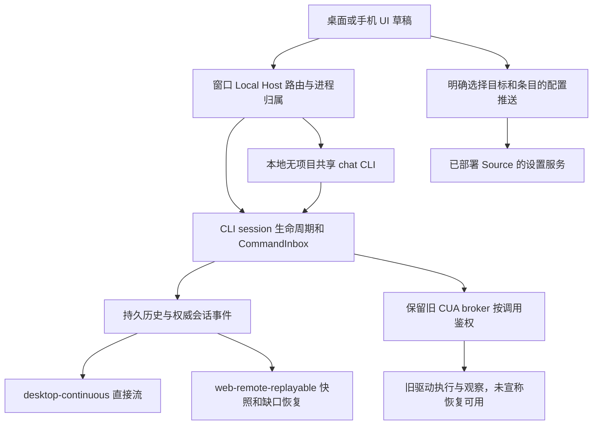

- Host 独占物理 CLI 分配，一个逻辑 workspace 固定归属至物理进程退出；共享池 key 不进入 workspace 身份、cwd 或数据库。跨工作区会话、配置、文件、反向请求与自动化必须显式路由；无归属拒绝，不回落首次目录。
- 单任务 restart 由 CLI 唯一生命周期 owner 串行执行：关闭准入、取消并等待旧资源释放、失效旧 publisher、历史优先恢复、发布新代状态。保留历史和草稿，不自动重放输入；其他任务继续执行。共享进程重建须如实说明全部受影响任务。
- 输入仍经 CommandInbox admission，UI 不新增已接受队列；保留 owner/lease、stale run、workspaceIdentity 与 remoteSessionId。
- 远端只连接用户预部署、预启动的兼容服务；显式停止/重启不得变成自动部署、升级、注册、下载或上传运行资源。默认使用目标模型配置，mirror-personal 仍需明确授权。
- SourceConnectionManager 独占物理连接，内部只有一个 SourceServerOperationFlights owner 持有显式命令和查询 flight：先阻断同设备新 attachment，退休旧连接与恢复意图，复检 Profile generation，再执行已安装 CLI 的 `stop --wait` 或 `restart`。停止后保持离线；重启成功才走既有鉴权/兼容/身份确认屏障重新连接。相同操作共用 flight，相反操作拒绝；线路换代/删除和 Host 关闭会取消 flight，迟到结果不得重新发布。停止前的运行任务列表严格校验，不可用不是空列表；查询取消和物理连接释放也必须等到收尾完成。
- 同步唯一入口调用目标服务，覆盖前重新确认内容版本，不删除目标独有条目，不同步官方身份；凭据转移范围必须可见，目标离线不回落本机，Hook 文件同步不等于信任。
- 设备设置 attachment 只能取得 SourceConnectionManager 已在线的物理连接，按连接 generation 隔离；不自动连接、不创建 workspace、不暴露任务/项目组织控制面。离线、换代、显式停止/重启及 Host 退出均关闭旧设置端口；手机不得申请此 scope。
- 模型同步状态唯一事实在 Main 的 Provisioning coordinator，Host 只转发 read/wait/retry 与关联回包。首次上线、配置变更和用户重试均只有 applied/already-applied 算成功，其余状态按固定阶段码失败，不将重试失败记作成功，不转抄远端自由文本。Host 对象换代后迟到回包丢弃；Host 退出拒绝 pending，不用超时掩盖缺失回包。
- 手机 attachment 使用明确的服务白名单，新增配置推送、设备设置及 Provisioning 控制默认拒绝；MCP 只开放现有手机设置页使用的配置/状态/信任方法。跨设备批量同步不因桌面新增服务而自动开放给手机。
- 个性化读写 `.zcodium/AGENTS.md`；写入由设置服务串行与现有原子锁协调，不增加第二份数据库/localStorage事实。
- 项目移除是组织变更，可撤销/恢复；本轮不接永久 purge 产品入口。用户文件、历史业务根与测试数据均不得因验证被修改。
- CUA 保留本仓 `@trycua/cua-driver` 后端和已有权限/会话隔离契约；本轮不接官方占位 Helper 的 PiP、拖拽授权或多会话光标空能力，不隐式下载闭源执行组件。保留 Node REPL 的其他获准改进并剥离统计归因，不以测试假件成功冒充真机输入有效。

## 实施与验收

### 冲突裁决补充

桌面 Source 管理、窗口远端注册表、Main/Host 启动装配、自有更新源和本地诊断继续使用本仓已经审计的适配器。官方此轮在这些文件内同时加入自动安装升级、账号 relay、off-peak 云任务及统计归因，不能整文件替换为官方版本。获准的共享 CLI、单任务重启和配置同步通过业务服务公开契约接入；电脑操作按用户最新选择保留旧后端。保留现有 RPC、文件操作、数据根和启动性能回归，后续类型门禁核对新增契约，不用退休测试/降低规则隐藏差异。

1. 先跑 freshness、基线架构，再生成受影响模块上下文；最终续接由主代理独立解决剩余冲突、核对边界和依赖并完成集成，前期分域记录仅作为历史过程保留。
2. 新行为采用上游现有测试并按当前实现适配；新增本仓边界/回归先于产品修补。交互至少做现有项目内 Chromium 场景；不能证明写范围的测试不启动。
3. 工具链为项目内 Node 24.14.0 / Corepack pnpm 10.33.2。HOME、TEMP、数据、缓存、日志、浏览器 profile 都经 `scripts/ci/project-test-sandbox.mjs` 限定项目内；启动前查链接/重解析点和子进程环境。
4. 必跑根 typecheck、lint、fmt:check、changed 架构、审计与平台守卫，CLI 类型/受影响定向测试、共享 CLI/重启/配置推送/Office/CUA 归属回归；同步前 CLI Lint 79 errors/55 warnings 是旧基线，合并后实测单列，不改门槛隐藏失败。
5. 检查桌面只产 exe/dmg、手动四架构 workflow、自有更新源、产品版本和 CUA 原生资源接线。未实际执行的 macOS、安装包、真实远端、实体手机、原生输入明确列为未验收。
6. 维护记录写入 `maintenance-model.md`；电脑操作技能/spec 与用户选择保留的旧后端一致，官方占位方案只保留裁决记录。完成本地检查后展示中文提交文案，再提交同步成果并合回本地主线；不隐含推送或发行。

## 实际结果

以下保留各阶段过程，最终固定源码验证见文末「最终主代理验证与本地交付范围」。开工 freshness 通过；基线架构 0 violations / 0 baseline / 0 new。merge-tree 预检约 1200 个冲突路径，该预检不构成实际合并或验证通过。

续接调查发现 14 个 shared 源码文件为零字节，前轮副本同样为空；因此「标记已清零」不能视为源码恢复完整。已从前轮真实三方合并结果恢复这 14 个文件，保留冲突待逐块裁决，不恢复已剥离的运行模块。后续写入先在项目内唯一临时文件校验完整内容，再原子替换目标并读回校验，避免 Windows `UNKNOWN` 打开失败留下空文件。2026-11-01 本次 root typecheck 首轮失败（包含空文件引起的连锁缺导出、重复声明和未准备 WDIO 类型）；changed 架构首轮 906 个新违规，均待处理，未提交或结束 merge。

### 契约收口裁决（2026-11-01）

Source Server 的 Profile generation、连接状态与 `{directory, states}` 管理快照仍以本仓 contract 为唯一事实；新纯任务清单、工作区历史投影、目标比较与迁移报告可复用，但不得另立 transport Profile 或自动安装/升级状态。既有 ID 保持严格格式与大小写，不强制 UUID 迁移。SQLite 保留本仓 adapters runner/backup/restore 与必备份门禁，删除新上游并列实现；新 storage-migrate 命令复用该 runner，恢复必须显式传递 writersStopped 与库身份，不枚举项目外备份卷。GenUI 数组契约作为 canonical 输入，历史文本仍通过已有严格解析恢复；历史原生工具 providerOptions、发现事实与压缩分组同时保留。

### 会话索引融合边界（2026-11-01）

TaskIndexRepo 仅接收 CLI syncer 的标题、时间、终态和软删除事实；展示缓存与组织态不能覆盖事实列。保留只读 metadata 查询不取长正文的优化和未读 CAS 水印。分组改由既有 TaskGroupRepository 与服务持有，不恢复旧 TaskIndexRepo 内的第二份分组实现。自动归档继续使用单条带 pin/unread/终态条件的 UPDATE 原子认领，排序与过期只读 CLI 权威时间；缺席列表不能产生删除。

### 历史恢复与新版任务适配（2026-11-01）

旧 JSON 快照回退仅提供只读历史，不因 resume 自动创建 SQLite session；显式导入继续走既有导入入口。创建任务使用新版唯一结构，同时传递 workspaceIdentity、remoteSessionId、附加目录、权限和 MCP。归档仅在数据库提交后更新 overlay 并发布列表通知；分组操作由独立分组服务持有。

### Provider 装配与 Office 退出（2026-11-01）

Provider 默认 transport 保持用户配置的请求地址；默认路由端口只返回原地址并遵守取消信号，无官方配置查询、凭据读取、设备 ID、系统/地区归因头或第二份网络策略缓存。显式注入的 transport 端口仍按现有契约运行。MCP 生命周期 tracker 继续持有 owner/lease；资源后台采样默认关闭，显式本地启用时才启动。Root 不默认创建 Long Task/Long Animation Frame PerformanceObserver；当前 Renderer 没有显式本地采样入口，不接入这一自动观察器。安全本地诊断 recorder 和启动/会话事件仍沿用既有契约。

Office server 是共享解析缓存、文件句柄和 session 注册表的唯一所有者；各 session 持有当前文档、视图与上报序号。进程退出先 dispose owner，再关闭 MCP server；dispose 幂等清除所有 session、缓存与句柄，异步加载返回后复检 owner/session 是否仍存活，迟到结果不能登记或恢复已释放的状态。只读 viewer 不接入上游 importer 的目录写入与历史清扫。

Web 保留本仓同源 Server WebSocket 入口与现有 mobile bridge；不装配已剥离的官方 relay/OAuth device client。主题种子仍由本地存储的已有偏好决定。对话交换继续使用本地 archive export/import 契约，attachment façade 必须转发其全部分块读写/释放方法，不能补回官方预览/续聊接口；受信 Host relay 上的正文和工作流读取沿同一 downstream connection 传播身份，手机 replayable attachment 不开放 archive 写操作。

### 归档版本与管理快照的续接裁决（2026-11-02）

本地归档继续遵守严格 v1 manifest（选择后的公开 rows 与校验过的 artifact bytes）。上游新增 content_blocks、内嵌图片及工作流原生快照尚未形成完整的本地编码/校验/导入闭环，本轮不在发布服务中半接线，也不声明该能力已支持。恢复既有 data/file URL 与未支持 artifact 协议的预检和导出阻断；本地导出/导入、分块句柄与隔离作用域保持可用。

Source 管理读取沿用 `{directory, states}`；目录 generation 判断目录版本，connection state 的 profile generation 判断线路归属。UI hook 只订阅已有 `onDidChange`，顺序合并刷新并在服务换代/卸载后拒绝迟到结果；不新增 flat snapshot 或自动安装/升级接口。

### 启动装配的续接边界（2026-11-02）

保留已审计的本地 scenes、默认 client config 与动态工作流开关；其历史命名不表示恢复官方控制面。Bot 远端仅使用 `bot-project-runtime` 与现有 Source connection，单 owner/lease 路由，不并列启动 parentPort workspace bridge。普通话题附件继续按 Bot 授权及可信 peer 分块读取，未接入官方 relay。CLI 查询不携带 Host 归档组织态，插件统计、官方 CUA installer 和完整网络捕获出口继续剥离。

### Subagent 配置缓存的装配（2026-11-02）

缓存由 Host SubagentsService 唯一持有；准备时串行迁移用户 Markdown 与 state，再按 workspaceIdentity/path 绑定用户/项目范围。state 读取失败发布既有 built-in-fallback，不冒充空状态；parent turn 只复制完成的缓存快照。Host dispose 先封住新 prepare/mutation，关闭范围监听并丢弃迟到结果；通用 Renderer RPC 不暴露 prepare/readRuntimeConfig。既有多目录与远端作用域不因缓存接线改变。

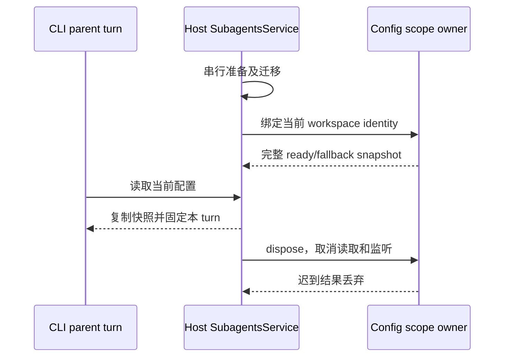

### SQLite 启动回包和 Provider 死链续接（2026-11-02）

CLI 迁移仍由 shared 通用 runner 独占锁、表级备份、事务和提交。所有新增 ID 必须显式声明真实 touchedTables；清单补充不修改历史 SQL/checksum。async startup 必须向 Store 传递该 runner 的真实 MigrationResult，ready 仅在提交与 WAL 配置成功后发布；失败或取消回滚并关闭未移交句柄。验收包括初始化、幂等重开、单表修复的全部无关表内容哈希、取消后的可重试性。Provider BYOK transport 保留调用方地址、显式 headers、请求 ID、timeout/abort；不保留已无调用入口的官方业务认证观察器和凭据核验缓存。debug 出口只记录结构与数字，不记录完整 URL。

Host tasks 迁移按 base/controller-remote/source-server scope 生成各自冻结合同；预检与执行引用同一清单。runTasksDatabaseMigrations 为唯一异步适配入口（Async 名称只保留同一函数的导出别名），锁、取消、显式备份目录和 transactionOpen 均交由 shared runner；scope 预检不执行 DDL。迁移进度 baseline 在锁内读取，schema 验收在提交前进行，不把晚生成的账本当旧基线；取消不得标记 ready。

Scoped ledger 兼容裁决：同一个 tasks 账本已有 base 与 controller/source 两类合法 ID，单 scope 预检不能误把另一 scope 的真实合同当未知。共享 inspect/migrate 接收只读 recognizedMigrations 合同：它们参与完整 ID/alias/checksum 验收，但不进入当前 scope 的 pending/备份/执行/回包。真正未知 ID 与已知 checksum 错配仍 fail closed，锁内重新检查同一完整目录；不扩大白名单、不伪造已应用项。

### 工作流 journal 调用方收口（2026-11-02）

WorkflowEngine 仍唯一持有 run 状态和报告累计值；报告计数包含条数与 UTF-8 字节，跨 resume 用同一 journal 的 countNodes/sumResultBytes 恢复。重放工作行不读取结果，产物行有界读取结果，report 正文不进入恢复扫描；首生结算事件仍驱动 FIFO 次序闸，取消结算永久打开闸门。本仓 commitHoleFill 原子提交、出生阶段与旧历史投影保留。persona 只接受已定义字符串键，缓存身份只比较 name/system，用户修改后续模型不重跑已完成工作。并发事件补齐实际发出的 limit_lowered/seeded 原因。

### MCP 租约调用取消续接（2026-11-02）

MCP registry 仍独占共享物理连接；会话 lease 只持有引用与自己的取消信号。工具、资源读取/列表/订阅沿同一 lease 合并调用方信号；关闭 lease 先封住准入和取消调用，再释放引用，不中断仍由其他 lease 持有的连接。异步回包必须再次核对 lease 存活及同名 entry 对象身份，已断开、替换或关闭的调用不发布迟到结果。

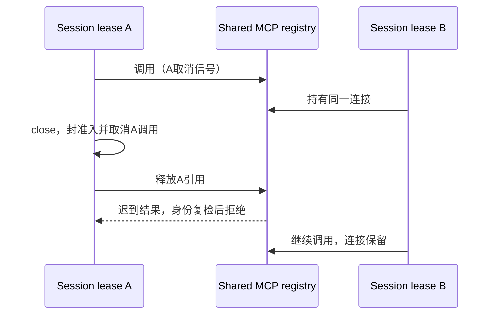

官方 OAuth→业务 JWT 换证缓存及无调用者的 RequestVerification retry stub 一并退休；Provider 普通重试预算不变。模型网络头部仍按既有敏感键净化，不依赖官方请求验证常量。个人插件来源的显式刷新继续拥有同一取消/事务 scope，manifest 原文只进入已验证的原子 staging；不自动请求官方 CDN 图标映射。

### Source 设置页的实际入口收口（2026-11-02）

现有 SettingsPage → SourceServerSettingsSection 保持唯一设备设置入口。未装配的新 SourceServerManagementPanel / EditConnectionProfileDialog 及其独立编辑 hook 退休，它们的自动部署、升级与第二套 profile contract 不进入运行时。现有 Profile 表单继续保存名称/线路/configurationMode，镜像配置仍先确认；修改线路由目录 owner 清除旧凭据，原文认证仍由显式连接入口取得。

停止/重启从现有 Profile 卡片触发；UI 只对最近握手版本 >= 3.17.1（本轮已确认支持命令的基线）、非 needs-\*、非 connecting 的设备开放，版本未知或旧版不发命令探测。查询可信运行任务清单后才打开危险确认，取消不执行，available:false 必须展示不可用说明。停止/重启共用单个 UI pending admission；Host 换代/卸载后的查询、确认和回包均不应用。命令事实/flight 仍属 Host，UI 不增加第二个业务状态 owner。

接受的浏览器验收：真实 Source 设置组件在 1280/390 宽度下，查询不可用清单、取消停止、确认停止、确认重启，核对调用序列与无横向溢出。当前脚本 scripts/ci/official317-source-management-browser.test.mjs 尚未执行；它使用项目内 fixture/profile/cache/下载目录，阻断对外请求。此浏览器场景不代表真 SSH、macOS、实体手机或远端进程验收。

管理快照 hook 对外操作回包只触发同一 Host 的串行重读，不直接发布不带查询代际的回包；同目录 generation 的状态也按实际读取顺序接纳。设备状态投影只接纳当前 Profile generation，安装/启动/升级要求只展示手动处理详情，不提供自动部署或升级动作。

### 连接向导的审计收口（2026-11-02）

Root flow 保留单 requestId/epoch admission、后台收起、取消释放临时 attachment、可信设备识别、边界说明和项目目录交接。不接受安装确认，不自动部署、下载、升级、降级或重装；needs-install/needs-start/needs-upgrade 只显示明确原因和手动处理说明。用户输入凭据继续由显式连接入口传给既有 Host，不写入 UI 管理快照。线路身份确认只从当前 canonical snapshot 选择 generation 一致且匹配本次目标的 identity-change-pending 状态，传入 profileId/generation/pendingSourceServerId；服务换代、改选或取消后的回包不得重试旧连接。历史快捷目录从 SettingService 的 sourceServerWorkspaceHistory 读取，不给管理快照加 flat history；未形成权威契约的设备重命名和远端 declaredWorkspaces 不装配。

连接阶段投影只显示通道、身份、握手及可选的目录交接，不显示本仓禁用的部署阶段；session ready 可结束握手，设备上线不能提前结束目录交接。日志只作展示进度，绝不成为连接事实或超时兜底。停止/重启由已有设置页的显式确认入口独占。验收覆盖 generation/目标/待确认ID匹配、旧确认拒绝、版本失败不调用安装升级接口，以及取消/收起和目录继续操作。

### 设置写入与个性化的续接修复（2026-11-02）

SettingService 继续唯一持有偏好写队列与跨进程锁。合并丢失的 exclusive commit queue 必须恢复：write queue 超时之后，已进入提交的旧 rename 和新写按同一 commit queue 串行，迟到提交前复查 generation。读取排空已接纳写入；Source fixedDataBaseDir 投影保持同步，普通 update 不允许改固定根。不装配无调用者的 workspaceProjection，不把已迁移的组织态塞回 AppSettings 或由偏好保存产生第二份事实。

个性化文件保持 HOME/USERPROFILE 的 .zcodium/AGENTS.md，与CLI的读取入口一致；每个服务实例创建时固定路径。独立 persistence helper 只拥有该文件的 FIFO 保存队列，读取先排空，首次保存先建父目录再取跨实例锁，使用原子私有文件写入并限制100KiB。缺文件为空，真实读写失败不吞。验收用项目内HOME和显式setting路径，覆盖首次创建、保存后读取、两次并发保存顺序、超限拒绝、固定根拒绝及偏好合并。

### HTTP 和可信资源返回路由（2026-11-02）

修复合并错位后，HTTP Bot回调只由一个handler处理，按现有webhook provider白名单校验并透传400/401/503，不能先执行远端连接。既有Web显式connect-remote入口使用严格remoteTargetSchema，仅连接用户预部署运行时并固定skipDeploy=true，不下发bundled资源或触发安装。普通/ws持续是terminal-client；只有一次性Host capability可以取得/ws/host与私有反向资源频道。Source topic返回路由由已鉴权peer唯一拥有，socket关闭先注销peer，再关闭协议与connection facade，不保存任务/队列，不移除identity和remoteSessionId匹配。验证通过localhost HTTP fake Bot服务实跑，拒绝非法/不支持的目标而不启动真实远端进程。

### 本地引导与既有安全修复的保留（2026-11-02）

引导记录唯一保存本地答案，读取历史 v1/v2 可剥离账号/设备/decision 元数据，写回统一为 v1 answers 格式，确保下一次读取可验。保存与偏好修改沿同一队列；验收覆盖写后重读和并发偏好合并。调度规则保留本仓更严格的 anchor/不可达年月日校验与错误类身份，cron 解析仍由 croner 适配；ToolSearch 保留权威 display 渲染与拒绝/取消状态，不从文本猜成功。文件监视仍以一个收口窗口投影单路径/全刷，最多保留一个路径，不丢 rename 的身份校验或 max-wait。MCP 的旧私有导入函数已经被 data-sync 唯一入口替代，退休死代码不产生新接口。

### 分享调用方收口（2026-11-02）

SessionPane 使用现有 open/pendingExcludedRowIds 浮窗事务契约，不再调用退休的 scope/stage/view 与选择 dock。选择面板展示 pending 范围并经同一预检缓存；确认才提交，取消/关闭回滚。正文与 Composer 不被分享 dock 替换。发布重新检查浮窗仍打开、没有 pending、预检 ready 且无阻断，只传 confirmed productTurnIds。确认范围变化后重置披露确认。预检复用现有代际 scheduler 和响应处理端口，并贯穿会话执行 fileReferenceRootPath；同 scope 关闭后重开不能接受旧回包。

迁移回归实跑 9/9 通过（source-tests-qKaqsW）；services fresh 类型检查通过（fresh317-services-SFOYAe）。这两项不代表全仓类型检查通过。子代理曾越界写两个 TEMP 源码副本，已记录并关闭该代理；未清理项目外文件。

侧栏折叠采用单一 setter：先检查组件 owner 存活，同步折叠 ref 与当前任务记忆；收起同时递增 terminalOpenRequest 使旧打开请求失效，随后保存任务记忆并发布 React 状态。功能切换和退出不能产生第二条写入路径，已卸载组件不写当前记忆。

工作区服务 hook 的第五参数同时接受已有 exact/ambient 路由语义和设置作用域 options；options 可显式声明 scopeResolution，省略时仍为 ambient。精确本地目标不借用同路径活跃远端 tab，精确远端 identity 无匹配 attachment 时保持 remote-waiting；forceUnscoped 只选择显式设置 attachment/base，不改变 workspace 的身份解析算法。注册表继续唯一持有 services/attachment 绑定，hook 不增加缓存或另一份路由事实。验收直接执行生产 hook 与 resolver，覆盖字符串参数、options、同路径身份冲突、远端等待及设置 attachment。

时间线继续吸收上游冻结历史/尾轮优化，保留本仓 workSegments、异常终态、浏览器轮尾截图与插件固定算法。ProjectionStore 是唯一消息 owner；分区只以不可变 rows 数组为 WeakMap 键，delta 应用与行共享完成后、发布通知前登记。只改尾轮时复用历史引用，跨轮、历史更新和 rewind 重新计算；每轮不得跨两段。渲染 selector 每个 Timeline 实例一个，只缓存当前分区；历史缓存额外受无 header 的 session phase、运行时钟和插件固定裁决约束。最终摘要、导航、查找与 normal-flow live tail 使用同一分区，不增加消息事实或采样。验收对照既有全量渲染 oracle，覆盖逐 token、开始新轮、历史 upsert、删除、跨轮交错、缺 header 与空尾轮。

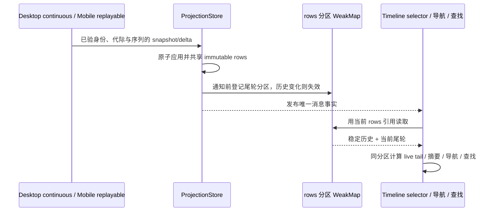

本轮续接证据：分享浮窗组件浏览器 1/1（source-tests-JYVSvQ；1280/390）；安全拒绝结构 6/6（source-tests-KOqjMO）；同 scope 预检取消/重开、session cwd 与日志出口 4/4（source-tests-dmSEuR）；工作区实际 hook/resolver 路由 3/3（source-tests-PX3qWL）；时间线分区/全量 oracle 4/4（source-tests-fvuDMI）。这些定向通过不代表全仓类型或真机验收。最新 UI fresh 门禁 fresh317-ui-sBK77f 仍失败（539 条，当时尚未包含本轮后续时间线修补）；根 typecheck/lint/architecture 仍需最终实跑。

### 默认并发显示收口（2026-11-02）

工作流并发配置和就地调整行沿用官方 3.17.1 规则：`concurrencyCeiling` 表示默认并发 D，不是可配置上限；高于 D 的用户请求保留原值，只有等于 D 或 null 才显示恢复默认。旧 CLI 缺少 D 时不以共享桶水位推断默认。

### 首发组织意图与恢复（2026-11-02）

Composer 点击发送时，在配置屏障前捕获 workspace identity、projectId、taskGroupId 和本地创建来源。projectId 缺省为显式 null；这些字段只作为已有 pending-command 恢复线索，不恢复 groupedDraftTask 或 Renderer 已接受组织事实。创建和预热提升共用该冻结上下文；Host 创建请求转发 projectId，CLI 不接组织字段。

创建 ACK 或用户明确确认的重发结果使用原上下文，经已有 ProjectDirectory owner 等待真实任务行。目录发布与详情提升共帧，导航取消后不得抢回详情；原目录 owner 仍负责完成已接纳的独立组织动作。控制端 Host 的 taskGroupService 校验任务存在性，沿用 creationId 原子幂等登记。失败显示仅重试组织动作的入口，不再次创建任务；组织 RPC 和分组重读不进入目录或首发屏障。桌面 continuous 与手机 replayable 继续共享相同 owner。

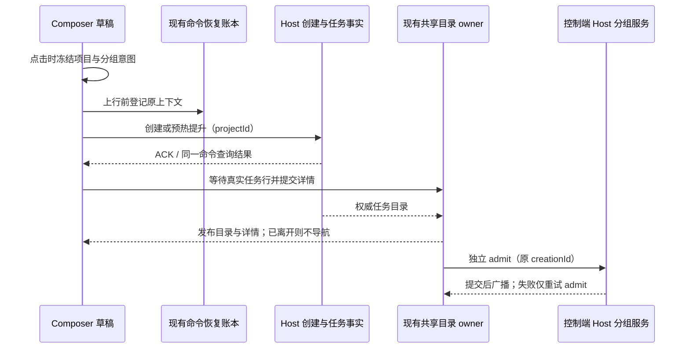

Hook/MCP 待审核改用 Composer 左侧权限按钮旁的 Indicator，提醒已读/忽略仍只属于 Renderer 展示，不改变 Host admission/trust。使用当前有效 session 和 workspace identity；不恢复常驻 banner。`/plan` 文本快捷分支已由当前 parser 退休，Plan 继续通过已有模式菜单表达。思考档回调使用当前菜单单参数契约，同时校验渲染模型与当前草稿一致，拒绝旧模型菜单的迟到选择。

### 创建结算先于 ACK 的身份边界

回归复现：createSession(firstInput) 的 sourceCommandId 权威锚点可能先于 ACK 到达。PendingCommandRegistry 必须在原 workspace 身份匹配时先把 null 创建桶绑定到快照 sessionId，再完成草稿收口并通知订阅；不能先移除订阅再等待 ACK。其它 workspace 的快照不得消费该创建，未传 scope 时不推断 null 创建桶。正常 ACK、duplicate、query 和投影共享一次结算通知。

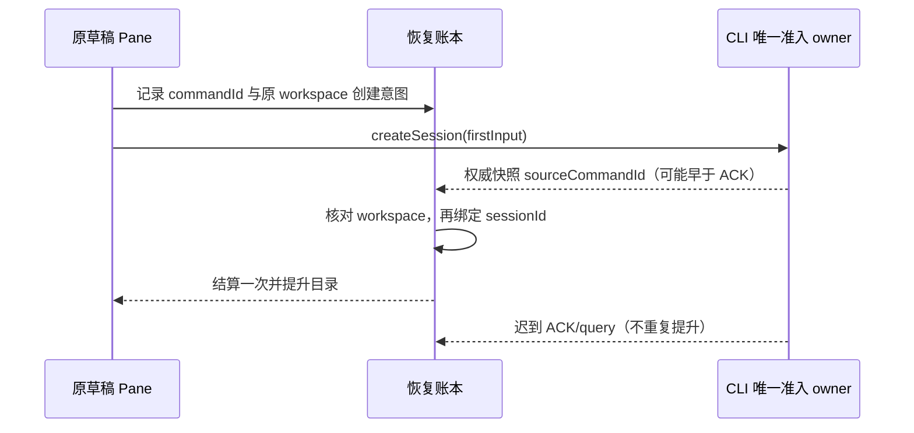

### Root 新建入口恢复

Root 快捷键与侧栏新建仍经同一个 startNewTaskFromActiveWorkspace：先冻结组织意图，由窗口 windowProjectDirectory 的 projectService 准备真实目录，再提交 tab 和草稿。远端复用既有导航端口，手机经已有 bridge 准备目录；迟到的目录准备不能覆盖已切换的任务。窗口项目面和 Source 设备管理面保持分离，不恢复 IServiceAccessor 的旧平行 projectService/remoteProjectService。空态 scratch 创建继续使用本仓 fileService 契约。退休账号参数从 Root 动作契约移除。

导航取消同时约束有目录 Provider 和无 Provider 的 Pane；取消只抑制旧草稿提升，已接受的分组组织继续按原 creationId 结算。目录等待期间捕获同一个 AbortSignal，不从换代后的 controller 读取新导航资格。

### Pane 平台与只读契约

吸收现有宿主下发的 readOnlyReason、compactForRemoteControl、allowEscapeStopOutsidePane：目录只读原因显示在原输入区，观察视图无原因时不误报；紧凑手机行上下文抑制外部应用操作；Esc 只在 focused Pane 内停止，宿主显式许可时才接收 Pane 外的 Esc，弹窗和已消费事件仍让路。不在 Pane 内探测/恢复目录或建立新平台状态。

### 远控 UI 的账号入口剥离

本仓根 WebRemoteControlDialog、useWebRemoteControl 和 camelCase/self-relay 契约继续作为桌面入口。上游新增 web-remote-control/WebRemoteControlDialog、OAuth 同步 hook 与仅服务该弹窗的 presentation 没有实际调用方（不把 barrel 导出当作运行入口），不保留官方账号/手机日志按钮的死代码。保留已经接到手机 Shell 与项目导航的 DeviceHeader、TaskViewReporter；查看上报和导航的兼容接线仍须分别验证。knip 本轮受 desktop vite 的缺失依赖阻断，不据此宣称全仓无孤儿；删除依据为未限 scope 的 dep:refs 和 production 调用/动态路径扫描。

### Source 恢复的当前所有者契约（2026-11-02）

SourceServerManagement 的唯一事件是 onDidChange，唯一快照为 directory/states。Renderer 串行重读快照；历史 identity alias 仍从 SettingService 读取，不把历史复制进 Source 快照。初次恢复和线路真正进入 online 才计算 logical attachment 候选；纯目录改名不触发恢复，主动断开仍由既有 Renderer 门禁阻止自动重连。换代或取消的 effect 不发布迟到结果，队列合并刷新而不并发提交。

本仓 bind 平台操作返回 void，表示 Host 与 Renderer attachment ready 握手已经完成；导航必须重新按 remoteSessionId 读取当前 store 的 services、identity、path 和旧 identity 提示，不读取不存在的返回字段。项目入口仍从 windowProjectDirectory 获取，Source 管理不创建无项目远端目录。Bot 的既有平台重连事件只更新同一 attachment/tab 投影，不恢复已退休 pinned/timeline 缓存。

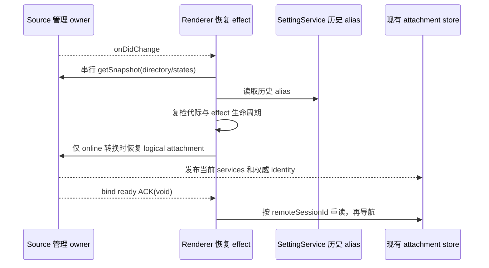

无项目远端对话的旧 intent 继续 fail-closed；已不可达的 openConversation handler、默认远端目录创建和 alias 写入 helper 退休。新建远端任务必须通过已有项目准备及导航端口。当前 connect IPC 不返回 reusedConnectionTarget/profile/Wsl 解析字段，Renderer 不读取不存在的事实；连接目标取 attachment 描述符，失败 code 从 Main 现有归一化结果透传，日志仅保留固定事件。

Root 远端项目接线恢复 attachRemoteProjectWorkspace 公共入口：先由窗口项目 owner 准备 cwd，再校验 host membership 与项目单 root，按完整 identity 查已有 logical session并通过现有控制器绑定。手机 openProjectDraft 从既有 workspace switcher 传入；Root 与远端历史共享已有持久化门禁，恢复失败或未完成时不写回半份目录。重连 restoreSelection 保留当前任务选择；仅显式新建发布原 projectId 草稿。

手机已经完成目录准入的 initialTaskDraft 原样交给现有 startDraftInWorkspace，沿同一 workspace identity 接收项目、分组和 Composer 附件，不再次准备目录或发送输入。显式 initialTaskId 优先；没有显式草稿的 renderer reload 保留续流选择，普通冷启动仍进入草稿。启动注入等待历史恢复门禁，每个 Root 生命周期仅执行一次。

### 本仓手机导航与瞬时查看接线

手机实际入口仍为独立 MobileApp，并非带官方账号的 Root/relay 页面。Root 的可选 prepared draft 端口完成契约修复，不能据此宣称手机项目创建 UI 已接入。本仓窗口 workspace 同步沿既有对象载荷发送完整 workspaceKey，不改成上游数组签名。

导航位置只用于恢复入口；瞬时查看来自已显示的 MobileApp 任务投影和页面可见性。Main 持有本次配对 epoch 和单调 seq，验证当前 bridgeSessionId、bridge generation、workspace identity 与任务行后发布 mobileTaskView；不以导航位置推断查看，不保存任务业务状态。配对、断链、换桥或删除目标立即撤销查看资格。手机收到 epoch 请求后重报当前可见目标，后台/页面隐藏发送 null；晚到的旧 epoch、seq 或 bridge 报告丢弃。Main 仅从 bridge 清单补 remoteSessionId，不信任手机提交的远端路由。Host 原有未读 CAS 与 owner/lease 保持唯一写者，Main 不写任务库。

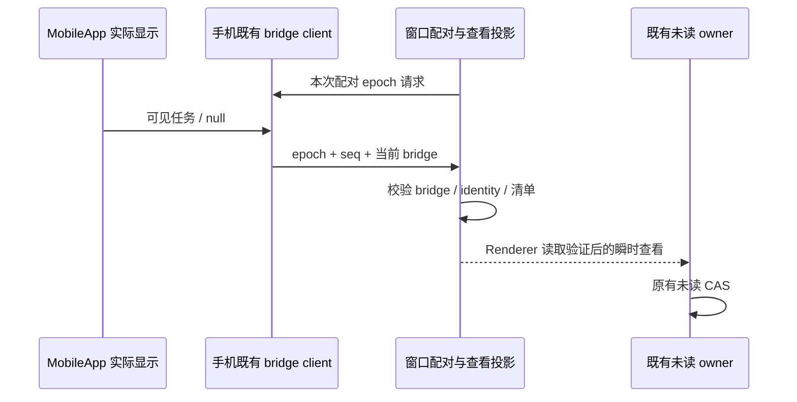

验证依赖随当前源码及 lockfile 收口，保留已吸收的 Windows/macOS 桌面、旧 CUA 和 E2E 工具版本；UI 的本地音频/JSX 组件使用官方声明的 media-chrome、react-jsx-parser。工作区跨平台预取仅保留 current/darwin/win32，不预取 Linux 发行或远端运行资源。本机仅安装校验依赖并禁用全部安装脚本，不打包、不触发 Electron/浏览器自动下载；store/cache/HOME/TEMP 全部位于当前工作树。

SSH backend 的同一次握手由一个 Promise 和同一个结算回调持有。dispose 先拒绝在途握手并摘掉临时监听，再关闭 socket；不依赖 TCP 超时或 close 到达。ready/error/close/cancel 只能结算一次，旧 client 和旧 generation 不能改写后继连接；常驻 error sink 留到 client 回收。测试只执行生产类配假 socket，不访问真实 known_hosts 或远端。

Core HTTP 继续只接收一个 ingress 鉴权中间件：匿名 server-info 仅返回版本、兼容性和鉴权要求，不返回 Source 身份、工作区或迁移事实；业务 RPC 必须持有正确 ingress token，Host RPC 还要消费一次性 capability。同一 socket 关闭先退休资源返回 peer，再释放频道、反向 client、协议与 connection facade。独立 CLI 的显式本地归档安装进度由自身安装器的阶段类型描述，不恢复桌面自动部署协议。

窗口项目组直接引用本机 Host 已有的 ProjectService/RemoteProjectService，并从同一 BroadcastService 发布变化；远端任务 attachment 不把 Source 的项目服务当作窗口目录。退休的窗口数组投影不再装配或消费。Host-wide 任务查询直接读取当前本机 TaskService 的持久化索引，不初始化未打开目录的 Agent。

desktop-attached 远端 Bot 的项目解析复用该本机 Host ProjectService，不读取远端项目 owner，不新建 Repo；缺少本机 owner 时拒绝装配。Source Profile 只接收现有 SSH/WSL/Docker 合同，HTTP server target 不进入此目录，不产生目录或凭据写入。Source 设置 attachment 不装配没有节点端注册及 UI 消费者的 OutputStyle channel。已删除的并列 windowTopicResourceRelay 不保留孤儿 module/contract；资源返回沿现有可信 peer 和物理连接 owner 处理。

Main 启动恢复只读取已解析的 lastWorkspaceSession/lastActiveTabIndex；本地预热仍最多一个，远端条目不成为本机 CLI 执行目录。浏览器 viewport IPC 以实际 sender 的 zoom factor 传给唯一 BrowserGuestManager，不接受 Renderer 提供另一份桌面缩放事实。关闭驻留托盘能力按本 fork 的 Windows/macOS 范围返回，不调用已退休的 Linux 桌面扩展探测器。

设置 hook 的平台订阅与已有按服务隔离的快照缓存共用生命周期：同一 settingService/platform 只注册一次 IPC listener，显式 cacheKey 消费者按引用计数注册刷新目标，最后一个消费者卸载才释放。不能引用未装配的平行 SettingsStore。Composer 从宿主 compactForRemoteControl 取得手机远控边界，并读取既有移动输入媒体查询；Ctrl/Cmd+Enter 的规则保持桌面窄窗口可用、手机远控移动输入不启用。

内置浏览器资源仍由 Main 的窗口 owner 持有。Main 首次为窗口启动 Host 时生成浏览器 id/generation，经 init-local 传给 Host；同一窗口的 Host 重建复用该身份，窗口关闭则退休。Host 不生成浏览器身份，Main 执行前复检当前窗口身份，过期或未初始化请求返回安全失败，不能创建 tab 或开始录制。

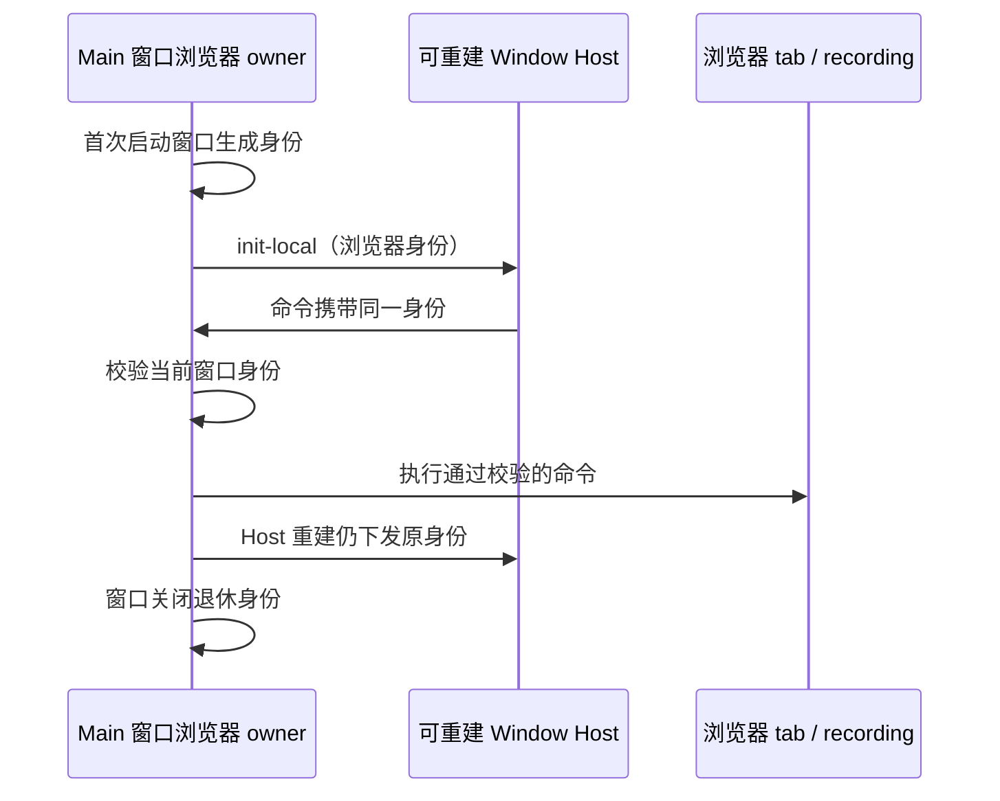

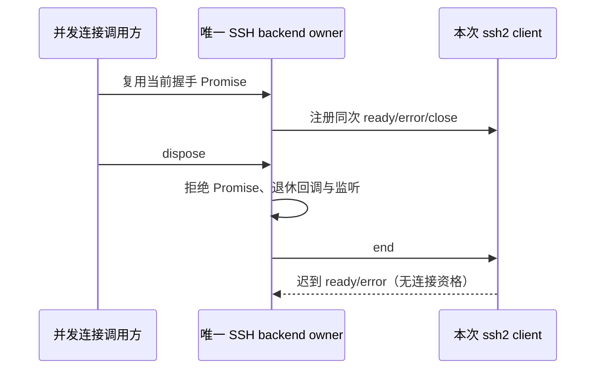

主草稿执行与侧栏归属只取 activeTaskId 或当前 scopeToken 下的 primaryDraftEffectiveSessionBinding；未预热时保持 null，不恢复已删 workspaceState.draftSessionId。scope 换代沿既有 generation gate 拒绝迟到绑定。Shell 不传已退休的 scratch workspace、并列插件管理与 treemapping 端口；新任务仍走已有 Root 目录 admission。图片预览使用现有 resolvePreviewPaneImageFileReference，源文件的 path/identity 与当前目标 workspaceKey 一起参与准入，同路径的不同远端不能添加到当前草稿。

配置目录 alias admission 必须持有实际 sourceServerWorkspaceService；端口缺席不开放配置 ready，已退休 attachment 的迟到结果不发布。user-config-sync 的分类适配只绑定实际通道，缺席以固定 service-unavailable 错误拒绝，不返回假同步成功。归档导入使用已有 resolveImportedComposerConfig，并经 setActiveTaskId 的 composerConfig 参数向唯一 Composer 初始化 owner 交接；reused 或已有草稿不覆写。退休的无消费者 groupedTaskView 投影移除，当前控制端 task-groups owner 不变。

Shell 只消费 App 已解析的会话执行目录与 ready 状态，并用现有 resolveTerminalWorkspaceScopeKey 生成终端隔离 key；desktop 主 pane 的预热回调与 scopeToken 必须贯穿 Shell，不由 Shell 复制预热 session 状态。工作流后继 run、Read 卡和产物 chip 原样保留 tab 冻结的 fileReferenceRootPath，workspacePath 继续表示身份根。

连接选择器直接接收 flow 从本机 SettingService 读取的 remoteHistory；Source snapshot 不复制历史，Profile 线路类型来自 target.kind，当前 directory 的 Profile 无虚构 retired 字段。项目恢复 helper 显式接收历史 alias 并保留成员复验；安装状态只取严格连接 state，不读取不存在的 server.installState/raw state.error。身份详情没有退休操作日志端口时只展示已知 connecting 状态，不猜测安装阶段、进度或耗时。旧手机 rendererAction IPC 没有装配方，移除孤儿执行入口；本仓手机仍沿既有 Host/RPC 动作通道。

插件 UI 裁决恢复本仓已有发布者句柄合同：Timeline 更新同一句柄，换 session 或卸载释放，最后一个活视图释放后删除派生裁决，不持久累计历史会话。Launcher 从当前管理 store 已知 manifest 的 uiSurfaces 派生入口，未知目录条目不猜 surface；商店目录保持既有目录顺序，不加载退休官方 rollout 推荐排序。插件安装/启用仍由原管理 store admission，不新增下载或官方目录来源。

### 任务导航的精确 attachment 复验

任务导航只读窗口 tab owner，不创建远端 attachment。本地目标仅匹配同路径且没有 identity、remoteSessionId、remoteTarget 的 tab；显式远端 identity 按 trim 后身份匹配，不受路径别名影响，显式 remoteSessionId 必须同时匹配。旧 session-only 远端按路径及明确 attachment 匹配。找不到远端目标时保留当前页面并拒绝导航，只有本地目标允许补开本地 tab。自动化运行历史将冻结的 remoteSessionId 传入同一准入路径。

界面容器只传当前公开合同。已退休的官方 user/login/logout 不再传向 Header 或 Footer；插件市场返回动作由拥有 side pane tab 的容器提供，关闭市场后只回到同 workspace/owner 的原 tab。插件页安装状态来自真实 activeOperations。自动归档仍由既有 SettingService/Host owner 执行，通用设置页接入已存在 TaskAutoArchiveSettings 控件与当前两个设置字段，不删除行为也不新增组织状态。

模型档位事件冻结渲染时的 provider/model，处理时复验当前 scope、当前 draft 的同一模型以及最新 ready 能力目录。迟到旧模型事件、scope 换代、目录等待或新目录撤销能力均不得持久化；目录只为原服务快照的读引用，不新增草稿或模型事实 owner。

桌面测试启动不再播种官方 OAuth/JWT，也不装配已退休 OffPeak gateway、配置生成或 beforeSession 回调。原 e2e-startup-credentials 仅生成官方身份，不含 Provider API Key 写入，连同专属测试删除；普通 Provider 测试沿原配置路径保留。request-security-edition 已是无行为 stub，移除其 runner 装配与空模块，不以恢复共享 stub 通过检查。E2E 本地显式抓包的通用凭据脱敏保留，取消对上游空敏感头数组的导入；默认回放与真实手机验收仍单独记录。

手机会话测试准备复用本仓自托管 relay 的真实匿名配对协议。测试只在 loopback 启动 relay，将 WebRemoteControl 的自定义 endpoint 写入隔离 setting.json，手机入口使用本仓 mobile.html；不生成官方账号凭据、不模拟官方设备 API 或手机推送。桌面与手机仍共用现有 Host attachment，夹具只负责网络服务和隔离路径，不持有任务队列或快照。所有配置、Vite 缓存、日志及子进程 HOME/TEMP 限于当前工作树，失败和正常结束均关闭服务并恢复夹具环境。旧 OAuth 门禁/登出与官方推送用例退休；保留本地配对、恢复及会话用例的入口，验证需区分协议回归与完整真机验收。

本地分享浏览器夹具与真实 dock 合同一致：披露确认由 ConfirmationDock 自身拥有，selection store 不写第二份披露字段；进度只使用 collecting、packing、saving，结果只使用 exportedFile 的文件名与下载状态。成功界面不出现云分享 URL、复制链接或打开官方页面。范围事务、预检查阻断、同轮选择、取消恢复以及桌面/手机布局断言继续保留。

桌面 E2E 的 `http-mitm-proxy@1.1.0` 只作为开发依赖保留，用于显式 Provider capture 或受控 HTTPS fixture；生产运行时不装配，不恢复 ARMS 或自动模型轨迹模块。默认 runner 沿既有 replay 入口，代理只在测试调用时加载。CA、capture artifact 与叶子证书清理必须在经过重解析点校验的当前工作树内；监听限于 loopback。NO_PROXY 默认只含 loopback，取消官方账号/支付/CDN 的直连例外；所有 capture 成品留在隔离目录，经既有凭据脱敏后写入，不向官方平台上传。

旧 loopback 分享 HTTP Mock 仍有 WDIO 动态装配，但模拟的是已退休的官方 preparation/upload/confirm/云 URL 协议。它和装配 helper/专属 multipart 上传测试整体删除，不把“服务监听本地”当成本地 ZIP 导出语义。现有完整性摘要、公共投影、文件字节和本地 ZIP 导出测试继续保留。旧 AUTH-08 OAuth 登出 E2E 退休；凭据保存失败仍可使用当前内存配对的规则由现存 manager 回归验证，不沿用旧“官方新设备保存失败须清账号设备”的断言。

Knip 对 Desktop 的 WDIO 配置和 E2E spec/helper 使用显式源码 entry。禁用会执行 `wdio.conf.ts` 的 WebdriverIO 配置加载插件，避免静态导出引用检查触发 Electron 安装、网络访问或测试目录写入；WDIO 源码本身及测试引用仍进入分析图，不忽略其文件或依赖。

继续收口桌面 E2E 时，退休只验证官方账号、套餐购买、OffPeak 网关与 ARMS/event-report 的专属测试和装配；混合会话场景保留任务、后台运行、远程连接和普通 Provider 行为断言。连接目录读取沿当前 `snapshot.directory` 合同，不恢复旧顶层镜像字段或自动安装生命周期。旧登录门控迁移到现有本地 Provider 配置入口，不能重新暴露官方登录。LocalTtftRecorder 的原样拆分继续由 recorder 拥有唯一 records/requestState，辅助函数只更新传入事实，不建立另一份状态或触发上报。

桌面远端自动更新、卸载重装的专属验收入口随产品边界退休；预部署 Source 的显式连接、断开、停止、重启与 running-task 守卫继续由现有合同和回归覆盖。只为官方 session-open ARMS 事件造样本的测试退休，不将其标为保留的会话重开 E2E。已删除的官方账号 Mock 测试不恢复控制面；构建复用的异步屏障与显式开关仍由独立本地测试验证。

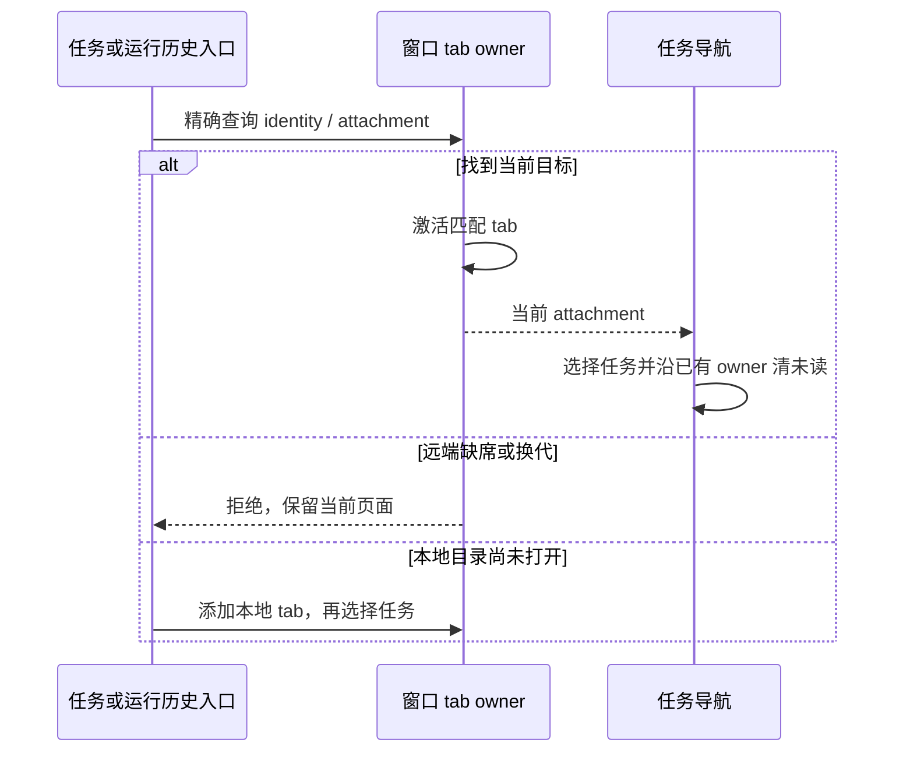

### Bot 的现有 Source 装配恢复（2026-11-02）

Bot 不创建 logical tab、attachment 或第二个 Agent。物理连接事实继续归 SourceConnectionManager / WindowRemoteConnectionRegistry；两者提供只读在线 scope，离线、busy、关闭与换代均拒绝。Bot runtime 复用此 scope 的 task/model/agent 服务，组织态命令仍经过窗口 Controller。没有窗口 tab 的稳定 Source 查询也可以按 sourceServerId 读取已在线物理服务，明确 attachment 的请求仍优先复验原 session，不能绕过失败 attachment。

旧授权 identity 只有与当前 Source Directory 的完整 Profile target 构造结果精确相等时，才可映射到该 Profile 的稳定 Source ID；同路径、多来源歧义或未绑定 Profile 不产生授权。规范化与每次命令准入都经过当前只读 workspace inspection，检查 owner 前后相同；history-present 不自动迁移。普通 Bot 输入不触发连接；显式重连只能通过既有设备 connectProfile 命令，未部署或缺少设备线路时失败。

验收覆盖：legacy/stable 同一 Source 两次 prompt、无本地 fallback、无新增物理连接；未知/歧义 alias 拒绝；只读检查期间断线换代拒绝；源目录/path 不匹配与 history-present 拒绝；组织态路由保留 Controller admission。以上为受控运行时回归，实体远端与 IM 传输未验收。

无 tab 的 Source 由 Controller 在订阅、索引读取、搜索和写操作前执行同一 workspace inspection；异步返回后复验当前服务与 Source owner。Bot 的任务方法每次调用重新检查工作区，参数中显式提供的 path/identity 不得跨越已授权 scope，只有 taskId 的调用先通过当前 scope 的任务元数据核对归属。不增加连接缓存或接受输入队列。

通用 `connectRemote` 也只启动预部署服务；省略 options 不触发 deploy，旧 skipDeploy 参数仅兼容调用者。显式离线归档安装仍由独立安装入口负责，不与连接命令联动。

旧 SSH 分享 E2E 的官方 JWT、云上传/预览下载和远端目录写入清理整体退休。替代回归使用真实分享服务与 attachment facade、受控远端 Rows/File 端口生成本地 ZIP，并逐字节验证产物、句柄隔离和越界拒绝；不把该回归记作实体 SSH 或完整桌面 E2E。旧 shell marker 探测/安装状态 E2E 随已删除的部署 probe 退休；预部署 Source 连接失败保留 Profile/Source 身份、恢复连接不部署的规则使用当前 manager/transport 回归。

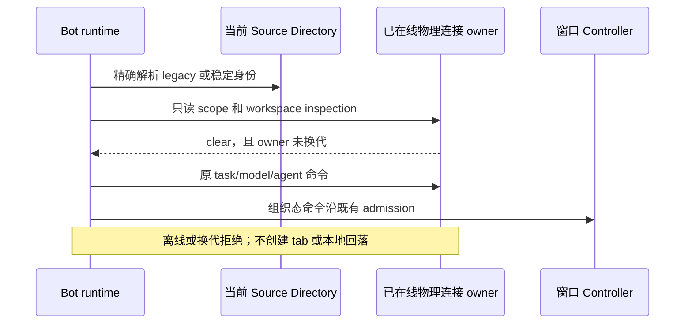

真实 Host/Worker 的创建重试与崩溃后原信封重放继续保留，Provider 夹具改为正式 BYOK 文件与独立 loopback 回放。退休只验证 Individual/Team 账号切换和权益交付延迟的 W99 专属场景，保留 Bot 下一轮、附件顺序、立即设置、Worker 重建后设置持久化与非法档位拒绝。请求证据来自显式本地 HTTP 回放 artifact，不依赖已退休的自动 model-io 录制。所有库、网络证据和子进程写入根都显式固定在当前工作树；不把 Provider HTTP 假件当作 CLI admission 假件。

Worker 夹具允许显式选择项目内 CLI 入口与 Node loader，当前源码验证使用 `src/main.ts` 和各包公开源码 aliases；发行 E2E 默认入口仍按被测安装包。fixture 的单一释放入口按 syncer → Agent → Repo → Provider runtime → replay 顺序逐项收尾；任一项失败不跳过后续释放，最后必定恢复之前的 data base dir，并向调用方保留释放错误。测试开始前校验全部路径及子进程 HOME/TEMP/cache/log/Provider/SQLite 路径，无项目外 fallback。

### 本次源码职责登记

固定官方提交的原样新增文件按既有双快照准入核验。本仓适配按下表登记具体文件及契约目录，未扩成 packages/apps 全域受管，不更新架构 baseline、不新增长度例外。登记只描述现有实现，状态所有者与事件顺序沿原合同。

| 模块                             | Owner            | 现有职责                                                                                                                                 |
| -------------------------------- | ---------------- | ---------------------------------------------------------------------------------------------------------------------------------------- |
| provider-endpoint-routing        | model-provider   | 只解析用户自选 Provider 的现有路由端口；无官方鉴权、账号或自动端点回退。                                                                 |
| project-memory-runtime           | conversation     | 缓存及待更新事实仍归原 AgentRuntime；辅助函数消费同一 runtime，取消和迟到结果保持既有代际规则。                                          |
| turn-tool-visibility             | agent-tools      | 从当前 turn/runtime 派生可见工具，不复制注册表、不恢复官方命令。                                                                         |
| desktop-source-settings-bridge   | remote           | 校验窗口事件和 attachment 后转交现有 MessagePort 服务连接；Source 服务身份和释放仍归既有端口 owner。                                     |
| desktop-test-config              | testing          | 只配置已有桌面 E2E runner；测试数据及子进程写入当前项目隔离根，不装配官方账号与云回放。                                                  |
| conversation-share-local-context | conversation     | 分享沿当前可信 attachment 读取冻结的会话/工作流/文件；只生成本地导出上下文，不上传，不制造第二个连接或快照 owner。                       |
| subagent-runtime-config          | agent-config     | 现有缓存按真实目录及 workspaceIdentity 隔离；原配置 scope 持有文件监听与代际，不复写 Agent 已接受输入。                                  |
| user-instructions                | desktop-settings | 用户指令按现有 .zcodium 路径显式读写，统一 100KB 校验；不读取官方账号，不创建第二份设置状态。                                            |
| conversation-ui-metadata         | conversation     | 首次创建来源和会话 DOM 定位标识是纯契约；不保存会话事实，不涉及遥测或网络。                                                              |
| windows-caption-menu             | desktop-shell    | Windows 标题菜单通过现有平台 hooks 发命令；更新状态来自原 owner，不恢复官方更新源。                                                      |
| source-server-ui                 | remote           | Source snapshot、名称/状态发布者、线路选择和窗口意图各复用既有 owner；Controller 只发原命令，投影不持久化连接事实、不触发部署。          |
| conversation-render-parts        | conversation     | 从当前协议 rows、活动和冻结文件根派生渲染/导航；不推断 Host 组织态，不新建 accepted queue，不更改 desktop continuous 或手机 replayable。 |
| server-docker-arguments          | remote           | 纯构造显式 Docker 命令参数；实际子进程与连接仍由既有 backend 持有，不下载运行资源。                                                      |
| web-theme-seed                   | desktop-settings | 只解释已有主题偏好及本地默认主题；不网络拉取配置，不额外写设置。                                                                         |
| cua-test-config                  | testing          | 保留旧 CUA 后端测试入口；不引入不可用官方电脑操作后端或平台下载。                                                                        |
| local-ttft-renderer              | diagnostics      | Renderer 独占提交/渲染时钟与现有观测缓存；采样和导出默认关闭，无官方接收端。                                                             |

工作流审批入口、canonical replay、Host attachment RPC 策略和手机状态 hook 分别补入既有 workflow-tool-entrypoints、cli-session-execution、desktop-source-connection、web-remote-control-ui，依赖按实际 import 推导，公开入口保留当前调用面。

### Web 启动壳合并修复

Web 入口保持一个 head/body/root，预渲染 logo 与主题样式全部在 head 内同一 style 中，主 bundle 只加载一次。合并误留的空 root 与提前闭合标签删除；现有首屏主题与 bootstrap 快照规则不变。新增 markup 回归先实测失败，再验证修补。

### 最终职责拆分与菜单证据

PendingCommandRegistry 继续独占 entries、storage、reconcileInFlight 与 resolution listener；恢复线索不能自动重放 CLI 已接受的输入。类型和校验函数独立，Composer 接收/拒绝/草稿归属检查仅消费同一 entry 与同一 storage，原调用点和异常语义保持，不引入第二份账本、草稿或重试状态。

WebRemoteControlManager 的公开类型拆出后仍由原 factory 闭包持有窗口 runtime、deviceSid 路由、生命周期 symbol 和授权 store；不移动或改变异步初始化、停止、配对和 bridge admission。

工作流分析的类型、参数替换及 lane 纯投影帮助函数拆分后，AnalysisState/Evaluator 仍持有原值图、不动点和 cache；所有函数继续读写原参数对象，不克隆状态或增加 IO。插件商店动作类型/徽标与产物头部仅复用父组件的当前 props，安装进行中事实、lease、版本与 hook 均归原 owner。

分组标题与任务行的 Radix asChild 必须直接包住原 DOM，组件层不得吞掉注入的事件/ref。Chromium 1280/390 × tooltip 开关四组合的真实 GroupItem/TaskRowContent 回归通过：重命名、IME Enter、普通 Enter、Escape、任务右键动作及原 dnd aria 保留；无 pageerror 或外部网络。证据 source-tests-NG8dcW，保持组件候选 pending-review，完整 Electron、实体手机与实际拖拽未验收。

### 文件链接来源隔离的最终复核

Markdown 文件链接已有 workspacePath/identity/remoteSessionId 时，右键 stat 和编辑器动作必须按同一精确来源解析；只有没有来源的旧链接保留 ambient 兼容。跨 Host 分屏打开 sink 复用现有 resolveTaskExecutionWorkspaceServices，base-local 意图明确走本机，显式远端断连不查本机。原 workspace 只读限制与打开/预览行为保留，不新建连接、tab 或来源缓存。新增回归执行真实 Shell callback，分别核对远端、本机及失效远端的实际 stat 接收端。

### 工作流入口与执行根的合并恢复

恢复 conversation-session-workspace 既有规则：保存的 run/产物入口原样传递请求 identity 与冻结 cwd，使用现有精确 tab 解析器，不能借活动远端身份。侧栏摘要没有 cwd 时，从来源 Host 的会话端口查询；断连、查不到或查询失败均停止打开。Shell 持有原代际 ref，新的点击、任务/Host/侧栏变化和卸载使旧响应失效，不使用超时。后继 run、actor、脚本和产物继续传递同一冻结根；脚本日志文件动作优先使用 journal 返回的 executionWorkspacePath。旧无显式 cwd 的终端回落当前会话执行根，显式 tab.cwd 保持优先。

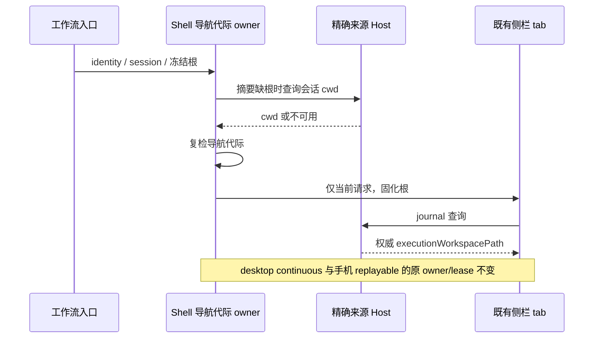

验收候选覆盖同路径本机/远端、断连、连续点击与迟到查询、保存的 run/产物以及关联 tab 的相对文件动作。源码 callback 证据只证明导航接线，完整 Electron/手机交互保留 pending-review，不冒称真机验收。

### 最终主代理验证与本地交付范围（2026-11-02）

本节是最终固定源码的结果，前文各阶段失败和早期验证保留为历史记录。续接由主代理独立完成，没有再次分派子代理；此前 95/95 工作流、19/19 内置插件等证据不冒充本轮重跑。所有验证、缓存、数据库、浏览器 profile 和日志均在当前工作树的隔离目录，使用 Node 24.14.0 / Corepack pnpm 10.33.2。

| 检查            | 实际结果                                                                                                     | 项目内证据                                                                                   |
| --------------- | ------------------------------------------------------------------------------------------------------------ | -------------------------------------------------------------------------------------------- |
| 根 typecheck    | exit 0；两个适配文件空白清理后再次执行                                                                       | official317-typecheck-9SdSRZ/logs/validation.log                                             |
| changed 架构    | exit 0，violations / baseline / new 均 0；暂存后复跑                                                         | official317-architecture-BHywRU/logs/validation.log                                          |
| CLI 类型        | core、bootstrap、cli、node-repl-host、dynamic-workflow 五包均 0 错误                                         | continue317-cli-types-sKfrkL                                                                 |
| 源码与接线回归  | 129/129；含审计、平台、Source 生命周期与 Worker 释放                                                         | source-tests-b1cgH8/logs/source-tests.log                                                    |
| 真实 CLI Worker | 1/1；BYOK、选择持久化、冷恢复及附件顺序                                                                      | source-tests-3bsrMd/logs/source-tests.log                                                    |
| 浏览器及接线    | 4/4，其中 3 个真实组件场景和 1 个静态接线场景；分组菜单、自动归档和本地错误                                  | source-tests-SkzVom/logs/source-tests.log                                                    |
| CLI registry    | exit 0                                                                                                       | resume317-cli-gates-tZG2b6/logs/registry-check.log                                           |
| 根 Lint         | exit 1，9 errors / 157 warnings；最终复跑结果不变，9 个错误均为官方原样文件的 max-lines                      | official317-lint-xo7DZQ/logs/validation.log                                                  |
| CLI 独立 Lint   | exit 1，89 errors / 80 warnings；89 个错误均为 max-lines                                                     | resume317-cli-gates-tZG2b6/logs/lint.log                                                     |
| 最终 fmt:check  | pnpm exit 2；1606 个待格式化文件全部与固定官方提交相同，本仓适配为 0；另有 4 个官方原样 HTML 解析错误        | official317-fmt-check-ctbg3j/logs/validation.log；resume317-format-review-2i0OYJ/report.json |
| 锁文件声明核对  | 54/54 importer、104 个 workspace link、7 个 patch 哈希一致；17 个 React override 与 UI 的 2 个自动 peer 正确 | resume317-lock-static-EX89nq/report.json                                                     |

上表证据的共同根为项目内忽略目录 .run-logs/project-only-validation/，不进入提交。CLI Lint 的 14 个错误文件与合并前 HEAD 相同，26 个与固定官方提交相同，其中 6 个同时相同；其余 55 个文件包含本仓适配，不能全部称为官方原样欠账。分类见 resume317-cli-lint-review-YY8dsH/report.json；同步前的 79 errors / 55 warnings 仅是旧基线。

格式首轮的 1621 个文件中，15 个本仓适配已修，最终只剩 1606 个官方原样文件。四个格式解析失败文件为 docs/electron/docs/fiddles/ 下的 features/web-serial/index.html、features/represented-file/index.html、system/clipboard/copy/index.html 与 media/screenshot/take-screenshot/index.html，均已逐个核对官方 blob。保留原样新增源码的双快照准入，没有全仓重格式化、放宽 Lint/架构规则或刷新 baseline。

冻结安装在复制的 54 个 manifest、workspace 配置、锁文件和补丁上离线执行，先受 Node 链接权限限制，调整为复制工作区内 store 后仍受 fsync 权限限制；两次均 exit 1，原锁文件与复制锁文件均未修改。日志 resume317-lock-check-9CqiO6 与 resume317-lock-check-XKnsCV；静态声明核对通过不等于完成 frozen install 或依赖安装验收。

真实 Worker 回归运行中仍有 meta_json 校验和退出退订警告，尚未单独定位，不能声称运行无警告。浏览器证据保持 pending-review，不晋升 formal/CI；完整 Electron、macOS 原生、实体手机、真实 SSH/IM、原生 CUA 输入、安装包与完整语料均未验收。

本地交付采用双父 merge commit，再将 main 快进至同步分支；提交号及分支状态以本地 Git 图为准。提交只包含同步源码、契约、测试和维护文档，项目内日志、工具链、缓存、合并临时副本与既有未知文件保留在当前工作树，排除在提交之外。用户授权展示中文文案后直接创建本地提交；不推送、不构建、不安装、不提 PR。

最终暂存按明确的 NUL pathspec 执行，900 个未解决索引路径归零，79 个临时或未知文件均排除并保留；跟踪文件没有未暂存差异。暂存后的审计守卫 11/11（source-tests-bAKos9）单独复跑，不重复计入 129 项。差分检查最初 638 条/79 文件，清理两个本仓适配文件的 5 处空白后，TypeScript AST 打印前后一致；最终 git diff --cached --check 仍 exit 2，633 条空白诊断全部来自 77 个官方原样文件，无适配文件诊断或冲突标记。最终分类见 resume317-diff-review-ph5BbC/report.json。
