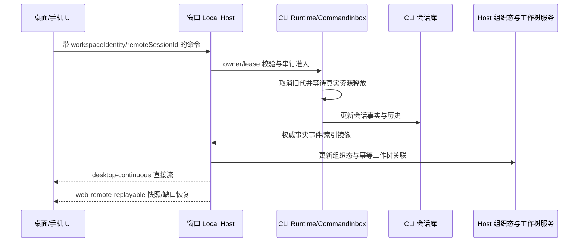
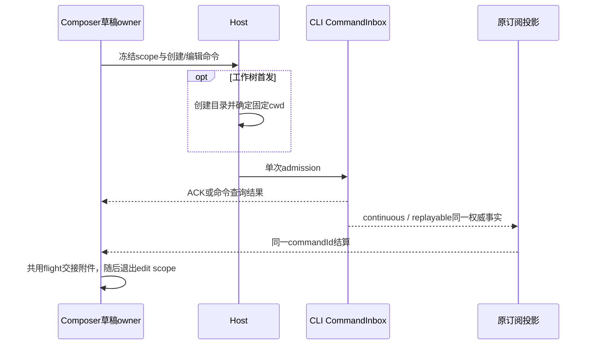
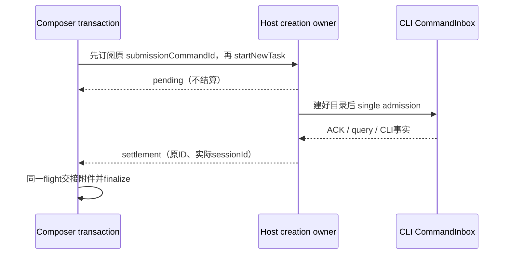

# 官方 3.18.2 合并与本仓审计

## 授权、基线与范围

用户于 2026-11-20 授权合并全部可兼容的官方更新，剥离现有 spec 禁止的官方服务依赖，保留全部自有修改并执行测试。唯一上游为 `zai-org/ZCode`；不合并第三方 fork，不推送、不创建 PR/issue、不触发 Actions、不打安装包。

起点为 `codex/rollback-before-native-context@03f5d4e56c581b11ac59c85fbec3ed0583496f66`，已吸收官方 `a60ba6a7e5a06742270ca605f5d2cc2766afa7e1` / 3.17.1。本次目标为 GitHub API 与 `ls-remote` 核实的官方 `fec975905a2abd4c07e35c40d51fa097a2258ec9` / 3.18.2，采用 `codex/official-3.18.2` 分支上的真实 merge。版本沿官方源码基线，本轮不发行。

从当前回退基线开始，不合并带已撤回原生上下文压缩的 `origin/main`。现有四份提示词/测试改动与 `native-context-rollback.md` 单独保存字节、SHA-256、Git 补丁与 stash，完成后恢复为原有未提交改动，不归入同步提交。本仓原生压缩模块、原图回取及其数据库迁移不恢复；渠道级请求压缩与其降级、option-map 装配顺序和草稿保存继续保留。

## 产品规则

吸收范围包括官方 3.17.2、3.18.0、3.18.1、3.18.2 中可独立工作的 Git worktree、浏览器设计/元素引用/本地预览隔离/设备预设/导出/热刷新、Extension Host、输入框编辑、流式 Markdown/历史恢复、会话控制工具、App 本地项目/任务控制、语言与平台修复、用户自有凭据保护。实施以实际源码和运行入口为准，不能以整文件保留本仓替代逐块融合。

以下审计边界沿用 [维护模型](maintenance-model.md) 与已有功能 spec：

- 保留 ZCodium 品牌、`.zcodium` 数据根、自有 `ZCODIUM_UPDATE_ORIGIN`，未配置时不检查更新且不回退官方；保留许可证与版权。
- 不引入官方账号/登录/OAuth、购买/套餐/权益/云配额、分享/上传/Sites、官方 MCP 凭据、市场自动拉取或官方在线搜索/推荐、client config/rollout、官方 relay/更新源/手机推送。
- 官方 ASR 依赖登录和官方服务，移除该实现及其 UI/设置/工具/依赖；不得保留空按钮或假能力。未来自建语音适配需单独产品契约。
- 不恢复官方遥测/ARMS/崩溃采集/UI 埋点/自动模型原文录制。安全本地技术日志保留；后台资源采样默认关闭，仅显式启用；自建 OTLP 必须显式开启及配置。任何日志级别继续遵守隐私净化边界。
- 桌面只支持 Windows exe、macOS dmg；不引入 Linux 桌面安装/下载/嵌入/远端发行资源。通用 CLI/Server 的既有跨平台契约继续保留。
- 用户自选 Provider API、个人 Key quota、普通 MCP OAuth、个人插件来源、历史 ID/fail-closed schema、只读历史轨迹按既有允许契约保留。凭据存储安全改进只应用于自有配置，不自动读取或迁移官方账号目录。
- 插件搜索/推荐可兼容保留纯本地 BM25、分页和显式确认：只搜索随包 seed 目录，内置市场刷新仅重读本地；安装/恢复复用随包缓存，无远端市场或官方地址 fallback。自动推荐默认关闭，开启也不能扩大数据来源；个人来源仍只走用户原有显式操作。CLI 生命周期唯一持有安全重载资格，不自动发送或重放输入。
- 已删除官方模块保持删除；保留的本仓 CUA 后端、纯本地内置插件与图标、Provider、工作流、配置目录、导入导出和日志接口不得为上游新接线覆盖。

## 唯一所有者与事件顺序

CLI 唯一持有会话存在性、标题、正文、CLI 时间、终态与 accepted 输入；Host 持有项目/分组/置顶/归档/未读 CAS 和本地工作树生命周期。Main 只负责原生窗口/进程/消息转发。UI 只持有草稿和投影；编辑 queued 消息也必须经原有 admission 路径，不新建已接受队列。保留共享 chat CLI、stale run 防护、身份与路径分离、永久绑定 cwd；工作树创建新任务使用新 cwd，不静默修改既有会话 cwd。

浏览器文件写回经既有文件/平台服务和明确工作区权限；撤销重做属于编辑 owner。本地预览文件隔离不能扩大现有文件范围。Extension Host 经公开契约、能力声明和消息校验接入，不直接取得业务状态所有权。远端仍只显式连接用户预部署服务，手机仍复用已有 Host attachment/runtime。

## 验收与本仓修改保护

1. 官方目标为真实 merge 第二父；原起点与官方目标均是最终历史祖先。不以整树 ours 或第三方代码冒充同步。
2. 原始未提交文件副本 SHA-256 一致；恢复后逐项比较原始差异。上游有重叠时保留本仓语义并记录融合依据。
3. 自动合并与冲突文件均复核新增依赖、端点、UI、设置、日志与数据路径；官方依赖模块、引用和文案同步清理。
4. 既有渠道压缩/提示词/工作流/模型目录、Markdown 复制/summary/配置菜单、归档/未读/分组/共享 CLI/迁移/身份/生命周期/浏览器权限/图标/安全日志回归按实际影响执行。
5. 交互场景：创建/分叉/移除工作树后任务 cwd 与归属不串；浏览器设计写回/撤销/导出与预览隔离；输入框编辑原消息和排队输入；Extension Host 启停与迟到结果；桌面/手机、本地/远端身份与 streaming/replay 语义。能运行的隔离场景实际执行，真机或远端未执行必须列明。
6. 必须执行根 `corepack pnpm typecheck`、`lint`、`fmt:check`、`architecture:check --changed`，CLI `typecheck`/`lint` 及审计守卫。失败区分新引入、已存在与环境限制，不恢复官方模块或放宽基线使绿。
7. Node 24.14.0/Corepack pnpm 10.33.2，测试数据/HOME/TEMP/缓存/日志/子进程写入均在当前项目工作树；先验证真实路径及重解析点，不能证明范围的入口不运行。不得打开/迁移/清理真实用户 `.zcodium`。
8. 在维护模型记录实际吸收项、剥离项、未同步项、验证结果和限制。原回退版本对已完成 native-context 迁移数据库的 `schema_incompatible` 限制继续如实保留，不擅自删 ledger/表绕过门禁。

## 合并前基线检查记录

freshness 与基线 changed 架构通过；5 份现有改动按字节和 SHA-256 保存于项目内 `.run-logs/project-only-validation/official318-USjROh/`，另有 stash `99247eab1250052cd18e6ee3ad142a53a367cf71`。GitHub API 与 `ls-remote` 确认官方目标；后续完成官方对象核验与真实 merge，以下合并前结果仅为基线。

固定 Node 24.14.0 / Corepack pnpm 10.33.2 的合并前验证：根 typecheck、根 Lint 均 exit 0；CLI 独立 Lint 89 errors / 76 warnings（exit 1）；审计/去遥测/退役购买/本地图标/会话连续性 source 回归 17/17 通过。日志保存在上述项目 sandbox 的 `children/official318-baseline-ULY5i6` 与 `children/official318-tests-QJ0Aij`。这些属于合并前基线，不计作最终源码验收。

# 合并适配补充：会话与插件入口

生命周期的 initialize 同时支持工作区/新建身份校验和本仓已有 ready 回调；ready 回调仍占据唯一 lifecycle 操作资格。同 ID 导入使用 reinitialize，释放旧实例后再执行自己的物化回调，不与普通 restart 共享结果。工作树的 workspace 保持项目配置根，执行 cwd 通过内部 executionWorkspacePath 传递，恢复只读持久化 path；共享对话的目录保活与拒绝路径降级边界继续保留。

插件 seed 异步准备保留原始来源 manifest 校验、显式生成依赖子树白名单与取消信号。来源只有本地 seed 和用户声明的来源，移除默认官方市场登记/网络回退。用户凭据加解密只通过已连接 Host 的通用协议能力委托，错误返回结构化拒绝，不读官方账号或失败后使用真实用户目录。Slash command 的现有本地 shell 展开仍在调用方执行目录内运行，与上游普通文本解析路径共用模板格式契约。

## 合并适配补充：Host / Server / 浏览器兼容

自有更新器吸收下载 Promise 完成后才发布 ready、安装目标锁定和失败恢复。唯一 Main 更新 owner 持有 preparing/installing/recovering；安装一经准入，迟到检查与重复安装不得替换已下载目标。退出准备失败或原生安装失败时重启恢复已关闭的 Host，不把失效窗口留作可继续操作。Windows 自动安装要求有效 Authenticode 签名，更新授权仍只来自显式自有 HTTPS 源和文件哈希；不要求官方证书或账号。保留本仓懒初始化、无源零检查和既有轮询频率。未签名发行包仍通过手动安装；本次不执行安装、签名或打包。

上游 worktree 的查询与任务预留增量移入本仓既有 project-repository-queries / project-task-creation，不恢复已拆分的大文件实现。workspace/cwd/worktree_root 分列；正常创建与同目录 fork 都保留创建回执及父目录继承。Host 唯一归档maintenance不增加官方第二scheduler；通用凭据cipher只服务用户配置。设置数据根切换复制后、提交新根前登记密钥，失败不变更根；保留本仓实例固定路径与写入CAS。

手机attachment继续显式服务白名单；新增凭据恢复只允许明确local scope的desktop-continuous。终端页owner独立于导航attachment，旧owner先退役，迟到create回收实际PTY。远端窗口owner缺席时不回退到Source创建GenUI控制面。source管理保持本仓generation/独立flight/预部署生命周期；上游下载升级、自动部署、安装预览与失败workspace动态迁移不恢复，其另一套恢复owner不得覆盖既有registry。

Windows runtime host吸收真实PID与进程关闭catch，保留共享chat CLI目录、GenUI可信根、workspace identity及显式本地采样env。Mac系统菜单多语言fallback保留ZCodium身份，Electron locale资源验收加入构建。桌面原未读像素模块已具备上游Win10/Win11抗锯齿实现，继续保留托盘未读与跨窗口去重。

Web补标准Array/Object API与legacy PDF主线程/Worker兼容；不恢复官方relay/登录/分享启动路由、官方帮助源或UI埋点。Server继续使用真实安装identity和Source固定根，prepare-credentials仅准备用户凭据，不降低旧格式以绕过迁移门禁。

## 合并适配补充：UI 投影与本地设置

继续保留本仓工具探索/终端/变更/CUA分组、按会话真实cwd显示文件次级路径、暂停隐藏文档动画、叶子读取权威工作起点的耗时，以及Markdown代码块tooltip作用域与已禁用正文重播动画。吸收子工具摘要、文件名tooltip、图片下载超时/体积上限和Web原生下载降级；日志仅记录来源类别，不保留URL、路径或错误原文。

面板临时完整视图继续由现有布局owner暂停持久化并恢复普通比例，同时在写入前拒绝全零/非有限布局。记忆设置设备选择沿用settings-scope attachment，在选定设备服务写入，不回落本机；本仓自选总结模型继续保留，远端查看/切换不得写本地模型。插件商店UI/管理可吸收本地贡献展示，成功安装后才通知运行时能力变化，套餐和官方市场控制面剥离。自有Provider页继续仅配置用户Key及预设，不恢复账号套餐联动。

启动时凭据损坏恢复只服务当前Host用户配置：inspect确认损坏后显示独立设置恢复页，显式确认才用fingerprint恢复，不把权限/网络失败判成损坏，不调用官方登录。恢复/错误投影绑定服务generation；退出不清理或迁移真实用户数据。全局DataSync/RemoteConnectionProgress展示owner在Root常驻，Web远控能力继续由已有feature prop控制。任务导航保持fork远端identity/同名路径排除/历史重复清理/迟到资格；新增深层导航通知只能委托既有handleSelectTask。

### 历史导航与图片预览融合

历史导航由现有hook单一提交；任务存在性以Host索引明确空结果为准，不以已迁走的UI缓存判删除。查询时保留真实游标，导航generation、原历史、原tab、活动task/draft版本和远端attachment必须仍匹配才提交。缺失项按对象位置移除，避免本仓已修复的批量重复条目跳过相邻目标；本地与远端同路径继续由完整身份匹配helper隔离。模型重启门禁继续订阅当前workspaceIdentity。

图片标注历史、保存和退出由Surface唯一持有；文本展示保留本仓提取与输入法组合态检查，增加actionBusy防并发，吸收未保存确认/添加到聊天/右键操作/绘图轨道。完整视图切回浮窗首次直接提交几何，之后展开收起沿既有owner过渡。

### 输入编辑、命令结算与工作树首发

最后一条输入与队列项编辑统一到composer-edit-mode的独立内存scope，消息行只发起编辑；原草稿正文、附件和配置留在原scope。保留本仓完整附件/序列化上下文/结构化会话引用/原队列kind，锁只由CLI裁决。取消与失效回到原scope，成功须等待提交时scope的附件交接完成才退出，迟到回执不得清理新正文或另一编辑目标。

Composer每次提交只有一个结算flight：ACK与权威投影都复用它。订阅允许同步投递，取消句柄必须在订阅前可用，组件卸载释放本实例订阅；未知ACK恢复正文后由既有模块级账本继续等权威结论，不重发命令。已接纳输入的本地附件交接失败不得回滚为可再次发送的正文；交接保留在所属scope并明确报告，重试只做本地交接。dispatch按目标session持有正确lease，edit blocked不等待替换投影，stale authority只恢复原订阅。

工作树草稿禁用普通预热，首次提交先由Host managedWorktreeService建工作树，再创建固定cwd的session并送首条输入；正文、附件、引用、模型/mode/Plan和创建归属随同一个命令传递。slash不支持时在创建前明确拒绝并保留草稿。远端草稿须有权威projectId才允许创建；扩展/插件使用实际ready session lease，手机仍复用原Host attachment。

回归场景包括同步ACK投递、ACK丢失后卸载重挂、新正文输入后迟到接纳、附件交接并发/失败、编辑队列kind与引用清空、取消恢复原草稿、工作树首发不预热、桌面/手机stale authority与runtime恢复。

Registry 的晚订阅通知窗口限定为同实例内 512 个结论、五分钟 TTL，只保留 commandId/结论/期限，不保存正文、不落盘、不作为 accepted 权威。取消移除 listener，新登记同 ID 清除旧结论；只回放已经通过原 workspace 校验的通知，提交 owner 仍检查冻结 scope。

项目彻底删除以当前 `docs/superpowers/specs/2026-10-24-project-management.md` 与 archive-management 的显式确认规则为准：当前基线已有本地数据测量/删除实现，保留用户确认、运行中/引用保护与唯一 CLI 删除 owner。maintenance-model 的 3.17.1 历史吸收记录不能用来删除当前已有实现；测试仅使用本工作树合成数据，不操作真实用户数据。

### Visualize 用户配置保护

保持本仓内置 Visualize 默认启用、协议宿主可加载、普通终端隔离的现有契约。不吸收上游关闭全部旧开关的迁移：读取配置不能覆盖用户启停选择，不写迁移标记。保留配置优先级、锁内更新、技能禁用与卸载边界；重复/并发启动和只读配置的回归验证均检查原文件不被启动改写。

### Server 异步凭据准备与关闭

stdio lifecycle 继续唯一拥有启动和退出。凭据准备使 createRuntime 返回 Promise 后，关闭必须等待当前创建资格归还；迟到 runtime 在归还资格前登记给该 owner，再按原 stop RPC → dispose service → exit 顺序释放，不发布 ready。配置读取仍可在关闭后直接丢弃，无需等待。回归分别覆盖创建中关闭、创建失败、正常启动；只使用内存 emitter/可控 Promise，写入范围由项目隔离验证入口约束。

### 设置页分区融合

SettingsPage 继续唯一持有设置值与保存动作。常规设置保留本仓自动归档控件；工具搜索、原生搜索和三项工具分组只在 Agent 行为区展示，复用原设置服务写入与投影。语言选项使用新增语言本名。移除官方手机推送与 Linux 桌面托盘入口；Windows 托盘、终端与网络设置继续可用。回归检查归档关闭时仍能修改阈值、分组开关保存后影响当前会话投影，以及切换设置分区不产生重复控件或第二写入路径。

### 编辑投影与归档事务

已接受的 editUserQuery 与 sendText 都由原 conversation store watchdog 等待权威输入投影；静默时只恢复同一订阅，不重发输入、不恢复旧分支。消息行编辑动作只发起 Composer 编辑 scope，不携带旧行内表单的另一套正文状态。任务自动归档在既有数据库事务内调用 automationRepo 的暂停 helper，与手动归档共用相同语义，不撤销已认领轮次。回归验证 edit ACK 后投影静默恢复，以及归档/暂停一起提交或回滚。

### 远端终止通知

Main 的远端路由确认不可恢复关闭后，仅通知窗口手机配对 manager。manager 按 remoteSessionId 更新已有清单投影，复用 syncWorkspaces 的 attachment 失效路径；先摘除并释放同一 bridge，再发送 degraded 和清单通知。其他远端身份与其他窗口不受影响，可恢复关闭继续沿原恢复路径。回归覆盖同路径不同 remoteSessionId、重复终止通知和已释放 bridge，禁止在 Main 新增会话业务 owner。

### 扩展本地生成速率

保留 models.onDidGenerate 的流式估算和服务商终态准确值。CLI live ingest 的纯派生接口 localGenerationFact 只白名单输出版本、实例/事件/会话/请求/模型标识、事件时刻、字符数及终态用量/时长；严格 schema 拒绝额外字段与非有限/负数。主轮以 querySource=main_turn 且无父工具为准；文本与思考 delta 只发长度，工具输入、子代理、标题/压缩旁路及原始错误不发。此接口不属于遥测导出、日志或可回放会话事实，不进入 snapshot，不保存正文，不访问网络，也不改变业务 admission。

窗口 Host 是唯一聚合点，仅有扩展订阅时按已有本机 workspace 订阅；agent 只接受当前 chat client 的本地通知，手机和远端 scope 不暴露。聚合按完整 workspace 身份、instanceId 和 sessionId 隔离，重试清零、终态释放、重复 eventId 不累加；每请求最多每 500ms 推流式估算，完成时仅在 durationMs > timeToFirstContentMs 且有 outputTokens 时推准确值。取消最后一个订阅释放派生缓存。CLI 无速率状态、无第二请求队列。

事件顺序：真实 ModelNetworkStatus/ModelStreaming → CLI 白名单 scalar → 当前 chat client 校验 → Window Host 唯一聚合 → Extension Host 订阅。desktop-continuous 消费 live-only 事件，web-remote-replayable 不补造历史生成速率。回归覆盖字段净化、旁路和父工具过滤、重试/终态、跨工作区同名会话、重复投递及无订阅不聚合。

### E2E 边界适配

移除纯官方登录/OAuth归因/套餐/官方MCP凭据和 Source 自动更新专用场景与专用夹具，保留用户凭据条件写入/损坏恢复、普通 MCP 启动错误、手机配对与会话回归。普通手机场景不播种官方 JWT；恢复后断言本地外壳和用户凭据写入，不以重新登录为成功。内置插件预热只运行当前随包本地 seed，路径与全部子进程环境先经项目 sandbox 审查，不删除历史模板。原生系统钥匙串专项仍为候选未执行，本机 WDIO 在启动前明确拒绝，不创建指向真实用户 Keychains 的链接。当前矩阵里的上游历史证据不计作本轮 ZCodium 覆盖。

微信轮询保留上游 getUpdates 可注入端口，默认委托原用户配置的 Provider 实现，唯一 runtime/游标/退避 owner 不变；合成回归通过端口控制失败、成功与取消，不发真实请求。日志仅输出失败次数与退避时长，不记录原始错误和 bot 标识；UI 失败使用稳定 messageId，原文错误不得用作状态兜底。

轮询锁 I/O 也提供同签名注入端口用于纯内存回归，生产仍默认使用原锁实现。获取失败按原退避重试；处理/游标失败仍先退避再在 finally 释放，取消必须等待该释放完成。锁获取、轮询、释放及配置刷新失败均使用固定事件文案，消息统计只含数量，原始诊断字符串不进入日志。身份仅用于原运行时和状态条目的路由，不能进入日志。

### 附件发送保留与交接失败

Host transfer record 唯一持有暂存引用。发送前先按 operationId reserveForSubmission，预留 ACK 后才发正文；预留使 cleanup/cancel/dispose 不删除可能进入 CLI 的引用。明确拒绝或尚未分配命令的本地失败可 releaseSubmissionReservation，恢复原草稿所有权；未知发送结果保持预留，等原 registry 的权威结论。adopt 是幂等交接，成功才把 UI 项标为 adopted/session-owned；交接失败保留 operationId、原 transfer service 与原附件 scope，禁止重传/重发正文/清理引用。已预留的 operationId 不允许新的 stage 覆盖。

Renderer 附件 store 继续唯一持有 scope 项及非持久 handoff 状态/重试闭包，不存另一份已接纳正文或命令队列。ACK 与权威结论共用一个 flight；正文 finalize 只执行一次，失败清空该 flight 以允许仅交接重试。手动重试复用冻结 scope/operation/service，成功才清对应附件和上下文并退出原 edit scope；晚回执按 owner 检查，不清新 scope。重挂仍能读取当前 scope 的 handoff 失败状态。用户移除、清空、上传重试和 runtime 换代均跳过预留项。

不执行按文件年龄盲删暂存的启动 janitor：它无法证明引用未被 CLI 接纳或仍用于历史。未决/已接纳引用在 Host 退出后保留；只由确定仍属 composer 的明确取消/清理路径回收。事件顺序为冻结附件 owner → Host 预留 ACK → 单次 CommandInbox admission → ACK/权威结论 → adopt flight → 成功清理并退出 edit；失败仅交接重试。桌面 continuous 与手机 replayable 共用原 admission/结论，relay/Main 不接管附件事实。回归覆盖预留失败零发送、ACK 丢失/交接拒绝、重复 retry、dispose、scope 切换与同 operation 覆盖拒绝。

带预留附件的未决提交由同一 attachment store 保留交接闭包，命令结论订阅不随 Composer 卸载释放；终态解除订阅。无附件正文继续使用已有 composerSubmissionSettlement 账本。普通发送/预热首发/包含 firstInput 的创建在真正上行前把实际 commandId 交给 Composer，空会话创建不代表输入接纳。Root promotion 沿用 token 时，从同一 workspace 的原 handoff owner 读取提示，不迁移或复制附件引用；切到别的 token 不展示旧提交提示。回归必须覆盖实际命令回调转发、原 scope 卸载后接纳及 promotion 后仅交接重试。

### 迁移合同与页面职责收口

保留本仓 CLI 迁移的显式 touchedTables 清单、冻结 SQL checksum 与启动前拒绝规则。官方新增的永久删除迁移登记实际新表与触发器所属表，不能因缺清单跳过备份或停用校验。逐迁移回放检查声明范围、未触及表和外键，再验证真实 CLI 控制运行时。

官方 `0023_repair_invalid_model_selection` 与本仓已发布 `0023_session_soft_delete_outcome` 保留各自完整 ID 和原 SQL 摘要；不能为数字前缀去重改写历史合同。旧 `0020_session_soft_delete_outcome` 账本通过既有 previousIds 识别，保留原行且不复制成新 ID、不重执行软删除 DDL。新库完整迁移为 26 项；测试分别固定这两个历史 ID、唯一完整 ID/alias 和执行顺序。永久删除旧 SQL 夹具从带冻结 checksum 的合同构造，025 只移除 apply，仍验证已发布摘要，不降低迁移校验。

插件材料缓存仍由同一 PluginMaterialCache 拥有；标准入口快速探测同时识别 `.zcodium-plugin`、第三方 `.claude-plugin`/`.codex-plugin` 与历史插件格式 `.zcode-plugin`。测试当前本仓 manifest 使用 `.zcodium-plugin`，不借测试恢复 `.zcode` 业务根。配置发现夹具使用 `zcodium.json` 与 `.zcodium/config.json`；不验证日志 IO 的夹具注入内存 logger，专门日志测试继续验证安全字段与落盘。

配置诊断在自身 logger 出口只传固定 validation 分类、failed API 状态和数量（落盘归一化为 error），路径/配置原文/诊断原文继续只属于配置返回值，不能交给注入的 logger。真实日志测试由现有 logger factory 的 flush 等待写入，检查 diagnostics-v1 的严格记录和原文缺席，不靠删除/延迟清理掩盖在途写入。

Windows 真正目录提交多轮出现间歇 EPERM，具体外部占用来源未确认。沿用插件现有 0/25/100ms 文件系统重试预算，目录 rename 仅在 Windows 的 EPERM/EBUSY/EACCES 且目标仍缺席时重试相同 source/target；其他错误或目标已出现立即失败。reservation、active target、marker 与 generation 仍由原 atomic-directory 唯一持有，整个提交/回滚等待真实 rename，重试不读写业务状态。持续失败保留原异常并恢复旧缓存，不清掉旧代后复制兜底。验收覆盖单次暂态成功、持续失败回滚与非暂态零重试。

最终扫描同时清理已无运行入口的 manualClaimPlan 领取/分享翻译，避免新语言恢复官方赠送套餐文案。旧 officeSuggestedPrompts 目录虽无当前引用，也只能保留本地图标或标准 iconName，不能为未来调用留下官方 CDN 默认请求；推荐正文、稳定 ID 与本仓当前 featureSuggestedPrompts 不变。该纯文案表归属 ui-local-prompt-catalog 受管模块，只有本地数据和纯筛选函数，不增加推荐入口、网络请求或状态 owner。

浏览器设计页面的浮层与舞台背景拆为参数注入的自包含工厂；宿主生成安装脚本时逐个序列化注入，页面函数不得依赖宿主模块作用域。选择、命令、CSS 预览与文档令牌沿用原运行时 owner，舞台页判断和样式撤销保留原规则。回归执行完整生成脚本，覆盖选择、多选序号、版本复用、背景恢复与 dispose。

图片预览仅将原控制器 hooks 与展示拆开；每个 Surface 仍只创建一份控制器，历史、手势、导出、离开确认和 receiver 均沿用原 owner。展示层只消费当前控制器值并调用原回调，没有新的草稿或保存状态。

### 独立会话生命周期投影

CLI lifecycle controller 仍是 unloaded/starting/ready/stopping/faulted 与 generation/revision 的唯一 owner。ConversationProjectionStore 只保存这份只读投影，生命周期通知不依赖已关闭的 conversation publisher；完整会话身份必须匹配，旧 generation/revision 不覆盖新态。首次 subscribe 引发的 starting/ready 不启动第二订阅；明确 stopping/unloaded/faulted 使旧订阅和在途 ACK 失效，历史 rows 可继续展示，执行入口必须同时具备连续投影与当前 ready 事实。

ready 到达后复用原 connect；被生命周期打断的旧 subscribe 结束时也检查该事实并恢复同一订阅流程，不重放命令。旧 CLI 缺少生命周期协议时保留既有 runtimeInitialization 判定。单任务恢复使用现有 useSessionRuntimeRestart/CLI lifecycle owner，成功后重订阅，不重启整个 workspace。远端 proxy 监听和查询均捕获原连接，换代后旧回调/读结果作废；关闭释放相同监听。

回归覆盖首次启动无重复订阅、同会话迟到生命周期、停止时迟到 ACK 退订、就绪恢复、关闭时监听释放与远端 proxy 换代。desktop-continuous 与 web-remote-replayable 均消费该独立事实，不补造 projectionReady 或另一套状态机。

### 最终官方依赖复核

插件本地目录继续展示普通贡献与兼容性信息；官方付费套餐徽标、文案及专用场景不进入本仓。遗留条目中的 requiresPaidPlan 不产生 UI 或安装门禁。

官方 account Provider 的主轮首 token admission 短重试与 goal verifier 套餐专用短重试剥离；通用 SSE 安全锚点恢复继续保留。用户 Key API 的服务商繁忙错误仍可按现有流恢复预算处理，耗尽后的错误使用通用 Provider 文案；旧历史错误名称仅保留只读归因兼容。

Android 远控外壳的官方默认地址与生产官方域名白名单也属于官方依赖。移除默认地址，zcode://remote 只有配置有效的自有 HTTPS /remote 地址才展开；用户显式输入的 HTTPS /remote 地址可连接，debug 局域网 HTTP 规则继续保留。没有配置和没有显式地址时停留连接页；不自动连接官方。此次不构建或运行 Android，源码守卫不记作真机验收。

独立生命周期使旧订阅失效时，应立即释放原订阅；否则错过 stopping 的新 ready generation 会遗留无人消费的监听。只使用原 unsubscribe 和 generation 守卫，不清历史、不重发命令。

### 工作树首发结算边界

startNewTask 的成功只表示创建 owner 已接受后台编排，不表示首条输入已被 CLI 接纳。Composer 在调用前订阅同一 service 的 settlement，以原 envelope.commandId（submissionCommandId）关联；重试更换实际 CLI commandId 后仍关联原提交。session-started 必须由 CLI ACK/查询确认或已有 CLI 事实产生，附带真实 sessionId；dismissed 才释放附件预留并恢复原草稿。创建失败/未知继续保留原附件交接，不自动重发。监听跨创建视图卸载保留，到终态解除；结果只用于既有 Composer transaction，不建立第二创建状态机。

后台开始返回 pending，Composer 不 finalize、不 adopt。终态仍共用既有结算 flight；promotion 的提示目标取真实 settlement.sessionId，附件 owner 留在原 scope。同步终态也须安全，start 明确被拒绝时解除本次监听；RPC 抛错不能证明后台未开始，仍等待终态。验收覆盖后台开始零 adopt、重试换 ID、异步/同步接纳、放弃恢复与跨 scope 迟到终态。

### 工作树 fork 的目录与身份

本仓保留项目 workspacePath/identity 与 workingDirectory 分离。子 worktree 的执行 cwd 改为子目录，workspace 身份继续项目主目录；Gen UI 目录的身份键也沿用同一项目身份与子 sessionId，不借 cwd 改写身份。fork 环境更新同时宣告子 cwd，但计算输出目录须与子 runtime 相同。对话专属输出布局需要执行目录时，明确传子 executionWorkspacePath；普通工作树仍使用原项目身份。回归对比 fork 环境目录与真实子 runtime helper 计算结果，防止保留自己的身份隔离后出现父/子不同输出键。

V4 的可信 cwd 不能塞进 legacy session/create 的 strict params。保持公开 schema 不接受 executionWorkspacePath；在原 record 创建流程中用独立内部参数穿过三层解析，再由既有 materialize owner 使用。目录已经由 workspaceRefWithCwd 校验，远端拒绝仍在原入口。不得为通过测试开放公开内部字段或把 workspace 改为 cwd。

受管目录统一为 `<dataBaseDir>/.zcodium/worktrees`，Host 创建与 CLI 的严格反向链接 resolver 共用同一布局常量。持久行 directory 保留项目身份，path 保存执行 cwd；分叉也保留父 directory，仅将 path 换为新 cwd。冷列表自然包含该项目行，不依赖额外 ID 才能发现。冷恢复仍校验 path 对项目的归属、完整父链、显式远程身份；已有目录必须验证真实 Git 反向链接，已删除目录仅适用既有受管布局与 projectID 规则。验证覆盖 Windows 大小写、删除后只读历史、foreign cwd 拒绝与 fork 子 runtime 注册。

### 行数门禁收口

生产模块仅按现有职责拆出纯数据、协议子合同、展示组件与读取/验证 helper，公开入口继续再导出；不增加状态 owner、运行时副本或新写入路径。根与 CLI 原有行数阈值、上游精确快照及架构 baseline 不放宽。既有 E2E helper 的精确路径例外随官方目录搬迁更新；纯验收 fixture/smoke 使用现有 test 规则，明确列举且不覆盖打包/开发准备入口。

本地推荐文案目录的默认随包子表独立为 defaultPrompts，原 officeSuggestedPrompts 入口继续再导出同一数组；正文、顺序、资源引用和筛选函数不变，以真实职责拆分保持 400 行上限。

### 最终配置诊断与工作树回归

配置诊断出口使用日志合同已有的 `status: failed`、`errorCategory: validation` 与数字 count，不增加新状态或输出原始诊断。Hook Trust 集成夹具使用当前 `.zcodium/config.json` 和 `.zcodium/worktrees`；验收须重建当前 Core/Adapters 公开入口的 dist，再运行真实 Git/SQLite/协议及信任回归，保留伪造反向链接拒绝、身份与执行 cwd 分离、冷列表和分叉断言。

## 最终同步与验证记录（2026-11-21）

在 `codex/official-3.18.2` 从 `03f5d4e56c581b11ac59c85fbec3ed0583496f66` 真实 merge 官方 `fec975905a2abd4c07e35c40d51fa097a2258ec9`，产品基线 3.18.2，CLI 沿官方 0.17.1。冲突已逐块融合；原已删除官方源码模块复核没有恢复项。未合并第三方或含撤回 native-context 的 origin/main。原五份改动单独保全，合并提交不包含它们；恢复时 context-builder 仅应用原补丁，保留本轮 Desktop meta-user 等测试适配。

日志根为 `.run-logs/project-only-validation/official318-USjROh/children/`。下表使用最终相关源码的实际运行结果，不累加重跑或 wrapper 内外层，也不将确定性测试写成完整设备验收。

| 检查                                                                      | 结果与证据目录                                                                                                                                                                                                |
| ------------------------------------------------------------------------- | ------------------------------------------------------------------------------------------------------------------------------------------------------------------------------------------------------------- |
| 根 typecheck / CLI typecheck                                              | 均 exit 0：`official318-types-qqPs8r`；纯文案模块登记与拆分后根再次 exit 0：`official318-command-dnJdmj`                                                                                                      |
| 根 Lint                                                                   | exit 0，0 errors / 729 warnings：`official318-command-9YpBbc`，未声称清理所有 warnings                                                                                                                        |
| CLI 独立 Lint                                                             | exit 1，88 errors / 133 warnings：`official318-command-30zqkH`；与真实合并前 89 errors 比较无新增错误，移除的 read-session-context 少 1 个，仍保留存量欠账                                                    |
| changed 架构（显式原起点）                                                | exit 0，0 violations：`official318-command-tEwUZM`；先发现旧文案未受管和 405 行，再登记职责及拆分默认子表，未放宽阈值或刷新 baseline                                                                          |
| 当前相关源码格式                                                          | 同版本 formatter API exit 0：`official318-command-dLnVH4`；许可证原文、notice 与 lockfile 未重排                                                                                                              |
| 根真实全量 fmt:check                                                      | 最终暂存后 exit 1：`official318-command-a8Krq4`，770 个未改历史文件，列出的本轮改动文件为 0；前轮 `official318-command-ipdrNL` 曾 exit 2 / Windows 原生 formatter write UNKNOWN，保留失败记录，不记作全量通过 |
| Git/SQLite/协议 worktree 与 Hook Trust                                    | 重建 Contracts/Core/Adapters 公开 dist 后 13/13：`official318-command-weOVVg`，保留冷列表、身份/cwd、分叉、反向链接拒绝与授予通知                                                                             |
| Core 相邻上下文、公告、后台通知、分叉、输入意图和 Gen UI                  | 八文件 169/169：`official318-command-rsXHkL`；该组合 config 的两处日志状态断言失败另行修复，不能将当次组合写成全通过                                                                                          |
| 配置及日志净化                                                            | 修正 API 状态与落盘归一化断言后 65/65：`official318-command-0USVZo`                                                                                                                                           |
| 插件全文件与 Windows 原子目录回归                                         | 124/124：`official318-command-Dly4Dj`；暂态重试、持续失败回滚与其他错误零重试真实覆盖                                                                                                                         |
| 会话库及永久删除                                                          | 两文件 61/61：`official318-command-a57Cav`，不包含当次其他失败配置用例                                                                                                                                        |
| TUI 实际挂载 / 后台审批及主会话投影                                       | 分别 10/10 与 11/11：`official318-tests-asM0R2` / `official318-tests-h14W2l`；保留首次组合 logo 首帧失败记录                                                                                                  |
| 官方依赖审计、去遥测、本地市场                                            | 25/25：`official318-tests-HRgUBx`；文案目录拆分后审计单独再次 14/14：`official318-tests-F1LEFc`                                                                                                               |
| stdio 生命周期、投影恢复、Gen UI 身份、附件所有权、扩展镜像与本地生成指标 | 外层 19/19：`official318-tests-pa4udh`，wrapper 子用例不重复累计                                                                                                                                              |
| 自建图标既有边界                                                          | ICR04–09 6/6：`official318-tests-8jldTg`，该早期组合 TUI 失败由后来独立实际挂载通过覆盖                                                                                                                       |
| 许可声明生成                                                              | exit 0：`official318-command-5xOJl3`，真实重新生成 notice/inventory                                                                                                                                           |
| 许可基础 / strict 标识检查                                                | 均 exit 1：`official318-command-UoOZ9Q` / `official318-command-OnwRBY`；4 个精确 CUA 平台包 MIT AND MPL-2.0、6 个 UBJS MPL-2.0 未获当前门禁放行，strict 在标识层即停止                                        |

材料清单 `reviewRequired` 为 20 项（基线 19，替换旧版本后新增六项 UBJS 精确发布材料缺口）；严格材料验收未通过。基础检查失败和材料缺口分别保留，不擅自扩大许可 allowlist 或伪造原始版权文本。原始保全、格式分类及 CLI 错误差异证据见 `.run-logs/official318-finish-evidence.json`。

主动剥离项包括官方账号/套餐/云额度/分享上传/Sites/ASR、官方市场和 MCP 凭据、client config/rollout/relay/更新源、手机推送/官方默认远控地址、遥测及默认采样、Linux 桌面与远端安装资源。兼容功能详见前述逐项融合记录；本仓 CUA、Provider Key、普通 MCP OAuth、自建图标与 OTLP、更新源、`.zcodium`、共享 CLI、owner/lease、双交付语义、提示词/工作流和先确认后 purge 边界继续保留。

未执行完整 Electron/Windows Shell、macOS/系统钥匙串、实体手机、真实 SSH/WSL/Provider/IM、Android、发行安装、完整语料和 GitHub Checks；E2E 候选/历史证据不晋升为本轮真机通过。本轮只重建验证所需公开 JS/dist，不打安装包、不推送、不触发 Actions、不安装或操作真实用户数据。原回退基线对已迁移 native-context 数据库的 schema_incompatible 限制继续保留。

暂存空白检查 exit 2，仅 1 个与官方固定快照逐字相同的 SSE 测试材料存在 EOF 空行；本仓适配空白诊断为 0，保留原始夹具不重写。暂存共 5144 个文件，原四份提示词/测试文件未进入合并差异；notice 输入及声明哈希核对通过。
