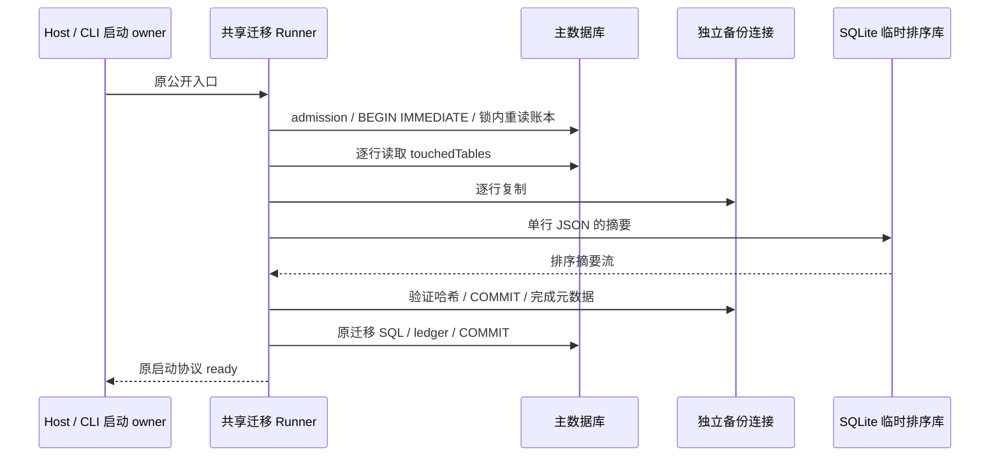
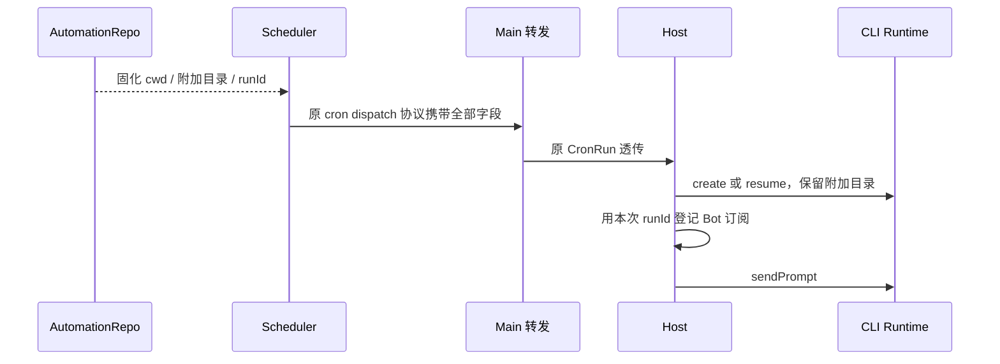

# 官方 3.18.2 遗漏修复与本地升级

## 范围与产品规则（2026-11-22）

用户要求吸收官方遗漏修复，完成后在本机重新构建并升级 ZCodium。官方远端 HEAD/main 在线核实仍为 `fec975905a2abd4c07e35c40d51fa097a2258ec9`，当前 main 已通过真实 merge 包含该祖先。此次复核官方 3.17.1 `a60ba6a7e5a06742270ca605f5d2cc2766afa7e1` 至 3.18.2 的变化，尤其是本仓保留/搬迁实现覆盖的新行为。清单和源码比较只作为索引，实际验收按相邻回归及运行证据登记。

完整吸收可兼容修复，同时遵守维护模型的身份、`.zcodium`、更新源、去官方云/遥测、Windows/macOS 资源边界。不恢复已经由用户撤回的原生上下文功能；不以整文件回退覆盖自有行为。本次明确授权本地 Windows x64 生产构建和覆盖升级，macOS 仍没有可用本机环境。

## 大表迁移备份的所有者与接口

共享 `sqlite-migrations` 继续唯一拥有 admission、备份、事务、账本和恢复。Host Worker、CLI `openStartup`、Source scoped 调用方继续通过原公开入口调用；不新增执行器、不修改既有 migration SQL、ID、checksum、touchedTables 或 schema baseline。

吸收官方逐行算法，保留本仓严格恢复元数据与安全边界：

- 备份只收集表布局与摘要，不收集正文数组。逐行复制到独立备份连接；逐行计算摘要，由限缓存、可落盘的 SQLite 临时库排序，再增量计算表哈希。
- 新备份格式 version=2，行 JSON 保留整数/BLOB 编码，行 SHA-256 按二进制升序排列并保留重复项，最终哈希前缀为 `sqlite-table-v2\0`。
- 恢复同时接受本仓 version=1/2，未知版本拒绝。v1 按 UTF-16 码元排序及旧外层 JSON 数组格式计算哈希，原备份可恢复。
- 恢复对备份连接持有读事务，以同一快照验证、复制和复查；原库保持 stopped-writers、身份/schema/账本校验、外键关闭、防级联、单事务、失败回滚。
- 备份必须完整成功后才写主库，候选目录显式配置；不引入上游的空间不足时跳过备份、自动寻找其他卷或自动清理备份。
- 大循环每批让出事件循环并观察取消，保证同进程 owner 可以继续释放锁与处理进度；不会靠加大堆或超时绕过同步。

## 其它合并接线遗漏

- 定时任务附加目录由 AutomationRepo 创建时固化，scheduler 只读该事实，Main 只透传，Host 将同一数组交给 create/resume；不得在运行时按当前项目重新猜测。Bot 终态订阅在发送前登记，并传递本次 runId，避免复用任务把结果关联到另一次运行。
- 自定义命令正文中的 shell 块统一复用已经吸收的官方 `expandCustomCommandPrompt` 文本交接，不在解析阶段调用 ExecutionPort。参数文本不再被作为 shell 块预执行；模型后续通过正常 Bash 工具和权限服务执行。发现目录仍按原 workspace/附加目录解析；清理退役的直接执行 helper 与选项。
- 远端更新候选 Core 在 Supervisor 未声明当前凭据格式时，向 `createLocalServices` 注入现有 `createLegacyServerCredentialCipher`，其文件路径来自 Source layout 的 configRoot。旧 owner 仍持有回滚权时不提前写入 v2；新 owner 声明 format=2 后沿原系统加密入口。既有 v2 被旧 owner 托管时失败关闭，不读取继承 HOME 下的另一套凭据。
- 相邻真实回归发现个人配置 Source 写死版本 3，而共享的个人配置 envelope schema 为版本 2，任何 read 都被自身 parse 拒绝。Source 版本必须直接取唯一公开 schema，数据仍只包含个人模型配置，不放宽协议接受旧账号 envelope，不恢复官方账号字段。

## 验收场景

1. 受限堆处理总正文超过 V8 单字符串上限的真实合成 SQLite：备份、迁移、关闭重开、恢复、内容/账本/外键检查。
2. v2 行顺序无关且保留重复行；v1 Unicode、整数、BLOB 和 rowid 兼容；清单与副本篡改仍拒绝。
3. 备份/复制/恢复取消、外部 BUSY、两连接 admission、备份失败零写、坏账本和不匹配身份保持既有契约。
4. 本次官方变化重叠清单逐项分类；确认可兼容遗漏后补对应回归再实现，实际未覆盖项不能写成全面验收。
5. 根/CLI 类型、Lint、格式、架构、审计守卫与受影响回归；当前 scheduler 声明新鲜度失败需在构建前解决并记录。
6. 正式版从准备阶段设置 ZCODE_ENV=production，完整重建 CLI/桌面资源，核对安装包身份、架构、版本与内容。在项目内大历史数据上验证成品启动和冷重启，通过后覆盖本机安装并核对实际文件。

全部测试数据、临时文件、HOME、缓存、profile、日志及子进程写入仅在当前项目工作树。真实用户数据库不作为自动测试目标；正式升级由用户授权的应用正常启动完成，不擅自编辑或清理数据和账本。

## 实际结果

代码阶段已吸收大表逐行备份/恢复、v1 兼容和备份读快照，并修复 INTEGER PRIMARY KEY 的 rowid 结果键遗漏。同步补齐 scheduler/Main/Host 及 direct-manual 的附加目录、Bot runId、旧 Supervisor 凭据模式、命令解析文本交接，并关闭个人配置 Source 的协议版本分叉。历史 migration SQL、ID、checksum 与两份 schema baseline 均未修改。

官方 3.17.1→3.18.2 的实际变更索引包含 5204 个路径：3990 个当前与官方一致、318 个在本仓缺席、75 个保留起点字节、821 个经过定制融合。进一步对其中 597 个重叠运行源码做函数/方法 AST 比较；保留旧函数名不等于漏同步，MCP 和内置市场已有新的身份/执行目录隔离及异步实现，messageport 使用等效公开类型。官方账号/套餐/分享/Sites/遥测/资源上传/远端自动安装更新相关部分继续按审计边界剥离；本仓未读集合去重、CUA 展示、用户插件开关和配置锁仍按原契约保留。清单不是所有行的人工或运行覆盖，不作永久“无遗漏”承诺。

索引位于 `.run-logs/project-only-validation/upstream-missed-inventory-mfe8Ix/inventory.json`，AST 复核材料在 `upstream-preserved-functions-Qlk1VD/review.json`。相关旧 Source 模型同步回归曾实报八项失败，其实际首因是生产 Source 发送版本 3；修复后十项同步/回滚/隐私回归通过。Source composition 五项通过；旧夹具只补当前 Supervisor 的格式声明，没有改变原身份和根目录断言。

SQLite 五文件的内层 65 项通过（`custom-fixes-vJRWlu`）；其中 96 MiB 堆处理 537,919,488 字节、65,664 行正文，完成备份/迁移/重开/恢复，maxRSS 129,300 KiB。接线六项及已有命令发现/交接场景通过（`custom-fixes-VCEags`）；此前 scheduler、Main、Host、命令预执行和 Core 兼容均有真实失败证据。完整调用函数在依赖替身下执行，不能称为真实 scheduler/远端/Provider 或实体手机验收。

根类型、CLI 类型、根格式与 changed 架构通过；根 Lint 0 errors/719 既有 warnings，CLI Lint 实际失败于 77 个既有 max-lines/132 warnings，没有放宽规则。首次根类型的四项 scheduler TS6305 来自声明产物被此前打包清理，固定配置重建声明后通过；不把缓存修复称为产品行为修改。最终变更后的必需门禁、成品大历史启动/冷重启和本机安装结果仍须继续执行并追加。

成品 E2E 夹具已在项目内创建真实旧版 CLI schema，保留 `0025_session_permanent_deletion` 待执行，包含 65,664 行、539,561,088 字节 JSON 正文。后续必须观测成品启动控制面的 ready，并复查全文、迁移账本、quick_check 和外键；不再只根据窗口有文字/按钮判断启动成功。真实用户数据不参与自动验证。
