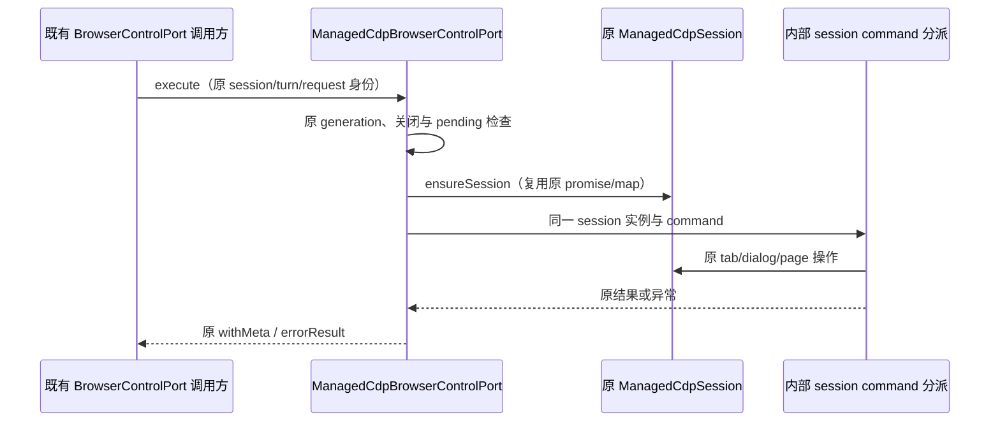
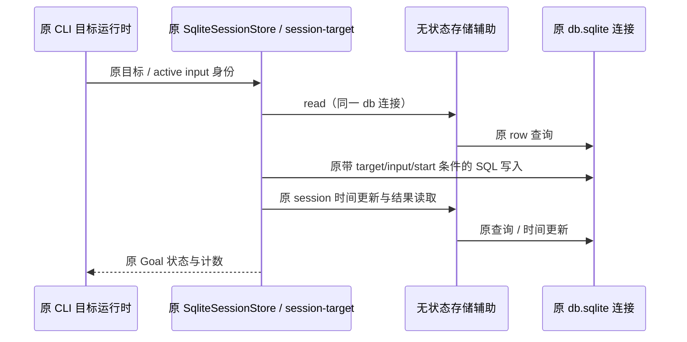
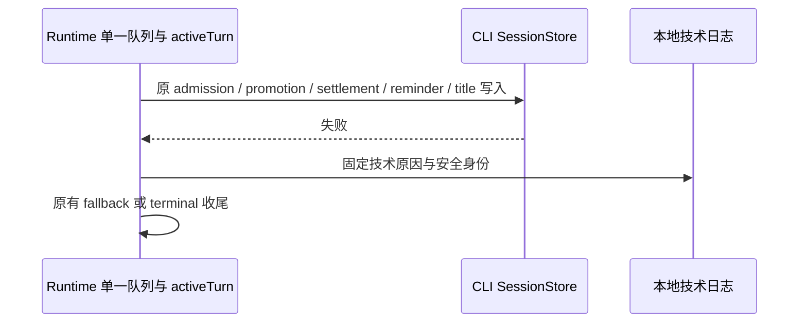
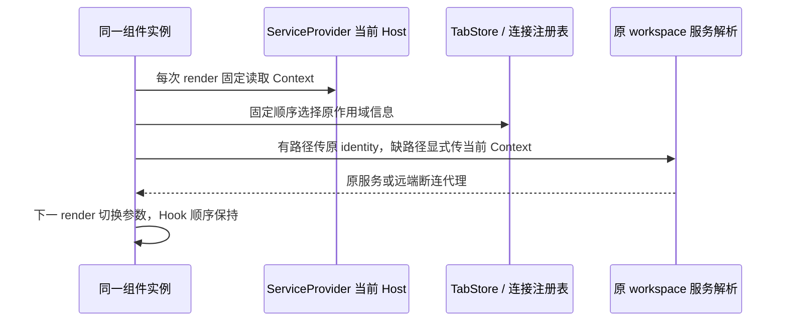

# 官方 3.18.2 自定义改动回归审查

## 范围与规则

2026-11-21 继续 [官方同步记录](official-3.18.2-integration.md) 的未完成事项。起点为
`93bd795329bcc4c4b4620c2b7157eff904f25ff6`，保持官方 3.18.2 基线及当前分支。
当前目标按用户 2026-11-21 的最新指示收紧：保持官方主线的可兼容更新，默认官方
实现正确，重点证明 fork 的自定义行为、剥离边界、合并适配及本轮本地改动没有引入
回归。以下「当前验收标准」取代此前宽泛的发行标准；后文旧阶段结果保留为历史证据。
本轮源码回归通过不等同于已经生成或验收 Windows/macOS 发行安装包。

## 当前验收标准（取代早期发行标准）

1. 官方 3.18.2 commit 是真实 merge 的祖先；不重做未受 fork 影响的官方实现。
   生成相对官方基线的完整文件差异清单，区分原样继承、定制/新增、删除、测试/文档
   与构建配置。清单只是审查索引，不能写成每个差异都有实际运行覆盖。
2. 重点审查 ZCodium 身份与数据根、自有更新源与无源行为、云/遥测移除后的调用链、
   Windows/macOS 资源限制、Provider/请求压缩、插件本地来源、工作区身份、共享 CLI、
   会话/输入/附件所有者、浏览器权限与未读。既有回归按实际风险选取；涉及身份、异步
   或订阅的定制必须覆盖切换、失败、迟到结果与资源释放，不仅验证静态字符串。
3. 本轮已完成的 SDK/纯计算拆分及依赖兼容适配也是 fork 差异，必须纳入回归证据。
   不再为清除官方存量行数或告警而继续拆分。已经实际复现并修复的故障保留，但说明
   来源与验证范围，不把官方故障冒充 fork 引入的问题。
4. 执行根/CLI 类型检查、根 Lint、格式与架构检查。检查结果如实记录；官方继承的
   行数/告警以及与 fork 差异无关的许可材料欠账不阻断本轮目标。自定义改动新增的
   Hooks、身份串用、数据丢失、网络回退、异常覆盖或凭据/原文日志问题必须解决。
5. 保留原五份改动及旧主线恢复引用。回归完成后仅切换本地主线；不推送、不触发构建、
   不修改 GitHub 默认分支、不发行 Release。提交前展示中文文案。

未执行的完整 Electron、macOS/手机/真实 Provider 或发行验证继续如实列为证据边界，
不因范围调整补写通过；它们不作为用户此次自定义差异审查的自动阻断。

## 当前自定义审查结果（2026-11-21）

官方远端 `HEAD` 与 `refs/heads/main` 再次在线核验均为 `fec975905a2abd4c07e35c40d51fa097a2258ec9`
（`release318-sX4F1m/official-main-check.json`）。该 commit 是当前真实 merge 的第二父
与祖先。完整差异索引在同目录 `custom-difference-inventory.json`：当次扫描 15646 个
原样继承文件、2056 个定制文件、2829 个新增文件、978 个删除文件，包含测试/文档。
这些是文件归类数，不是逐文件人工或运行验收数；最终提交前须重新冻结本地改动。

| 审查面                                     | 当前证据                                                                                    | 验证范围                                                                                                            |
| ------------------------------------------ | ------------------------------------------------------------------------------------------- | ------------------------------------------------------------------------------------------------------------------- |
| 身份/更新源/去云与去遥测/平台资源/本地目录 | `release318-8FB1hc`，59/59                                                                  | 源码守卫、真实配置与离线公开目录解析，无官方请求                                                                    |
| workspace identity/输入/附件/会话投影      | `release318-RUSGxh`，81/81                                                                  | 生产回调、注册表/结算、独立子进程与合成源协议；不是真实远端                                                         |
| 浏览器权限/未读/总结模型/扩展镜像          | `release318-0jJz4Q`，23/23                                                                  | 真实 adapter 接线和受控运行副作用；无目标机权限 UI/真实 Provider                                                    |
| Provider/压缩/凭据与信任                   | `release318-UyKzZR`，39/39                                                                  | fetch、失败与降级、同源作用域、凭据释放；无真实 API                                                                 |
| 渠道权限/初始化终态/失败隐私               | `release318-KfDjQl`，60/60                                                                  | 原会话精确权限、实际 appendEvent 与内存 event store；不向外部发送                                                   |
| 插件/Visualize/工作树/启动/流恢复          | `release318-AFcXwk` 七个未失败文件 54/54；`release318-RxHoc4` Visualize 18 通过/1 平台 skip | 实际 App、合成模型、项目内 Git/SQLite/配置；skip 是 Windows 不适用的 Unix chmod 场景                                |
| Hook 实例稳定性                            | `release318-GYco6Z` 4/4；`release318-SYBXZB` 2/2                                            | 真实组件/React/Context/TabStore；不代表全 Electron/实体手机                                                         |
| 必须执行的源码门禁                         | `release318-hWKUyB`                                                                         | 根/CLI typecheck、根 Lint 719 warnings/0 errors、changed 架构 0 violations、两套浏览器夹具类型及 Hooks 规则回归通过 |

本次确认并关闭两处 fork 合并回归：ReplyToChannel 的精确权限豁免遗漏、初始化前
终态写入覆盖原始错误。已经完成的额外 Hook 修复也纳入本轮回归。继承自官方的
未读/模型/插件之外实现按用户要求作为基线，不继续为存量告警和行数开展改写。

专项 Hooks 对 11 个本次相关文件扫描，服务/恢复卡/夹具无调用或依赖诊断；未读
Hook 有两个既有 deps 告警，已复核：controller 分支不使用 scopes，fallback 分支的
scopeKey 是完整 scopes 的序列化值，services 变化会重订阅。它们不是漏掉身份变化
的证据。ToolCallBlocks 子列表的三条 deps、plugin UI feedScope 的 remoteSessionId
缺失诊断也存在于官方同一调用结构；新增 fileReferenceRootPath 已列入相应 deps。
不称为全仓 719 个 warning 已人工复核。

额外 CLI 夹具严格类型探查 `release318-94mD3B` 失败：旧 registry/provider/model 测试
基座不满足当前严格 DTO，另发现 Visualize 的已移除官方 headers 选项。只移除该
过期参数，不修改生产接口或重写官方基座来让额外检查变绿；新终态回归无自身诊断。
这项结果不冒充必须执行的根/CLI typecheck（两者均通过）。

SDK、无状态 helper、Hono 与 boolbase 的先前 AST/契约/真实连接及消费者验证继续
采用后文原始证据，本轮没有再次升级依赖或调整其行为。12 项 strict 材料及完整
安装/真机/真实 Provider 等发行证据边界保留；本轮结论限于用户修改后的定制回归目标。

收尾复核：`release318-QHusro` 再确认官方 main 未变，差异索引更新为 15645 原样
继承、2057 定制、2830 新增、978 删除（当时 310 个本地文件，包含原五份保护项）。
`release318-G2DCDR` 对移除过期 headers 参数后的三个协议配置场景实跑 3/3；其余
16 项未选择，不作为新通过数。额外夹具类型复查 `release318-NaoCuN` 仍失败，但
诊断只在四份与官方逐字相同的旧测试基座，新终态回归和 Visualize 文件无自身诊断。
最终根格式 `release318-jx2SAH` 通过；本地提交与主线切换前再冻结源码与保护文件。

最终独立 CLI Lint `release318-dc0vdH` 仍 exit 1，77 errors/132 warnings；77 个错误
全部是既有 max-lines，没有为了本轮目标继续拆官方文件、提高阈值或把失败写成通过。

- 保留开工前四份提示词/测试改动及 `native-context-rollback.md` 的原始内容。
- 不恢复原生上下文压缩、官方云服务、遥测、Linux 桌面或远端发行资源。
- 本轮先完成实现、门禁及隔离运行验证；不触发 Actions、不发行安装包。
- 许可变更必须绑定精确包版本、发布方原文及可核验源码。MPL 标准条款与源文件的
  Exhibit A 声明共同核验，不能把缺少 MIT 式版权姓名误判为 MPL 无效，也不能凭
  包字段直接解除二进制源码提供义务。
- 第三方材料仍由 `third-party/` 唯一登记，构建继续复用已有分发入口。
  许可 allowlist、架构 baseline、行数阈值及格式继承快照不得为通过检查而放宽。
- 全部测试 HOME/TEMP/data/cache、浏览器 profile、子进程目标与日志限制在当前
  工作树。复用 `createProjectTestSandbox`，写入前验证路径及重解析点。

## 验收顺序

### 早期持续目标的正式上线标准（已被上方当前标准取代）

2026-11-21 用户进一步要求建立持续目标，达到正式上线标准后再将同步分支切换为主线。
以下是用户修改目标前的标准及工作依据，仅作历史记录，不再驱动当前审查范围。

| 门禁       | 达标证据                                                                                                                                                                                                      |
| ---------- | ------------------------------------------------------------------------------------------------------------------------------------------------------------------------------------------------------------- |
| 工程       | 固定 Node/Corepack；根与 CLI typecheck、Lint 无错误；根格式、全量及 changed 架构、schema 和实际受影响工程回归通过。warning 分类复核，不能留下未审查的 Hooks、潜在数据损坏或凭据泄漏诊断                       |
| 审计与许可 | fork 身份、数据根、无官方云/遥测/更新 fallback、无 Linux 桌面资源的守卫通过；精确依赖及原生组件材料登记完整；当前清单 strict 检查通过，实际产物材料可读取且来源可核验                                         |
| 核心运行   | 实际当前代码执行项目/工作树创建与冷恢复、输入 admission/取消、stream/history、上下文展示、归档与未读、附件/权限/插件、浏览器和设置关键路径；受影响的 desktop-continuous 与 web-remote-replayable 均有回归证据 |
| 发行与平台 | production 准备起构建；支持的 Windows/macOS 目标产物生成、启动及资源/原生依赖/许可交付验证通过。当前可执行设备完成安装启动和升级关键场景，其他平台以对应平台 runner 的真实证据覆盖；不得以源码断言替代        |
| 缺陷与记录 | 无未解决的 P0/P1 缺陷、无会导致核心流程失败的 P2；剩余不影响发行的限制逐项记录。最终冻结候选源码、门禁输入与验证证据相符                                                                                      |
| 主线切换   | 仅在上述门禁全部满足后执行。主线不得带回已撤回原生上下文代码；保留原五份未提交改动及旧主线可恢复引用，不以 merge origin/main 恢复退役功能。远端变更仍需满足用户的推送授权                                     |

用户此前的「暂不推送或构建」继续有效，本地调查、修复、类型/Lint 和运行测试持续推进。
待本地候选可复核后，再明确处理外部构建与远端主线所需授权；不提前标记目标完成。
CLI 行数欠账按现有模块中的纯计算、接口类型及 IO adapter 职责拆分，保留唯一状态
所有者和调用顺序，不调整 400 行规则、刷新 baseline 或增加豁免。每块改动配套现有
回归、类型和 Lint 证据，避免为了消除单条错误建立第二条业务写入路径。

首块拆分由 `@zcode/contracts` 拥有浏览器动作结构和工作流事件 JSON 裁剪规则，登记
`agent-protocol-values` contract 模块。模块只提供无状态值契约和纯计算，不依赖 Runtime
或 IO；原端口通过该模块的 `contract.ts` 再导出，包内外原公开导入路径保持。
边界为「既有端口 → 受控值契约 → 原有消费者」，没有新的事件、状态 owner 或写入路径。

模型契约下一块把无状态标识/错误构造、Provider 用量计算、消息与网络 JSON schema
划入同一受控值契约模块。保留既有枚举、class 身份、schema 对象关系及公开导出，输入
类型、重试/准入时序和 Provider 调用仍由原 owner 管理。模块实现不反向导入原模型
barrel；用量计算继续采用既有 cache/input 规则，JSON schema 的字段与允许值不调整。
模型内容序号判定与稳定排序也保持为无状态纯值计算；有任何非法/缺席序号时仍返回
`undefined`，不能改变原消息回放的 fallback 规则。

工作流值契约再按定义、图、事件形态与 scheduler 纯派生拆分。Zod schema 的默认值、
refinement、graph record 判别字段及节点/边的顺序保持；存储端口、run snapshot 与
session link 投影仍留在原入口。`workflow-contract.ts` 仅再导出迁移前的工作流公开面。
派生计算中的 Map/数组只属于当前函数调用，不能改成跨调用缓存或新的 scheduler owner。

许可候选核验发现 `@hono/node-ws@1.3.2` 的精确 npm 发布归档包含完整 MIT 原文，
归档 integrity 与 SHA-256 已校验。两个 Server 依赖计划从 1.3.0 固定到该补丁版本，
保留既有 Hono/WS 版本和 HTTP/RPC 接口；升级前后执行真实回环连接与释放回归。
安装使用已登记的项目内 pnpm store，并禁用安装脚本；先核对锁文件和实装图，确认
1.3.0 不再分发后，才将旧缺口保留为历史审计并为当前版本登记实际原文，不能删除
历史证据或以新版本许可覆盖仍在分发的旧代码。主版本候选暂不直接替换。

下一阶段为现有 `@zcode/contracts` SDK 登记 `agent-contracts` 模块：所有者仍是 Agent
公共契约，范围只覆盖 `packages/contracts/src`，不纳管整条 CLI 运行时。公开入口按
当前 `package.json` exports 登记；现有 DTO、schema、公共计算、技术上下文和内存测试
适配器保留原实现，不增加业务状态或写者。嵌套 `agent-protocol-values` 保留独立边界。
模块登记引起的消费者依赖按真实导入核对并同步 manifest，不刷新 baseline 或扩大公开面。
这为后续会话存储端口的类型拆分提供受控范围；此阶段不改 SQL、迁移、标题/状态/组织态
或 continuous/replayable 交付规则。CLI 会话事实与 Host 组织态所有者保持既有划分。

SDK 纳管实际发现跨入口类型循环与既有物理行数超限。先将已经独立的模型值类型
从聚合 `model/index.ts` 路由到 `agent-protocol-values` 公共入口；只调整 type-only 导入，
不改变运行时模块初始化。协作模式/风险等级及既有模式收紧计算提取为无状态值，
guarded/YOLO、auto 未实现时的原有规则保持。消费者 manifest 根据实际新增 SDK/
值契约导入登记，不能用关闭 cycle 规则、增加行数豁免或刷新 baseline 解决这些失败。

工具 JSON schema 转换继续保持就地规范化和原字段排序，避免 Provider 缓存前缀变化；
实现转入协议值模块，原工具 helper 路径保留转发。已由 SDK 根/接口公开导出的
`permission-full-access` receipt schema 在所属 feature 模块中登记其既有公共路径，
不开放该模块的 Runtime 实现。其余跨模块类型引用使用现有公开 events 入口与 shared
ModelSelection 原始定义。

模型 SDK 剩余内容按消息值/格式化、请求与结果、工具契约和网络状态类型拆为内部叶文件。
`model/index.ts` 保持原公开导出；Model 工厂和调用级 AsyncLocalStorage 只改类型引用的
定义路径，保留原实现及实例。工具引用 schema 与请求 capabilities 是两侧共享的值契约，
移入协议值模块并保留旧工具导出，避免模型基础类型反向依赖 ToolSearch 聚合入口。

权限决策、steer 来源/交付模式、标题来源/消息可见性等原始值类型从聚合会话/事件端口
拆出；事件与 Hook 仅引用这些值，不反向加载会话端口。所有枚举字面量、公开导出及
持久化表示保持，CLI/Host 仍各自唯一写入原字段。工作流失败 DTO 独立于主 run 端口，
workspace 读取契约引用该 DTO，消除纯类型循环，不改变错误归因或恢复门禁。

SDK 契约继续按职责拆成内部叶文件：配置按运行值/默认值与配置访问端口划分，Hooks
按事件标识、输入输出和执行配置划分，浏览器按命令、响应与 attachment 端口划分，
MCP 按连接配置、工具描述、资源订阅与调用端口划分。原公开入口再导出同一对象和类型，
不改变 schema、默认值、类身份或调用链；新叶文件不加入 package.json exports。
拆分前后比对每个声明的 AST，已有实际契约回归验证运行行为，类型和架构验证导入边界。

工作流创建工具的输入、图/phase 纯计算与输出声明分别提供单一 schema 实例；目标工具
按值/schema、模型提示文本、verifier 文本解析及兼容名称划分，保持既有 verifier fail-open
语义。工具结果按展示 schema 与持久化解析划分，保留旧记录净化顺序及 ProviderStop 剥离。
浏览器 backend/context 值独立于执行端口，响应只引用这些值，避免形成端口与响应的类型循环。

会话事件按基础 envelope、公共 payload 值、生命周期/工作流元信息、输入/turn、模型消息、
工具/交互及汇总划分；枚举字面量、序号、工厂 UUID/时间和失败尝试用量规则保持。事件原
入口再导出所有既有名称；拆分完成才移除旧单文件 max-lines disable，不增加替代豁免。
动态工作流 run 按提交/amend 请求、状态值、snapshot、artifact、事件读取、详情和端口划分，
snapshot 与详情共同引用状态值，不能相互反向引用。会话存储按 session 元信息、消息语义、
消息头、基础 part、timeline、tool part、消息组合、entry/input、事务 bundle、usage 与访问
接口划分；组合 SessionStorePort 的方法集合保持，具体 Repo、SQL、持久化表示及事务仍不变。

EventReducer 仍是事件到 SessionProjection 的唯一入口，按原连续键顺序组合生命周期、
输入队列与工具/权限三组无状态 handler。每个 reducer 实例仍创建自己的 handler 表，
不缓存投影或引入跨实例可变 Map。保留 reduce 的初始投影、unknown 事件更新时间、
queue 同 id 编辑的原位置/时间、工具批次不将 turn 提前置 idle、错误归因和恢复 anchor。
现有 reducer、状态、retention、内存 journal、workflow 与工具展示回归共同验证拆分。

SDK 拆分后的 `release318-HAAibE` 类型、Lint（0/0）及 changed 架构通过；扩展至 17 份
回归后 158/160 通过。两项失败是已有验收夹具失配：当前 HEAD 已有跨 shared 的 `fill`
字段，冻结字段表遗漏它；Hook snapshot 夹具仍使用被 fork schema 拒绝的 `.zcode`。
修正夹具使其验证现有字段与 `.zcodium` 身份，保留 strict 未知字段拒绝和 immutable 检查。

实际 JSON schema 验证在 `release318-AVutNQ` 复现合法 `tool_reference` 消息被拒：content
的 `oneOf` 存在两个完全相同的分支，Ajv 返回 `passingSchemas: [0, 7]`。只移除重复分支，
保留其唯一 schema、字段顺序、其他 content kind 和未知字段拒绝规则。回归通过现有包的
公开模型入口编译 schema，验证所有支持 kind、混合块、空 toolName 与额外字段；不以数
分支代替实际验证。Ajv 8.18.0 已在锁定依赖图中，显式登记为 contracts 的测试依赖，
不升级其版本或引入新发行依赖，安装保持 offline/frozen/ignore-scripts。

本阶段完成证据：SDK 160/160、typecheck、Lint 0/0 与 changed 架构 0 violations
（`release318-p4sMA4`）；根架构聚合 79 通过/1 平台 skip（`release318-fHFc1p`）。模型
schema 新回归先 10 通过/2 失败（`release318-q5xLMX`），修复后 12/12
（`release318-gXlwr6`）；Ajv 显式测试依赖 offline/frozen 安装通过
（`release318-GcFaHU`，仅增加 importer、复用已有 snapshot）。根 Lint 保持 729 warnings /
0 errors，CLI 全量 82 errors / 133 warnings；三份新增依赖 manifest 的格式问题已定位，
按同版本 formatter 修正。仍未完成全量 CLI 行数收口、13 项 strict 材料或安装/设备验收。

`release318-ejsarN` 的实际数据库门禁发现 tasks-index 已有 `0007_task_permanent_deletion`
迁移，而该 scope 的审核快照仍停在此前结构。真实迁移已创建 task_purge，失败来自
`assertAdditiveSchema(current, reviewed)`；不是运行时删表。ProjectStorage 全库快照包含
更多组织表，不能拿它覆盖 tasks scope。只将 tasks 审核快照补齐既有 task_purge 和两个
触发器：先证明相对 HEAD 只增、其余 sqlite_schema 对象及完整 SQL 字节保持，再写入。
不修改迁移 id/checksum、数据库 runner、表语义或 baseline 更新旗标；实际两库启动、
重复打开和严格快照比对重新执行。验证仅使用项目内合成 SQLite，无真实用户数据操作。

全量架构 `release318-qWyYI9` 暴露两个旧登记残留：window-topic-resource-relay 与 shared
request-security-edition 的所有 runtime/test roots 已删除，policy 仍要求各四份 artifacts。
清理须先确认当前 Git/工作树无这些 roots 的文件、无其他模块 requires 指向它们，再只删除
这两条登记。Main/Adapter 的既有无状态兼容入口、用户 Provider 网关错误消息仍保留，
不创建旧云 relay/请求签名模块来满足门禁，不减少对现有源码的 managed 覆盖。

该阶段门禁：根/CLI typecheck、根 Lint 729 warnings/0 errors、根格式与 changed 架构通过
（`release318-NMFkNd`；CLI Lint 82 errors/133 warnings 仍失败）；schema 补齐仅增加原迁移
的三个对象，既有 SQL 字节相同（`release318-sjj3Kp`），真实两库门禁通过
（`release318-prSQuo`）。清理两条无文件/无 incoming dependency 的旧登记后全量架构通过
（`release318-SKIKC2`）。许可真实刷新及基础检查通过，strict 仍 13 项
（`release318-F14Wlh`）；五份原文件、HEAD、空暂存区与 stash 复核保持
（`release318-GcYwvm`）。

下一项许可收口针对 boolbase：精确 2.0.0 发布归档和完整 ISC 原文已核验，但它只导出
命名函数，css-select 5.2.2/nth-check 2.1.1 的 ESM 消费者仍导入 default。
`release318-N7ZENn` 已复现原版 2.0.0 的六处 bundle 错误；最小 default 对象适配保留
同一 trueFunc/falseFunc 函数身份后，真实 bundle 与六项选择器场景通过。计划全图覆盖到
精确 2.0.0，并通过 pnpm 精确 patch 同步 JS 与 d.ts 的 legacy default；不升级消费者或
改写原函数。使用固定 Node 24.14.0，正式支持工具链满足该包 >=20.19.0 的要求。
升级后实际 CJS、ESM 与 bundle 消费路径均验收，再为当前版本登记许可并保留 1.0.0 的
全部历史缺口。任何旧版仍分发或兼容测试失败都不能解除缺口。

boolbase 后续执行：`release318-iUDLae` 的包管理器锁解析成功，但无关选择变化被范围
守卫拒绝，未直接安装该锁。只保留真实 boolbase 节点、override、patch 与消费者测试
importer（`release318-GsVIkb`），逐值核对其他锁定关系不变，offline/frozen 安装成功、
下载 0。现有 zcode-relay 的未生成开发 bin 告警保留，不恢复官方 relay。
安装后的 CJS、ESM 与 browser bundle 三项消费回归通过（`release318-X5pEQf`），每个
选择器通道覆盖六种实际选择。精确 archive integrity、安装原文、patch 哈希与旧版本已
退出锁图均核验后登记新 notice，1.0.0 的原记录完整保留（`release318-dF43nx`）。
strict 是否降至 12 项须以最后重新生成后的实际检查为准，尚不据此宣称许可门禁通过。

CLI 下一块纳管现有 `adapters/src/browser` 为 managed-cdp-browser adapters 模块。
范围仅为 standalone CLI 的 CDP 浏览器适配器，Electron WebContentsView 仍由原 owner
管理。ManagedCdpBrowserControlPort 唯一持有 browser、launchPromise、generation、
sessionPromise/session Map、pending 和 closing 集合；ManagedCdpSession 唯一持有原
context/tab/dialog。将不引用 this 的 session command 分派搬到模块内部函数，仍接收
原 session 实例并调用原 page command，无新连接、缓存、计时器或写入路径。

取消、closeSession、turnEnded、最终 browser close 及有限清理等待保持原顺序。接收端
的 continuous/replayable 类型与身份原样传递，不在此适配器新增 replay owner。先执行
现有 fake Playwright 回归，再拆分、声明类型检查与相同回归；不得把 fake browser 当作
真实启动或跨设备恢复验收。新内部文件使用既有 SDK 公开值类型及同模块依赖。

boolbase 阶段的完整本地复核 `release318-yRPmTO`：根/CLI typecheck、根 Lint（729
warnings / 0 errors）、根格式、全量架构、数据库门禁通过；根架构聚合 82 通过/1 skip。
许可声明刷新与 2212 个实装包基础检查通过，strict 实际仍有 12 项缺口，未标通过。
CLI Lint 仍 82 errors/133 warnings。此前 `release318-SeXPYD` 因 scoped lock 的新增键
顺序与 pnpm 实装快照不同拒绝生成；逐值证明两份 lock 完全相同后，仅采用包管理器
规范键顺序（`release318-BAczIz`），没有改实装快照或放宽原文字节比较守卫。

CDP adapter 拆分前 fake Playwright 14/14（`release318-D7XV6c`）；纳管后唯一架构失败
是入口 445 行（`release318-pmtvni`）。分派函数不读取 this，原函数体 AST 保持，唯一
port 调用改为同模块函数（`release318-gy07ac`）；随后执行相同回归、types、Lint 和全量
架构。原 close 等待留在 port，没有新增 timer 或另一套 session 状态。

CDP 拆分验证 `release318-xK81AK`：相同 14 项 fake Playwright 回归、adapters typecheck、
该模块 Lint 0 warnings/0 errors、全量架构均通过；CLI 全量仍 81 errors/133 warnings，
只关闭本块行数错误。`release318-v1LIEa` 再次确认五份保护文件、HEAD、空暂存区与 stash
不变。尚未推送、构建安装包或切换主线，继续处理 CLI 欠账和 12 项材料/平台验收缺口。

下一块为 CLI session_target 的存储辅助，纳管 `storage/session-goal-support` adapter
模块。SqliteSessionStore 注入的原 db.sqlite 连接仍是唯一存储 owner；原
session-target.ts 保留目标替换、fork、status、run、用量、summary 与 clear 的 SQL 写入。
仅把原 row 类型/解码、read/must-read、session 时间更新、目标 ID 和耗时计算迁入辅助。
辅助不建连接、不持有 cache/定时器、不读 Host 库；旧 readSessionTarget 公开路径再导出。
所有 SQL、CAS 条件、UUID/时钟调用位置、ceil 耗时和字段表示保持原语义。

以 `goal-elapsed-accounting.md` 和 `goal-session-fork-state.md` 的既有 owner 与 fork 裁决
为准，不新增自动运行、pause 或新的事实字段。先执行已有真实 SQLite 的 goal 替换/
预算/run/恢复回归，拆分后重跑；测试只在项目沙箱新建数据库与子进程缓存，拒绝越界。

### 持续目标阶段进展（2026-11-21）

- `release318-cqZGAv`：SDK typecheck 与 46 项回归通过；SDK Lint 尚有 2 项行数错误，
  changed 架构尚有 12 项行数/disable 问题。先前类型循环已经消除，未调整阈值或 baseline。
- `@hono/node-ws` 精确升级到 1.3.2 后，实际 HTTP/WebSocket 清理和 callback 生命周期
  回归通过（`release318-fbLoHc`）；锁文件只修改该依赖记录，原 1.3.0 材料保留历史核验。
  `release318-2w43Lu` 基础许可通过，strict 仍失败，当前缺口为 13 项。
- 项目内 Chrome Headless Shell 147.0.7727.15 已完成 7 项真实组件交互：admission、
  Timeline、归档设置、Source 生命周期、远程连接、错误详情、分组/任务菜单及 IME。
  证据分别为 `release318-lJ4Md9`、`release318-IACPe1`、`release318-1OFxhO`；桌面/手机
  宽度覆盖不能代替 Electron、实体手机或跨设备恢复验收。
- 根 Lint 最近结果为 729 warnings / 0 errors；CLI 最近全量结果为 84 errors / 133
  warnings（`release318-ge4H3W`）。SDK 后续改动使此前类型、格式与 bundle 证据过期，
  当前最终候选须重新执行，以下早期结果只保留为历史记录。

1. 固定 Node 24.14.0 / Corepack pnpm 10.33.2，记录根及 CLI 类型、Lint、格式、
   changed 架构和现有发布契约的真实结果；区分继承问题与本次改动。
2. 核对 10 项 CUA/UBJS 许可阻断与清单的 20 项材料缺口；取得证据后才更新登记。
3. 执行现有工程/审计测试及受影响运行回归。检验真实公开入口 bundle，不能只用
   源码字符串或陈旧 dist 验收。
4. 检查 Electron/E2E 启动入口的写入与外部副作用，执行能够证明项目内隔离的场景。
   macOS、实体手机、真实远端或个人 Provider 未执行时继续标明缺口。
5. 对当前修改做最终 typecheck、lint、格式、架构及对应回归，更新维护记录。
   开工前五份改动逐文件哈希复核。任何剩余失败不得写成可正式上线。

## 执行记录

本轮在 Windows 使用项目内 Node 24.14.0 / Corepack pnpm 10.33.2。上一轮结果不计作
本轮通过；证据均位于 `.run-logs/project-only-validation/release318-*/`。

### 构建契约回归修正

首次工程回归 66 项中 5 项失败。现有 `official317-build.test.mjs` 路径保留作为长期
ZCodium 发行边界门，版本断言跟随当前 3.18.2 基线；暂存夹具等待既有异步
`stageAgentBundle` 完成并继续断言仅复制 `.zcodium-plugin`。类型检查解析器须同时验证
session-control 包级检查与两个真实 tsc 命令，不能把 `pnpm --filter` 当作 tsconfig。
E2E 环境清单从现有公开再导出读取，仍验证自有更新源登记及官方变量缺席。
行数夹具仅跟随已搬迁的真实精确例外路径，不修改规则、增加豁免或减少 400/401 断言。

### 格式门禁

修复全量格式检查列出的历史文件，仅作同版本 Oxfmt 排版，不改变业务规则。原五份
改动及原始许可快照不写入；官方精确继承排除继续沿用当前快照，不更新快照或新增忽略。
TypeScript/JavaScript 比对 AST 结构与字面量，JSON/YAML 比对解析值，检测到语义变化
立即拒绝写入。格式改动与行为修复分别记录；需要再次通过根真实格式检查。

排版后两份历史 QA 工具超过 400 行：采样器的命令分词、进程后代与 CPU 纯计算拆为
无状态 helper；bootstrap 的路径/重解析点/Node preload 校验拆为注入原 repository、
fixtureDirectory 与 desktopRequire 的 adapter。采样与启动流程、调用顺序、默认路径和
bootstrap 计数仍留在原入口。路径 helper 不启动进程或创建第二份业务状态；旧 QA 工具
不作为本轮执行入口。新增回归仅在项目合成路径验证拒绝和纯计算语义，不操作真实数据。

### 持续目标前的本地结果

| 检查                                       | 实际结果与证据                                                                                                                                                                                                                             |
| ------------------------------------------ | ------------------------------------------------------------------------------------------------------------------------------------------------------------------------------------------------------------------------------------------ |
| 根 / CLI typecheck                         | 均 exit 0：`release318-SkQ98T`。生产 JS 构建清理旧声明后曾报 TS6305；`release318-sgaV4h` 强制重建当前声明后通过，没有修改 tsconfig 或减少目标                                                                                              |
| 根 Lint                                    | exit 0，729 warnings / 0 errors：`release318-SkQ98T`，与开工基线一致。排版新增的 QA 行数失败已按职责拆分，未提高阈值或新增豁免                                                                                                             |
| CLI Lint                                   | exit 1，88 errors / 133 warnings，与开工基线一致；错误均为存量 max-lines。本轮没有将该结果称为通过                                                                                                                                         |
| 根真实 fmt:check                           | exit 0：`release318-SkQ98T`。使用既有精确继承快照，原五份文件和原始许可快照未排版                                                                                                                                                          |
| changed 架构                               | exit 0，0 violations：`release318-SkQ98T`，显式相对原同步起点。没有刷新 baseline                                                                                                                                                           |
| 根 test:architecture                       | exit 0，80 项中 79 通过、0 失败、1 项平台跳过：`release318-AQiEkz`。许可复核与最终 QA helper 回归已进入该入口及现有 desktop.yml checks 步骤                                                                                                |
| 工程 / 审计 / 构建 / 声明组合              | 76/76：`release318-R30YF3`。随后最后追加的 QA 纯计算和路径检查另由上述聚合入口覆盖；两组有重叠，不累加为全量验收                                                                                                                           |
| 当前 Agent bundle / Desktop 生产 JS bundle | 均 exit 0：`release318-QkAude`，准备起即 production；不是 exe/dmg 打包或安装验收                                                                                                                                                           |
| Windows 原生 Host                          | exit 1：`release318-QkAude`，`spawn cmake ENOENT`。未安装系统工具链或改写编译计划绕过缺失                                                                                                                                                  |
| 许可声明生成                               | exit 0：`release318-PkC9d1`，当前 package.json 和全部原文输入重新生成                                                                                                                                                                      |
| 基础许可 / strict                          | 最后清单重新生成后复核 exit 0：`release318-LXFF9V`，2212 个实装包、17 项构建依赖及声明新鲜度通过；strict exit 1：`release318-rpD2Qi`，仍有 14 项材料待核验                                                                                 |
| React Hooks 专项                           | `release318-EfsDuR` 保留原始 JSON，2 条既有 deps 告警。该 hook 本轮仅排版，deps、分支及 AST 语义不变；scopes 由序列化 scopeKey 驱动，controller 模式有明确订阅分支。未新增诊断，未用整体对象依赖或禁用规则消除告警，不声称完成真实渲染验收 |

### 浏览器与未完成验收

项目内 Chromium 下载只完成部分字节，已停止该任务的下载进程，不计作浏览器验证。
只读复制 Chrome 151 和 Edge 157 的程序及静态资源到项目 sandbox，未复制任何用户
profile。两种程序都尝试 admission indicators、Timeline、归档 UI 三项现有场景。
两组各有 2 项被 120 秒测试期限取消，归档真正交互均在 30 秒 browser startup 期限
失败；归档纯源码接线断言各自通过，不算 UI 通过。

证据：`release318-NmEcHy`（Chrome）及 `release318-FZ803K`（Edge）。两者明确打印
`DevTools remote debugging requires a non-default data directory`，并出现无法读取 local
app data 目录的诊断。HTML/交互断言尚未完成；没有使用真实 USERPROFILE/HOME 或
放宽路径守卫使测试通过。程序副本、下载片段和验证用源码归档用完清理，保留日志与哈希。
完整 Electron、Windows Shell、macOS/钥匙串、手机、真实远端和 Provider 仍未验收。

### 持续目标前记录的阻断

- 14 项材料：10 个 npm 包，React Best Practices 复制技能，Skia、QuickJS-NG 和已登记
  Rust 标准库来源。npm 固定来源复查 `release318-IuOJae` 中 7 个树没有许可原文、3 个
  发布引用无法解析；React 固定树 `release318-SV6tIa` 也没有许可文件。没有推定权利人、
  删除缺口或将基础检查当作严格合规。
- 88 个 CLI 存量行数错误；大型状态模块拆分仍需各模块受控上下文和独立回归。
- 当前机器缺 CMake/MSVC 原生构建条件，且隔离下两种已安装浏览器不能建立调试协议。
  GitHub Windows/macOS 构建检查尚未触发，现有工作流也不能代替完整设备 E2E。

当前结论：本轮关闭格式、失效验收入口及 CUA/UBJS 精确材料缺口，尚不能宣称可正式上线。
保持 `codex/official-3.18.2`，不合并 origin/main 或第三方；原五份改动保留。
没有 commit、push、PR/issue、GitHub Actions、安装或 exe/dmg 打包。

### 持续目标前的本地保留确认

用户明确选择「保留本地，暂不推送或构建」，本轮改动继续保持未提交状态，不触发
`desktop.yml`。该选择没有关闭上述发行阻断，也不构成安装包或上线验收。

最后的 `release318-final-proof.json` 确认开工前五份文件哈希均未变化，HEAD 仍为
`93bd795329bcc4c4b4620c2b7157eff904f25ff6`，暂存区为空，许可声明输入新鲜。
已清理本轮项目沙箱内的 Chrome/Edge 程序副本、Chromium 下载片段和源码核验归档，
保留材料快照、验证日志与哈希，没有清理项目外路径或真实用户数据。
固定 Node 的 freshness 与 `git diff --check` 最后复核均 exit 0；freshness 提示当前
分支没有远端跟踪分支，未据此推送或合并含已撤回功能的 `origin/main`。

## 持续目标本阶段最新结果（2026-11-21）

目标辅助的 `release318-Jr9RjX` 通过同一真实 SQLite 目标场景（1 项执行、52 项未
选择）、adapters typecheck、辅助及原入口 Lint 0/0、全量架构；CLI 全量仍失败，
最新为 80 errors/133 warnings。`release318-sAP3gz` 证明 7 个迁移声明与 11 个原目标
写入/run 函数的 AST、SQL 一致，拆分脚本得到 391 行入口。没有新增目标状态、时钟、
连接或其他写者，不把单一场景的多条断言写成全量测试。

源码最后保全复核 `release318-zdhyM9`：五份原文件哈希不变，HEAD 保持 93bd7953，
当前 codex/official-3.18.2，暂存区为空，原 stash 完整，差异空白检查通过。源文件仍为
本地未提交状态。当前 strict 材料缺口仍为 12 项；平台/安装及原生 Host 验收仍未完成。
正式上线目标保持 active，主线切换待全部标准实际满足，未推送或触发发行构建。

最后当前源码的根/CLI typecheck、根 Lint（729 warnings/0 errors）和根真实 fmt:check
均通过（`release318-kDDb5B`）；未把 CLI Lint 的 80 项错误写成通过。剩余行数位置已
由当前实际 Lint 日志生成清单（`release318-I9WjKH`），供下一阶段按 owner 与受控上下文
逐块拆分。warning 分类、12 项材料、完整运行和平台产物验收继续保留为未完成门槛。

### 用量故障日志与无状态投影收口

2026-11-21 复核 `usage-observability.ts` 发现三个存储失败出口把原错误 message/String
写入 warn。错误可包含路径、URL 或其他原文，非 Error 对象的 toString 还可能再抛错，
违背「用量写失败不阻断主执行」的既有规则。出口改为固定 `storage_write_failed` 技术
原因，保留原 event/module/status 和安全 trace 身份；不解析、格式化或记录异常原文。
模型用量记录中的既有业务错误归因与原 UsageStore 写入不改，故障日志与持久化事实分开。
先用 model/turn/tool event/tool result 四种真实函数入口，对 Error、string、抛错 toString
三种失败回归。相邻 turn-tool-usage 的相同出口一并修复，不改变成功写入与业务归因。

网络事件过滤、首 token 时间、业务错误归因及字符串/数字读取划入 cli-usage-projection
domain 模块。模块只派生输入事件与值，不持有 runtime、store、cache 或时间 owner，不
执行 IO；原 IO 函数仍负责时钟、用量 ID、去重字段与原 UsageStore 调用顺序。使用 SDK
原始 isCoreError/SessionEventType，保留 errorInfo 与读取规则，不引入新的采样或导出。

事件规范化下一块将 canonical fact 类型、stream/attachment/origin 的纯转换划入
cli-conversation-facts domain 模块。原 event-normalizer.ts 继续唯一分派事件，保留
TurnStarted 的 Gen UI 输入适配；ProductProjection 仍持有 product turn 与 open segment
状态，模块只接收原 context 值，不维护第二份 map 或 row/target 状态。Root
SessionEvent → 原入口 → 无状态 canonical 转换 → 同一 ProductProjection/delta apply
顺序保持；desktop continuous 与 cold/replayable 都使用同一身份解释和事件排序。
所有实体 ID、transcript ID、visibility、origin、placement、diagnostics 和附件字段保持。
原导入路径再导出既有类型；不移动 Gen UI/Core runtime 或扩大包 exports。

规范化拆分前组合回归 `release318-mWW2Y3` 为 23 通过/2 失败。失败来自 DeferredMutation
夹具沿用 ToolSearch 的 alwaysLoad=true：原 admission 规则明确 alwaysLoad 优先，目标
实际不是 deferred，因此只留下被拒 wrapper 的 ledger。夹具显式 alwaysLoad=false 后
才能验证已声明的 deferred 完整调用中断场景；保留原准入规则、目标 Hook/权限和未执行
断言，不改生产门禁使错误夹具通过。
修正后 ledger 检查转绿，第二条旧断言仍期待内部 streaming 事件携带 wrapper；既有
ToolSearch spec 明确「内部目标名/参数，模型请求恢复 wrapper」。该断言跟随原契约，
继续分别验证内部事件、模型请求副本、continuous/replayable 和 SQLite cold 重放。

### 后台通知、目标提醒与标题失败日志

相邻故障出口继续遵守既有日志净化规则：后台通知 admission/promote/discard 的落账
失败、Stop 的 pending goal reminder 物化失败、session/goal 标题生成与 fallback 写入
失败，只记录固定技术原因与原安全 trace、event、module、status 和实体标识。异常原文
与异常对象不进入 logger，不调用其 message/toString；日志处理不能让 best-effort 失败
变成新的 rejected promise 或阻止原有 fallback/terminal 收尾。

保持 CLI 唯一会话/目标事实 owner、原 Residency tracking 与 admission 等待关系；
不改变标题优先级、stale target/首条 query 编辑门禁、目标提醒单次物化或队列交付规则。
验收覆盖八个真实方法失败出口，每个分别注入 Error、string 与抛错 toString 对象，
检查无原文、无需格式化、原有成功结果/回退/出队结算继续完成，再执行受影响运行回归。

### 工作流宿主选项契约拆分

工作流 Runtime 的 DriverFactory、RunControlBinding、RunWorkflowOptions 及原
HarnessWarning DTO 划入 cli-workflow-harness-options app 模块，只定义现有宿主
调用边界，不执行 IO、不创建状态或控制句柄。原 harness/child-entry-file 和 package
公开入口继续再导出同一类型；字段、默认值说明与类型约束保持。

WorkflowEngine 仍唯一裁决 run；harness 继续持有同一 engine/actorMap/child、按原
stdio 顺序分派，first-wins finalize 只清理子进程并等待 close。子进程 argv、env、
entry file 路径、launch/args/resume 元数据均由原函数处理。拆分前后复核声明与函数
AST，并执行真实子进程的 spawn/控制/元数据/参数/续跑及关闭等待回归，不以类型检查
代替真实链路，也不新增行数豁免。

首次拆分前组合为 28 通过/3 失败，失败均来自 child-spawn-args 仍期待上游 `.zcode`
路径；当前生产入口及 fork 契约已使用 `.zcodium`，真实 run 已完成但旧路径断言/读文件
失败。夹具跟随现有业务数据目录修正，保留 argv、heap flag、SEA 零旗标与 payload
内容断言，不改生产路径或转移数据以满足过期断言。

### 存储启动失败与清理的错误优先级

prepareProtocolStartupStorage 的原契约要求原始存储/传输失败优先于失败通知和连接
清理错误。现有 `if (!failure)` 将原始 throw undefined/null/false/0/空串误判为成功，
二次 close 错误会覆盖原始失败。以本次调用的显式成功/失败标识区分结果，保留原异常
身份；定时器/readline 清理保持原顺序，连接 close 结束后才向调用方传播结果，避免
finally 的 throw 覆盖主流程异常。没有新 retry、持久化状态、握手分支或迁移实现。

验收使用真实 stdio/readline 与存储端口故障注入：五种 falsy 原异常及 Error 必须保留，
失败不发 storagePrepared，原有成功与 reuse 路径仍通过；再执行真实 SQLite/Writable
屏障场景。Host 仍需先确认观测边界才打开库，所有权与 fail-closed 门禁保持。

## 本阶段可核验进展与剩余门槛

- 用量故障四出口的 12 个隐私场景及原 2 个用量场景通过（`release318-9L61TY`），
  实际 Runtime 用量/运行中换模型两场景通过（`release318-zXRHil`，其余 66 项未选择）。
- canonical fact 拆分后的 25 项规范化/事务/冷恢复/deferred stream 回归通过
  （`release318-bV2asV`），类型、专项 Lint 与全量架构通过。两条过期夹具修正跟随既有
  ToolSearch 准入与内部/模型请求事件契约，没有更改生产准入门禁。
- 后台通知、目标提醒及标题失败的八出口共 24 场景先全部失败
  （`release318-YYj6Mb`），修复后 24/24、Core 类型、专项 Lint 0/0 与全量架构通过
  （`release318-2itCjF`）。实际 Runtime 目标标题回退/stale target/关闭标题请求/目标暂停
  后工具结果顺序四项通过（`release318-WVRjTD`，其余 242 项未选择）；模型与存储依赖
  为测试适配器，不当作完整设备/真实 Provider 验收。
- 工作流选项拆分的四个声明及原函数 AST 一致（`release318-pK6fHh`）。八文件的 31 项
  原回归通过（`release318-NB5E6W`），包括真实子进程及内存 journal 续跑；类型、专项
  Lint 0/0 和全量架构通过。初次 3 个旧 `.zcode` 路径断言失败仍保留证据
  （`release318-MP0TQk`），修正路径后拆分前即 31/31（`release318-gUZ4ml`）。
- 启动清理首次 5 失败/3 通过（`release318-3IKfYu`），修复后连同真实 SQLite/Writable
  屏障共 9/9（`release318-voiH89`），保留原异常值/对象身份、成功/reuse 与失败通知。
  Bootstrap 类型、专项 Lint 0/0 及全量架构通过；没有加重试或忽略存储失败。
- CLI 全量实查 77 errors/132 warnings（`release318-A10Dsq`）；错误均为 max-lines。
  行数阈值、架构 baseline、格式继承和许可规则未放宽。错误仍阻断上线。
- 根告警分类（`release318-rLapjF`，对应 `release318-SS0MMz`）为 Hooks deps 454、
  Hooks 调用规则 21、unused 245 和其他 9，共 729。已建立逐条待复核清单，分类不等于
  人工审查通过。CLI 的 unsafe-finally 已用上述真实错误优先级修复关闭；其余告警继续
  待核验，未宣称整个 Runtime 日志或 Hooks 已完成收口。
- strict 真实检查仍失败，明确 12 项未关闭（`release318-ZrhspC`）。QuickJS 3.7.0
  精确归档完整 MIT 原文已读取，但真实默认工厂试验表明它要求 WASM 参数，现有
  pac-proxy-agent 9.0.1 调用 QuickJS.create() 无参数；原 2.2.0 的真实 PAC resolver
  两种主机路径通过（`release318-TNvR2x`）。因此没有替换依赖、推定兼容或解除旧缺口。
  npm 元数据确认 2.x 当前最高 2.2.0，没有可直接采用的后续 2.x 补丁。
- npm unsafe-pointer 发布证明 payload 的 revision 与既有 f9771c0c 一致
  （`release318-1zHWR8`），没有得到新的原许可材料；payload 解码未作为验签或材料
  完整性证明。quickjs-wasi 2.2.0 的 attestations 端点返回 Not found。

当前保持本地候选，不满足上线标准，不切换主线。原五份哈希、HEAD、分支、空暂存区
和 stash 最后源码保全见 `release318-GmsF9M`，最终收尾需再次核对；没有提交、推送、
Actions、安装包或安装。启动时 origin fetch 本轮超时，固定 Node 的 --no-fetch
本地 freshness 通过（`release318-nutlGD`），不称远端跟踪已刷新。

最终当前源码的根/CLI typecheck、根 Lint（729 warnings/0 errors）、根格式及 changed
架构均通过（`release318-zK2Kgr`）；全量架构由 `release318-voiH89` 复核通过。
同一收尾再次确认五份原文件哈希不变、HEAD 93bd7953、codex/official-3.18.2、空暂存区
和 stash 完整（`release318-zK2Kgr/children/release318-93IKwz`）。临时 QuickJS 候选
运行目录经逐级路径/重解析点检查后清理，保留许可原文、归档哈希与实际工厂/PAC 证据。
这些结果没有关闭 CLI 行数、告警复核、12 项材料及完整运行/安装门槛，目标仍 active。

上一阶段仅定位 Hooks 调用规则诊断：恢复卡在 memo/callback 前早返回，Grouped
TaskRow 的 dragOverlay 分支及四个 service hook 分别需要生命周期核对。下述恢复卡
已继续实现与验证；其余源文件尚未修改，不把所有诊断直接当成同一原因或已发生崩溃。

### 恢复工作流卡的稳定 Hook 调用

当前两态卡契约不变：未联接时显示原 ToolLayout、runId 与续跑说明，已联接时显示
同一 WorkflowRunCompactCard、权威状态/步数与宿主绑定的打开入口。工具 ID 保持稳定，
同一组件生命周期内联接可能到达或撤回；所有 Hook 必须在两个分支之前按相同顺序调用。
保留现有 memo/callback 的精确依赖，不改变 ToolLayout 展开状态 owner、run 联接表、
Provider、状态派生或详情导航接口，不为测试重挂整个恢复卡。

浏览器候选使用现有项目内 fixture runner、真实 React/恢复卡/ToolLayout/紧凑卡与
intl/主题样式，直接提供合成的 renderer context；没有执行 CLI/Host/Provider。保留
同一工具 key，使用点击变更 context，页面导航只用于各独立主题/宽度初始场景。
按业务场景放在 UI browser manual-review/pending，浏览器脚本保持独立 runner，
不作为桌面 WDIO 转正或设备验收。

| 场景  | 前置与操作                                   | 验收                                                        | 状态                              |
| ----- | -------------------------------------------- | ----------------------------------------------------------- | --------------------------------- |
| WRC01 | 未联接 → 联接 → 完成 → 解除联接 → 再联接     | 无 Hook 异常；同一工具可反复切换，状态/步数更新             | component-pass: release318-SYBXZB |
| WRC02 | 初始已联接 → 解除联接 → 再联接               | 不因新增 Hook 崩溃；无 display 的旧输出可显示，再联接仍成功 | component-pass: release318-SYBXZB |
| WRC03 | 已联接，宿主提供打开回调                     | 点击、Enter、Space 各触发一次原回调，不改变 run 身份        | component-pass: release318-SYBXZB |
| WRC04 | 上述场景分别用 1280/390 宽度、Zai light/dark | 卡片与说明可见，无页面水平溢出、无外部请求                  | component-pass: release318-SYBXZB |

首次实际浏览器为 1 通过/1 失败（`release318-5slm98`）：初始已联接再解除联接时
报告 useContext 后新增 useMemo 的顺序错误；两条路径的交互断言本身仍执行，不能
把该证据写成两个方向都崩溃。移动早返回后 2/2 通过，分别完成四个主题/宽度组合。
场景 JSON 明确零页面/React 错误与零外部请求，代表桌面/窄屏截图已视觉复核。

所有原语句及三个 Hook 的依赖 AST 保持（`release318-EFBndg`）。该文件退出精确
warn 例外，恢复 rules-of-hooks error；四项真实 Lint 规则回归及专项扫描 0 诊断通过
（`release318-052M3d`）。独立候选夹具类型检查通过（`release318-3RHWsa`）：先前
临时 tsconfig 漏读 Node/资源声明与 Vite/client，以及 Windows glob 分隔符错误导致
失败，保留 `release318-052M3d`、`release318-5sfW7I`、`release318-30a0BN` 的原始
失败；只修正验证环境和已有声明输入，没有新增空类型或忽略真实源代码错误。

其余诊断的已知边界：Agent/Session/Task 三个 service hook 依据 workspacePath 在
useServices 与 useWorkspaceServices 之间选择；后者有额外的 TabStore、远端注册表与
memo 订阅，不能简单改为总是返回 base host。未提供路径时原本读取当前 ServiceProvider，
有路径时须保留 identity、远端断连与 base host 路由，后续用真实 Hook/Context 场景核验。
Onboarding 的 try 内 useServices 当前每次执行，已有 useOptionalServices 可用于保持
无 provider/缺少服务的 null 契约；尚未修改或运行该项。Grouped overlay 在当前调用方
属于独立 DragOverlay 子树，需同时保留纯展示且无 action tooltip/RPC 的现有约束。
这些仍是后续工作，不是已关闭的告警。

本项最终根/CLI typecheck 与根 Lint 通过（`release318-8sMUME`，726 warnings/0 errors），
其中 rules-of-hooks 实查剩 18 条，恢复卡没有相关或新增 deps 诊断。桌面
typecheck:e2e 通过（`release318-oQNRoU`），全量架构通过（`release318-4GH8YC`），
changed 架构通过（`release318-052M3d`）。同轮首次根 fmt 只列出本记录新表格，保留
失败；随后按原配置排版并复核，不调整继承快照。原五份哈希、HEAD、分支、空 index
与 stash 保全通过（`release318-obuZYZ`），最终文档完成后再次核对。

本轮没有改变 CLI 或许可输入，CLI 77 errors/132 warnings 与 12 项 strict 材料缺口
继续保持为开放门槛；完整 Electron/平台/安装、真实远端/Provider 未验收，不切换主线，
不提交、推送或触发 Actions。

### Service Hook 作用域与调用顺序

Agent/Session/Task Hook 不能依据 workspacePath 有无在不同 Hook 链之间切换。
统一通过现有 workspace services 解析链执行：有路径沿用原 ambient/identity/attachment
规则，无路径显式保持当前 ServiceProvider（不能换成本地 base host），并使用既有
forceUnscoped/unscopedServices 选项。仅这个显式无作用域分支可不要求 TabStoreProvider；
普通 scoped 调用仍缺 provider 即失败，禁止把缺失上下文静默降级为本地路由。

TabStoreContext 与远端连接注册表仍唯一持有导航/attachment；新增无状态 Hook 入口
只选择原解析链参数，不新建 store、缓存或写者。useTabStore 的 required 默认 true，
显式 false 才读取已有空 fallback；useOptionalTabStore 复用它。所有 Context/selector/
memo 按稳定顺序执行，forceUnscoped 的 selector 不读取活动 tab 路由。持久化 task
snapshot proxy、并发去重与 scope key 保持原实现，UI 不持有第二份会话事实。

Onboarding 先用既有 useOptionalServices 读取 Context，再保持缺 provider/缺服务及
getter 异常时的 null 返回，Hook 不进入 try；不触碰 onboarding 存储或回退到其他 Host。

候选浏览器使用真实 Hooks/Context/TabStore/注册表，合成 IServiceAccessor 的只读
方法记录目标 Host；不建立真实远端连接或读取用户库。每个 Hook 单独从 unscoped
切本地 → remote-B → remote-C（同路径不同 identity）→ C 断连 → 重注册 C → unscoped。
请求必须落到当前指定服务，断连不能打到 base；同一实例无 Hooks 错误。另验证无
TabStore 的无路径读取可用、有路径仍显式拒绝；Onboarding null/getter/恢复契约。
该场景是 component browser 验证，桌面 continuous 与手机 replayable 的投影/协议
仍按既有门禁维护，不以它代替真实两种链路验收。

实际浏览器最终 `release318-GYco6Z` 为 4/4，通过三种服务的作用域往返、同路径
身份隔离、断连拒绝、重注册、无 TabStore 的显式无路径调用与 Onboarding getter
失败后的恢复。缺 provider 的 scoped 调用由 ErrorBoundary 接收预期拒绝，日志中的
该异常不是测试失败。Onboarding 最初的失败另含 React dev profiler 遍历合成 prop
getter 的夹具影响；改为稳定对象并断言 getter 确实抛错后，才记本项通过。

Agent/Session 的原条件调用及恢复工作流卡的早返回与官方 commit 相同，属于继承
问题；这些已经实际完成的最小修复保留为本轮额外定制并纳入验证，不再继续清扫
未受定制影响的官方 Hooks。四个已修复服务文件退出精确 warn 例外，恢复 error。

### 自定义测试与官方基线的失配归因

`release318-yTNb5T` 对比官方固定 commit 的 MiMo modelRules、modelApiRules 与
templateModelRules，三组逐值完全相同。3.17.1 维护记录已经接受官方的宽泛后缀
匹配及旧 2.5 默认关闭；3.16.2 测试仍要求旧边界和旧默认，属于过期断言。更新离线
测试验证当前匹配、两个 2.6 默认可执行、旧 2.5 可由个人配置明确开启，保留 API
作用域、无账号事实、缺 Key 拒绝与个人覆盖；不改生产目录来恢复旧快照。

Provider 的业务错误 fetch 已按 fork 规则剥离官方 endpointRoutingPort 装配；测试
仍注入这个已删除选项并期待它改写地址，触发错误代理连接。回归改为用户原始地址
经 NO_PROXY 直连，断言最终地址原样保留，不恢复官方路由。独立 routing adapter
保留原协议兼容测试，默认路由端口继续不读配置、不取凭据、不发官方请求。

workspace services 源码回归的严格依赖 double 缺少当前已有 useShallow，导致模块
加载即失败；只补该纯 selector 包装入口，scope 判定仍执行生产代码。真实 React
订阅顺序由上述浏览器场景验证，不能由这个无 React double 宣称通过。

### 合并回归：原会话渠道回复的权限豁免

`release318-s6W1UJ` 的实际 PermissionService 回归在 build/edit 返回 ask、plan
返回 deny；原七项测试中三项失败。对比官方 commit 与
`docs/bots-feishu-group-collaboration.md`、`docs/plan-mode-approval-boundary.md`，
确认 merge 适配漏掉既有 ReplyToChannel/channel.reply 的精确预批分支。
恢复原分支位置和全部条件，显式项目 deny/ask 仍优先，其他网络工具不能借用它。
默认注册、Host 默认发送接线与提示仍停用；Host 的任务绑定、授权来源和接收范围
不修改。验证只执行 PermissionService/内存发送端口，不向真实外部会话发送。

### 合并回归：初始化失败不能覆盖原始错误

Visualize 的旧夹具把全局生成目录放在工作区内，触发本仓已有 Gen UI 路径拒绝。
隔离追踪 `release318-W2pngr` 确认：这是夹具错误；随后 fork 新增的终态落库尝试
更新尚未创建的 session，二次报「Session not found after write」，覆盖了原始错误。
终态更新只允许 Runtime 既有 sessionPersisted owner 已确认创建/恢复的会话；初始化
失败不补建会话，不忽略真实已持久会话的写入失败，不改变 live/replay 的 event owner。
用实际 appendEvent 及生产内存 event store 验证早期失败保留、既有终态映射与写失败
传播；随后用真实 App/SQLite/合成模型重跑 Visualize 的配置、目录隔离和主/子技能场景。

Visualize 夹具用同一项目 sandbox 内的 workspace 与生成目录作为兄弟目录，保留
生成目录必须在执行 workspace 外的规则；协议默认启用，个人显式关闭/卸载仍生效。
目录使用 `.zcodium`，loggerFactory 由测试提供无 IO 端口，避免清理时与日志写者竞争。
