# 官方主线优先的仓库整理

当前验收结论见[本阶段最终验收](#本阶段最终验收2026-11-23)。下文保留各轮调查、失败及修复过程；其中“待执行”“目标未完成”等描述属于当轮状态，不代表末轮结果。

## 目标与范围

2026-11-23 用户已接受长路径 ID 兼容修复。唯一派生 owner 仍为 `projectIdFromDirectory`：保持现有小写化与短 slug 原值；仅 slug 超过 80 字符时取前 15 字符、分隔符与完整小写目录的 SHA-256（64 位）。内部 ID 长度仍有界，不改 workspaceIdentity、会话 UUID、正文、目录或数据库 schema；不读取、复制或删除归属不明的旧权限记录。验收包括短路径与空值兼容、80 字符边界、长前缀分离、大小写契约、项目默认模式隔离和旧记录保留。

剩余 Hooks 复核先验证两个可能的旧闭包：新建任务回调须随 taskGroupService owner 换代，浏览器 favicon 监听须向当前 recentVisitsScopeKey 写元数据。后者保持同一 guest 与 ref 监听生命周期，使用当前 scope 引用，避免为依赖变化销毁 guest。其余字段级依赖、稳定 setter/ref 与 epoch/signature 失效输入逐项留证，不机械扩展对象依赖。

真实 mobile/LAN 回归重新执行时，合成 Agent 服务缺少当前必需的 `onDynamicSessionLifecycle` 事件入口，在真实 RPC listen 阶段报错。夹具补齐独立会话生命周期 Emitter，并由同一 fixture owner 释放；不改生产 attachment、准入或恢复规则。旧远控用例仅服务已剥离的 token/list/MID 设备选择部分随入口退役；大消息传输、会话提交和窗口项目目录断言保留在当前协议、mobile/LAN 与真实 SQLite 夹具中，逐项记录替代来源与实际执行结果。

| 旧候选入口                                                      | 当前处置与保留的验收                                                                                                                                                                                                                           |
| --------------------------------------------------------------- | ---------------------------------------------------------------------------------------------------------------------------------------------------------------------------------------------------------------------------------------------- |
| remote-abort-api-compat / remote-device-groups / remote-version | token/list、官方账户设备 MID 与云版本路由已退役；现存匿名配对、proof、重连及失效版本在 mobile/protocol、connectionPresentation 与真实 relay fixture 验证                                                                                       |
| remote-device-switch / remote-home-only-workspaces              | 云设备选择与旧 Root home-only 退役；当前同窗口 attachment、工作区切换、连接换代和跨目标草稿由 web-remote-control-mobile-smoke 验证                                                                                                             |
| remote-task-open / remote-submit-lifecycle                      | 旧 Root/Composer/反馈上传入口退役；当前 MobileApp 的历史、提交前准入、投影早于 ACK、丢失回包对账、草稿保留与同 ID 重试在真实 mobile/LAN smoke 保留                                                                                             |
| remote-large-rpc                                                | 进一步检查确认旧 Client acknowledged adapter 与 Serializer 已退役，不能恢复旧硬上限/预算；大消息、物理帧字节、重复交付、ACK 前缀释放、丢片重放、背压和残片超时使用当前 Shared rpcTransport/rpcAckReleaseWork 与 Mobile protocol 的实际合同验收 |
| remote-project-directory                                        | 保留真实 ProjectService/RemoteProjectService、两份隔离 SQLite 与项目夹具，使用当前窗口/Source 公开服务验证可见集合、置顶、同 owner 查询和远端身份；当前 UI/bridge 另由 mobile/LAN、window-directory-sync 验证                                  |

上述替代不把旧宽屏 Root、云设备列表或上传反馈算为当前 mobile 覆盖，不把 loopback 当作实体设备验收；删除失效入口前已有有效断言必须找到实际保留来源。

Guest dom-ready 必须读取当前自由尺寸模式：旧订阅闭包在退出该模式后仍把 guest zoom 设置为 1。复用已有 webview 事件订阅，把模式列为其真实输入；只重新接线，guest 节点、导航 owner 与访问历史保持原生命周期。验收在同一挂载中切换模式后触发真实生产 dom-ready 回调，不用延时推测。

完整 worktree 回归发现 Bootstrap 与 Core 各有一个 project ID 算法，Core 写入会话时仍截断，导致冷恢复与权限 key 分叉。ID 派生统一由 Core 原 helper 实现并从现有 Core 公开入口导出，Bootstrap 包内旧函数只转发；保留两处历史空 slug 的既有默认值（Core session、Bootstrap default），实际规范化目录调用共享同一算法。长路径不再有损同名；测试保留真实 Git/SQLite/冷恢复，旧 slug 碰撞用例通过显式旧存储 ID 验证归属门禁，不能强求新算法产生碰撞。

普通 cwd 用例以前也被前 80 字符碰撞掩盖：当前官方创建路径单独传入执行 cwd，workspaceDirectory 仍来自原 workspacePath。用例据该现有合同同时验证 workspace 的项目 ID 与 plain 的执行目录，并保留远端 cwd 拒绝；不改生产目录 resolver 或身份契约来迎合过期预期。

第四轮 Bootstrap 全量为 246 通过/3 失败/4 跳过文件，3,507 通过/7 失败/21 跳过用例（custom-fixes-yBHzKK）。完整 TUI 两项、独立 CLI、124 项 cold-resume 和 44 项 resident pool 均在该轮通过。两项 Built-in Account/隐藏 Request Auth 正向用例只覆盖已剥离套餐凭据，随接口退役，普通真实 API Key Personal Overlay→Registry→Adapter 保留。另有一次子代理旧状态文件迁移 rename EPERM，不能据单次失败增加重试/延时；先重验同一入口及完整套件并保留失败记录。

旧 Web 浏览器入口退役后，Web workspace 自己已无 playwright-core/ws 消费者；真实 mobile 浏览器工具由根 CI 入口持有，保留根声明，移除本轮误补给 Web 的两项开发依赖。tailwindcss 仍被 Web 的 CSS/Vite 使用，不能随之删除。锁文件使用已审查的项目内缓存工具同步，不升级版本线或执行安装脚本。

依赖审查追加确认 module-details-from-path 只出现在 Desktop 的强制装包/核验名单，当前源码、动态 require 与打包闭包无消费者（原遥测链已剥离）。移除该声明及两个过期名单项，保留 undici 等有真实运行时闭包的要求；当时暂留的 @babel/runtime 在末轮消费者复核后也已移除，依据见后文。先验证清单守卫失败，再执行当前打包配置工程回归。不构建安装包。

最后独立 CLI manifest 测试入口第一次实际执行为 441 通过/61 失败/13 跳过（custom-fixes-sHnJAr），当前未完成。失败分为退役 OAuth/Coding Plan/telemetry/TUI 原文缓存、过期 SEA 资产命名/平台假设、Windows 路径与 file URL、模型 registry 夹具和实际 plugin host/迁移入口；不能恢复退役接口或按定向通过推算完整成功。进程诊断验收改用当前 errorType/errorCode/frames 严格 schema 并拒绝原文；正常 CLI 输出与安全可操作错误仍按各自现行契约验证。完整 Bootstrap 第五轮、CLI 全部其它包和最后格式/维护记录继续执行，目标保持 active。

剩余 Bootstrap 旧用例继续按当前公开合同收口：官方账号 snapshot 交付、请求期账号 Key/套餐退回、来源语言 Header 与对话 telemetry fact 已退役，不恢复这些接口。v4-gateway 仅退役纯 fact 正向导出用例；混合用例保留 Memory ACK、duplicate、live/hydration、大小上限与已提交 fork 的恢复断言，并继续验证不产生遥测回调。TTFT 计时使用现有 SessionEvent 业务事件，保留排队、执行时钟、重试、压缩和截断断言。MCP 的隔离配置写入当前 `.zcodium/cli/config.json`，迟到的已释放 lease 明确拒绝且不发布旧工具。路径夹具使用宿主 path API，不改生产目录/身份算法。

协议 transport 仅退役原文网络采集批次与控制用例，保留业务背压、取消、EOF、outbox 与 catalog 生命周期；原已删除的 Account config 方法不能作为占队列的夹具，改用现有普通 workspace/readState。Registry 混合用例保留真实 Personal overlay 和启动 owner，只移除官方账号 Source 的刷新路径；执行模型用例保留 Registry 和 reasoning 准入，退役仅服务套餐凭据转发的两个正向用例。CommandInbox 保留普通执行策略的 duplicate/conflict，并验证退役鉴权材料在 schema 准入时拒绝。

浏览器旧 Provider family/Start Plan 切换及 Off-Peak Team eligibility 只服务已退役账号套餐，测试与失效 fixture 随功能退役。provider-settings-batch 的通用 BYO Provider 编辑、模板、反馈及模型字段仍保留；YOLO 混合夹具仅移除 Off-Peak surface，保留 composer、automation 与 approval 的确认/取消/目标切换断言。历史浏览器验收记录保持原文；这些清理不表示剩余场景已执行，也不做 pending 转正。

协议日志回归在连接存活时触发 SDK warning，然后关闭 input 并等待 agent 及 writer 完成，避免测试在已关闭 owner 后写日志与目录清理并发。日志读取只扫描 diagnostics-v1 的普通 JSONL 文件，验证现有固定技术事件的顺序；缺失的无数据 startup-completed 文案登记到固定日志 catalog，不恢复旧 event/context 原文格式。

三项 shell 场景创建带 POSIX 执行位的 zsh/bash 脚本，Windows 实际按 Git Bash 契约解析，不能用 Unix stub 验证；仅这三项在 Windows 明确跳过，保留 Unix 场景与 Windows 已有执行器验证。项目默认模式隔离夹具改为两个独立的项目内 Git 仓库，排除共同 Git 根干扰；原跨项目隔离断言仍失败，确认另有长路径内部 ID 截断碰撞，见待用户裁决项，不改生产身份 resolver 来放行断言。

会话持久化夹具的 finally 只关闭了借用的 SessionStore 或删除目录，仍让 App 的日志/工作流异步写入继续，复跑出现 EBUSY/ENOTEMPTY 及 index.json rename 未处理拒绝（`custom-fixes-WN1CZj`）。32 个在 try 内创建的 App 显式提升到对应 try 的生命周期作用域，finally 按创建逆序等待 App.close，再沿用原 store/目录清理；已有直接 close 可按原幂等契约重复调用。只调整测试资源所有权，不拦截 rm、不加入重试或延时，不扩大写入范围。

boolbase 的旧补丁在 dist/index.js 末尾追加 default，项目 pnpm 的 patched side-effect cache 在再次安装时复现了二次追加（`custom-fixes-1wYoA0`）；原始 CAS 的 98 字节源码完整性仍成立且无 default。改用包公开入口的兼容薄层：保留原始 index.js/index.d.ts，package main/types/exports 指向补丁新增的 compat 文件，薄层从原始模块重导出同一对函数并提供旧 default 对象。新 patch hash 隔离旧缓存，不递归删缓存、不重写缓存元数据；安装后重跑原生 CJS/ESM/浏览器消费者，并再安装一次验证稳定性。不会以修改函数身份或删断言来绕过问题。

上述冷启动预算由仅供 Bootstrap Vitest 的 `registry-backed-test-app` 集成基座统一声明（23 个调用文件，独立 Node 的 test/ 无引用）。它的 `createRegistryBackedTestApp` 使用真实 `createZCodeApp` 和随包资产，默认 30 秒测试 IO 预算；该基座不改变模型、工具、asset 或状态 owner，不设置生产延时。纯工具/算法测试以及不使用该真实 App 基座的文件仍沿用原预算。

插件私有配置的代表用例同样在真实 seed 阶段超出默认 5 秒（`custom-fixes-GaBlhh`），该集成文件使用 30 秒 IO 预算。夹具 manifest 使用当前 `.zcodium-plugin`；协议回归的用户配置根和显式 `ZCODE_STORAGE_DIR` 统一指向项目内 FAKE_HOME/.zcodium，结束后恢复环境。保留私有值隔离、sink 限制、workspace 优先级、重置/卸载和损坏文件保全断言，不改生产配置所有者或恢复旧目录。

会话控制 Bootstrap 集成用例实际准备完整内置资产，Windows 隔离冷目录在默认 5 秒预算内未完成；代表性两项先超时，随后清理与仍在写入的 seed 冲突（`custom-fixes-8LfmQX`）。这份集成文件单独使用 30 秒测试 IO 预算，保留会话 owner、persisted-history 写权限、approval 及 child admission 断言；不修改生产启动/锁预算，不引入等待重试或删断言。其它纯测试继续用原预算，后续超时逐项按实际阶段调查。

依赖候选按完整源码、测试、构建脚本和字符串入口复核：UI 的 `@dnd-kit/dom`、`@dnd-kit/helpers`、`@dnd-kit/react`、`highlight.js`，CLI core/adapters 的两份 `cheerio`，以及 stream-animate 的 `lucide-react` 没有消费者，移除这七份声明；现用的 dnd-kit core/sortable/utilities 与 Shiki 保留。只做 manifest/锁文件清理，不删除组件或改变产品行为。plugin-api 的 zod 虽无直接源码 import，但发布声明内联共享协议后仍可能引用其类型，按现有发布合同保留，不能按 knip 的直接引用统计删除。

knip 对 release-it 的默认配置发现只含 json/js/cjs/ts/yml/yaml/toml，漏掉本仓实际 `.release-it.mjs`。显式登记这份配置，让插件分析其真实 plugins 与 hooks，不增加依赖豁免。旧 `apps/zcode-cli/test-model.mjs` 没有 manifest、脚本或文档调用者，且依赖未列出的旧 AI SDK，固定连接已剥离的官方 API；随该孤立验证入口退役，不为它恢复依赖或模型请求。

2026-11-22，用户授权按一致性审计结果整体整理仓库。官方基线为 `zai-org/ZCode@fec975905a2abd4c07e35c40d51fa097a2258ec9`，起点为本仓 `99c88981b5c9d38831cf87cc06c99cc9c3f5fdf7`。本轮修复和验证保留在工作树，不推送、不构建安装包。

维护基调是官方实现加必要、可验证的定制补丁。品牌、`.zcodium`、自有更新源、去官方云/遥测、Windows/macOS 桌面范围，以及现有 Provider、请求压缩、总结模型、工作流、任务组织与目录、导入导出、CUA、AstrBot、提示词和插件定制继续按原契约维护。普通代码的搬迁、排版或工程规则不自动归为产品定制。

普通算法、类型和文件结构优先跟随官方。保留有实际正确性或收益证据的补丁；取消只为行数产生的独立实现路径。此次对齐官方行数政策是用户已接受的维护规则变更，不是为单项失败新增例外。历史 spec 中 400 行与旧检查结果作为历史记录保留，现行标准由本 spec 覆盖。

## 行为与唯一所有者

附加目录的 subagent 发现与主工作区统一使用既有 ZCODE_USER_DATA_DIR_NAME；旧代码只将主目录改成 `.zcodium`，附加目录仍读取 `.zcode/agents`，导致 backend/review 限定名遗漏。真实多目录回归在主目录成功、附加目录缺席时失败（`custom-fixes-FWD9GR`）；只统一现存路径常量，保留目录去重、namespace 与项目级权限收紧，不读取或迁移真实旧目录。

BYO Provider 请求不自动注入 OpenRouter 站点归属头。真实 Bootstrap→Adapter→SDK 回归确认 OpenRouter 地址仍携带 X-OpenRouter-Title/Categories（`custom-fixes-n7w8J9`）；captureModelSnapshot 只沿用原 mergeModelRequestHeaders 合并显式执行头和 Provider 头，取消默认站点归属 helper 的自动调用。用户显式 Header 保留、不拼接重复值，绑定配置仍不可变；不通过删掉请求边界断言放行。

隐藏项目设备名的既有定制偏好仍由 createZCodeStore 的 hideProjectDeviceNames/setHideProjectDeviceNames 唯一持有，保留 localStorage 与现有 broadcast 传播；ProjectSidebarNode 继续只在 Desktop 应用该偏好。旧 SourceServerManagementPanel 删除后，当前设置分区没有任何消费者调用 setter，用户无法切换该功能。把原开关接到现存 SourceServerSettingsSection，复用 SettingsRow/Switch 和既有国际化；Source 管理服务不可用时本地偏好仍可修改，不引入另一份状态或恢复旧 Panel。挂载回归先验证开关缺失，再验证读取和写入原 owner；原跨窗口、重载与手机展示用例继续保留，夹具改用当前设置组件。

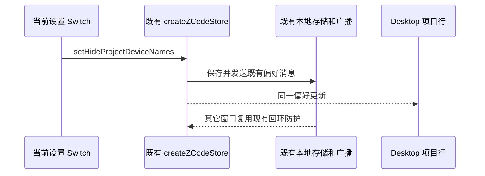

浏览器控制恢复官方 3.18.2 的唯一 Main owner：BrowserGuestManager 持有窗口 backend identity 和 controlScopes，Host 只转发同一 identity 与 controlScopeId。旧窗口 WeakMap 身份路径退出，init-local 从 manager 取得身份，Main 不再丢弃 controlScopeId。scope 释放先关闭准入，再等待已开始命令与录制结束；未知 scope 释放留下关闭屏障，迟到 open/旧请求不能复活。会话只读列表保持 sessionView，控制写入按严格 scope 匹配。恢复源码中遗漏的官方实现，不新增协议/数据迁移；已验证的缩放、guest 销毁监听和下载监听清理继续保留。官方 9 项回归在当前旧实现失败，需在恢复后与既有生命周期/截图回归一起验收。

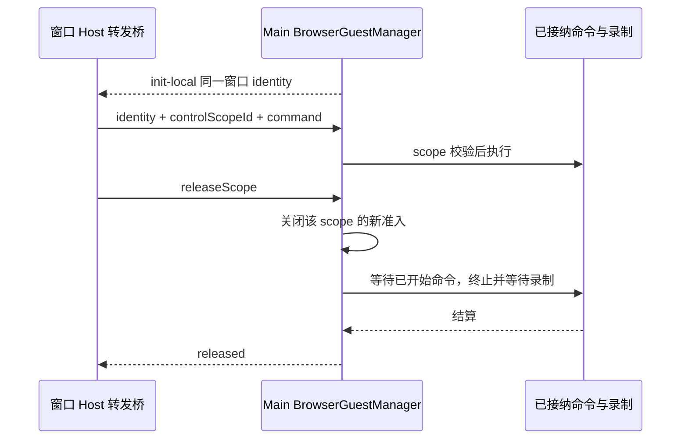

待用户裁决：官方 `projectIdFromDirectory` 对完整目录 slug 截取前 80 字符，两个共享长前缀的项目会得到同一内部 ID；在独立 Git 仓库夹具中仍复现默认权限模式跨项目泄漏（`custom-fixes-AkCGQ6`）。这属于数据身份设计问题，不能改断言掩盖。建议保持所有短路径旧 ID，只对会发生截断的目录使用有界前缀加完整规范化目录的 SHA-256 摘要；workspaceIdentity、会话 UUID、`.zcodium`、正文与工作区文件路径不变。旧的长路径权限默认值存在归属歧义，不自动复制到新 ID，也不删除旧记录；新项目默认采用既有 build 模式，用户可显式重设。需验证短路径兼容、长前缀区分、Windows 既有大小写契约和旧记录保留；本段尚未实现该 ID 变更。

SDK warning 回调保持 stdout 纯净，并在自身日志出口只传固定事件、模块、结算状态和数量；model/provider、feature、message、details 不进入 Logger 参数。Node 本地诊断仍按既有白名单处理，不能依赖下游 redactor 才去掉原文。直调出口回归先捕获这些原文材料（`custom-fixes-LZbgcu`）；记录数用既有 count 指标，生产模型请求和 warning 的非致命语义保持。

已有 `permission.scope=session` 的任务保持任务独立模式：setMode 先读同一 CLI SessionStore 的 scope，更新 runtime 后只写该任务 permission；普通项目 scope 继续走原 LocalSettingStore 项目默认模式。Host 不写 CLI permission，group 组织态不成为新的模式事实源。现有 group-mode 回归在整理后失败，恢复这个既有定制分支；读取 scope 失败时不先改 runtime。日志验证仍只接受净化后的 operation_failed，不能要求恢复原始 SQLite 错误文本。

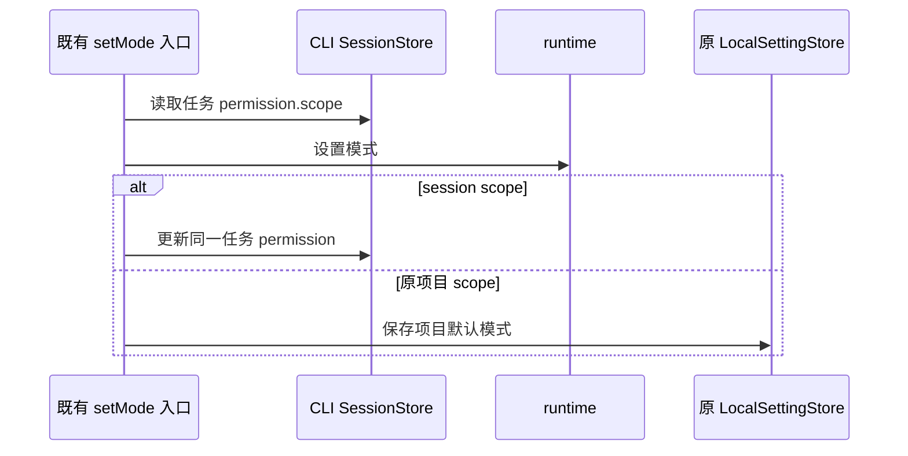

子代理解析诊断的返回材料仍供显式界面/调用者使用，日志出口只写既有 validation 技术分类、数量和模块名，不展开诊断中的原始路径、正文或错误文本。Node writer 仍使用现有 diagnostics-v1 JSONL 白名单封装，errorCode 仅接受已有系统技术码，不能为业务诊断扩充枚举。夹具通过同一 factory.getLogDir/flush 读取实际记录，按固定诊断事件与技术分类验证 Host 不重复解析、Files 保留一次诊断，并断言无原始路径/正文。更新读面后先复现原出口没有安全分类（`custom-fixes-rgqIRG`），不恢复旧原始日志格式来让验证通过。

异步本地日志 writer 是唯一写入 owner，既有 session-facade closePromise 继续独占关闭顺序：停止准入→等待 runtime/workflow→释放所属资源→等待可选 LoggerFactory.flush→报告完成或既有 AggregateError。flush 只等待已提交写入，不关闭借用 factory、不增加 IO 队列；无异步 writer 的 factory 无需实现。并发/重复 close 共用一次 flush。可控写入 barrier 回归先确认 App.close 没调用 flush（`custom-fixes-iOU3HZ`）；不能用清理重试或延时来掩盖未完成写入。

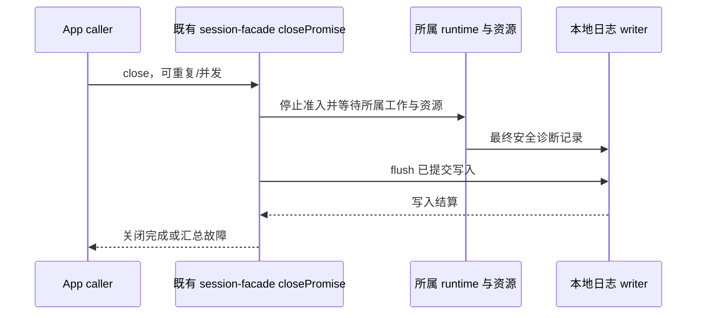

Root 的运行时偏好同步以“设置已加载”和三个实际偏好字段为失效信号。未加载时不写；空对象加载完成后也向 CLI/Bot 初始化默认值；只改主题等无关字段不重复同步。设置事实仍由既有 Settings owner 提供，Root 只派发既有 syncAppRuntimePreferences，不保存第二份偏好。挂载回归先确认 null→{} 时没有任何同步（`custom-fixes-y2Tiz1`），修复仅解构三个原始字段并加入 readiness 信号；日志不携带原始错误文本。

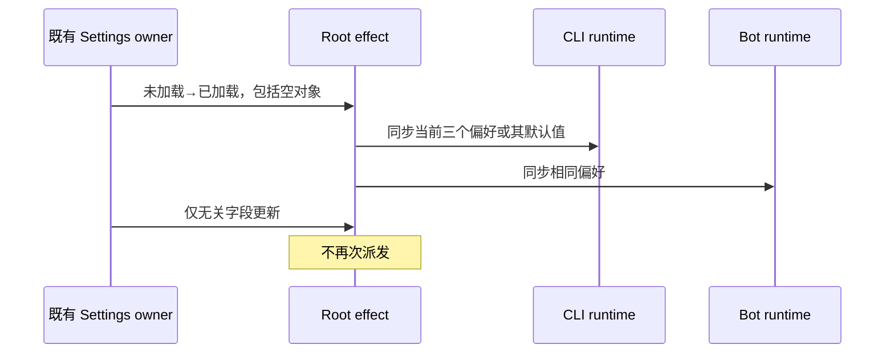

Agent 展开块同样读取当前 nestedToolRenderer 和自动化打开回调，不因其它内容引用未变而保留旧展示或旧动作。单独挂载回归先复现旧 renderer（`custom-fixes-WgLgNS`），仅补这两个成员依赖，不订阅整个 context。

Execute/Changes group 的展开回调也必须跟随同一 nestedToolRenderer 更新。两项真实挂载回归在子工具与其它 props 引用不变时复现旧 renderer（`custom-fixes-kOww5b`），只补原 ToolCallBlock 回调依赖，不增加渲染 owner 或整个 context 订阅。

Edit 多文件展开摘要同样读取当前 animateDiffCountOnMount；已挂载摘要在其它展示成员不变时切换动画选项必须生效。真实回调挂载回归先复现 false→true 后仍保留 false（`custom-fixes-HV1UCY`），只补该标量依赖，沿用原展示 owner 与输出结构。

嵌套工具块的展示由既有 `ToolCallBlock` 唯一负责；已挂载子块在工作流打开回调、摘要动画开关或 diff 入场动画改变时必须使用当前值。分屏接管主会话后，primary 绑定可为空，shell 的 activeSessionId 仍随实际活动会话更新，供已有划词路由读取；不新建绑定 owner 或写入路径。挂载回归覆盖回调替换、两个动画开关及 primary 为空时 A→B 的活动会话切换；两项先复现旧值（`custom-fixes-2mp9sI`），精确补齐依赖后同文件 18/18 通过（`custom-fixes-7SDpm6`）。

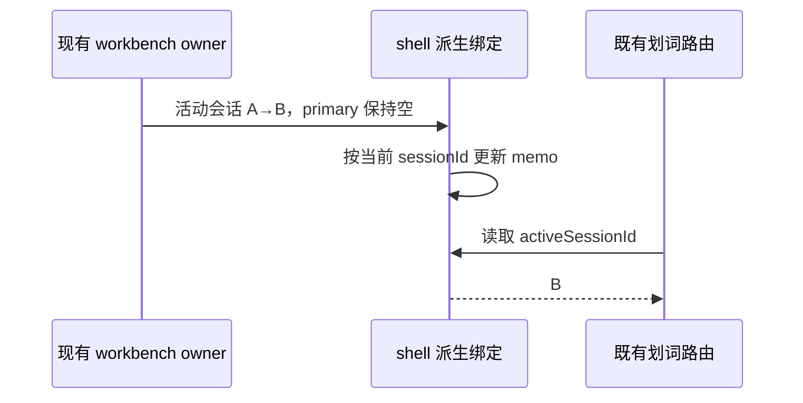

个人模型配置 Source 只读取 Personal 文件，Target 仍独占目标文件 CAS、Registry 刷新和同步回执。默认模型或思考档位失效仅表达新会话偏好，按官方实现原样同步，由既有模型推荐逻辑决定实际可用选择。写入、刷新和回执失败继续回滚；并发用户编辑不被旧快照覆盖。不得恢复账号字段或官方凭据同步。

Source/Target 输出共享协议定义的固定错误阶段码；Host 保留授权检查和字段透传，Main 的 Environment lane 保留代际、单飞和首次上线屏障。自由错误文本不进入公开技术日志，阶段码不构成另一份业务状态。

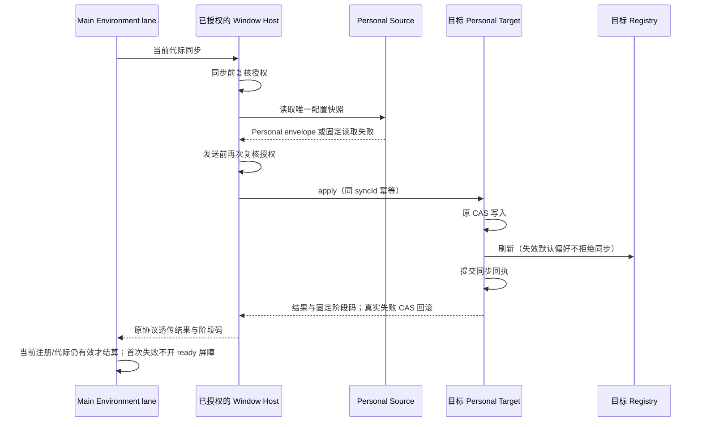

CLI `check` 恢复 registry、类型和行为测试的验证职责；CLI Lint 复用官方 `run-cli-lint.mjs` 和原样文件哈希准入。根 Lint 与架构文件大小政策跟随官方 800 行标准，包括官方已有大文件的精确行数告警规则；不新增生产目录豁免，不改 Hooks 的级别和调用规则，不刷新架构违规 baseline。

CLI 使用独立 workspace，类型检查须保持 CLI cwd，以 `./packages/*` 与 `./tools/*` 选择包；实际枚举须包含 core、adapters、bootstrap。回到仓库根会误选桌面包，使用根目录下的 CLI 路径又不会命中独立 workspace，均不能当作 CLI 通过。保留现有 TUI 构建准备，不扩大为全部原生插件和发行资源构建。

纯排版的六份 Workflow 源码恢复官方字节。Design 页面运行时在确认只有 helper 搬迁、引用和回归后恢复官方自包含函数结构，删除退役 helper 及其契约说明；宿主选择、页面投影、注入参数、CSS 预览、document token 与取消/清理边界保持。

清理明确未使用的导入和局部变量时，保留模块初始化副作用及调用顺序。导出删除先查询跨仓引用；动态加载和公共入口不能仅凭零静态引用删除。Hooks 根据真实 owner、闭包读取、失效信号和调用位置复核；官方原样诊断与本仓问题分别登记，不机械扩大依赖、不禁用规则或声称告警数等于 bug 数。

已退役的 OAuth 图标和 request-security 实现没有消费者时，同步清理指向不存在文件的 package exports；对应构建回归验证入口不可用，不恢复退役模块使旧测试通过。公共组件的兼容 props 不因局部解构未使用就删除，仍先核对实际调用链。

CLI 边界回归还发现三条官方专用测试的新增悬空导入：project-token 冷恢复、业务 Token 刷新夹具、官方 Sites 命令端点。它们只验证已剥离的官方认证或云功能；确认夹具消费者后连同业务 Token 刷新测试一并退役，不恢复后端，也不扩大悬空引用 baseline。其余历史悬空测试仍列作待整理项。

分组任务行的 common presentation 继续读取同一 Context 与任务事实；未消费返回值的 Context 读取仍可能承担刷新失效，保留订阅。纯拖拽预览与真实交互行使用独立组件生命周期：预览不注册 DND 节点、不查询 task/provider 路径，真实行独占菜单状态和 DND 注册。同一公开组件在两种模式间切换不能改变一个组件内部的 Hook 顺序，退役真实行时先释放它的登记。

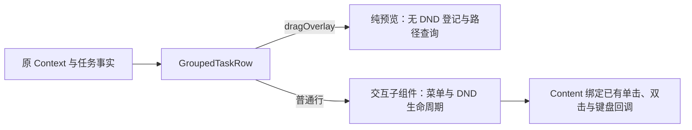

真实行继续使用已有单击/双击 handler：单击打开任务，双击第二击不再次打开，双击在已有禁用、触屏、菜单及目标元素裁决下触发重命名。纯展示 Content 只接收并绑定这些回调，不另造事件裁决。TODO 显示由既有 context.messageStreamShowTodos 控制，更新该标量必须使工作项 memo 失效，不扩大到整个 context 对象。

文件候选面板的展示根跟随当前会话 cwd，即使候选数组未换引用也必须更新。空态标题在远控紧凑模式与普通模式间切换时，旧测量订阅必须清理，恢复普通模式后重新测量。只补入这两项真实闭包读取的标量依赖。任务列表的 enabled 与既有 disabled 门禁已覆盖同一布尔语义，不将它的静态提示认定为另一个已复现 bug。

Composer 控制区读取当前 runtimeBlocked、远端可用性和移动输入视口；这些值变化时须重新投影模型控件的禁用状态和布局。复用已有 handleSelectModel 回调，不新增动作入口。草稿恢复仅在 scope/workspace 切换执行，保留已记录的恢复与晋升规则，不因静态提示重填正在编辑的正文。

## 验收

1. 实际 Personal Source/Target/Registry 的缺失默认模型与无效思考档位均成功同步；普通写入、刷新和回执失败分别返回固定阶段码，CAS 回滚和同 ID 重投正确。
2. Host 授权前后复核及错误码透传，Main 首次失败、显式重试和迟到注册的现有回归保持。必要的交互场景使用项目内受控 fixture，不冒充真实 SSH/实体手机。
3. 800/801 行边界、原样官方准入和本仓修改不获原样豁免的工程回归实际执行；CLI 检查入口包含行为测试。不能证明子进程写入范围的全量入口不运行，记录具体限制。
4. 六份排版源码与官方 blob 一致。Design 注入的实际自包含脚本验证原行为与清理，公开引用无退役 helper 残留。
5. 保留定制回归与去云/遥测、品牌、数据根、插件默认集合、Windows/macOS 资源守卫；Superpowers 仍作为本仓既有定制，Design 来源仍为官方。
6. 根与 CLI typecheck/Lint、格式、架构和受影响回归报告真实结果。相关 Hooks 专项扫描与运行证据按当前检查文档执行，未解决的官方/既有诊断单列，不以退出码 0 宣称全部无问题。
7. 数据、缓存、HOME、TEMP、日志和全部子进程写入只在当前工作树；无关 `native-context-rollback.md` 保持原字节。真实用户数据、系统凭据和已安装程序不参与本轮自动验证。
8. 分组行预览↔交互切换没有 Hook 顺序异常，预览的 DND 登记和 task/provider 路径查询数为零；单击/双击和右键原行为保持。TODO 开关在 rows 与其它标量不变时也即时影响工作项。组件/浏览器夹具与完整桌面 E2E 的证据分别登记，不混称真实设备验收。

## 执行记录

### 2026-11-22 剩余工作收口范围

用户继续要求完成行数、Hooks/knip 与尚未执行的验证。本阶段继续在工作树中处理，不提交、推送或打包。行数修复按实际职责：目录查询模块独占同一 rows 引用的派生缓存，Publisher 只转发查询并提供水位；甘特图独占 vis-timeline 实例、选择和窗口内全屏，App 保留数据获取与视图选择。原传输订阅、恢复水位和 cwd 种子规则不变，不新增行数豁免。

Hooks 按闭包输入、订阅所有者、清理与失效条件逐项收口；不把每次变化的 Context 整体机械加入依赖，不把刻意刷新信号删除。knip 先明确 CLI 嵌套 workspace、公开入口、工具与验证脚本的实际调用契约，再用全仓引用和动态加载证据处理真实残留。配置只补正确入口与解析规则，不用扩大 ignore 或标记导出掩盖真实问题。

远端 Flow 的事件回调需要读取当前渲染的输入和服务，原 getContext 闭包被局部 useCallback 保留后可能带入旧字段。flowState 仍独占状态；currentContextRef 仅提供当前 Context 投影，不承接连接事实或持久化。稳定 getter 返回当前投影，事件回调通过同一 getter 获取上下文；异步操作仍冻结开始时的 Context 并使用既有 epoch/owner 防迟到提交。Effect 的触发字段按原场景保持，执行体用 Effect Event 读取最新回调，避免整份 Context 导致重复重连。

设置页能力计数只属于选中 Scope 的 UI 投影。插件/MCP/技能/命令的计数回调冻结该 Scope key，迟到回调在目标已切换时被拒绝；不把上一设备的计数写入新设备。保留 Scope key 对回调换代的依赖，不依靠无语义的依赖项制造刷新。

全量 CLI 验证先审查 Turbo 的构建任务与子进程环境、测试路径、原生准备和网络端点，合成数据、HOME/TEMP/缓存/profile/日志均限定在当前工作树。退役账号/云功能的专用测试随实现退役；现存本地和用户自建服务能力必须执行对应验证，不能恢复云模块使旧测试通过。正式发行及真实外部设备需要各自真实环境，不能以合成夹具替代。

全量验证新增确认：Android 包混用 Node/Vitest 测试入口，需分开调用真实 runner；Design 用例应通过已安装 Git shell 执行 POSIX hook，路径比较统一分隔符并继承项目内 HOME/TEMP。快照演示工具的指定目录若嵌套在父 Git 仓库中，先确认 Git 顶层与指定目录一致，才能使用 Git 清单，否则按指定目录遍历，避免父仓库忽略规则使清单为空。没有新增上传入口或恢复官方服务。

冷恢复继续接受成功 ToolSearch/LocalToolSearch 的严格新 `modelContent` 与历史 `toolSearchContent`，复用已有恢复解析函数；普通工具、失败结果与带额外字段的伪造引用不能产生 discovery。Canonical part 和逐条签名保持原值，当前请求仅投影副本。Compact 的测试替身须提供当前 Registry，模型状态 sink 须实现原有 disposable 生命周期，不改变生产接口来兼容旧替身。

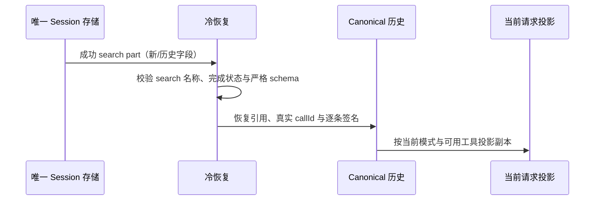

验证入口按实际 runner 区分 Node `test/` 和 Vitest `tests/`。本地性能摘要继续验证 `ToolExecutionPerformanceSchema`，不恢复退役 telemetry 名称；JSON schema 字节夹具对齐当前官方输入契约。退役 login 提示与云采样专用测试随功能删除，MCP 连接/关闭、用户 Key、权限、资源与本地 TTFT 的有效场景继续保留。Windows 用例解析 SSE JSON 后比较路径，通过受限夹具 helper 创建项目内 symlink，URL 转文件路径使用 `fileURLToPath`。

Core/Adapters 的 Vitest 入口同时执行当前 colocated `src/**/*.test.ts`；这些文件均使用 Vitest，先前仅传入 `tests` 把关键 admission/close 等源码回归过滤掉。Node 的 `test/` 保持独立入口，不混 runner，不以临时专项通过代替正式测试覆盖。

CLI 根 Vitest 配置由 testing 的 `cli-test-config` 模块登记，范围只包含现有配置文件及其职责合同，与 desktop/cua 的现有配置登记方式一致，不扩大未受管源码准入。

Skill 的合成项目带独立 Git marker，以当前发现契约阻止扫描祖先工作树的真实技能；只测默认发现范围，不向上继承本仓 `.agents`。Node writer 夹具用 `--no-warnings` 排除测试权限模式的启动提示，原退出码、真实输出、晚到输出、取消与进程释放断言不放宽。迁移用例通过唯一异步 runner 执行冻结 SQL，旧同步入口继续只检查 ready；restore 显式声明测试写入者已停止。POSIX mode 位在 Windows 不作安全断言，其系统凭据测试仍用注入存储或显式合成密钥。

Workflow 的 `channel`/`future` 沿用已存在的 facade 与 cell 内实现，无站点、无 journal、不过线。lowering 对 checker 确认来自 facade 的调用改写为对应 `__host` 成员；原调用遗漏改写导致真实沙箱 `ReferenceError`，复用 log 的同一改写分支，不按字符串名称改写用户自己的函数。Compact 恢复官方与主循环共用工具目录和请求投影的方式，使摘要命中同一前缀缓存；真正的工具执行仍由原有拒绝边界阻止，不恢复官方鉴权或遥测。实际无工具的辅助请求使用已有 off 投影，原历史不改。

引用工具的默认图须覆盖主仓和嵌套 CLI 的生产源码、两种测试目录、工具与验证脚本。按实际 package exports/main/types 的现存源码映射包引用，UI `@/` 按其 tsconfig 指向 UI 源码；禁止将 dist 声明与源码当作两个独立符号而漏报消费者。未映射、未加载或动态入口仍不能据此删除。此修正先用于交叉审查 knip，不能把一次扫描当作完整删除依据。

REPL 的安全日志调用复用现有 `diagnosticPrivacy`，通过公开子入口取用，避免从 shared 总入口加载无关 schema 和网络采样历史契约；仍保留同一日志净化算法、白名单与退出行为。MCP 的官方拆分接口和协议值 schema 是当前公开契约依赖，打包守卫按实际叶模块核验；兼容 CUA 的 `@ubjs/node/typescript` 解析器不等于 Agent Workflow 的 TypeScript 编译器，守卫仍拒绝后者和 Agent/core 业务树。Node 权限提示只属于验证环境，真实子进程退出码、协议输出和 realm 防护继续核验。

侧栏标签总览的标题投影必须响应完整的当前 presentation labels，包括新增 Workflow、扩展、权限和界面语言字段；旧依赖列表只包含早期标签，数组引用不变时会显示旧标题。仅把真实展示字段构成稳定投影，保持搜索排序、选中与关闭回调。相对时间使用该组件已有的分钟时钟，传入现有格式函数的可选 `now` 参数；其它调用默认仍取当前时间，不删除时钟刷新信号来消除诊断。

会话行的文件、附件与 rewind 入口由现有 runtimeReady 唯一门控。该事实改变时，即使 snapshot 与其它依赖引用不变，也必须更新 rowContext，进入不可用状态时立即撤销入口。Composer 只解构已有、无 receiver 的稳定附件 action，并依赖真正提交的 draftScopeId；既有草稿恢复只由身份换代触发，不因每次正文更新重填编辑器。

草稿恢复 Effect 在现有 scope/workspace 触发时通过 Effect Event 读取当前草稿、工作区 key 和代次 token；正文更新本身不触发恢复，RAF 与结算清理仍沿用已冻结的那次输入。发送 callback 依赖实际 draftScopeId，防止复用 Composer 时按旧 scope 清理。移除未读取的依赖只减少无效 callback/memo 换代，功能刷新信号仍保留。

Hooks 后续核对保留字段级投影：编辑器目标、Git watch paths 和文件过滤只读取各自已有的标量/数组字段，不把每次渲染新建的 Scope/options 当作刷新条件。Workflow 设置与后继 run 共用冻结 tab Scope 的稳定投影，并覆盖已有 `fileReferenceRootPath` 的变化，不能在跟随后继时丢失执行根。PDF wheel listener 使用当前 zoom action，容器生命周期仍拥有累计滚轮量；缩放 action 更新不重新注册监听器、清空累计输入。插件卡片宽度回调按真正的 callback 身份注册和释放。

插件侧栏的资源 feed Scope 必须随现有 `remoteSessionId` 换代，不仅比较路径与 workspace identity。项目目录的排序结果订阅现有偏好排序 action；action 仅随排序键与旧键升级映射更新，展开偏好不重建排序。模型选择输入仍按已定义的 JSON 内容键绑定稳定只读投影，等价对象不重复订阅。工具展示的 normalize callback 和插件 tab 的 Scope 解析只依赖实际公开字段，不订阅无关 Context 对象。

Hook 表单保存保留当前 boolean `hook.shell`，图片键盘导航读取当前 index/回调与既有编辑 guard，不受旧 listener 闭包影响。Global task list 继续使用已有 `disabled` 的同一逻辑值；Provider mutation 回执直接交给已存在的 Settings View `commit` action，不重复包一层状态或订阅。

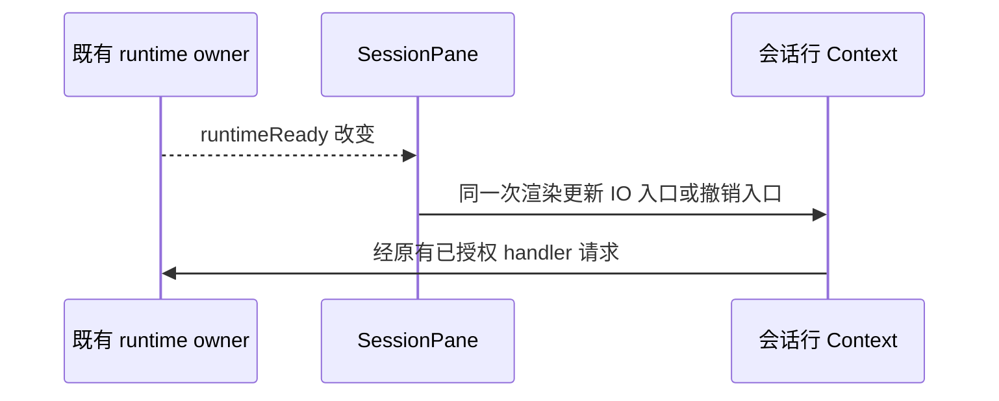

整理前 freshness 与 changed 架构通过；审计依据和隔离复现位于 `.run-logs/project-only-validation/upstream-alignment-review-f5VpaP/report.md`。官方基线与本仓 HEAD 均未变，本轮没有提交、推送或打包。

A1/A2 已跟随官方允许失效默认偏好同步，恢复固定阶段码与 Host 透传；真实写入/刷新/回执失败、CAS、幂等和两次授权复核保留。A3/A4 对齐 800 行政策和唯一 CLI Lint 入口，恢复行为测试职责，并修正独立 CLI workspace 的类型检查范围。A5/A6 的六份排版源码与两份 Design 主体恢复官方原文，三个只用于拆分的 helper 已删除。其它 Host/UI 结构没有全量撤销；不因搬迁遗漏官方算法，也不把保留的正确性补丁冒称为已测得的性能收益。

A7 两轮移除 171 个已确认未使用的导入绑定。使用实际 TS 编译输出核对模块初始化顺序：整条未使用值导入保留为裸导入，纯类型导入才删除。清理未引用的私有函数、局部值、重复标签和退役 exports，保留公共兼容 props、必要 Hook/Context 调用及工厂初始化。Design helpers 与业务 Token 夹具的全仓 dep:refs、动态文件名搜索完成；夹具唯一消费者随官方认证功能一起退役，没有扩大悬空引用 baseline。

真实回归还修复分组行预览切换的 Hook 顺序、未绑定的双击重命名、TODO memo、文件候选展示根、紧凑标题订阅，以及 Composer 控制区的 runtime 门禁与移动输入视口。草稿恢复/晋升、ACK 结算、Controller 行引用复用、候选过滤、Main 代际与单飞、有界备份等有正确性或既有收益依据的补丁保持。

以下是前阶段的验证记录，后续收口以本节后面的最新记录为准。所有证据目录均相对于 `.run-logs/project-only-validation/`：

| 验证                                                                           | 真实结果                                                                                       | 证据目录              |
| ------------------------------------------------------------------------------ | ---------------------------------------------------------------------------------------------- | --------------------- |
| 模型同步、Host/Main/lane、任务行、TODO、局部 Hooks、Design、审计边界与检查政策 | 56/56；其中包含 14 项审计守卫                                                                  | `custom-fixes-WnAmte` |
| 总结模型、工作流及 AstrBot 契约                                                | 29/29；工作流另外实际执行 37 项源码回归                                                        | `custom-fixes-sS3sPO` |
| CLI 目录选择、退役云功能和悬空引用棘轮                                         | 7/7，清理前发现的三个新增悬空导入已消失                                                        | `custom-fixes-XwkcxO` |
| CLI 打包入口契约                                                               | 13/13，退役 request-security 无法解析是预期拒绝                                                | `custom-fixes-s8BY0O` |
| 分组行菜单浏览器夹具                                                           | 1/1，覆盖 1280/390 与 tooltip 两状态、右键、重命名和双击；无页面异常或外部请求，代表截图已复核 | `custom-fixes-zzedjP` |
| 根类型检查                                                                     | 通过，包括最终 Composer 改动                                                                   | `custom-fixes-mptgxA` |
| 真正 CLI 类型检查                                                              | 通过，实际检查 core、adapters、bootstrap 等 CLI 包                                             | `custom-fixes-HumycN` |
| 根 Lint 与 session-control 边界                                                | 0 errors / 504 warnings；存量诊断保持可见                                                      | `custom-fixes-Tmboj5` |
| CLI 官方 Lint 入口                                                             | 失败：2 errors / 158 warnings，另接纳 2 项原样官方行数诊断                                     | `custom-fixes-D0ojjr` |
| 本轮格式与全量 fmt:check                                                       | 通过；全量核验 15,639 份继承文件、检查 3,971 份文件                                            | `custom-fixes-iiCMTo` |
| changed 架构                                                                   | 通过，new=0；未刷新 baseline，未配置模块的运行语义不由此证明                                   | `custom-fixes-pDPmnN` |
| Hooks 源码专项扫描                                                             | 2,805 文件，135 文件中的 481 条依赖告警，调用顺序诊断 0                                        | `custom-fixes-2LIFmL` |

格式验证使用项目内独立 Git index，将八份已核对的官方原文映射到计划暂存状态，以满足原有两份快照准入；真实暂存区未改。首次权限限制及误纳入的历史日志排版已纠正，历史日志改动已撤回，未改格式政策或准入清单。正式暂存时仍须沿用同一门禁。

局部 Hooks 回归抽取并执行实际生产 Hook 表达式，使用 React/JSDOM 与明确替身验证更新/清理；任务行回归编译实际组件。浏览器使用项目内校验过摘要的 Electron 44.7.0、隐藏离屏窗口、独立 profile 和合成只读服务。初次运行文件缺失、Playwright Electron 握手超时、夹具缺少 ServiceProvider 与隐藏窗口截图问题均记录为失败；最终 CDP 驱动通过。不把这些证据称为完整桌面、真实 SSH 或实体手机验收。

### 剩余问题与验证边界

迁移回归按当前审计契约验收：restore 必须同时声明 `database: "cli"` 与停止写者；v1 仅保留旧摘要算法兼容，仍要求完整且内外一致的身份、schema 和账本清单，不恢复跨 schema 降级或忽略未知迁移。内存数据库有存量行时显式提供项目内备份目录。短 busy_timeout 只在迁移期间使用并恢复原值；错误包装保留原异常为 cause。另一个写者完成迁移的夹具直接提交已完成冻结迁移的完整账本，避免在等待者持有进程内 admission 时递归调用同库 runner。

后续旧测试按现存入口收口：MCP 显式资源采样复用 `createMcpProcessTracker`，不恢复被删除的 telemetry 入口；ToolSearch 默认不由官方 access 类型推断开启。Anthropic 请求保留用户显式 provider metadata，不向其中注入内部设备/会话身份。旧官方 MCP 套餐错误只作为历史输入验证不会生成购买提示；不恢复额度服务。已经删除的 command hash 专用断言随采集功能退役，固定公开命令名分类保留。非标准 HTTP status 通过既有请求错误合同拒绝，普通合法响应与后续请求仍验证。

子代理恢复沿用官方 `metadata.json` 的最小状态合同。运行时唯一事实归现有 `RuntimeTaskRegistry`，状态文件只保存 agent/execution ID、running/completed/failed/stopped 以及开始、恢复、完成时间；不保存 prompt、配置、原始错误、轨迹或重复对话。启动阶段先完成该状态写入，再创建 child；失败时按原路径移除首次 task 或恢复原 terminal snapshot。终态先由 registry 领取，再写状态与 TaskOutput，最后沿原通道发布事件。每个 registry 内同一 agent 的文件写入串行，写入前复核 execution ID；旧运行不能覆盖已换代的状态。业务错误原文仍在既有 TaskOutput 与事件的产品契约中，安全日志不扩展。

FillWorkflowHole 回归沿当前合同：有效端口必须提供可拼接的已记录脚本，使 resolve 生成 `effective_script` 与 SHA-256 基线；缺失基线的调用仍拒绝。内联编译失败后才把函数体写到现有数据根的 session/run/site 作用域，相同内容复用、用户编辑过的文件不覆盖，模型提供的 path 不另铸文件。未绑定模型在 resolve 阶段拒绝，不开一个注定失败的确认窗；不恢复 session always-allow 或旧工作区 fill 落点。

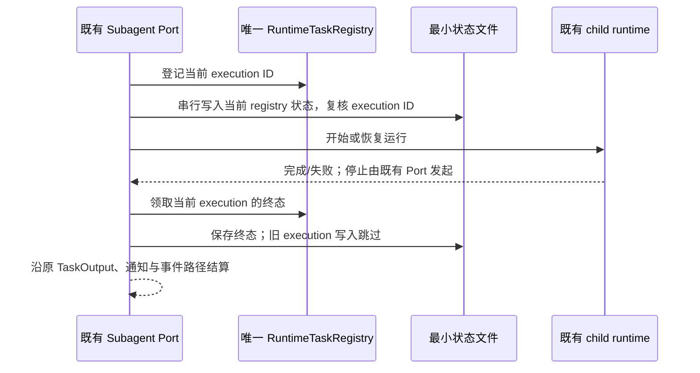

全量 CLI 的旧 Vitest 夹具也纳入本次整理：当前工作区作用域根与执行 cwd 分开传递，Read/ToolSearch 派生的 deferred 夹具显式取消继承的 alwaysLoad，专门的 alwaysLoad 优先级负例保持。Workflow、插件与配置的现行路径按 `.zcodium` / `.zcodium-plugin` 验证，历史迁移案例保留历史路径。引用扫描先前遗漏测试消费者的入口恢复官方导出，不以删除测试代替恢复。ToolSearch 的 max_results 按现有正整数 schema 分别验证拒绝非法输入与有效的大结果保真；不改变生产 schema 兼容旧夹具。

完成态 metadata 写入也沿用官方 `modelContent` 字段，与已修复的冷恢复同源。写入仍限制为成功的 ToolSearch/LocalToolSearch 严格引用内容，普通或失败工具不能注入 discovery；旧 `toolSearchContent` 仅作为历史读取兼容。原写入只识别 Native 名称并使用旧字段，会让 Local 搜索的恢复丢失引用，本轮全量用例已复现。

普通 MCP 的 `waitForAppConnection` 恢复官方等待语义，经现有 pool wait 与 lease/generation 检查返回握手完成后的摘要。连接被替换、lease 被释放或关闭时返回 null，不另起连接。它属于已有 MCP/App 接入契约，不是官方账号或云能力；先前剥离遗漏实现导致当前接口和生命周期测试失配。

DeferredToolCall 恢复官方首次输入校验器，向模型返回明确的 schema 失败信息；错误仍保持包装身份，不进入目标 Hook/权限。通用错误替代具体校验说明的本仓改写不保留。

Workflow 工具注册恢复官方 `enabled && activated` 判定。唯一 activation owner 仍是 runtime，首次装配与分支刷新同读其 config/activation；旧改写把 helper 改为 config 参数而调用仍传 runtime，导致显式 disabled/onDemand 失效。它是本地工具开关与运行时状态，不需要官方 client config/rollout 服务。

主循环恢复官方 `applyCacheControl: true`，在完整 provider 投影后统一选择缓存锚点。先前改写遗漏该参数，实际请求与过滤 Continue 后的记录走了不同缓存规则；计划提醒、steer 和多轮前缀回归已复现。保持请求副本，不向 canonical 历史写入缓存标记。

路径比较的显式 platform 参数须同时选择 Windows/POSIX normalize。原 POSIX 分支调用宿主默认 normalize，在 Windows 上验证 Darwin 或远端 POSIX 路径时仍产生反斜杠，破坏 `/private/tmp` 等价边界；改为原生 `path.posix.normalize`，保持当前平台默认行为。纯平台模拟在 Windows 执行，真实 symlink 和设备验收仍按环境记录。

普通 MCP OAuth 的全新凭据目录也须可授权。授权 leader 获取 lease 前创建其既有凭据父目录，随后仍使用原有锁竞争、owner-dead 回收、错误上报与 fencing；不提前写凭据、不放宽锁语义。隔离空目录已复现 ENOENT，已有目录的单元测试此前掩盖了这条真实首次授权路径。

MCP 工具请求继续传递既有 `root_session_id`，用于子代理与父会话在同一 MCP 实例内复用状态。这是普通 MCP 的运行时身份契约，误删它会使 REPL 等状态归属失配；恢复官方字段不恢复采集、账号或官方认证头。

MCP pool 的连接任务归 entry，caller 的等待预算归 lease。恢复官方对调用方 signal 的独立等待，取消不终止共享连接；新 entry 不重复 ping，只有已有 entry 的 revalidate 才复查。相同有效连接键集合的全量刷新共享当前配置代次；真正的增删、换源或换 scope 才换代，仍拒绝旧配置的迟到快照。

连接已经失败、正在回收资源时，entry owner 保留已选定的失败事实，后来的 lease close 不改写成取消错误；caller 仍等待同一资源完成边界。尚未失败的共享握手则由 caller signal 独立取消等待。源码回归已覆盖这两种顺序。

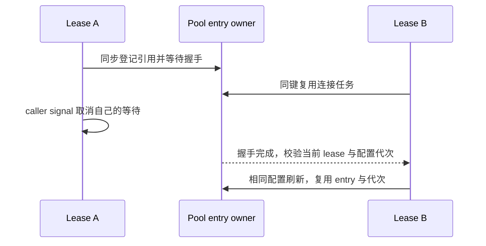

- 本仓两项 CLI 行数错误已经解决。最新官方 Lint 入口为 0 errors / 155 warnings，另保留 2 项经字节核对的原样官方行数诊断。Publisher 的任务目录定制归既有目录模块；Debug 的展示投影归受管 presentation，不恢复采样 UI、不提高 800 行上限。
- 根与专项扫描的依赖告警未全量清零。远端 Flow 的 Context/helper 依赖、其它订阅及面板更新仍需独立场景复核。SessionPane 的 composerDraftGeneration、Timeline 的 sessionKey 等失效信号，以及 enabled/disabled 的同义门禁按真实契约保留；静态告警不直接认定为 bug。分组任务行已移除调用顺序 warn 例外。
- 全量 knip 仍失败，有大量入口、夹具与导出分类；本轮只清理具备引用证据的项，没有扩大 ignore 或批量删除。历史 CLI 悬空测试仍有待整理项，棘轮通过只表示没有新增，不表示全部已可执行。
- Core/Adapters 完整 Vitest 已执行到第三轮，仍有失败，不能称为完整 CLI check/test 通过。Bootstrap、CLI/TUI 和其它包的全部入口仍需最终收口，根/CLI 类型与 Lint 不能代替测试。用户确认没有 Mac、真实远端和手机环境；这些真机验收未执行，正式打包和安装也没有执行。

2026-11-23 收口过程中的最新证据（阶段性，非完成声明）：

| 验证                                                                                               | 真实结果                                                               | 证据目录              |
| -------------------------------------------------------------------------------------------------- | ---------------------------------------------------------------------- | --------------------- |
| 超过单字符串上限的迁移备份与恢复                                                                   | 5/5；96 MiB 堆下处理 537,919,488 字节、65,664 行，峰值 RSS 131,432 KiB | `custom-fixes-Kxe3Aq` |
| 迁移账本、identity、DWF 存储回归                                                                   | 批次 172 passed / 2 failed；两个失败随后单独修复                       | `custom-fixes-Q090xS` |
| 异步启动、锁等待、取消、cause 与失败进度                                                           | 最终 12/12                                                             | `custom-fixes-q0twew` |
| Workflow 执行根、PDF 输入、插件宽度/远端 Scope、项目排序、Hook shell、图片键盘及已有局部 Hook 回归 | 12/12，先复现旧闭包与依赖遗漏，再验证修复                              | `custom-fixes-2iXbAP` |
| 根类型检查                                                                                         | 通过，包含本轮 UI 修改                                                 | `custom-fixes-7pTBVy` |
| 根 Lint                                                                                            | 0 errors / 307 warnings；告警继续逐项核对                              | `custom-fixes-W0p81t` |
| Hooks 专项扫描                                                                                     | 274 条，调用顺序错误未出现；尚未全部收口                               | `custom-fixes-ysmyvL` |
| CLI 官方 Lint 入口                                                                                 | 0 errors / 155 warnings，另 2 项原样官方行数诊断                       | `custom-fixes-6tRcti` |
| changed 架构                                                                                       | 通过，baseline=0 / new=0；没有刷新 baseline                            | `custom-fixes-XOrR5c` |
| Core 完整第三轮                                                                                    | 4,840 passed / 104 failed / 27 skipped；后续定向修复继续执行           | `custom-fixes-Vzqae0` |
| Adapters 完整第三轮                                                                                | 2,320 passed / 222 failed / 70 skipped；后续定向修复继续执行           | `custom-fixes-72uSKH` |
| 当前计划/Memory/Workflow/安全工具展示契约                                                          | 101/101                                                                | `custom-fixes-SQdefh` |
| 显式 MCP 资源采样                                                                                  | 5/5，包含真实项目内 Node 子进程探针，使用当前不透明连接 ID             | `custom-fixes-R3MJ7Z` |
| Workflow 开关、目录、Memory 执行快照与工具契约                                                     | 最终 110/110                                                           | `custom-fixes-RBX5hY` |
| 子代理最小状态、启动 IO 失败、停止、错误交接与恢复权限                                             | 96/96                                                                  | `custom-fixes-OvwbK1` |
| 子代理 live 事件镜像                                                                               | 5/5；原失败来自 Windows 合成路径失配                                   | `custom-fixes-1x2v7i` |
| 源码修改后的真正 CLI 类型检查                                                                      | 通过，包含 core/adapters/bootstrap/TUI 及当前包入口                    | `custom-fixes-kfWTRR` |
| 源码修改后的审计守卫                                                                               | 14/14                                                                  | `custom-fixes-OeWAwN` |

freshness 的联网 fetch 因 GitHub TLS 连接中断失败；`--no-fetch` 对已有 remote ref 的检查通过，当前 HEAD 与已有 origin/main 相同，不能据此声称最新联网获取已成功。CLI 配置登记与 ToolPresentation 原文准入引起的架构失败均保留证据；配置按既有测试模块模式登记，只为消除静态告警的 ToolPresentation 改写已撤回，最新架构检查通过。

子代理终态缺口已由官方源码与两个当前消费者确认：剥离 prompt metadata 时误删了 running/terminal/resumedAt 的必要写入，导致冷恢复无法区分正常停止与进程崩溃。已恢复上述最小 registry 投影并保留终态测试；相关启动/停止/交接回归通过，完整冷恢复与全量仍待最后验证。Knip、未执行完整入口和其余 Hooks 仍在当前目标中，本阶段没有提交、推送、打包或安装。

子代理恢复启动的回滚同时覆盖 registry 与最小状态文件。`resumedAt` 属于当前 execution 的生命周期时间，随 registry snapshot 保留；恢复未到 ready 而失败时，只有仍持有该 execution 的调用能还原旧 snapshot 和其最小文件投影。启动 IO 期间已经取消的 SendMessage 不创建 child，也不把未启动执行留为 running。终态写入与后继恢复交错时沿用同一 agent 的串行文件 IO 和 execution fencing，不另建业务状态 owner。验收包括启动失败后重读文件、取消发生于状态登记时，以及旧终态与后继执行交错。

旧 execution 结算时不能领取后继 execution 的 `notified` 标志或按后继标题生成旧结果通知。通知入队同时复核已有 execution ID；旧生命周期事件仍携带原 execution ID，供原消费者按原代次处理。

工作流回执恢复官方已有字段与顺序：留白到达时间来自事件或原快照；设置回执的 `ceiling` 保留默认并发 D；`null` 表达回到默认，并非无限并发。沿用脚本的模型绑定不可用时返回 `model_unavailable`，成功登记后继 run 后激活现有工具面，再排入设置轮。模型消息 JSON schema 的 `toolCalls` 保持官方 array 合同，不在拆分模块时额外收窄条目字段；实际工具输入与协议继续由各自既有校验器处理。

自动压缩估算复用同一步已算出的请求工具，包含本轮 denylist；不能再次用完整 runtime 目录作不同的引用曝光，也不重复执行模型工具合同投影。真正压缩后的 continuation 仍通过原回调重新获取更新后的目录，不建立跨步骤缓存。

模型空超窗处理保留官方单一终态判断：思考签名属于有效 assistant content，即使文本长度为零也交还原 Core；不在 chunk 处理器增加只按字符数判断的第二条错误路径。明确空超窗的原 `finishReason` / `rawFinishReason` 随既有错误上下文返回；安全日志仍经原白名单净化。`sensitive` 与拒绝/过滤/超窗一样不作空响应原样重试。

首有效内容时间恢复官方 transport observer 的数字事实：`firstContentAt - startedAt`，每次重试使用该次已存在的 observer。缺少线协议观测时保持缺席，不用 SDK 缓冲后可见事件时间伪造 TTFT。完成事件和安全本地数字诊断继续使用原通道，不恢复 telemetry milestone 发布、原文采样或外部出口。

DeferredToolCall 的内部目标身份与 provider 包装分别保留：出口沿官方 `toModelToolCall` 构造协议字段，移除内部 `modelCallWrapper` 标记并保留块顺序；canonical 历史及其 fork/compact 副本仍保留目标 name/input。退役的 Skill/MCP telemetry 回调与顶层采集 metadata 不恢复，现存 Skill 正文、MCP 展示和能力事件继续验证。

System reminder 的来源目录保持唯一：保留本仓 `shell_environment_change`，不再次登记官方已有的 `tool_search_announcement`。生命周期分类和包装不变；验证整个来源目录没有重复名称。

Browser 子会话的释放归属与现有 child runtime 资源 flight 一致：runtime 建立前由装配层清理；建立并登记后，只由 runtime 的 retire/close 释放和重试。装配层不能在 finally 再关闭一次，绕开尚未释放资源的 owner 或提前消费重试。父 tab 归属与 child session 登记保持。

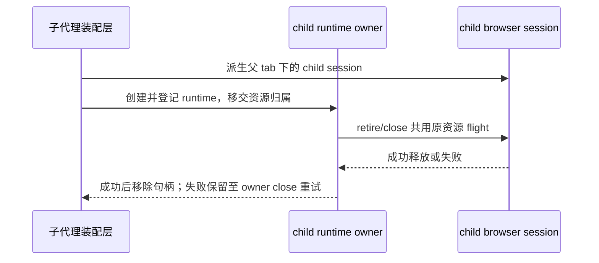

测试 HOME/TEMP、数据、缓存、日志、profile 和子进程输出均限定在项目工作树。无关 `native-context-rollback.md` 的 SHA-256 保持 `9225aa0d33dbff7edeca5ea26702851781736c9dc265f27edc5d078190e4c750`。此次没有使用真实用户数据或系统凭据，也没有重新安装应用。对全部历史差异仍不作“永久无遗漏”承诺。

测试完成后尝试清理新解压的 `custom-fixes-AcxwEJ/electron-runtime`：命令包含固定绝对路径、工作树边界与重解析点检查，执行前被自动审批拒绝，返回“blocked by policy”，没有运行删除或进程终止。该测试依赖暂留项目内；本轮没有生成安装包。日志、合成数据及截图作为验证证据保留，没有清理历史其它轮次目录。

### 2026-11-23 继续收口的证据

已复现并修复子代理恢复启动回滚、状态写入期间取消、旧执行误领取后继通知标志，以及 browser child 资源的重复释放。工作流恢复官方的留白到达时间、默认并发回执、模型不可用原因码与后继工具激活。模型消息 schema 撤销拆分时额外的 toolCalls 限制；DeferredToolCall 恢复官方出口字段。空超窗撤掉错误的重复字符数判断，保留思考签名和结束原因；TTFT 取原 transport observer，未恢复遥测发布或外部身份头。

旧验证按当前合同整理：原文件、剪贴板、Memory 和 ESM URL 夹具采用宿主路径；workspace key 原串与执行 cwd 分别验收；子标题使用当前流式返回；内部执行选型不重新接入退役 requestAuth。普通 MCP 保留 stdio/http/sse 和 alwaysLoad，官方 auth/forged provenance 仍拒绝。本地日志测试改用 factory.flush 和 diagnostics-v1 白名单记录，使用项目内真实 IO 失败夹具；不恢复原文/cause-chain 日志。有效 preflight 四项保留，类型改为 UI 公开合同；四个 services 验证引用现存 startup-entry。账号 PAT 专用 smoke 与命令随退役服务删除。更新网络 smoke 使用 Desktop 的 #src 别名，真实生成入口编译通过，未将编译称为完整 Electron 下载验收。

以下均为项目内隔离证据，路径相对于 `.run-logs/project-only-validation/`：

| 检查                                                                        | 实际结果                                                                            | 证据                                          |
| --------------------------------------------------------------------------- | ----------------------------------------------------------------------------------- | --------------------------------------------- |
| 子代理恢复失败/取消/交错、状态文件与旧运行对账                              | 101/101                                                                             | `custom-fixes-CBuj8z`                         |
| 工作流回执、schema、目录刷新与压缩/开关                                     | 265/265                                                                             | `custom-fixes-lPcShv`                         |
| Browser child 单一资源 owner 与相邻权限/执行                                | 28/28                                                                               | `custom-fixes-eJFPjx`                         |
| DeferredToolCall、流式 part、Skill/MCP 非采集事件                           | 79/79                                                                               | `custom-fixes-NVErd2`                         |
| 当前子提示、附件、REPL 文档、reminder、ToolSearch 冷恢复、WebSearch 与 fork | 129/129                                                                             | `custom-fixes-fsmb25`                         |
| Explore 生命周期与最小状态                                                  | 56/56                                                                               | `custom-fixes-ohbehN`                         |
| Read、post-compact、session persistence 与 Bash                             | 批次只有 Edit deny 夹具失败；该文件随后 33/33，通过时保留拒绝断言                   | `custom-fixes-QSeEgr` / `custom-fixes-tXaMrl` |
| 模型 empty completion                                                       | 109/109                                                                             | `custom-fixes-nHawQY`                         |
| SDK 显式 provider headers 与内部归属不外发                                  | 57/57                                                                               | `custom-fixes-b1bjSl`                         |
| 本地白名单日志、异步 flush 和真实 IO 失败                                   | 12/12                                                                               | `custom-fixes-FAy8kl`                         |
| 线协议首内容时间                                                            | 13/13                                                                               | `custom-fixes-cbULRO`                         |
| 普通插件 MCP 与退役官方 auth                                                | 22/22                                                                               | `custom-fixes-zLjCIW`                         |
| preflight 当前公开合同                                                      | 4/4；首次缺 UI 路径映射的执行失败已保留                                             | `custom-fixes-CC6TqO`                         |
| updater smoke 实际生成入口                                                  | 编译通过；没有执行完整 Electron 断言                                                | `custom-fixes-mziv3M`                         |
| 根类型 / 真正 CLI 类型                                                      | 通过；后续源码修改后 CLI 已另起复核，不能把早期绿灯当最终状态                       | `custom-fixes-4dW4tP` / `custom-fixes-nioQws` |
| 根 / CLI Lint                                                               | 0 errors / 306 warnings；CLI 0 errors / 155 warnings，另 2 项 pristine 官方行数诊断 | `custom-fixes-4czMWr` / `custom-fixes-GZDjQR` |
| changed 架构 / 审计                                                         | new=0、baseline=0；审计 14/14                                                       | `custom-fixes-g19ZdP` / `custom-fixes-lMCbiF` |

第四轮完整 Core 为 4,912 passed / 36 failed / 27 skipped（316 文件，`custom-fixes-YA1WNX`）。第五轮完整 Vitest 已通过：316 文件、4,948 passed / 27 skipped（`custom-fixes-4VWEZM`）；独立 Node `test:source` 另起执行，不与 Vitest 覆盖混淆。第四轮 Adapters 为 2,352 passed / 195 failed / 70 skipped（171 文件，`custom-fixes-TUCiUv`）；随后有上述定向修复，剩余旧 raw ModelIO、官方账户/市场夹具、路径/进程与其它有效入口仍待收口。未执行包入口、全部 Hooks 和 knip 仍属于 active 目标。

最新 knip 候选映射验证（`custom-fixes-FVSHac`）为 exports 1,552 / types 1,011 / files 629 / unlisted 594 / unresolved 27 / dependencies 48 / devDependencies 29 / duplicates 18，另 1 binary。`/packages/*` 只映射已存在的 Vite 地址；正式配置、依赖与锁文件尚未修改，没有批量删官方导出或扩大 ignore。完整格式核验曾失败于 `scripts/ci/local-hook-inputs-runtime.test.mjs` 一份文件（`custom-fixes-VU7NKG`）；随后再格式化该文件并单独检查通过（`custom-fixes-ltTwEd`），12 项实际 Hook 回归也通过（`custom-fixes-0ElSFD`）。新增修改后的全量格式仍待末轮复核，真实 index 与无关草稿保持不变。

用户已确认当前没有 Mac、真实远端和手机访问环境。继续完成工作树内可执行验证，不把合成场景称为这些设备的真机验收。本阶段未提交、推送、打包或安装，整体目标仍未完成。

Adapters runner 旧用例继续按当前合同收口：仅覆盖已删除 ModelIO 留存、轮转、增量缓存的用例退役；成功与失败请求改验原文文件不产生。混合用例继续保留 native-null 输入规范化、签名修复的请求局部性与预算、pending SDK 聚合 promise 下的及时取消。内部归属头不自动发往用户 Provider，退役账号刷新回调不得调用；普通 Provider 的重试与 native WebSearch 仍需实际验证。Core 独立 Node 入口已通过（`custom-fixes-0SOjoL`），不与 Vitest 混计。

默认 Windows cmd 的 cwd 捕获原先把多行命令直接交给 `/c`，只执行首行，既不保存 cwd，也不能按原退出码执行收尾。捕获包装使用唯一临时 batch 文件，保持默认延迟扩展关闭与用户原命令顺序；状态在下一行读取，成功才写 cwd。既有执行 flight 唯一持有清理回调，准备中取消、spawn 失败和正常退出均在 finally 清理，后台执行仍不捕获 cwd。准备/读取/清理使用异步 IO，不新增环境变量或第二条执行路径。

真实 Windows 关闭 child stdin 的回归观测为 `code=EOF, syscall=write`，exitCode 仍为 0；该组合与 EPIPE 一样表示子进程主动停止读取，不能把成功退出改判失败。仅此写入 EOF 组合加入既有分类器，读取 EOF 和未知写入故障仍保留失败。对应真实进程回归与分类断言均必须执行。Node shim 按必需门禁集中现有接口声明与实现，补齐模块清单、契约、示例和文档，原公开路径与 API 保持兼容。

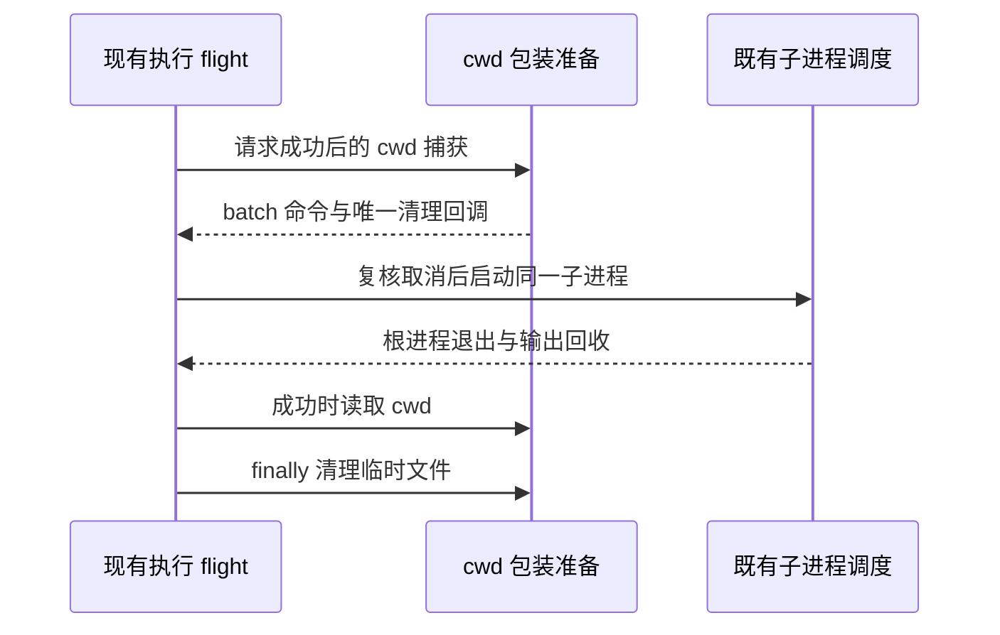

本轮适配器已完成两种入口：第六轮全量 Vitest 为 169 passed / 2 skipped 文件、2,539 passed / 70 skipped 用例（`custom-fixes-Gt6BoE`）；独立 Node `test:source` 为 72/72（`custom-fixes-3GLe7w`）。Core 独立 Node 为 133 passed / 4 skipped（137 用例，`custom-fixes-0SOjoL`），在此前全量 Vitest 4,948 passed / 27 skipped 后，新增 providerOptions 修复的 Core 回归为 47/47（`custom-fixes-6LJXTJ`）。

定向证据：runner 当前合同 125/125（`custom-fixes-br459C`）；MCP/迁移/绑定边界 83 passed / 7 skipped（`custom-fixes-GovgPs`）；默认 cmd、真实 stdin EOF、后台根退出、普通 OAuth 跨进程与 verifier 91 passed / 45 skipped（`custom-fixes-UfG3Hw`）；协议、Shell、PDF 和输出尾部批次只有 verifier 的过期预期失败，该项随后已在上一批通过（`custom-fixes-u6mvRE`）。此前的失败记录保留，不按减法推算全量通过数。

官方市场专用 CDN/合并分片用例已按本仓「当前 bundled seed 唯一权威」重写，保留真实文件原子替换失败回滚、并发完整快照、同内容不改写、历史 CDN 不复活和旧注册源零请求。个人市场保留目录元数据解析。普通 OAuth caller 预算与授权准备使用事件屏障分别验收，不假设 100ms 预算到点已经完成发现/DCR；授权事务在预算返回后继续完成，未延长调用预算。坏 JSON 用例区分 0022 档位修复与后继 0023 空选择修复，未更改迁移 SQL/校验和。非 Git Hook 夹具仅遮蔽宿主仓库的 Git marker，其余文件 IO 和子目录断言保持真实。

Hooks 本轮最新专项扫描为 276 条 exhaustive-deps、112 文件，rules-of-hooks 为 0（`custom-fixes-5ltqGn`）。按诊断形态为失效依赖 133、缺失依赖 103、cleanup ref 22、不稳定依赖 9、复杂表达式等 9；这只是审查索引，不能据此称全部为 bug 或已完成。CLI 其它入口、Hooks 全项复核、正式 knip 配置/依赖/锁文件与最终根检查仍待收口，目标保持 active。

WorkspaceShell 的文件链接处理器消费完整 baseServices/当前 workspace 服务来解析目标 Host，不只是 fileService。相同 fileService 下连接注册表更换时，回调必须跟随新的服务 owner，不能持有旧 Host 路由。侧栏 resize 的卸载清理捕获所属 DOM 节点，React 清空 ref 后仍对原节点收尾；不操作后继节点。Git 未提交数量只依赖 staged/unstaged 两个 dataset，传入这两个实际输入，不机械订阅整个 gitState。以上变更通过实际 Hook 与 DOM 操作回归后才视为完成。

WorkspaceShell 的 worktree 分支标签必须随当前 Intl owner 切换语言；在同一个 composer 上只替换语言实例时，实际 Hook 回归复现仍显示旧英文（`custom-fixes-gbpVS2`，15/16 通过）。补齐该 memo 的 intl 输入，不新增语言状态。共享代码提示按钮的六个事件回调从 React child props 逐项解构，保留回调变化、preventDefault 和 scope 归属语义，同时避免为静态分析订阅整个 props；实际 Hook 回归验证无关 child props 变化不重建事件处理器。文件/插件请求 scope 中的 version、workspace identity、owner 与启停信号用于首帧失效，不因被报为多余依赖而删除。

留白补全缺失草稿时恢复官方原有的 writeWorkflowDraft 注入调用：当前 run service 创建本次独占草稿，路径随引擎同一事务的 hole-filled 落库；引擎拒绝时只清理本次新建草稿。已有草稿仍在成功提交后就地改写，写失败保留 journal 的有效脚本并不推荐旧草稿。模型绑定、commitSequence 与原串行补全队列保持。诊断不包含草稿路径、原始错误或正文。真实 SQLite 夹具先关闭使用它的 service，再关闭数据库，断言失败也执行此顺序，避免 child 后续结算访问已关闭数据库。

冷读与 resume 的草稿路径不能因出现过 hole-filled 就永久隐藏：当内存没有写回确认时，原读面异步读取草稿，与当前 run 的有效脚本逐字节比较，并在 IO 后复核有效脚本未改变。一致才发布路径；文件缺失、旧内容、IO 故障或期间有效脚本改变均不推荐草稿。验证是本次读取的派生结果，不新增持久化状态或另一份写回流程。实际生成草稿夹具必须写入真实内容，并同时验证改成旧内容和删除文件后的拒绝推荐。

knip 继续核对退役入口：三份 mobileLogPull/Export/Sink 测试只覆盖已移除的设备原文采集与导出；devDesktopRemoteProdScript 只要求自动 CDN/远端资源；反馈上传 E2E 及其 helper 只要求官方帮助配置、反馈表单与日志上传。上述纯退役验证随功能移除，不恢复生产模块。localDiagnostics 的混合文件保留现存本地安全日志、计时、限制与 Reporter 回归，仅移除已退役 ConversationDiagnostics 原始事实消费用例。退休的 buildGroupedTaskViewFromSessions 优化验证也随该旧投影移除，当前 task-groups owner 与已有行/排序回归保留。有效远程动作、Provider、权限和项目场景中的失效引用继续调查，不按退役采集用例处理。

浏览器用例中的 `/packages/...` 动态 import 是 Vite 根地址，knip 的 TypeScript paths 无法解析这种绝对浏览器地址。仅在 knip 的 mjs 源输入编译器中将该类 import 映射到同一真实项目文件的相对地址，产品源码和浏览器实际请求不变；目标文件不存在时仍报告 unresolved，不加入 ignoreUnresolved。缓存命中夹具只注入目标 Browser Use 插件的真实 manifest 与全部 requiredSeedPaths，避免其它未构建插件阻止成功缓存建立；目录复制、marker 删除、manifest 改写与最终复核仍使用真实 IO。

缓存命中及校验期间改写三项回归在隔离真实来源后仍失败（`custom-fixes-EgXQna`）。源码确认 preparationPaths 仍登记已退役的 marketplace.json，而本仓只写 bundled-marketplace.json；因此文件事实始终缺席，成功缓存无法登记，校验期间的 marker/manifest 改写也无法识别。路径清单只保留当前 bundled 分区及既有插件 required 文件，原 owner、admission、不可变事实基准、最终复核与有界重新准备逻辑保持，不能创建空旧文件或恢复 CDN。

完整大报告读面回归还确认了两处原子绑定适配的扩大读取：仅需 run-launched/hole-filled 的模型绑定，以及留白元数据查询，误用 types=all、reportItems=all。65,536 条报告用例向 JavaScript 交付了 328,064 个 item（预期 384）；40 条 1 MiB 报告的快照读入约 48 MB（上限 8 MiB），见 `custom-fixes-MbyMis`。恢复事件类型下推与 reportItems limit=0；草稿同步核对只查询 hole-filled 类型，正文不进入这些元数据读面。真实报告分页仍按原条数/字节预算，不能改写大报告断言来放行。

Sharp 已声明并同步到实际环境。两份旧浏览器入口首次执行失败（`custom-fixes-XJEh63`），宿主 Chrome 拒绝调试启动；重试改用已在项目内的 Chromium headless shell（`custom-fixes-qtAVLr`），浏览器启动成功，像素用例失败、预览用例仍被依赖构建拖延。预览夹具的 Vite 缓存改为本次专属目录，依赖改用现有浏览器隔离准则的 noDiscovery 与明确列表，避免加载期间持续重新预打包；页面错误立即传播，失败也关闭所属 page。不能把这些未通过的断言称为 UI 验收。Hono 2 / node-ws 1.3.2 的 HTTP 与真实 WebSocket 兼容回归已通过，旧三项连接生命周期也通过（`custom-fixes-K1f1wJ`）；首次夹具错误和拥有进程的清理记录保留。本地诊断前三份合计 21 用例通过，CLI 最小 metadata 旧预期已按现有冷恢复合同更新后另验。

元数据下推后的大报告批次为 4/5 通过（`custom-fixes-2B5VH4`），40 条 1 MiB 场景的字节上限已通过。65,536 行夹具逐条写入真实磁盘耗时 261s，超出其 120s 测试预算；准备改在本次 fixture 的 SQLite 连接上用公开 createDwfJournalStore 在一个事务内写入，同一生产 writer 与全部 65,536 行保持，不放宽时间、数量或字节断言。预览夹具沿用现有 project-browser-fixture 的 watch=null，不监听整棵工作树及验证目录。

Lucide 像素回归确认一处官方基线内的主题错误：浅色 foreground-subtle 是 70% alpha，图标插件却对所有主题固定使用 60%，导致浅色图标的非交点颜色也改变。主题 CSS 持有既有文本与图标共用的 alpha，插件引用该变量，subtlest 同样复用其原有变量；保留颜色层级、hover/disabled、继承、透明类与一次合成的交点规则。实心图标的 filter 合成与原生 alpha 绘制在 Chromium 中有一个 8 位色阶的舍入差异，像素比较沿用同文件非交点测试已有的最多一个色阶误差，仍拒绝二次淡化等明显差异；不改颜色值来迎合舍入。

本段最新实际通过证据：大报告 5/5（`custom-fixes-jSjJzU`，65,536 行场景耗时 36.5s，条数/字节断言保持）；缓存事实三项 3/3（`custom-fixes-24yZd2`）；实际 Hook 与 DOM 16/16（`custom-fixes-5HiVOm`），根类型通过（`custom-fixes-Ok46CX`）、根 Lint 0 errors / 298 warnings（`custom-fixes-lZPBjj`），之后源码又有变更，仍需末轮重验；真正 CLI 全部类型通过（`custom-fixes-V8bezk`）。预览卡点击、菜单、键盘与四主题 hover 7/7（`custom-fixes-nv6xtx`，首次 8.06s）；图标透明度、继承、状态与像素 4/4（`custom-fixes-Yog9dZ`，390/1200、浅/深色）；本地诊断四入口共 26 用例通过（`custom-fixes-Nt9YkF`）；Hono 与连接 4/4（`custom-fixes-K1f1wJ`）。以上均为项目内合成环境，不是 Mac、真实远端或实体手机验收。

本段根 typecheck、Lint（0 errors / 298 warnings）与审计 14/14 已通过（`custom-fixes-GJCgFs`、`custom-fixes-GFB8zY`、`custom-fixes-QnTTIU`），完整格式通过（`custom-fixes-KduAXi`），实际 Git index 未变。架构门禁发现官方已有的 `packages/ui/lucide-colors.mjs` 位于 UI 既有 src 根之外，修改后不再享受原样继承准入；把这份现存 UI 构建文件纳入原 ui 模块的精确 roots，不创建另一套颜色服务或豁免。ui 仍是既有粗粒度未受控模块，此归属登记不代表层间治理已覆盖 UI 全部源码。

粗粒度 UI 归属尝试未满足 managed 门禁，并触发 data-sync 归属匹配变化（`custom-fixes-df4bT2`）；已撤回该 roots 修改。现存颜色构建脚本与其主题 CSS 改登记到独立的 ui-style-build 受控构建模块，只声明 Tailwind 插件与样式输入契约，生产文件路径和实际实现保持；四项契约工件按现有门禁提供，不新增颜色服务、业务状态或重复编译路径。

ui-style-build 四项契约已填写，源路径保持，架构 new=0 / baseline=0（`custom-fixes-jJ8qX2`）。Bootstrap 库重新生成（`custom-fixes-oOZxoa`）。旧插件用例按现存合同调整：Claude 图标不自动拉取/改写，空目录只提供 bundled 市场，保留保留 ID 拒绝覆盖、抑制缓存与显式第三方刷新断言；插件 dataPath 跟随显式 storage root，不能把 config HOME 当成数据 owner。image-search 的官方默认服务已剥离，用户自建 MCP 入口保留且未配置时关闭；仍验证单文档开关不影响其它格式。POSIX 执行位用例在 Windows 明确跳过，不为不存在的 Windows 权限位修改生产实现。

受控模块登记过程中确认了架构工具的根匹配缺陷：moduleForFile 先筛出匹配模块，再按每个模块的全部 roots 中最长字符串排序，未匹配的长 root 会抢走更具体的真实 owner。恢复既有「实际匹配的最长 root 优先」规则；无匹配仍返回 null，同长度沿用原列表顺序。不修改允许的层或 requires，不刷新违规 baseline。增加嵌套目录与精确文件 root 的回归，验证给宽模块增加无关 root 不改变已有文件归属。

根匹配两项先复现失败（`custom-fixes-VUyxqZ`），修复后架构门禁通过（`custom-fixes-ad36Ta`）、根类型通过（`custom-fixes-W4Avgg`）。完整架构测试为 81 通过/3 失败/1 跳过（`custom-fixes-kwy2Jz`），失败只在已安装 boolbase 的重复默认导出。已核对项目 pnpm cache：原始 dist/index.js 的完整性成立、无默认导出；当前 patch side-effect cache 的完整性也成立，但其内容包含两个默认导出。仓库补丁本身只添加一次；清除这一个错误的副作用缓存，并从已核对的原始包重新安装这一依赖，不修改兼容测试或通过去掉默认导出来回避旧消费者合同。

插件三文件最新批次仅剩 3 项失败（`custom-fixes-3PmqtV`）。image-search 保留的是用户自建 MCP 入口，官方默认服务已经剥离；未配置时默认关闭，不应按已删除插件断言。bundled 分区通过公开 manifest 读取函数解包，历史 CDN 同 ID 场景验证只恢复 bundled 缓存、零请求且历史文件不改写。

最新正式 knip 为 unlisted 2 / unresolved 15 / dependencies 49 / devDependencies 29 / exports 1,550 / types 1,009 / files 629 / duplicates 18（`custom-fixes-ahp4Cn`）。剩余两项未列依赖是 Server 所属 PTY 构建解析和旧 test-model.mjs；其余候选仍需消费者、动态来源或退役入口审查。Hooks 尚须在本段修改后重扫，不把之前的 268 条当成当前统计。Bootstrap 七文件批次仍是 187 通过/14 失败/1 跳过；之后缓存和草稿修复是定向证据，不按减法推算全量通过数。当前目标保持 active，没有提交、推送、打包或安装。

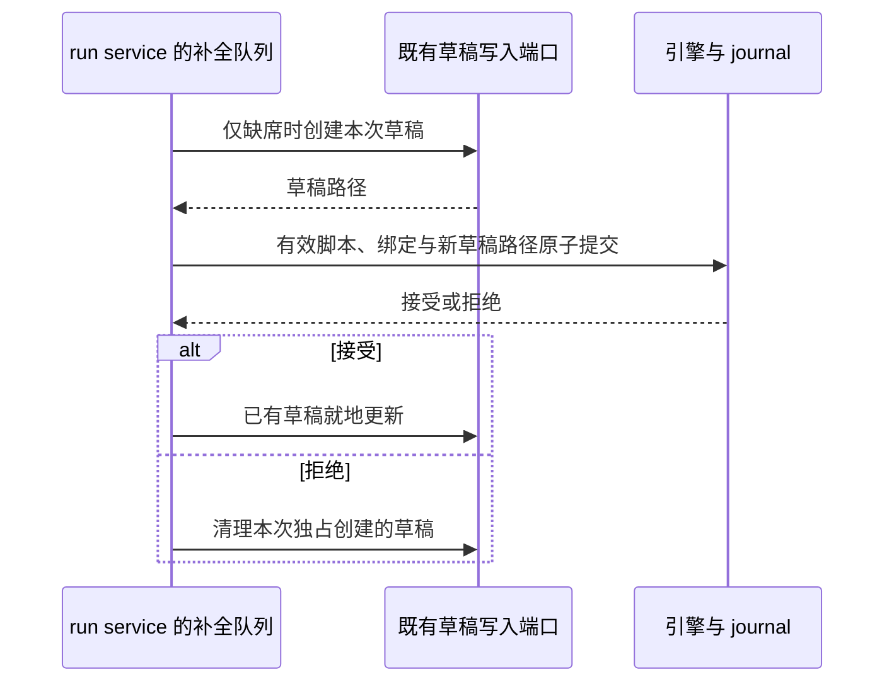

knip 正式入口沿用官方 knip.json 的源目录审计范围，由 knip.config.mjs 根据当前 workspace manifest 和架构公开入口补充源码、契约示例、测试/脚本/HTML 入口及路径映射。两份存在于 package bin 但由打包器生成的 dist bundle（CLI zcode.cjs、Server CLI server-cli.js）按所属 workspace 排除重复源码扫描，真实 src/main.ts 明确纳入；不扩大任何生产源目录的 ignore，不按告警标记导出。候选中已验证这两份 bundle 的悬空依赖来自产物静态扫描，源入口与构建回归继续验收。其它未列依赖、悬空引用、无消费者导出及动态来源仍必须逐项处理。

依赖声明按实际使用者补齐：根和 UI/CLI 的验证工具列入 devDependencies，Desktop 的 zod/schema 与 updater 运行依赖列入 dependencies；已安装的工具版本保持现值，不升级版本线。MCP SDK 1 只用于历史插件兼容夹具及既有 CUA type-only 合同的开发依赖，生产 MCP 接入仍为 SDK 2，不恢复账号/采集端口。Sharp 与 Tailwind forms 的两个未安装入口另行核对，不凭空填版本。远端 PTY 脚本通过 createRequire 从 Server manifest 解析 Linux PTY，已有 Server 声明不复制到根，不为 knip 新增 Linux 分发依赖。锁文件在项目内缓存更新，禁用安装脚本，不构建安装包。

首次补齐声明的锁文件已更新（`custom-fixes-uEc2dA`）。Node Permission Model 固有禁止 fsync，前两次 pnpm 更新失败；锁工具单独审查目标锁文件、node_modules 和项目缓存路径，禁用安装脚本与 pnpmfile，使用隔离 HOME/TEMP/缓存运行后成功，未解除应用测试的路径守卫。当前 4 处 peer 警告需最小配套调整：使用锁中已有 esbuild 0.27.7 满足 Vite 8；CLI 的 FFI 开发依赖使用其工作区既有 TypeScript 5.9.3，根编译器仍为 6；Hono WebSocket 1.3.2 要求 Node Server ^2.1.6，Server 与 Server CLI 同步该配套入口并验证已有 loopback/类型合同。其它弃用提示不据此升级整条依赖树。

补齐后的锁复核仍有 Android emulator 的 esbuild 与 TUI 的 TypeScript 两处配套警告，沿用上述已存在版本收口。Design 的 `test/fixtures/frontend/tailwind.config.js` 是导入设计系统测试读取的静态文本，执行会写入 `EXECUTED` 哨兵；其中 require 不是包运行依赖。撤掉误加的 Tailwind 声明，仅将这份静态夹具从 knip 的程序输入排除，生产源码与真实测试入口继续扫描。Sharp 属于两份实际浏览器像素验证的工具依赖，需声明、安装并执行相关验证。

Bootstrap 首轮完整 Vitest 为 66 failed / 185 passed / 4 skipped 文件、408 failed / 3,157 passed / 17 skipped 用例（`custom-fixes-9lF8KD`），另有 child 尚未完成就关闭数据库的异步异常待调查。路径合同定向批次为 59 failed / 104 passed / 1 skipped（`custom-fixes-8JfU4k`）。SEA 清单路径修正后两项哈希回归已通过（`custom-fixes-jj3vrp`）。单独冷恢复插件开关测试实测 7.63s，超过默认 5s 测试预算，但在 60s 诊断预算内通过（`custom-fixes-hZwtEw`）；仅真实内置资产 IO 和跨进程测试需要明确独立预算，不改变生产启动、锁或调用预算，不以延时掩盖状态同步问题。Hook 审核失败继续 fail closed，诊断只验安全事件与 reasonCode，不恢复原始错误文本。

协议剩余夹具继续按当前合同收口：四项只验证退役账号配置/官方请求凭据及旧刷新协议的正向用例退出；BYO 模型、请求 ACK、不可变绑定与普通 Registry 回归继续保留。项目 MCP 信任夹具使用当前 zcodium.json 和 .zcodium-plugin 文件名，验证未信任项目配置不连接。detached child 事件断言包含当前可选目录源参数，仍验证父记录活动时间不变化。

冷恢复冲突准入：真实 SQLite 回归确认，initialize 带 onReady 回调时先等待 entry.flight，跳过了 run 已有的 workspaceConflict 准入，冲突 session/resume 会等待被它的调用者持有的启动 gate。所有 initialize 请求在等待前复用同一冲突检查；正确归属的回调仍在同一启动安全完成后执行，不增加 owner、超时或第二条启动路径。桌面 continuous 与手机 replayable 两种协议均覆盖。

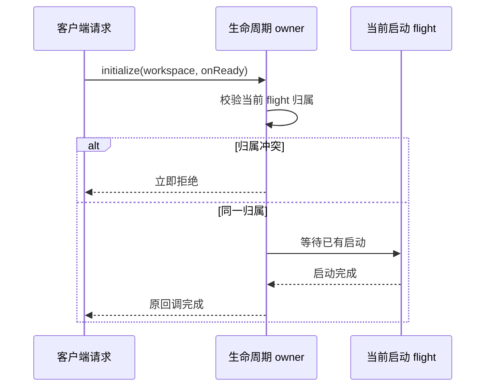

工作流技能三份正文仍停留在旧版，缺少当前留白、逐条流水线和完整示例，且 facade 与编译入口不一致。三份资产恢复到当前唯一官方基线 fec9759；未保留没有本仓定制依据的旧段落。技能资产没有官方网络端点；编译、字节上限和全部完整示例继续由真实守卫验证。bundled root 已是异步 IO，夹具必须 await 同一解析结果，不修改生产发现时序。

剩余诊断断言使用当前出口合同：补全缺少审批模型绑定时保留 9011、函数体坐标、模型名、原脚本与等待状态，不再要求枚举旧绑定表或旧说明文字；关闭失败仍保留故障状态及 Inbox 结算，以 AggregateError 顶层稳定文案与失败的暂停调用验收。actor 关闭日志只验已有事件、sessionId 和安全错误分类，不能要求恢复原始错误文本。

灰度关闭回归进一步确认 zcode-guide-plugin 仍保存官方已移除的旧 dynamic-workflows 三份资产，导致插件来源的同名技能绕过 bundled 路径门禁。当前官方 tree 不包含这三份文件，本仓也没有独立定制契约；同步其删除，保留插件其它技能。SSH sessions-index 夹具只读 SQLite 历史元数据，远端目录保持 identity 编码的 POSIX 路径，不能用测试的 Windows 物理工作目录替代；数据库文件仍在本次项目内隔离目录，不启动远端 runtime。

实际 React 挂载新增两项先红回归（custom-fixes-lFa8TC）：Explore 展开内容仍显示前一 nested renderer；初始关闭的侧面板重新打开后，关闭回调未调用当前完整视图 owner 的 exit。Explore 只补齐 renderer 输入。侧面板先获得既有完整视图出口，再构造关闭回调，仅依赖当前打开态、exit 动作和原 collapse 动作，不复制完整视图状态或增加关闭路径。

PTY 构建依赖由已有 Server buildRemoteValidation.ts 承载：根工具的 createRequire 已从 Server manifest 解析平台包，移入同一构建模块以匹配实际 workspace owner；原 JS/addon 同源策略不变，不增加依赖或构建平台。独立 CLI 进程夹具的 --import 使用 file URL，并向子进程传递当前 Node 文件权限及项目内 TEMP/TMP/缓存路径，避免 Windows 默认系统临时目录；模型仅连接本次 loopback Provider，不使用系统凭据库。

独立进程真正启动后发现 FIRST/SECOND 各多出一次模型调用；夹具把 plugins=false、titleGeneration=false 写进旧 .zcode，当前 CLI 未读取。配置统一写入 .zcodium，保持三次模型请求和原 SQLite 历史断言，不放宽计数。TUI 同类夹具同步配置路径及子进程环境隔离，PTY 若受 Node Permission Model 限制仍按实际失败报告。

原生编辑/重试夹具去除退役 Highspeed 卡鉴权假设，仍验证显式 BYO Selection、破坏性操作前模型准入、Registry 改变后的单次准入、收口竞态入队和逐轮选择不改变会话常驻模型。原 Off-Peak draft flag 和纯 workflow_cmd 归因标签用例退出；当前 bundled 命令灰度与正文展开仍由已通过的真实技能守卫覆盖。

Workflow child 仅退出已剥离的官方 runtime headers 鉴权路由用例，普通权限、AskUserQuestion、Browser owner/close 和插件技能仍验收。Shell/cd 夹具按宿主平台表达同一命令，Windows 使用 cmd 原生 cd 输出 cwd，POSIX 保留 pwd；增加 exitCode=0 断言以暴露执行失败，不能把缺少 cwd 当作路径漂移。

knip 依赖核对确认根 border-beam、d3-path 无源码/脚本或运行时闭包消费者；UI 自有 border-beam 样式不使用该包，d3 图表依赖通过其所属包正常传递。根 tailwind-scrollbar-hide 与 UI 的同版本声明重复，CSS 消费者归 UI，保留 UI 声明、移除根重复项。WDIO 自动插件、SEA postject、Office build 顺序与 Server HTTP 外置依赖继续按其实际分发消费者保留，不凭 knip 输出批量删除。Babel runtime 的暂留判断已在末轮撤销，依据为源码及装包闭包均无消费者。

工作流 child 回归确认漏吸收官方 notifyExternalChildSessionEvent 的交互镜像调用：普通权限请求虽按父 session 路由，父投影没有 PermissionRequested，确认窗缺席。恢复官方原调用，子事件只落库一次，只有交互镜像通知父 sink，工具活动仍归子会话。另一个回归确认 Browser forChildSession 被同一 factory 调用两次；移除重复赋值，复用已经构造的 childBrowserControlPort。Shell 夹具使用现有平台解析器的 display.name 与 dialect，Windows 选择 Git Bash 时不能发 cmd 的 cd 语法或要求 CMD 名称。

真实 Git Bash cd 回归确认 cwd 捕获的宿主映射缺陷：自定义 TEMP 被 MSYS 映射为 /tmp，pwd -P 返回 /tmp/...，纯字符串盘符转换无法还原其物理 Windows 目录，结果缺席。Git Bash 的同一成功捕获改用内建 pwd -P -W 输出物理 Windows 路径；POSIX 继续 pwd -P，原主进程 stat/realpath 校验、成功门禁与唯一 flight 清理保持，不加入另一套 mount 状态或路径猜测。

成功捕获后，child 持久化的 path 正确冻结在创建时的执行 cwd（cd 后的 src），directory 仍保留 workspace 键路径；原夹具把这两字段都要求成 workspacePath，与当前 I2/I11 合同冲突。重开继续分别验收 path=cwd、directory=workspacePath、workspaceID 不变与 child 正文，而非改写生产持久化路径。

随后真实 remote child 只读查询仍缺席，确认 lineage 校验把 auxiliary 的执行 path 当成 workspace 归属路径：有 identity 时，cwd=src 会阻断正确父链。auxiliary 按其持久化 directory 校验工作区范围，再沿完整 parentID 链找到目录 owner；root 维持原 path/legacy 判据。错误 identity、外域 directory、缺父、已删除父与环继续拒绝，验收覆盖原 SAT30 全组，不放开远端路径猜测。

软链验收夹具准备使用 Windows 原生 PowerShell 接口，并在 Node 和 PowerShell 两端检查目标及 link 的完整绝对路径均位于本工作树，拒绝现存重解析点和覆盖。它只创建本次夹具的两条链接；测试仍读取真实链接并验证工作区内/外的实际落点，Node 的应用文件权限保持项目范围。POSIX 按原 symlink API 运行；不把受限链接创建变成生产软链校验的跳过。

TUI 的原生 ConPTY 夹具需要创建 Windows 命名管道，Node 文件权限无法表达这一瞬态 IPC。将 node-pty 放在单一夹具进程中：该进程只校验并读取项目内启动配置、建立 PTY、转发键盘/屏幕与退出码。目标 Node、cwd、HOME/TEMP/缓存与 ZCode 配置/数据库路径均经过同一工作树门禁，实际 CLI 继承原 Node 文件权限。夹具关闭等待原生终端和所属进程完成后才清理其启动配置；测试仍通过真实 TUI 键盘、屏幕、Write 结果和 SQLite 重开验收，不替换产品权限 broker 或 runtime。

两份旧 Main relay→Renderer action 用例的生产入口已退役，按当前唯一 Source Server RPC/attachment 路径移除过期验证；当前桌面 Source RPC 与 task mutation 验证保留。Workflow 世界读取夹具通过宿主 join 构造绝对路径，git/文件 op 的抽象相对路径与安全 argv 断言不变；不让 POSIX 字符串假扮 Windows 文件系统路径。

Xterm 的空字符串回调在独立实际调用中已确认正常（custom-fixes-CdZr0t），撤回 NUL 屏障尝试。TUI 失败屏幕实际显示 CLI 用法，继续按当前参数接口检查入口；原生夹具在 PTY exit 之后结束所属 helper 进程，并先发送真实退出码，避免 IPC reader/worker 保活使清理永久等待。

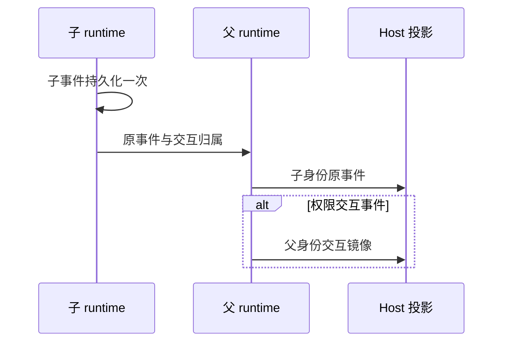

DB109 的旧 restore CLI 当前明确返回 LEGACY_RESTORE_UNAVAILABLE，不恢复已退役导入实现。该用例改验显式拒绝、现存正文/迁移 ledger/CLI 与 task-index 文件字节不变；旧 Reader 与重新升级的真实内容读取仍由同文件全部其它案例验收。这个结果不表示旧 snapshot 导入功能可用。

MCP/catalog/slash 协议七项真实冷资产夹具仍超过 Vitest 默认 5s（custom-fixes-6kRhmw），仅这些构造真实 App、读写 bundled 插件/技能资产的用例采用独立 30s 预算；生产 Host 偏好、准入锁和生命周期预算不变。当前配置/插件清单路径改为 .zcodium/.zcodium-plugin，/init 继续验证当前 AGENTS.md 的位置。未知时序阻塞仍单独排查，不对整个 Bootstrap 放宽测试预算。

该批次随后为 17/18，唯一余项是 draft catalog 仍要求自动官方 CDN 图标，按已剥离合同改为不自动生成该 URL，冻结 catalog/标识与当前字段断言保持。TUI 屏幕已进入 Ready 状态但 Unicode 显示为 Windows 本地代码页乱码；在本次 ConPTY 夹具中准备 UTF-8 console 的实验仍待验证，不据此修改产品绘制或交互代码。

保留 Guide 条目存在断言后确认实际漏项：builtinPluginAssets 的 Guide 必需文件清单还要求官方已移除的三份 dynamic-workflows 旧资产，整包被当作不完整而不发布。清单同步其删除，仍保留 Guide 的其它必需资产，新的工作流技能只由 bundled-skills 承载；不恢复重复技能来满足旧清单。

Guide 的中央清单进一步对齐官方 bootstrap 的唯一入口标记 skills/zcode-configuration-guide/SKILL.md；原 commands/workflow.md 同样已从官方 tree 退出，本仓同步删除，/workflow 只由当前 CLI 内建入口负责。构建守卫和运行时共用这份清单，避免 staging 与冷发现再次分叉。UTF-8 ConPTY 的真实键盘用例已通过（custom-fixes-1UdohX），覆盖允许/拒绝后台 Write、来源 ID、正常退出和 SQLite 重开；该结果不代表系统旧代码页环境已经验收。

2026-11-23 剩余 CLI 验证收口：开发 Provider 配置直接指向真实随包文件，SEA 只物化 runtime/provider/bundled 基线；login/logout 不加载配置。测试不再要求下载缓存、额外 bundled 环境字段或错误原文。插件宿主仍是有效入口，保留早期分流、凭据拒绝、存活和退出用例，求值探针只阻止 Agent 业务模块，不阻止 Main 自身使用的安全日志模块。显式 tui 入口须传递已解析的 workflowMode 与 toolsearchMode，和 headless 一致；兼容 --enable-workflow 按当前官方合同保留。Windows SEA 损坏缓存修复使用公共文件锁作为发布 owner，锁内再次校验；仅替换已确认非链接的损坏目录，EPERM 在 Windows 且目标满足上述条件时才进入替换，不吞掉权限/锁文件失败。

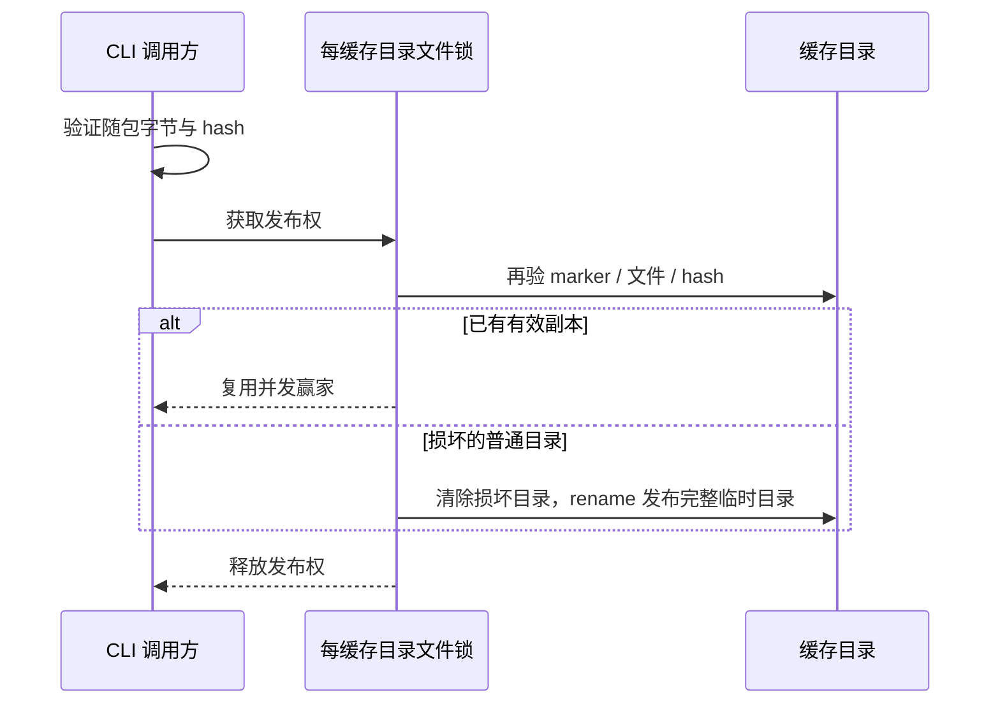

本轮再次核对当前官方 tree，visual-judge.md 仍存在；交接摘要称其退役不准确。保留真实文件和随包断言，缺失 seed 用例只遗漏该文件、其余 seed 完整准备，避免因先缺 dist/LICENSE 把拒绝原因验错。superpowers 同样按当前已吸收清单保留。SEA 纯内容采集测试中的 Linux 行只使用合成工具字节；真实 TUI/Playwright 依赖采集采用宿主目标，不下载 Linux 资源。

Desktop Babel runtime 保留判断复核后撤销：当前 pnpm why --recursive 只显示 Desktop 这一处直接声明；Main/Host 构建文件、当前源码及外置依赖闭包未找到 Babel helper 消费者。旧 peer/ARMS 时代的装包恢复要求已经过期，和 module-details-from-path 一起从声明、强制注入、重新包含与过期测试清单移除。undici、PKI、飞书 SDK、SSH、解压及 updater 等当前实际运行依赖保持。此项只清理不再使用的依赖，不触发安装包构建。

各包完整 manifest 验证继续发现过期夹具：Git Bash 的旧语法断言更新为已验证的 pwd -P -W；自建模型请求只保留调用方显式 Header，不要求额外 x-openrouter-title。Subagent waitForTask 只裁决终态，测试移除目录之前必须 await 同一 port.close，等待后台写入与通知完成，不能用 rm 重试或延时掩盖 owner 尚未退出。Windows 本地 endpoint 验证使用本轮唯一 named pipe；Unix 保留项目内 socket，不将 Windows 磁盘路径传给 server.listen 作为 pipe 名称。测试 PATH 保留系统工具优先级，把 Git/usr/bin 放在尾部，避免 GNU tar 把 C: 当远程主机。性能 10s 断言保持，先在空闲环境定向复查，不扩大预算。

stage 的 broken-link 用例保留原断言。受限 Node 无法创建 symlink 时，测试验证器提前准备目标为同一项目内 missing 的相对链接，测试只 rename 该 fixture 到本轮 stage；普通测试仍直接创建链接。来源与目标路径均在启动前审查，不扩大文件权限或允许项目外链接。

完整入口结果 custom-fixes-7ehFiK：TUI 217/217；CLI 493 通过/1 失败/13 跳过，余项是 Darwin 剪贴板 mock 未解析 AppleScript 反斜线转义。Bootstrap 独立 Node 94 通过/1 跳过，上游入口 3511 通过/1 失败/21 跳过；两次 live catalog 之间 Spreadsheets 的初始缓存才完成发布，不能把变动的实时 inventory 用作静态元数据对照。目录用例先通过当前 preparation owner 完整准备资源并断言 failedSeeds 为空，再让同一 owner 处理两个查询，保留原数组、身份、显示元数据和无 CDN 的全部断言；finally 先 dispose owner，再移除 fixture。不会增加 query 重试或改变生产 catalog 语义。

Sites 纯本地归档回归在正确系统 tar 下仍出现 CRLF 和 Windows BSD tar 的控制台编码差异。文件名断言改为实际解压到本轮项目内目录后枚举文件，保留长文件名、中文文件名和完整集合；解压前先检查工具列出的路径没有绝对路径或 .. 段。Archive 的执行位仍通过标准 tar listing 独立校验并仅规范化换行。不改生产 tar 写入算法或把中文名字删出覆盖。

再次完整重验：Core 独立 Node 133 通过/4 跳过，上游 316 文件与 4948 用例通过/27 跳过；CLI 完整 494 通过/13 跳过。动态工作流完整 32+2039 通过，仓库快照工具 27/27。Bootstrap 旧目录失败通过，但资源包用例未显式验证第一份 goodRoots 非空，空集合相等可能掩盖未准备到旧包；补齐确切旧 pack 路径、来源、scope/priority 前置断言，保留坏 hash 拒绝、旧包回退及无临时目录全部检查。Adapters 另一次同步 best-effort 配置写回未完成尚待复查，当前没有据此增加重试或超时。真实 native 搜索 6/6 与无头 Chromium MCP 链路 1/1 均另行通过。

CLI 独立 workspace 元数据遗漏已确认：当前 CLI manifests 使用 workspace:_ 引用同仓外层 shared、provider、provider-node、model-option-map、session-control、formal-proof、zcode-cua，但 apps/zcode-cli/pnpm-workspace.yaml 只列内部 packages/tools，旧 CLI 锁也缺新增内部包，Turbo 无法计算完整闭包。修复只把这些当前已依赖的同仓路径纳入 CLI workspace，并给 test 明确 ./packages/_ 与 ./tools/\* 过滤，保持 CLI cwd 和原测试范围，不误选 Desktop/Web，也不新增下载模块或恢复 Linux 桌面资源。根工作区规则保持；两份锁分别按当前声明同步，CLI 不再靠缺失的包图做缓存推断。新增边界回归先红后绿。

CLI 锁实际同步发现 Office runtime 独有 Vitest 4.1.4 固定版本，与 CLI 已声明 ^4.1.5 的 coverage-v8 形成真实 peer 不匹配。Office 测试工具跟 CLI 当前范围 ^4.1.5 对齐，避免增加 override 或禁 peer 检查；不改产品依赖。源码模拟与完整测试正在复核，根/CLI 锁分别同步。

实际 Turbo discovery 拒绝 CLI workspace 外层路径；此前包图修复的 pnpm lock 成功不等于 Turbo 可用。最终 Turbo 入口从真实仓库根执行，并显式使用 apps/zcode-cli/turbo.json 与 CLI packages/tools 过滤。CLI pnpm workspace 仍登记已依赖的共享包，类型/单包 pnpm 命令保持既有入口；Turbo 的 cache inputs 相对实际根修正，并同时保留 CLI 与根配置/环境文件输入，不引入第二份 Turbo 配方。root dry graph 在项目内 global config 下已能完整解析。

Windows FS 不提供 POSIX 执行位，chmod(0755) 不能让普通 server.js 的 stat.mode 获得执行位。归档 mode 验证按宿主已有契约检查：server.js 在 Windows 为 0644、Unix 为 0755；ELF 原生可执行文件仍由格式识别写入 0755，start.sh 仍检查 0644。只修复平台夹具，不改生产打包规则。

最终工程入口复核发现 scripts/engineering-test-files.json 仍登记 12 个已不存在的测试，涵盖退役账号、遥测、旧远端资源和已移除夹具。清单只删除文件已不存在的记录；现存工程测试、公开源入口与平台范围保持。验收以实际文件存在检查、架构工具回归和当前工程选择为依据，不把 glob 自动忽略悬空路径视为覆盖。

最终 knip 复扫新增的 CLI Turbo 依赖候选来自入口归属调整：所有 Turbo 脚本已从真实仓库根运行，根 manifest 的 Turbo 是唯一执行工具。删除 CLI 子工作区不再使用的重复声明，两份锁按各自现有入口同步；不删除根工具，不改变配方或测试范围。

构建专项工程回归首次为 3 项失败：两项沿用官方强制遥测及编译期注入的旧预期，按本仓既有合同改验发布未配置时为空、每个 bundle 都不注入默认值，显式自建配置的字段/HTTPS/完整性校验保持；另一项受限 Node 无法创建 node_modules 链接。真实 Server ESM 构建夹具使用项目内独占 sandbox，Node 沿工作树祖先解析已有依赖，无需链接；实际产物版本探针使用 sandbox 的受限子进程环境。保留真实 tsup 构建与 ESM 启动断言，不恢复遥测或放开全局文件权限。

## 本阶段最终验收（2026-11-23）

本阶段目标内的代码修复、Hooks/knip 审查与可执行验证已收口。官方基线保持 v3.18.2 / fec975905a2abd4c07e35c40d51fa097a2258ec9。收口后改动已提交并推送到 fork：整理提交 `3a7f1f818`、文档提交 `2649d1a50`，`origin/main` 由 99c88981b5c9d38831cf87cc06c99cc9c3f5fdf7 前进到 2649d1a50d5d4f2caa71fe8d6c3f70a7b36b7266。推送前实际执行 `pnpm run verify:pre-push` 全链路（工作树、E2E 目标、Lint、过期文案、schema、架构回归、changed 架构、affected 工程测试）退出码 0；husky 钩子在 git 的 sh 环境找不到全局 pnpm 未能自动运行，改为手工执行同一命令后以 `--no-verify` 推送，不据此声称钩子本身通过。2026-11-23 21:27–21:46 又以该提交在 Windows x64 本机完成正式构建（`ZCODE_ENV=production`、Node 24.14.0、pnpm 10.33.2），产物 `ZCodium-3.18.2-win-x64.exe` 244.2 MiB、SHA-256 `3C63835AB98B3C986BB28D4C2204721E0C15217BB7EC05D028B71E6AD7085495`，静默覆盖安装到 `C:/Program Files/ZCodium`；安装后 `app.asar` 与 `ZCodium.exe` 均与构建产物哈希一致，隔离数据根冷启动与内置 agent CLI 通过，构建产物已在装机后清理。本机无 cmake/MSVC，`prepare:windows-runtime-host` 用 `isRuntimeHostReady` 校验既有 staged 产物摘要一致后复用。真实 Provider 会话、UI 交互与真机仍未验收；表中的构建只用于工程与入口验证。无关草稿 native-context-rollback.md 的 SHA-256 仍为 9225aa0d33dbff7edeca5ea26702851781736c9dc265f27edc5d078190e4c750。

2026-11-24 的重新构建修复了 preload 内联回归，并首次用 CDP 验证安装版首屏启动、启动遮罩退出、工作区与历史会话恢复；完整 UI、Provider 与真机验收边界不变，详见 [维护记录](maintenance-model.md) 同日段落。

### 完整 CLI 入口与实际回归

首次跨包完整运行 custom-fixes-7ehFiK 的失败记录保留；失败包分别按完整 manifest 复跑，均已通过，不用定向结果、减法或旧缓存推算。Node 与上游 Vitest 的结果分列，不累计重跑及外层 wrapper。最终 CLI 图在两份锁同步后再次验证：35 个 test task，CLI 范围外为 0（custom-fixes-LSZ8V6）。

| 验证入口                       | 最终实际结果                                                                                                            | 项目内证据目录      |
| ------------------------------ | ----------------------------------------------------------------------------------------------------------------------- | ------------------- |
| Core 完整 manifest             | Node 133 通过 / 4 跳过；Vitest 4948 通过 / 27 跳过                                                                      | custom-fixes-ZZs1WR |
| Adapters 完整 manifest         | Node 72 通过；Vitest 2540 通过 / 70 跳过                                                                                | custom-fixes-NMpvm2 |
| Bootstrap 完整 manifest        | Node 94 通过 / 1 跳过；Vitest 3512 通过 / 21 跳过                                                                       | custom-fixes-LyVjR5 |
| CLI 完整 manifest              | 494 通过 / 13 跳过                                                                                                      | custom-fixes-mUnQeM |
| TUI 完整 manifest              | 217 通过                                                                                                                | custom-fixes-7ehFiK |
| Dynamic Workflow 完整 manifest | Node 32 通过；Vitest 2039 通过，原性能断言保持                                                                          | custom-fixes-uFOe4K |
| 仓库快照工具完整 manifest      | 27 通过                                                                                                                 | custom-fixes-zfqjn3 |
| Office runtime 完整 manifest   | 104 通过                                                                                                                | custom-fixes-2Ir8ou |
| Sites 完整 manifest            | Node 25 通过 / 2 跳过；Vitest 71 通过                                                                                   | custom-fixes-VUYOtc |
| 其余 CLI 包声明入口            | 首次跨包运行已成功；Contracts、Node REPL、Design、DWF runtime、debug、i18n、插件及 Provider regression 结果保留在原日志 | custom-fixes-7ehFiK |
| 真正无头 Chromium MCP 链路     | 1 通过                                                                                                                  | custom-fixes-BgUsQx |
| Windows 原生搜索               | 6 通过                                                                                                                  | custom-fixes-I5uDqr |
| 实际 React 挂载回归            | 29 通过                                                                                                                 | custom-fixes-06xhCy |
| 构建专项工程测试               | 6 文件，52 通过 / 1 平台跳过，包含真实 Server ESM 构建与启动                                                            | custom-fixes-0iFCEp |
| Desktop 构建边界               | 20 通过；未构建安装包                                                                                                   | custom-fixes-viXkbx |

### 必需检查与保留裁决

根 typecheck（custom-fixes-jpvHy4）、真正 CLI typecheck（custom-fixes-TfjEk2）、根 Lint（custom-fixes-YouUG7）、CLI Lint（custom-fixes-cXTkZN）、changed 架构（custom-fixes-wGE6bM）均通过。根 Lint 为 286 warnings / 0 errors；CLI 为 154 warnings / 0 errors，另有 2 项原样官方行数诊断。本仓两项行数错误已解决，未提高阈值、禁用规则或刷新违规 baseline。架构工具回归为 84 通过 / 1 跳过（custom-fixes-vJn7fd），schema 22/22（custom-fixes-fNbrBp），审计 16/16（custom-fixes-p4yWBs），CLI registry 校验通过（custom-fixes-3TtjCy）。完整格式使用项目内计划 index，真实暂存区保持原值，末轮收据见 .run-logs/alignment-format-location.json。

两份锁分别实际同步（根 custom-fixes-wsUAij、CLI custom-fixes-IwdFU8），下载和安装包数均为 0，安装脚本关闭，没有 peer 警告；依赖自身的弃用提示仍存在。离线更新因本轮隔离 metadata cache 缺失而失败（custom-fixes-h6xSzC），随后正常联网解析成功，不把中间失败改写为始终通过。

Hooks 最终专项源扫描仍有 242 条 exhaustive-deps 提示，源文件 rules-of-hooks 为 0。逐项源码合同、失效信号、owner cleanup、字段投影及稳定引用裁决已刷新到当前行号和 SHA，保留提示可见；29 项真实 React 挂载回归单列，不能据此声称 242 项均已逐项运行验收。完整记录在 .run-logs/final-hooks-dispositions.json。

正式 knip 最终仍为 exit 1（custom-fixes-feRSDY）：unlisted/unresolved 均为 0，dependencies 36、devDependencies 27、exports 1550、types 1009、files 629、duplicates 18。63 项依赖候选与 3206 项源码/公开表面/兼容别名分别留有消费者及保留裁决（.run-logs/final-knip-dispositions.json）。公开 API、既有 fixture、动态构建闭包与兼容名称按现行合同保留，不为扫描全绿删除它们；已确认无消费者的声明和退役入口已清理。保留是维护裁决，不能把静态无引用或官方相同字节称为运行时证明。

工程清单当前 158 项且无悬空文件。常规 affected 选择器实际选中全套并按已有规则跳过（custom-fixes-d7WEOv）；显式按构建脚本相关选择为 0 项（custom-fixes-DOrPyd），这些 exit 0 都不表示执行了测试。因此另直接执行了上表 6 个当前工程规格，保留真实构建和运行断言，不称全部 158 个规格已通过。远端队列检查因 private queue absent 跳过（custom-fixes-RCWrvZ），不称真实远端验收；旧文案扫描通过（custom-fixes-JiOOcN）。

### 实际验证边界

本阶段验证使用工作树内隔离 HOME/TEMP/cache/profile、合成数据和明确进程环境，不使用真实 .zcodium、系统凭据或项目外测试目录。MobileApp/LAN 的真实浏览器与 RPC 链路已在项目内通过，WebKit 工具链缺失；Windows ConPTY 键盘、审批、退出及 SQLite 重开也已实际验证。用户确认没有 Mac、真实远端和实体手机，仍缺这些设备及真实 Provider、完整产品场景的验收。本阶段完成不表示全仓每项历史功能或全平台发行已验收，也未重新构建、安装本阶段代码。
