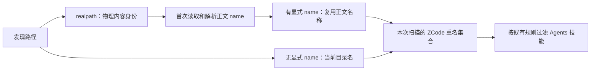

# 多轮性能改动整体审计：正确性、必要性与根因

## 审计范围与判定标准

审计当前未提交的性能改动及新增生产文件，按真实调用链分组，不把历史轮次的测试数量相加当作正确性证明。保留无关工作区改动；不构建安装包、不启动现用应用或真实 Agent、不调用模型 API、不提交推送。

每项分别判断：是否解决实际重复工作/错误生命周期；是否保持产品语义；新增缓存是否只存不可变派生数据且有完整 key/失效/释放；收益属于算法工作量、资源数量、局部实际耗时还是整机体验。没有证据的层级不得宣称已优化。优先使用 HEAD 源码与当前代码的同环境对照，新增针对原测试盲区的回归。

架构初检 violations / baseline / new 为 0 / 0 / 0。已读取 ui/services/shared/rpc 受控上下文、RPC 所有权与生命周期契约、React 性能规则、设计规范和历轮证据。freshness fetch 遇到 GitHub 网络超时；Node 为 24.18.0，mise 指定 24.14.0，不改环境。

## 技能发现：物理内容与路径名称不能使用同一个缓存键

第十三轮复用技能正文时，新增 `skillNameKeyByCanonicalPath` 把经过目录名 fallback 的展示名称按 realpath 保存。根因是缓存了依赖访问路径的结果，却只以物理文件身份为键。

当工作区先扫描无 frontmatter name 的技能 `workspace-name/SKILL.md`，用户 ZCode 根又通过 `user-name` 目录链接指向同一文件时，正文可共享，目录名 fallback 却不同。原行为按用户 ZCode 的访问路径生成 `user-name` 重名 key；优化后误复用 `workspace-name`，可能展示本应被 ZCode 覆盖的 Agents 技能，或隐藏原本不重名的 Agents 技能。

修正规则：

- 每次 discoverSkills 仍是唯一临时 owner；realpath 仅用于正文去重和复用正文中声明的 name。
- 只缓存解析得到的显式 name；无 name/读取失败时，重名 key 在使用点按本次访问路径的目录名计算。不为链接增加专用例外分支，不重复读正文。
- 技能摘要仍按既有首次发现路径产生，用户 ZCode 对 Agents 的名称优先级保持原样；空 name、无 frontmatter、显式 name、读取失败和多个别名均遵守相同规则。
- 不改变技能根顺序、根去重、启用状态、workspace identity、CLI/runtime 技能发现或公共服务接口。
- 验收使用测试自己的临时目录与链接，通过公开 skillsService.list 检查展示结果和实际读取次数，先在当前优化实现复现，再修正并核对原行为。

## 分享指纹：只保留实际使用的批量入口

第九轮已把 SessionPane 的两个调用点改为批量指纹计算，但旧的单轮导出仍留在生产文件中，仅供测试作为预期结果。全仓 `dep:refs` 确认没有生产引用或 re-export；文本查询确认没有动态字符串调用。这个包装入口没有兼容职责，也没有运行时性能收益，删除它以收敛生产接口。

原测试让批量和单轮入口调用同一个新提取的内部函数，不能独立证明指纹语义未变。审计时直接从仓库 HEAD 加载旧单轮实现，仅注入原有预览文件引用解析依赖，核对既有行顺序、重复项、路径、scope、空轮次和替换输入结果。通过后把已独立验证的字节固化为快照，移除对生产旧导出的依赖；提交后 HEAD 将不再包含该导出，回归不能依赖可变 HEAD 的旧接口。生产继续只有批量入口和一个内部指纹算法，不增加持久状态或失效分支。

## 审计结果

结论：不能把这批改动统一称为“全部必要、全面提速”。已经确认并修正一处优化引入的技能名称回归，删除一处没有生产调用方的包装接口，并补上独立算法对照。其余受审路径在已执行场景中保持预期语义；这不等于证明所有平台和真实负载下都不存在回归。

续接时清单包含 111 个已跟踪生产文件改动和 24 个新增生产文件；其中 CLI context 的独立修改等不属于性能任务，不回滚、不作为优化成果。沿上次已读源码和调用链继续检查，不把全量工作区都归为本次新修改。本次续接的生产代码只删除旧指纹包装的 10 行；没有新增运行时缓存、计时器或兜底分支。

### 按根因分类的保留判断

| 类别                                     | 根因与处理判断                                                                                                    | 证据及限制                                                                                                                                                                   |
| ---------------------------------------- | ----------------------------------------------------------------------------------------------------------------- | ---------------------------------------------------------------------------------------------------------------------------------------------------------------------------- |
| RPC / stdio / WebSocket 请求生命周期     | 请求登记、取消、关闭和迟到结果原来有多条清理路径；保留 requests 单一事实源及统一 finish、连接先结束请求再释放协议 | 同步重入、取消、编码失败、迟到成功/失败及实际 stdio 回归通过；不是新增业务队列，未移动 owner/lease                                                                           |
| 启动门禁、终端、Git、桌面 guest/dialog   | 等待方或资源已结束却仍持有 listener、timer、进程启动 continuation；保留按 owner 生命周期及时释放                  | 启动取消、256 个超时命令计时器归零、迟到 shell 不启动、guest/dialog 释放等回归通过；只影响对应异常/结束路径，不代表普通命令加速                                              |
| 会话投影和 render/navigator cache        | 正文未变却换对象引用，导致历史轮次派生与 React 工作重复；保留实例内不可变派生缓存、窗口 retain 与弱键             | 检查完整 row 引用、pin、语言文案、位置、session/epoch 及目录 revision；rewind、同 ID 替换、补页、跨 Host 回归通过。缓存省掉派生计算，但每帧仍需遍历当前窗口                  |
| 轻量问题目录                             | 为显示导航而补齐全部正文，把目录需求与正文窗口耦合；保留摘要目录接口及按点击补正文                                | 分页游标不推进、epoch/同 epoch revision 失效、旧 flight、关闭与正文窗口不扩张测试通过；没有把全量正文缓存回来。分享仍有独立完整正文需求，不能误删 loadAllOlder               |
| 任务列表、membership、pending command    | 多个组件对同一版本重复查询；无变化也复制整个表；一次同步响应逐项写存储                                            | 保留 service/endpoint/version 作用域、迟到失败不能删除新 flight、copy-on-write 与同步批次提交。未读 overlay、先持久化再上行、重排及成员资格回归通过；不跨 await 延迟命令提交 |
| Gen UI 文件通知                          | watch 与写入 ACK 对同一文件排出重复完整读，简单复用在途读又会漏掉较新状态                                         | 保留“当前读 + 最多一份未开始的后续读”；每批等待自己的读取，不用 debounce 或全局互斥延迟 ACK。写锁、原子替换、跨实例通知、dispose 与故障恢复测试通过                          |
| 文件索引 / Worker / Office               | 文件列表往返和编码重复、取消后继续取块、普通 Dirent 也进入异步 stat 路径                                          | 保留请求级取消与身份隔离、打包索引直接交 Worker、符号链接才异步查询。真实临时目录和浏览器 Worker/Office 交互通过；并发与忽略规则不变                                         |
| FIFO、行区间、增量归约、文件树与指纹分桶 | 数组反复移动、逐项线性查找或为每个目标重复全量扫描                                                                | 保留线性处理与立即释放已消费引用；冻结输入、旧源码差分与字节/顺序断言通过。属于大输入或突发负载收益，不能一概视为用户日常卡顿的主因                                          |
| 代码片段与提示职责                       | 聊天里的只读代码却创建完整文件查看器，每个按钮各建独立提示状态                                                    | 保留稳定原文 + 可见高亮层，以及消息内单一提示 owner；复制、折行、Range、焦点、ARIA、React 19 ref 清理及主题浏览器回归通过。已有浏览器前后对照支持局部收益，仍有终态重挂成本  |
| Shiki、技能、进程采样、图标              | 同内容/同资源反复初始化或读取、树遍历重复扫描                                                                     | 按语言保留 Shiki 语义隔离；技能只共享物理内容的显式名称；进程遍历保持原顺序；图标保持有界 LRU 和在途所有权。保留已测收益，不将 helper 数量或调用次数等同于整机速度           |

### 实际收益的层级

本次不启动真实 Electron 或 Agent。既有同机浏览器报告可用于确认组件级效果，但不是本次重新测量：

- [代码片段报告](../performance/chat-code-2026-10-17/report.md)：240 围栏的 Shadow Root 从 240 到 0，消息元素从 14,885 到 5,173；开发态终态提交区间仍有明显重叠，不能声称该改动单独根除了终态卡顿。
- [提示共享报告](../performance/terminal-2026-10-17/report.md)：7 组交替采样的终态提交中位数 73.2 → 50.2ms；独立 3 组真实按键回显 116.2 → 60.6ms。仍观察到约 50–60ms 长任务，样本量有限。
- [Shiki 报告](../performance/shiki-2026-10-17/report.md)：24 组多语言/主题输出一致，局部 JS 堆增量减少约 3.30MiB；首次加载耗时只有一组样本，不能推算长期 CPU 或整机内存下降比例。

本次 `performanceAuditDifferential.test.ts` 从 HEAD 取出原始 apply、coalesce 和文件树模块，向它们注入相同纯函数依赖，与当前实现同环境对照：200 组 × 80 条交错会话增量，分别通过 continuous/replayable 的过滤与归约；120 组 Windows/POSIX 文件路径和查询结果一致。输入被冻结，没有通过改写原输入取得收益。

对照完成后，原始源码固定为测试 fixtures 中的三个 `.ts.txt` 文件，并记录来源 revision 与内容 SHA-256。回归读取固定样本，不再在每次执行时读取可变 HEAD；否则提交优化后会把新算法当成旧算法，甚至因新增 import 不在依赖白名单中直接失败。仅冻结测试依据，不新增生产执行路径或引入 Git 运行依赖。最终三个样本与 Git 原始字节及 manifest SHA-256 全部一致；固定基线后，差分、分享和技能三个文件的 **16 项测试再次全部通过**。

附带不加计数器的耗时采样如下。每项先预热 4 次，之后前后顺序交替采 15 次，表内为中位数；小 apply/coalesce 每样本循环 100 次后取单次均值，其他每样本 1 次。这里只是合成局部计算，同机负载及 JIT 会影响数值，测试不设快慢阈值：

| 输入                        | HEAD / ms | 当前 / ms | 判断                                         |
| --------------------------- | --------: | --------: | -------------------------------------------- |
| 60 行 / 20 条文本增量       |  0.013746 |  0.007467 | 差值只有约 0.006ms，不应包装成肉眼可感的改善 |
| 20,000 行 / 20 条文本增量   |    4.8980 |    1.9430 | 大正文窗口减少重复查找和复制                 |
| 8 条互不相关 upsert         |  0.000683 |  0.000424 | 亚微秒量级，不作体验结论                     |
| 2,000 条互不相关 upsert     |   29.2701 |    0.0733 | 突发批次中避免二次复杂度                     |
| 4 个现存 / 4 个删除文件     |    0.0338 |    0.0185 | 绝对差值很小                                 |
| 500 个现存 / 500 个删除文件 |  100.7250 |    0.9477 | 文件树批量处理避免反复复制、去重和排序       |

### 尚未解决的根因与范围

[已有 Electron profile](../performance/electron-2026-10-17/report.md) 定位到：终态从 live tail 换到历史父节点引发整轮 React 重挂，Streamdown 同时从 streaming 切为 static。轻量代码和单一提示 owner 减少了重挂时每个节点的工作量，但没有改变这个父树/身份边界。后续若继续消除终态长任务，应围绕稳定正文挂载身份和虚拟列表测高契约做设计，并保留 static 模式已有错误规避；不能用更多缓存或定时等待宣称根治。本次没有未经设计对齐直接重写该边界。

2026-10-18 后续：用户授权结构修复后，已将 live/历史渲染合并为同一父节点下的 keyed 列表，消除该父节点迁移导致的整轮重挂；设计、身份回归和保留的 Markdown 内部解析边界见 [时间线稳定挂载规格](performance-timeline-stable-mount.md)。

没有新的整机 before/after、真实长会话泄漏循环、macOS 或实体手机实测。桌面连续与手机可恢复语义有隔离协议测试，不能将其说成实体设备性能验收。已存在但没有产品调用方的 PersistentProtocol 只保留内部契约验证，不把它的算法收益列入日常应用提速。

## 本次验证结果与真实失败

- 正确选择 Vitest 文件后，**91 文件 / 661 项通过**；另补跑 client 的采样回归 **1 文件 / 1 项通过**，合计 **92 文件 / 662 项**。覆盖性能各轮、RPC/Server、Gen UI、会话行共享、ref/可见性、桌面 guest/dialog/servicePipe、手机协议/恢复、Host scope 和远控清单转换。分享测试固化快照后另单独重跑 **4/4 通过**，不重复累计为新用例。
- 最初扩大到整个 services/test 时，把 11 个 `node:test` 文件交给了 Vitest，产生“没有测试”的 runner 错误；已按 Node 原生入口重新执行，**11 文件 / 48 项全部通过**。这些不属于产品失败。
- 扩大回归另发现 `sharedConfigMutations.test.ts` 的技能开启测试失败，同文件其余 8 项通过。使用 Vite 内存加载器只替换技能模块为 HEAD 原始源码后，该项仍以完全相同原因失败：Windows 原生反斜杠配置 key 被读时规范化，开启时却只删除正斜杠 key，旧 false override 留在文件中。这是现存的功能缺陷，未因性能审计扩大修改；不把扩大回归写成全绿。
- fake Electron 图标回归 **5/5 通过**，没有启动桌面应用。
- 根 `corepack pnpm typecheck` 通过；bootstrap 的 `corepack pnpm --dir apps/zcode-cli/packages/bootstrap typecheck` 通过。
- Desktop Main 的独立 CompilerHost 类型检查仍有 **60 条错误**；同依赖、仅把 3 个待审 Main 文件替换为 HEAD 的内存基线也有 **60 条**。逐文件、错误码及消息多重集比较 **新增 0 / 移除 0**。未调用 emit，不输出桌面包。
- 根 `corepack pnpm lint` 通过。CLI 独立 lint 仍为 **58 warning / 80 error**；待审 4 个旧 bootstrap 文件定点为 **5 warning / 3 error**，与 HEAD 对照一致。根默认忽略的两个 ai-elements 旧入口展开检查为 **3 warning / 2 error**，与 HEAD 对照一致。两组忽略行号与 max-lines 的行数数值后，规则/消息多重集相同；不把根通过扩写成所有独立 lint 通过。
- 新增 turn-directory、tooltip-scope、当前指纹文件和本次指纹测试显式 lint 为 **0 warning / 0 error**。没有修改 lint 配置、放宽行数规则或为审计拆分已有大文件。
- 最终根 Lint **3,063 文件、0 warning / 0 error**；架构复检 **0 violations / 0 baseline / 0 new**，未更新 baseline。本次相关 7 文件格式及全工作区 diff 空白检查通过。ui/services/shared/rpc 属于既有未托管区域，检查器通过不能代替表中对状态 owner 和时序的逐链审查。
- 浏览器 **11 个入口全部通过**：performance-browser、performance-chat-code-browser、performance-fetch-browser、performance-search-browser、performance-find-browser、performance-round11-find-browser、performance-round12-subagents-browser、performance-round13-settings-browser、performance-round14-output-browser、performance-review-hints-browser、performance-shiki-browser，均位于 scripts/ci、后缀 `.test.mjs`。包含 240 围栏的桌面/手机宽度、复制/折行与稳定 Range、500 个命中对应 500 个 Range、补页规范化 3 次、子任务卸载后 0 后续分页请求、16 组过期握手 0 错误读取、30 组 React ref 生命周期和真实 Shiki 多语言/主题输出。并行静态检查期间的浏览器耗时仅用于运行记录，不用于性能结论。
- 浏览器执行的是原脚本临时副本，仅把 Vite 创建入口换为测试专用临时缓存和随机 loopback 端口，产品入口、夹具、交互与断言保持原样。每个浏览器使用自己的测试 profile；11 次运行结束后，本轮缓存目录和浏览器临时副本已清空。没有调用已安装应用、真实 Agent、模型或系统剪贴板。
- 本轮 4 份临时审计辅助脚本、6 份 Lint 基线源码及其目录也已清理。固定原始测试样本与既有证据保留；未删除或恢复工作区其他改动，没有构建、安装、提交、推送或触发 Actions。

freshness 的 fetch 本次仍连接超时（300 秒），`--no-fetch` 对已缓存 origin/main 为 ahead 0 / behind 0；不声称已确认远端最新状态。Node 24.18.0 与固定 24.14.0 的差异保留。
