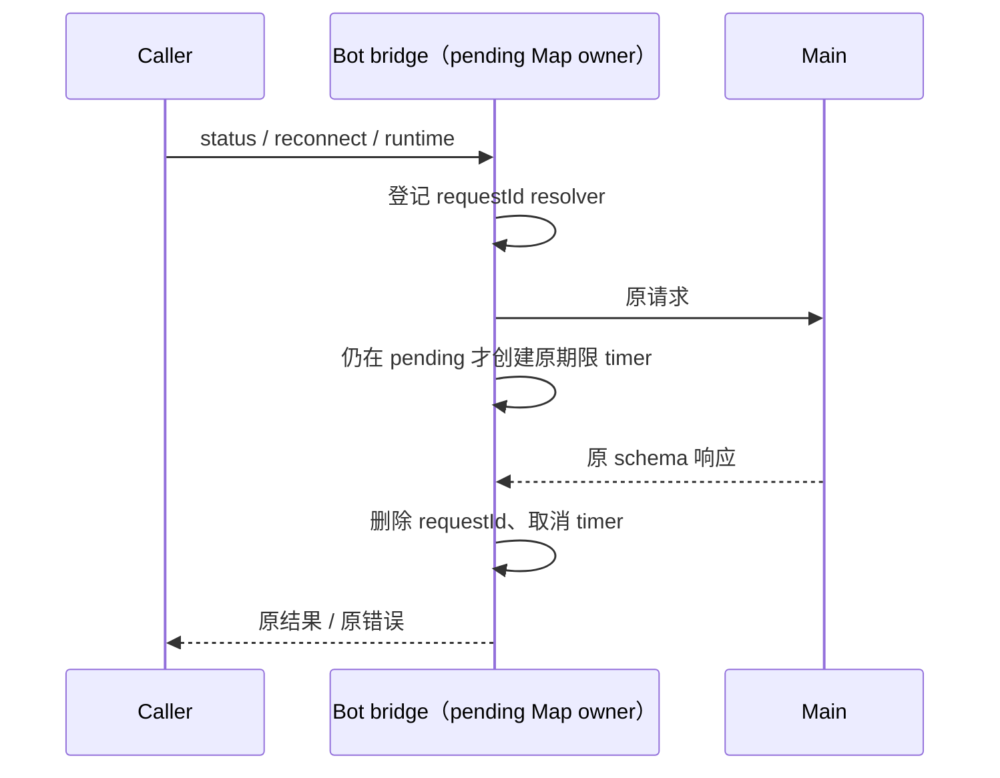

# Bot bridge 已完成请求的计时器释放

`createBotRemoteWorkspaceService` 的 status/reconnect/runtime-port 请求各注册一个 5/60 秒超时。Main 正常回包时虽删除 pending resolver，计时器仍引用请求上下文直到期限结束。状态由每类请求原有 Map 唯一拥有，不新增缓存或请求合并。

## 设计

- 用桥接实例内一个泛型等待函数统一原三条相同的登记/发送/超时路径。Map 类型及响应 schema 不变，onMessage 仍按 requestId 取出、删除并完成。
- resolver 完成时立即取消自身计时器；postMessage 同步响应时不再创建已无消费者的计时器。发送抛错保持原 Promise 拒绝错误，移除不可完成的登记。
- 计时从原 postMessage 返回后开始，status=5000ms、reconnect/runtime=60000ms，超时错误文案、原始正常/失败响应、connected fallback 和 runtime preferences 就绪顺序保持。
- 多请求独立，未匹配/迟到/非法响应不能取消其他请求计时器；不取消 Main 实际连接工作，不改变凭据加载、identity 优先匹配、owner/lease 或协议字段。
- 用户已明确授权修复关闭时请求悬挂；关闭错误、在途 IO 和 RPC adapter 释放遵守 [Bot bridge 关闭契约](bot-remote-bridge-lifecycle.md)。正常运行的结果、deadline 与两种 V4 delivery kind 保持。
- 没有 UI/交互、持久化或公共接口变化，无新增交互 E2E 场景。

## 验收

用 fake parent port、fake clock、合成设置与 runtime stub 驱动真实服务。先在旧实现确认：成功/失败回包之后计时器仍存活；新实现立即为零。覆盖三类请求、同步回包、多个并发请求、精确 deadline、错误响应、迟到/错误 ID/非法 schema、发送抛错、workspace identity 路由和正常 runtime ready 流程。不得使用真实凭据、连接、Agent。
