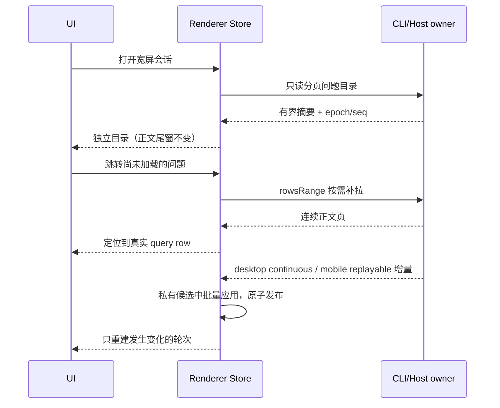

# 有界性能工作量

## 范围与所有者

优化长会话分组、问题目录、文件搜索、增量应用、历史分页、首次加载和文档传输；保持现有用户可见内容、搜索匹配规则、滚动定位、主题与国际化。

- CLI ProductProjection 是会话事实唯一所有者。问题目录是只读摘要，不持久化、不写入正文投影，不参与命令 admission。
- Renderer ConversationProjectionStore 拥有订阅快照和目录查询生命周期；按 logEpoch 与目录 revision 丢弃过期查询。正文窗口保持连续，点击未加载问题后按需补拉到该问题，禁止把不连续页拼成连续窗口。
- UI 的分组缓存仅派生自行引用、会话状态和插件折叠裁决。只保留当前窗口的轮次，切换会话销毁缓存。秒级时钟仅改变运行状态文案。
- 文件服务拥有索引和文件读取；命令中心通过 hook 搜索，返回至多 80 条文件，不把完整索引搬入 Renderer。保留大小写不敏感、多词 AND、原索引顺序的匹配方式；空查询不查，关闭和作用域变化使在途结果失效。
- 文档服务通过顶层 Uint8Array 返回完整字节，沿用原文件大小上限、错误与平台边界；不在 JSON 对象里嵌入二进制，不在 Renderer 做 Base64 逐字节解码。旧接口保留兼容调用方。

## 接口与不变量

1. `applyConversationDeltas` 与逐条纯函数归约值相等；输入快照及其 rows/row 对象不变，空帧或无效行更新不制造无意义更新。每批最多建立一次私有行容器及索引，不能把 mutable accumulator 暴露后继续写入。
2. `rowsRange` 保留 rowId 升序、严格 `< beforeRowId`、limit、hasMore、profile 和 epoch 水位语义；有序定位只扫描返回区间，不按页扫描全部历史。
3. 新的只读问题目录按真实用户 query 分项，包括同轮 guide；助手摘要按 product turn 聚合，文本有长度上限。目录请求复用现有 Agent transport 和 workspace identity/remoteSessionId 路由。旧端不支持时保持当前尾窗目录与手动历史加载，不自动回退全量正文下载。
4. 历史分组缓存不改变最后轮、异常轮展开、插件固定、工作段与隐藏行规则；追加、rewind、snapshot 替换、跨会话同 rowId 均须正确失效。
5. 设置页、设置分区、终端只在使用时加载；Suspense 使用现有轻量加载样式，失败仍由现有 ErrorBoundary 处理，不改变已打开终端的保活策略。
6. 不改持久化 schema、owner/lease、ACK/seq、命令幂等或回放边界。Desktop 与 mobile 使用同一查询语义，仍按各自 delivery profile 校验。
7. 命令中心的多词 AND 匹配与原索引顺序要求 Host 支持 `matchMode: "terms"`。旧 Host 忽略该参数时，Renderer 仅复核至多 80 条候选，可能漏项或保留旧排序；需要升级 Host 才能取得完整语义，不自动下载全索引补偿版本差异。

## 验收

- 批量增量与参考逐条实现对照：append/upsert/delta/remove/state 更新交错，未知行、空帧、分支清空、两个 delivery profile；冻结输入验证不可变。
- 分页边界：首尾、游标落在空洞、空窗口、超限参数；大窗口验证仅访问定位及返回区间。
- 分组缓存：streaming 尾轮变化时历史 unit 引用稳定；计时不重建历史；phase、插件 pin、rewind 与会话切换正确更新。
- 目录：千轮会话打开后正文保持尾窗；guide 逐项；点击旧问题定位；查询中 rewind/关闭/重连不提交旧目录；窄屏不预取。
- 搜索：多词、大小写、目录排除、原顺序和 80 条上限；输入交错与关闭后旧响应不覆盖结果。
- 文档：字节逐位一致、大小上限与空文件、远端二进制返回；Office/PPTX 仍可展示。
- E2E 场景：宽屏长会话打开/导航/流式更新、命令中心快速输入/关闭、首次打开设置和终端、文档预览。记录可执行环境限制，不把静态测试记为 E2E 通过。
- 执行目标单测、typecheck、lint、architecture:check --changed；用相同合成数据比较分组、增量和搜索开销。构建和推送不在本次范围。

## 本次验证记录

- 变更模块：`ui`、`shared`、`services`、`zcode-cli`。架构基线违规 0、新增违规 0。工作区净增约 1250 行，包含规格、测试和浏览器夹具；未引入持久化迁移或新的业务状态所有者。

- 最终验证使用 `mise.toml` 指定的 Node 24.14.0：根目录 `typecheck`、`lint`、`architecture:check --changed` 通过，架构新增违规 0；变更文件格式检查通过。
- `packages/ui/test/performance*.test.ts`、`conversationProjectionStore.rowSharing.test.ts` 与 `src/v4/useConversationProjection.test.ts` 共 39 项测试通过。覆盖目录正文隔离、查询中 rewind、按需加载、不可变归约、二分访问量、搜索规则、文件字节一致性及取消、缓存失效和远端时钟领先。
- 浏览器入口：`node --test scripts/ci/performance-browser.test.mjs`。使用真实 Edge、React hooks 和 Navigator，Host 返回值由夹具控制；覆盖搜索竞态/关闭、1000 项目录虚拟化与键盘选择、局部时钟、懒加载入口。它不替代完整桌面 Agent/PTY/Office 查看器联调。
- CLI 包独立 `corepack pnpm --dir apps/zcode-cli/packages/bootstrap typecheck` 未通过：当前环境缺少 `@zcode/contracts`、`@zcode/adapters`、`@zcode/core` 等内部包的声明产物，产生模块解析及后续类型错误。未把该结果计入通过，也未为此触发构建。

同机、同组合成数据、预热 5 次后取 30 次中位数（微基准运行于 Node 24.18.0；不是 Electron 整机延迟，也不代表包体收益）：

| 路径                               |               原方式 |                     优化后 |
| ---------------------------------- | -------------------: | -------------------------: |
| 5000 轮 / 50000 行，尾轮变化的分组 |             43.49 ms |                    7.32 ms |
| 50000 行，20 条增量                |              7.70 ms |                    3.32 ms |
| 300000 文件，无命中重复查询        | 82.32 ms（Renderer） | 15.05 ms（Host，分批让出） |

目录仅发送每项最多 220 字符的用户/助手摘要，每页最多 200 项；加载全部摘要仍与问题数成正比。导航点击会按需补拉连续正文到目标位置；分享的显式全文加载仍保留。
