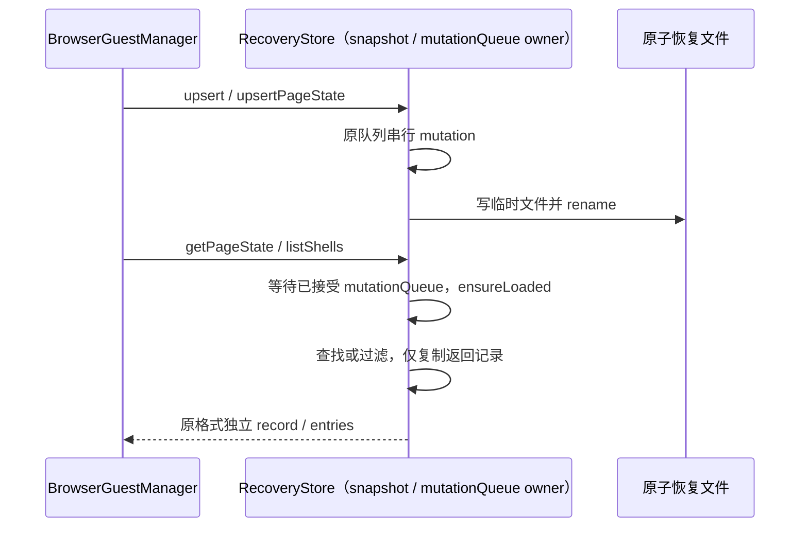

# 性能扫描：浏览器恢复记录按查询范围复制

## 已确认问题与范围

`BrowserTabRecoveryStore.getShell`、`getPageState` 和 `listShells` 先调用 `readSnapshot`，复制全部 shell、全部 page state 和各自历史条目，再查找或过滤。BrowserGuestManager 恢复单个页面调用 getPageState，恢复会话 tab 列表调用 listShells。存储最多可保留 100 个页面、每页 500 个历史条目；读一个 tab 或只列 shell 时也复制最多 50,000 个无关历史对象，给 Main 增加临时分配和垃圾回收压力。

仅优化 desktop legacy 模块原有文件，不新增接口、索引、缓存或持久化格式。已读取 desktop 受控上下文、store 实现、BrowserGuestManager 调用与已有 guest 性能规格；工作区开工时该生产文件没有本地改动。

## 所有者与事件顺序

- BrowserTabRecoveryStore 仍唯一拥有内存 snapshot 与 mutationQueue；读操作等待原有 mutationQueue，再执行 ensureLoaded。
- 保留 ensureLoaded 的懒加载、损坏隔离、失败通知和空快照规则。此次不改并发初始化、写入失败/恢复或 mutation admission 语义。
- getShell 查询内存 shell 列表，只复制找到的 shell；getPageState 查询内存页面列表，只复制找到的 record 和它的 entries；缺失仍返回 null。
- listShells 先按原 workspaceKey、remoteSessionId 空串 fallback 和可选 sessionId 过滤，再复制匹配的 shell，按 openedAt / tabId 原比较器排序。不读取或复制页面历史。
- readSnapshot 显式全文读取仍复制全部记录。返回值的复制深度保持原样：shell 使用浅复制（viewport 不新增深复制），pageState 与每条 history entry 使用浅复制。不能为了优化暴露原 record/entries 或直接排序内存数组。
- 读取等待写队列的时序、原子文件替换、page-state 淘汰、history 截断、whenIdle 退出屏障均不变。
- 不改变 Electron tab/guest 所有者、workspace identity / session / generation、Desktop continuous 或 mobile replayable 的链路。

## 验收

先添加真实临时文件测试并在旧实现运行。验证正确性原本通过，工作量断言复现无关条目访问后失败；再修改生产文件。

1. shell/pageState 查询、缺失 null、scope 隔离、稳定排序、remoteSessionId fallback 均保持；修改返回 shell 或 pageState/entries 不影响后续读。
2. 读取等待在途写入并返回更新后的记录，whenIdle 和 readSnapshot 全量复制保持。
3. 对已加载内部 history 的字段 getter 做仅测试使用的访问计数：读 shell 或列 shell 不访问任何 history；读一个 pageState 只访问它的 entries。测试数据不接触用户目录，不启动 Electron 或 Agent。
4. 执行定向测试、可用原有 browser recovery/guest 回归、根 typecheck/lint、架构及格式检查。不更改用户交互，无新增 UI E2E。

## 结果

- 原实现 4 项测试中正确性 3 通过、工作预算 1 失败：80 页 × 200 history，getShell/listShells/getPageState/缺失查询各访问 16,000 条历史。
- 修复后 4/4 通过；前三类窄查询历史访问分别为 0 / 0 / 200，缺失查询为 0；显式 readSnapshot 仍为 16,000。返回拷贝深度、scope 排序、在途写队列与磁盘复读一致性通过。
- 已纳入 106 文件 / 737 项整合回归，全部通过，根验证结果见 `performance-scan-verified-improvements.md`。未启动 Electron guest 或真实 Agent，没有新增浏览器恢复全应用 E2E。
