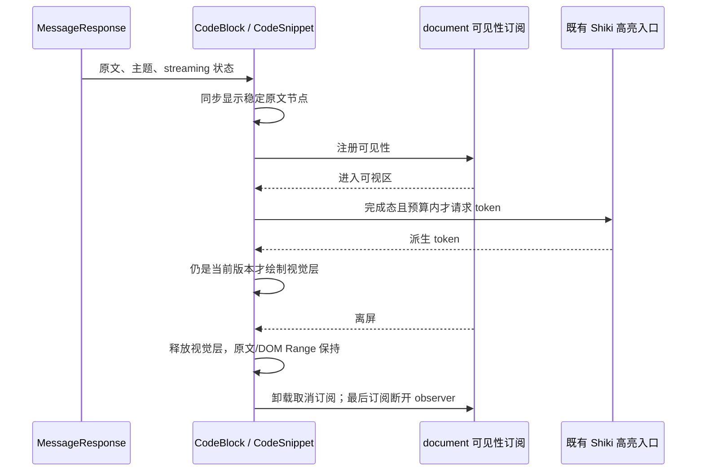

# 聊天代码围栏的展示边界与工作预算

## 问题与决策

既有 `docs/performance/electron-2026-10-17/report.md` 记录：240 围栏的长回复在终态有约 500ms 主线程长任务；查找冷历史时完整文件查看器也占用大量 CPU。根因之一是 Markdown 只读片段使用 `CodeViewer / @pierre/diffs File`，轮次虚拟化并不能限制单条正文内的查看器数量，CSS content-visibility 也不能省去它们的 JS 构建。

明确两个展示职责：`CodeViewer` 负责文件、行号、诊断、评论与行定位；`CodeSnippet` 负责 Markdown 围栏的原文、语法颜色和折行。`CodeBlock` 保留现有标题、复制、折行状态及 Mermaid 分支，通过显式 `codeView="snippet"` 选择后者，默认仍为文件查看器。本次只在 `MessageResponse` 选择 snippet，不扩散到其他调用者。RPC、会话业务状态、live-tail 与 streaming/static 防护不改。

## 所有者与接口

- 原文来自 MessageResponse，CodeBlock 只拥有既有折行与 Mermaid 预览状态。
- CodeSnippet 的 `<code>` 原文文本节点是选择、辅助技术、浏览器查找和会话 DOM 高亮的唯一文本来源。
- 语法 token 是派生视觉层：inert、不可选择、aria-hidden、data-conversation-find-ignore，不修改原文节点，也不参与布局测高；原生浏览器查找和会话查找均只读取原文。原文和视觉层共享字号、等宽字体、行高及折行规则。
- 同一 document 的片段共用一个 IntersectionObserver；它只拥有元素可见性订阅，最后一个订阅退出时 disconnect 并移除注册项。离屏不保留片段的 token DOM；完整原文始终存在。
- 只有完成态、受支持语言、当前可见且不超过 20,000 字符的片段请求已有 `highlightCode` 入口。单片段最多展示 10,000 个 token；超预算、加载失败、无 IntersectionObserver 时显示完整原文，不截断内容。缓存遵守既有 shikiHighlighter 预算，不新增源码缓存。
- 代码/语言/主题变化、离屏或卸载后，旧异步结果不能显示；请求和结果必须属于同一输入版本。视口变化不发服务端命令、不影响流式协议或恢复语义。

## 验收

1. 240 围栏的真实 MessageResponse 冷挂载、streaming→static 和模拟历史重挂均不创建文件查看器/Shadow DOM；高亮工作只涉及可视代码块。
2. 使用相同合成文本与隔离浏览器，对修改前后冷挂载、终态及重挂进行同机对照；记录耗时、长任务、查看器/DOM数量和高亮数。耗时只作观察，资源上界作为稳定回归断言，不能声称整机同比例加速。
3. 桌面与手机宽度均可复制原文、鼠标选中文本、折行和横向滚动；明暗主题、字号、未知/纯文本语言、中文、空行及超预算代码保持可读。
4. 已建立的原文节点、selection 和会话查找 Range 在高亮就绪及离屏释放后保持有效；视觉层不产生重复命中。
5. 流式阶段无高亮，完成后按视口高亮；主题/正文快速变更、离屏、卸载不接受过时结果，订阅清理后无存活 observer。
6. Mermaid 的预算、图表和预览入口沿用现有分支；默认 CodeBlock 的行号、诊断、聚焦及完整 CodeViewer 保持可用。
7. 运行相关单测与浏览器回归、根级 typecheck/lint、架构检查。测试只用临时 Vite 与无头浏览器的合成数据，不启动桌面、真实 Agent 或外部模型，不修改安装/业务配置，不构建安装包。
