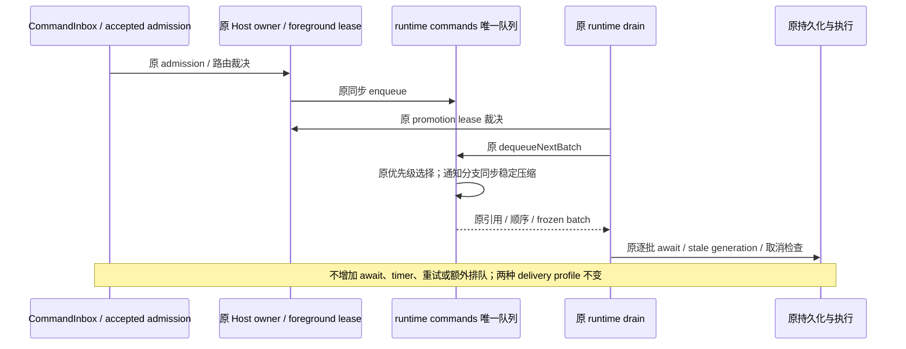

# CLI 字节截断与通知批量出队的有界工作量

## 范围与产品规则

只修改 `apps/zcode-cli/packages/core/src/tool/executor/result-content-projection.ts` 的内部字节截断算法，以及 `apps/zcode-cli/packages/core/src/runtime/command-queue.ts` 的通知批量删除算法。新增两个 Core `node:test` 回归文件；不改 MCP、scheduler、其他 runtime、协议、配置或 CI。保留开始前的本地改动，不构建、提交、推送或触发 Actions。

此次优化只减少同步计算、临时分配和数组搬移。公开结果、错误、预算、命令优先级、取消、promotion、owner/lease、admission 和异步执行顺序全部保持。测试和微基准只用合成数据，不调用模型、真实 Agent、网络或用户业务数据。

## 唯一所有者与事件顺序

- 工具结果仍由现有 executor 序列化路径拥有；`fitStringToBytes` 只计算一次调用内的 UTF-16 切片边界。没有跨调用缓存、新的 IO 或新的预算所有者。
- `createRuntimeCommandQueue` 闭包中的 `commands` 数组仍是唯一 runtime command 队列，原 cancel-pending Set 仍只负责取消标记。通知批次和 snapshot 是原接口返回的数组容器，不成为第二份已接受队列。
- `CommandInbox` 仍是已接受输入的串行 admission 所有者；Host owner/lease 和 foreground promotion lease 仍由现有调用方裁决。此次不改它们的实现或接口。

## 字节截断的参数与不变量

1. 继续按 UTF-8 字节预算，而不是 UTF-16 长度或字符个数。head 取最长可容纳的码点前缀，tail 取最长可容纳的码点后缀。只有 `direction === "tail"` 才选择后缀；不改变公开类型或进行方向归一化。
2. 合法 high/low surrogate 对不可拆开，UTF-8 成本为 4；孤立 high 或 low surrogate 各计 3 字节，并以原 UTF-16 码元保留在结果中。不得通过 UTF-8 编码再解码截断，否则孤立代理项会变为替换字符。
3. `maxBytes <= 0`（含负数、负无穷、正负零）保持空结果。正小数继续由原 `<=` 比较决定可接受的整数成本，不提前 floor。NaN 的所有字节比较均为 false，保持空结果；正无穷完整保留。空文本和不足一个码点的预算保持原结果。不得通过新增特殊兜底分支掩盖算法不等价。
4. suffix 仍先按 head 预算截断，随后独立执行 `Buffer.byteLength(suffixContent, "utf8")`，再截断正文并追加 suffix。即使正文尾部和 suffix 开头的孤立代理项在最终拼接后形成合法代理对，也不能用拼接后的字节数重新分配预算。
5. 保留 `fitContentWithSuffix`、hook 追加、持久化失败 fallback、官方 CUA 原子媒体对及结构化块的公开形状、顺序和错误。外围 `serializeOutput` 的完整 `originalBytes` 扫描与 returnedBytes 定义不变；不宣称整个序列化仅扫描预算内字符。
6. 内部扫描使用原字符串的 UTF-16 下标，只扫描实际可接受的边界及一个不能容纳的码点。整串可由每 UTF-16 码元最多 3 字节的上界证明可容纳时可直接返回原文。若长度不超过字节预算但上界无法证明，允许一次原生 Buffer.byteLength 计量并在实际可容纳时直接返回；计量输入本身受预算约束，不能对任意超长全文恢复全量扫描或码点数组展开。

## 命令队列的参数与不变量

1. priority 仍为 `now < next < later`，相同 priority 仍选最早入队的命令；`getByMaxPriority`、`snapshot`、`size`、`hasPending`、ID 生成和取消标记接口不变。
2. 非通知分支仍只移出选中的一个命令。选中通知时仍移出所有且仅同 priority 的 `task-notification`，包括被其他 mode 隔开的通知；batch 和剩余队列均保持原入队顺序。
3. 同一次同步通知出队从左到右读取原数组，命中项进入 batch，其余项稳定写回同一数组，最后缩短 length 释放尾部引用。不新增队列索引、异步步骤或对命令内容的裁决。
4. 命令对象引用和其中的 Promise 回调、abortSignal、inputId、startReservation、branchGeneration、traceContext 等字段不变。不克隆或冻结命令对象；只按原接口冻结返回的 batch/snapshot/getByMaxPriority 数组，空结果的冻结行为也不变。
5. `removeById` 对重复 ID 仍只移除首个；取消标记即使暂时无对应命令也按原 consume/clear 语义保留。命令成功、失败、取消及 stale branch 的收口继续由原消费者处理。
6. foreground promotion lease 的同步命中/移除/消费，active-loop 的 control-only 屏障和逐项持久化，CommandInbox 的 double lookup、settle gate、live-input pin，以及 desktop-continuous / web-remote-replayable 的恢复边界均不修改。

## 回归与工作预算

先固化当前未修改算法为测试内 oracle，再修改生产实现。功能对照必须在旧实现通过；工作预算必须在旧实现失败、优化后通过。

- `apps/zcode-cli/packages/core/test/performance-byte-truncation.test.ts`：覆盖 head/tail、所有数字边界、ASCII/中文/emoji、合法与孤立代理项、CR/LF/BOM/NUL、suffix 与跨拼接代理对、hook/结构化及序列化结果的既有形状，另用固定种子的 UTF-16 随机输入比较。大输入计量全文展开、字节探测和码元读取，预算内扫描不得展开全文。
- `apps/zcode-cli/packages/core/test/performance-runtime-command-queue.test.ts`：完整旧实现对照三 priority/全部 mode、混合与纯通知、空队列、重复 ID、取消、连续出队和重入 enqueue 操作，检查对象引用及容器冻结。对 K 组交错通知/非通知，旧实现逻辑搬移为 K(K+1)/2；新通知分支必须稳定线性处理，不逐项 splice。
- 使用 Core 当前 `package.json` 的真实 `node --import tsx --test --test-isolation=none` 入口。现有 Core 回归及 bootstrap command-inbox 回归不替代新算法专测。
- 微基准嵌入上述两个测试文件，通过标准 Node 参数 `--test-name-pattern=benchmark` 单独开启；普通回归跳过 benchmark。固定输入、串行执行、预热后交替旧/新顺序取中位数，报告所有采样规模。没有基于时间的通过阈值，也不从局部耗时推算整机、模型或远端改善。
- 所有验证通过 `pwsh` 和 `corepack pnpm --use-node-version=24.14.0`。只运行 Core 定向 typecheck/lint、架构复检与本轮五文件格式检查；全仓 typecheck/lint 由主代理统一执行。每条验证独立捕获退出码，不隐藏已有失败。

## 实施与实测记录

生产改动仅为上述两文件：字节截断以原 UTF-16 下标扫描预算边界、保留孤立代理项；通知批量出队在原数组同步稳定压缩。未新增公开入口、owner、IO、缓存或异步步骤，未修改外围原始字节计量、多媒体保护、admission、取消或 lease。

### 先红后绿与工作量

- 未改生产代码时，功能对照 10/10 通过；独立工作预算 4 项中固定旧算法校准 1 项通过、3 项预算失败。首轮一条人工 head/tail 夹具预期写错，按已通过的固定 oracle 修正；没有修改产品行为或放宽预算。
- 2,000,000 个 ASCII 码元、4096 字节预算、空 suffix：旧算法展开 2,000,000 个码点并向 `Buffer.byteLength` 提交共 4,048,109 个码元；新算法 0 全文展开、0 全文字节探测、4097 次 `charCodeAt`（含首个不能容纳的码点）。计数为实际 API 输入工作量，不等同于 V8 实际堆字节。
- 2000 项交错通知/非通知：旧算法 6000 次 priority 读取、1000 次 splice、500,500 个逻辑保留槽搬移；新算法 4000 次 priority 读取、0 splice、0 splice 搬移。剩余 1000 个命令在原数组各写回一次，不另建队列。
- 扩大回归增加相邻 surrogate/UTF-8 宽度穷举、1000 个固定随机 UTF-16 输入、3000 次随机队列操作、可变命令引用与 frozen snapshot、promotion/cancel/control-only/stale generation 及序列化的完整原文计量。新实现与固定旧算法输出和引用保持一致；没有发现需要参数兜底的算法不等价。

### 局部交替微基准

Windows、Node 24.14.0、合成输入；字节截断每 fixture 预热 4 对、交替 15 次，队列预热 6 对、交替 25 次，取每次调用中位数。计量 spy 不参与耗时采样。下表为加入可容纳文本原生快路后的最终重新采样；两项 benchmark **2/2 通过**，原始采样通过测试 diagnostic 返回，不为耗时设置通过门槛。

| 输入 / 局部操作                      | 旧算法 ms | 新算法 ms |
| ------------------------------------ | --------: | --------: |
| 1 MiB ASCII，20,000 字节预算，head   |    27.392 |     0.056 |
| 1 MiB ASCII，同预算，tail            |    27.522 |     0.243 |
| 4 MiB ASCII，50,000 字节预算，head   |   113.402 |     0.758 |
| 4 MiB ASCII，同预算，tail            |   117.441 |     0.711 |
| 600,000 UTF-16 码元混合文本，head    |    52.615 |     0.271 |
| 同混合文本，tail                     |    50.797 |     0.321 |
| 1000 对交错通知/非通知，仅批次出队   |     0.266 |     0.078 |
| 5000 对交错通知/非通知，仅批次出队   |     2.945 |     0.411 |
| 10,000 对交错通知/非通知，仅批次出队 |    10.944 |     1.451 |
| 10,000 个纯通知，仅批次出队          |     1.082 |     0.452 |

小输入另测 1024 码元和 16 项混合队列，差异处于微小耗时区间，不据此承诺普遍收益。采样存在调度/JIT/GC 波动；没有用耗时作为测试门槛，也不能从这些局部结果推算应用、模型、远端或整机速度。

### 主代理最终复核补充

- 主代理另外比较了可容纳的 ASCII 文本。最初的有界扫描对 20,000 / 49,990 码元、50,000 字节预算分别为 0.0414 / 0.1027ms，原原生计量为 0.00575 / 0.01425ms；该边界确有额外同步扫描，不能只报告超大输出的收益。
- 先补可容纳文本的工作预算，在候选实现复现 49,990 次 charCodeAt 而不是原生快路；随后仅在 `value.length <= maxBytes` 时保留一次有预算界限的 Buffer.byteLength 确认，可容纳则直接返回。超长文本不恢复全文计量，所有 surrogate/数字/suffix 语义不变。
- 同样输入重测 20,000 码元为原算法 0.00571 / 当前 0.00579ms，49,990 为 0.01423 / 0.01427ms，恢复到原快路误差范围；4096 码元仍由上界直接返回。新回归明确可容纳文本不逐码元扫描，超大文本预算不变。

### 验证边界

- 最终 Core 当前 `package.json` 的真实 `node:test` 全集为 **72 项通过、0 失败、2 项 benchmark 默认跳过**；两个新增文件单跑为 **18 项通过、2 项默认跳过**。benchmark 随后通过标准 Node `--test-name-pattern=benchmark` 单独执行，**2/2 通过**。这些用例与全集有重叠，不重复相加报告。
- Core `tsc --noEmit`、CLI 配置定向四文件 Lint 已通过。Core tsconfig 排除测试，另用内存 CompilerHost 覆盖新测试；首次发现测试 spy 的隐式 `this` 类型并只修正该新测试注解，不改类型规则。
- 5 个现有 Core 内联文件实际使用 Vitest。首次误用 node:test 因缺少 Vitest runner 上下文失败；改用现有 `packages/ui/vitest.config.ts` 串行运行，5 文件 / 22 项通过，没有修改测试或 timeout。
- bootstrap 原 command-inbox 与 desktop-continuous / web-remote-replayable 流回归共 4 项通过；没有改这些文件。
- 当前仓库 `packages/zcode-cua/frame-contract.js` 的 frame-pair resolver 返回 undefined，无法通过该公开入口实测有效官方原子媒体对；已检查未改这条保护路径，并用普通结构化媒体引用回归覆盖现有可执行边界，不把它描述为官方 CUA 实机验证。
- 主代理最终根 typecheck/lint 通过，并在最新快路实现上复验 Core `tsc --noEmit` 及四文件 CLI 定向 lint；无错误或警告。两处 CLI 生产改动合计 **+55 / -22，净增 33 行**。未运行真实 Agent、付费模型、macOS、实体手机或整机内存采样；没有 commit/push/build 或 workflow 修改。
