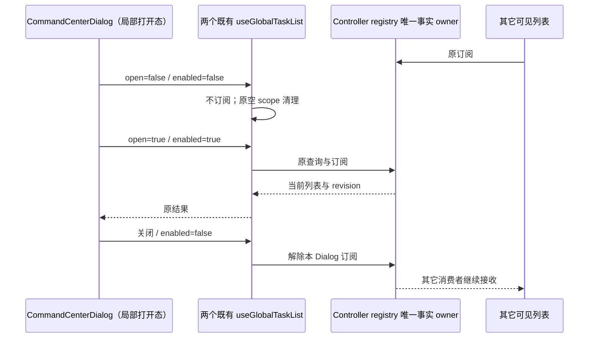

# 命令中心关闭态不订阅任务列表

## 产品规则与范围

命令中心已在关闭时将 commands、workspace tabs、recent changes 降为空输入，但两个 `useGlobalTaskList` 未传 `enabled`，仍订阅窗口 Controller revision。每个任务 activity 帧会让隐藏组件重跑空 scope 的 load 并创建新的空数组。

只在 `CommandCenterDialog` 的两个既有列表 hook 传入 `enabled: open`；不修改 `useGlobalTaskList`、registry、Controller、搜索、任务数据或打开态查询策略。

## 唯一所有者与不变量

- Controller/registry 仍拥有任务事实、游标与缓存。Dialog 仅拥有打开态、输入草稿、展开态和选择回调，不增设业务状态或第二条查询路径。
- `open=false` 时不注册两个任务列表观察者，其他可见列表仍正常订阅；不停止共享 registry 的其他消费者。
- 打开后使用原 hooks、参数、排序、数量限制、scope/identity、查询 cache、陈旧结果防护和错误处理。重新打开仍立即读取当前列表，不复用关闭前的陈旧任务。
- 关闭仍按原 effect 清空 query/scope/展开草稿，在途列表结果仍由原 requestSerial 失效。打开/关闭的时序、搜索结果高亮、选择、历史、键盘、主题与布局不变。
- 不改变 accepted commands、owner/lease、Remote session identity、Desktop continuous 或 mobile replayable 协议。

## 验收

先在未改生产代码的真实 React/浏览器夹具验证关闭态仍存在两条多余观察者并发生空结果重渲染，功能断言保持。补已安装共享组件与生产 hook/registry 的隔离交互回归，使用测试自建 Controller 与内存任务，不访问用户 Host 或模型。

- 关闭/打开/关闭/重开：两条列表观察者仅在打开时存在；背景消费者不受影响，卸载后归零。
- 打开显示当前 recent tasks，搜索与选择回调保留 taskId、workspacePath、identity；关闭后更新任务，重开获取当前列表。
- 关闭期间合法 Controller 帧不导致隐藏列表重渲染；打开仍接受当前 revision，非法/过期帧遵守原规则。
- 宽屏/390px、键盘选择、主题基本交互保留；无布局修改。合成任务必须满足当前共享 `ZCodeTaskMeta`，包括数值时间和合法 `ZCodeTaskMode`；测试文件排除在根 UI 工程之外时另做限定严格类型检查，不用类型断言掩盖任务字段错误。
- 使用固定 Node 24.14.0 运行可用验证及官方浏览器；根 typecheck/lint、格式和架构由主流程统一复检，不调整测试超时或产品节流。

## 实施记录

- 生产只在两个既有调用中增加 `enabled: open` 和一条隐藏约束说明，+3 / -0；不修改 hook、registry 或 Controller。
- 新增 `performanceCommandCenterClosed.test.ts`：关闭时两 hook 都禁用且仍按原顺序调用；打开时启用、保留 80/4 数量、只取匹配 workspace identity，2 项通过。
- 官方可用浏览器加载真实 CommandCenterDialog、生产 hook/registry 与测试自建 Controller。修改前关闭态为 3 个 registry listeners（1 个测试背景消费者 + 2 个隐藏列表）；触发一帧实际通知 3 次。修改后关闭态仅 1 个背景消费者，一帧通知 1 次，列表查询仍为 0。
- 打开后恢复 3 个观察者并显示当前任务；输入 `# Synthetic` 仍按原任务 scope 查询。点击真实任务选项后 Dialog 关闭、观察者回到 1，选择回调保留 `workspacePath / taskId / workspaceIdentity`。390px 打开仍显示原分区、任务和历史。
- 测试夹具首次用了字符串时间导致时间文案为 NaN；改为数值时间与完整字段，不修改产品时间逻辑。最终静态复核又确认 `mode: "agent"` 不属于当前共享任务模式，改为合法的 `"build"`。额外严格检查 UI 生产源、新 SSR 回归和浏览器 TSX 夹具，**0 类型错误**；两个回归重新执行 **2/2 通过**、定向 lint 为 0 warning/error。根 UI 工程排除 test，这项额外检查不以根 typecheck 代替。状态观测最初使用 requestAnimationFrame 在此浏览器宿主不刷新，改为测试自己的微任务输出。
- 此浏览器的高层 click 两次虽目标唯一/可见仍超时，改用已观察 locator 的页面 click 完成同一组件事件。Enter 未产生可确认选择，Escape 调用被取消且标签随后不可用；不把这两项说成键盘 E2E 通过，也未切换浏览器。已经观察到的打开/搜索/鼠标事件回调属于受控浏览器组件回归，不替代真实桌面或实体手机验收。
- 浏览器临时服务器只监听 loopback、使用独立临时 Vite 缓存，不触及用户 Host/模型。本轮服务器收到自己的停止标记后正常退出（exit 0），其缓存已确认删除；三个早期因非交互 stdin 结束而退出的启动仅留下临时 Vite package 标记，经逐一检查内容与进程后已清理。未终止用户浏览器或桌面进程。
- 最终官方 IAB 复跑确认关闭态 1 个背景订阅、一帧通知 1 次且不查询；打开态 3 个订阅并读取当前任务，任务 scope 搜索与选择保留 path/taskId/identity，选择后回到 1 个订阅。关闭后发布更新不增加查询，重开显示最新标题；390px 内容保留，卸载所有消费者后 subscriptions/controllerObservers 同为 0，页面 error/rejection 为空。事件仍由官方浏览器中唯一已观察 locator 的页面 click 驱动，不冒充高层指针/键盘或真实设备 E2E。
