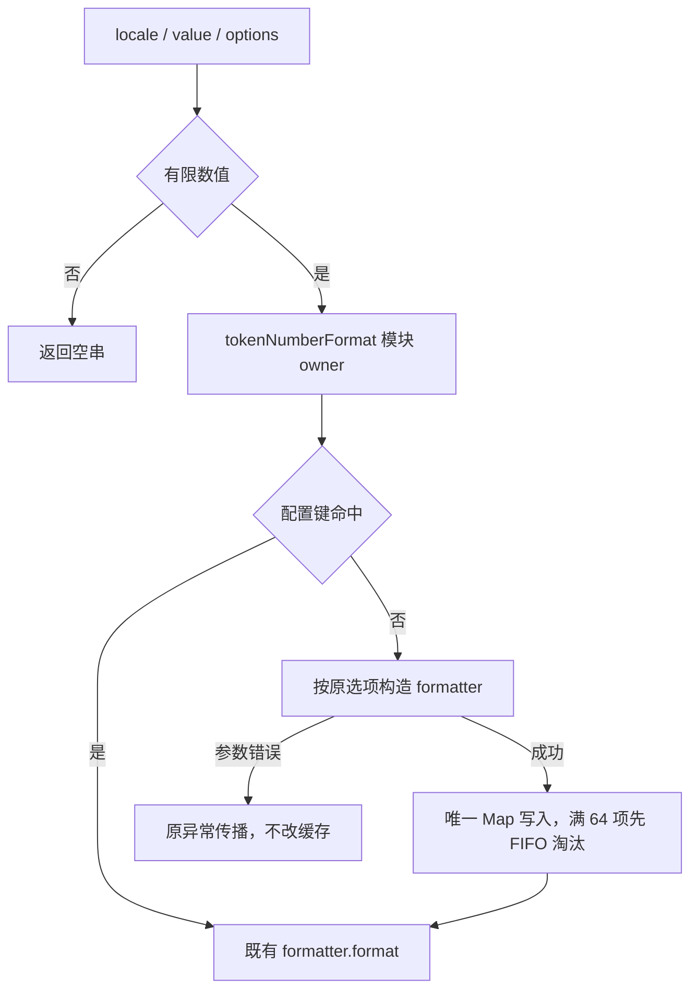

# Token 数字格式化器的重复构造

## 问题与边界

`packages/ui/src/lib/tokenNumberFormat.ts` 的两个导出函数（`formatCompactTokenNumber`、`formatModelContextWindowLabel`）原先每次调用都 `new Intl.NumberFormat(...)`。

- `Intl.NumberFormat` 构造要重新解析 locale、协商语言数据并解析全部选项，成本远高于一次 `format()`；这是确定性的重复准备工作（构造次数可用打点精确计数），不是墙钟猜测。
- 调用方全部是渲染路径：`settings/usage-stats/usageStatsUiParts.tsx`（统计表每格一次）、`chat-input-toolbar/contextUsage.tsx`（上下文工具栏每段一次，随重渲染重复）、`components/ai-elements/context.tsx`、`settings/model-provider-section/*`（模型卡片容量 badge）。数值越多、行越多，重复构造越线性放大。
- 本次只改这一个纯计算模块内部的构造策略。缓存是模块私有的可丢弃派生对象，没有 IO、异步或业务状态；不触碰 hook/store/组件、`assistantDirectiveParser.ts`、`buildGroupedTaskViewFromSessions.ts` 或跨包接口。
- 不改任何输出字符串、不改 locale 语义（中文仍万/亿、英文仍 K/M/B，模型 badge 仍强制 en-US）、不改非有限值返回空串的行为。

## 语义契约（必须逐位保持）

对任意 `locale: string`（含空串）、`value: number`、`options.maximumFractionDigits`（缺省 1）：

1. `!Number.isFinite(value)` → 返回 `""`，不构造 formatter；
2. 记法：`Math.abs(value) >= 1_000 ? "compact" : "standard"`；
3. 构造参数：`new Intl.NumberFormat(locale || undefined, { notation, maximumFractionDigits, minimumFractionDigits: 0 })`；
4. 返回 `formatter.format(value)`，与旧实现逐字符一致；
5. `formatModelContextWindowLabel(contextWindow, _locale)` 忽略 locale，固定 `formatCompactTokenNumber("en-US", contextWindow)`（即缺省 1 位小数、minimumFractionDigits 0）。

构造抛出的 `RangeError` 等异常路径行为不变：先求值 locale/记法/小数位，再构造；失败的构造不进缓存。

## 修复依据：不可变派生缓存

- `Intl.NumberFormat` 实例保存固定的 locale 与选项；同参数复用与每次新建的输出通过旧实现对照逐字符验证。
- 缓存键用 JSON 数组编码原始 locale、记法和小数位。空 locale 独立于含 NUL 等非法 locale，不能通过键碰撞绕过原有参数校验；失败构造不入缓存、不提前淘汰已存对象。
- 缓存不引入第二事实来源：它只保存不可变派生对象，丢弃（FIFO 淘汰）后最坏退回"重新构造"，输出不变。上限 64 项防御异常调用方持续喂新 locale 造成无界增长；到达上限时按插入顺序淘汰最早一项（`Map` 迭代序即插入序）。
- 不改导出签名、不新增导出、不新增模块间依赖；模块文件位置与所有权不变。

## 验收方案（先红后绿）

1. 新增回归 `packages/ui/test/performanceTokenNumberFormatterCache.test.ts`：
   - **输出等价**：把当前"每次新建 formatter"的实现原样固化为测试内 oracle（不进入生产代码），在结构化语料（边界值 999.4/999.5/1000/-1000/0/1、非有限值、空串 locale、fractionDigits 0/1/2）与确定性伪随机数值语料（多 locale × 两记法）上逐字符串比对。
   - **构造次数预算**：打点替换 `Intl.NumberFormat` 构造器，统计一次合成工作负载（6,000 次格式化、4 个互异配置）内的构造次数。旧实现实际构造 6,000 次并失败，修正后精确为 4 次；负载使用与等价语料互不相同的 locale，避免预热干扰计数。
   - **错误等价**：默认 locale 预热后，含 NUL 的非法 locale 仍抛 RangeError；非法 locale 与非法/边界小数位的成败和异常类型与旧实现一致。
   - **淘汰正确性**：插入 70 个新配置后，最近配置仍命中、最早 6 个各重新构造一次，输出与旧实现一致。对照函数在计数窗口外运行，预算只统计生产构造。
2. 专用入口 `scripts/ci/performance-continuation-ui.test.mjs`：在 `project-test-sandbox` 内用真实 vitest 运行上述回归，纯内存计算，不读写用户目录；以确切计数断言套件未被跳过。
3. 最小实现只在 `tokenNumberFormat.ts` 内部加缓存与取值函数，生产导出与行为不变；中文注释说明重复构造原因与不可变复用依据。
4. 修复后：入口全绿；`architecture:check --changed` 无新增违规。全量 typecheck/lint 由主代理统一执行。

## 验证边界

- 回归为纯内存计算；构造次数打点是确定性证据，不换算整机提速比例，不冒充真机/浏览器验收。
- 未启动 Electron、未联网、未触碰真实 `.zcodium`；沙箱环境变量（HOME/TEMP/APPDATA/数据根/缓存/日志）全部限定在项目树 `.run-logs/project-only-validation/` 内。
- 未验证的其它扫描线索不作为本规格的已确认欠账。

## 复现与修复结果（2026-10-31）

初始旧实现的 4 项回归为 3 过 / 1 失败，失败为构造次数 6,000 与预算 4 不符。审查补充键碰撞、错误和有界观察后，最终 6 项已通过。缓存原型的键碰撞在交付前排除，不算仓库原有 bug。

最终根 typecheck、lint、架构与格式结果由主代理统一记入 [续查记录](performance-continuation-20261031.md)。未启动真实浏览器或 Electron，不把纯计算回归写成 UI E2E。
