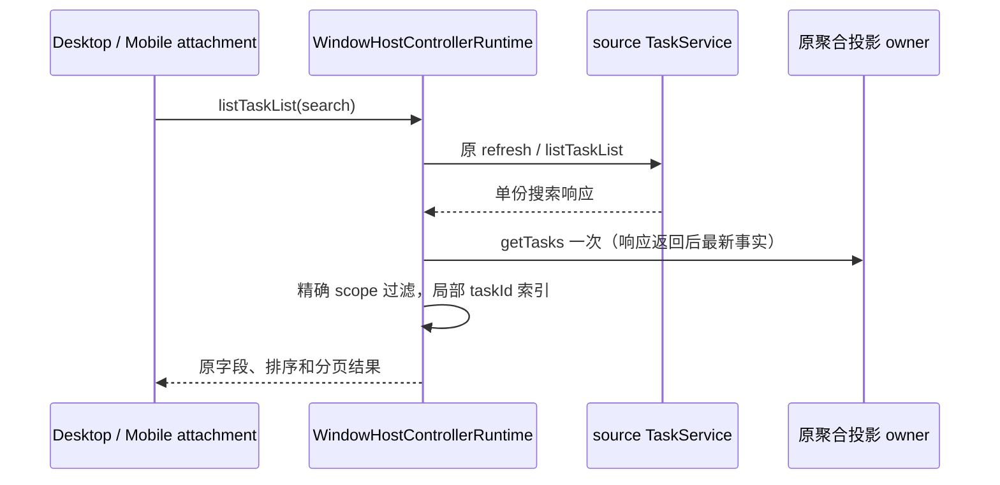

# 性能扫描：Controller 搜索响应局部投影索引

## 已确认开销

windowHostControllerService 的 listTaskList 搜索分支对 source 返回的每条 item 调用 projection.getTasks().find。getTasks 每次聚合并排序整个窗口任务表，M 条结果、N 条投影会重复 M 次全量排序和查找。目标文件开工时 clean；已读取 desktop 受控上下文、projection 的 allRows、source refresh/查询及现有 Controller 回归。

## 设计与时序

- WindowHostControllerRuntime / projection 仍为现有聚合投影所有者。新增 Map 仅存在于单份搜索 RPC 响应的同步处理范围，不缓存跨请求事实。
- 继续先 refresh 全部 source，再并行向在线 source 搜索。必须在每份 source 的 await listTaskList 返回后建立索引，不能提前捕获投影，否则会漏掉查询在途期间的 live overlay/refresh。
- 对该 source 的 workspacePath、workspaceIdentity 和 remoteSessionId 按原严格相等过滤，再按 taskId 建 Map；保留 getTasks 原排序和同 key 首项匹配语义，不用 path fallback 合并不同 remote session。
- response 映射时用 taskId 常数查找，继续优先投影 meta/liveStatus/activity，保留 searchSnippets、远程地址、无投影 fallback 和排序/limit/total/hasMore。
- 空响应不取投影。每份响应的同步 map 内无 await，因此单次读取投影不改变外部事件可介入的边界。
- 不新增请求、计时器、store、跨包依赖或更改 owner/lease/源替代/generation/desktop continuous/mobile replayable 规则。

## 验收

旧实现先运行工作预算回归，真实 runtime + source fixture，计数全投影 Array.sort 次数；96 条结果不应重复排序96次。正确性覆盖跨 source 同 taskId、远程 session 区分、搜索在途 refresh 后新 title/status、fallback、排序/limit/snippets与source失败独立；同步投影只读取一次。测试不启动 Agent 或读写业务数据。再跑已有 Controller 本地/远程归档刷新回归、根 typecheck/lint、架构及格式检查。

## 结果

- 原实现 2 项测试中查询在途 refresh / scope 正确性通过，工作预算失败：96 条结果触发 96 次全表投影排序。修复后 2/2 通过，全表排序为 1 次。
- 在 search 等待中更新本地投影，返回新 title/error；同 taskId 远端仍取自己的 meta 和 current remoteSessionId，snippets/fallback/limit/total 正确。既有 Controller 本地/远程归档与路由 3/3 通过。
- 已纳入 106 文件 / 737 项整合回归。首次根 typecheck 在本轮测试发现 5 项声明错误（this 未标注、meta 不含 searchSnippets），已修正并重跑通过；不把首次失败记为通过。最终门禁见 `performance-scan-verified-improvements.md`。
