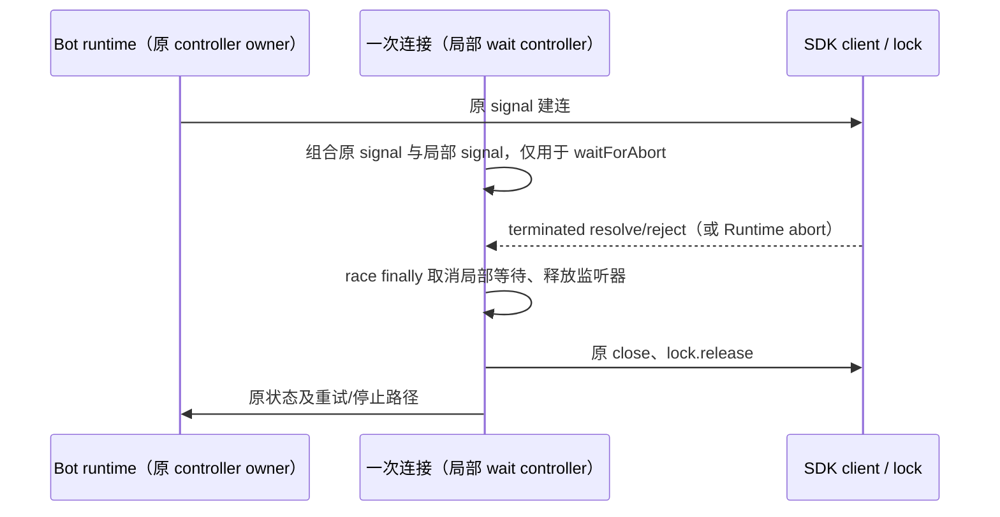

# 飞书重连等待的监听器释放

第二轮同类复查确认 `feishuChannelRuntime.runBot` 在每个连接尝试中 `Promise.race([waitForAbort(signal), client.terminated])`。client 先结束时，原 runtime signal 尚未 abort，失败竞争者的监听器会跨重试累积，直到整个 Bot 停止。

不改变共享 runtime AbortController、SDK 的 signal、连接状态、错误结果、锁、5 秒重试或 stop/dispose 顺序。每个连接尝试为 abort 等待创建局部 AbortController，以 `AbortSignal.any([原 signal, 局部 signal])` 只驱动原 waitForAbort；race 完成后在 finally abort 局部等待，立即移除 once 监听器并完成失败竞争者。该局部取消不能传播到 SDK 或 runtime controller，不新增计时器或连接。

先用真实 runtime + waitForAbort/waitFor、fake SDK/锁/时钟验证旧实现每次重试遗留一个监听器；优化后仅保留当前活动等待。检查连续失败、正常终结重启、stop/dispose、共享 signal 不被局部取消、锁与 client 先释放后退避、精确 5000ms 重试。仅统计监听器和活计时器，不虚构堆字节或真实网络性能。不改变 UI 交互、协议、数据、权限或平台契约。
