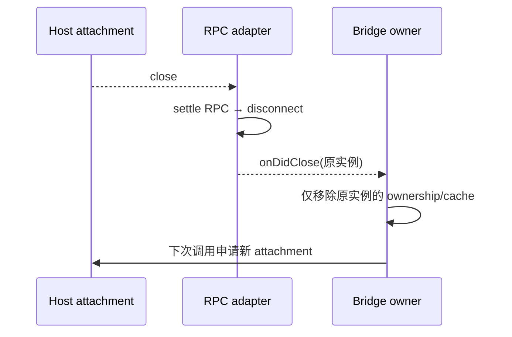
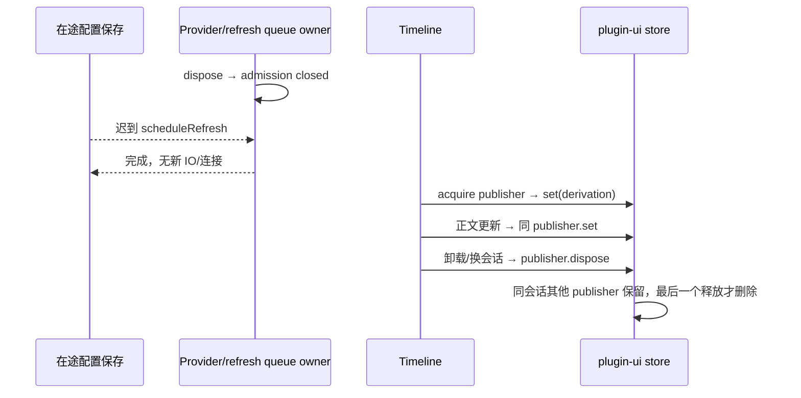

# 性能复查的生命周期修复

用户已授权修复两轮复查确认的五项遗漏。本规格补充 bot-remote-bridge-lifecycle 与 performance-plugin-disposition-subscription；不改变任务 admission、协议 schema、权限、平台范围或持久化格式。

## Bot RPC 与端口所有权

- Runtime adapter 拥有 ChannelClient/MessagePortProtocol，公开只读 closed 与 onDidClose。对端 close 和本地 dispose 共用幂等终结：先禁止新调用、移除 close 监听，终结本地 RPC，再释放协议并通知 owner。
- Bridge 持有 adapter 集合及按 workspace identity 的缓存。关闭通知仅删除同一 adapter 对应的缓存；迟到旧连接关闭不能删除新连接。初始化期间关闭也不得写入缓存；下次访问申请新 attachment。仅连接关闭不会关闭整个 Bridge。
- parentPort 的消息分发属于传输生命周期：每个 parentPort 一个共享消息分发器，Bridge dispose 仅注销该实例的 consumer。分发器不保存已关闭 Bridge、请求、runtime 或历史结果；无 consumer 时仍回收迟到 runtime-port 消息携带的端口。其固定监听器与 parentPort 同寿命，不能每次 Bridge 重建新增监听器。
- runtime-port 回包无人接收（超时、重复、畸形或 Bridge 已关闭）时，传输分发器关闭转移端口。接收成功后的端口由 Bridge 托管，交接给 adapter 后由 adapter 回收。多余端口也不得遗留。
- 消息 schema 解码与 requestId 分发统一在 `botRemoteWorkspaceMessages`；三个 pending Map 与已接收端口 Set 仍由 Bridge 创建并注入，分发器只完成匹配、交接和注销，不另存请求事实。
- 固定监听器在不接收 consumer 参数的独立工厂中创建，避免与 unsubscribe 共用闭包环境而保留首个 Bridge。验收除了监听器数固定，还需在隔离 Node GC 进程确认已注销的 responses 对象可回收，之后迟到端口仍会关闭。
- Main 重连清理在 resolve/reject 两条路径均完成，返回给调用方的仍是原 Promise；清理不能生成未处理拒绝。保留原 key 与同实例判断。

## Bot 关闭终态

- Provider runtime 的 refresh queue 拥有单向 closed 状态。dispose 同步关闭 admission，使已排队/在途 reconcile 失效，并阻止后续 scheduleRefresh/refresh 启动 IO/连接；正常配置切换继续串行、最新代优先。
- BotsService 关闭前已经开始的配置保存可完成原持久化并返回保存结果，但其迟到刷新不再产生 runtime 工作。不回滚已经成功写入的配置。三类 Provider 使用同一队列终态接口，重复关闭不复活。
- Telegram 的独立 syncCommands 入口也遵守队列关闭终态；普通刷新失败仍允许未关闭队列继续处理下一版配置。
- reconcile 等待存储迁移完成后先验证 generation/closed，再读取配置；关闭期间已开始的迁移或凭据读取可完成，但不得进入下一阶段 IO。已发出的 Provider 命令同步沿原调用完成，不增加第三方取消协议。

## 插件裁决发布生命周期

- 裁决仍由 plugin-ui store 持有，新增按 Timeline 发布者管理的句柄，包含 set 与幂等 dispose。一个挂载 Timeline/会话一个发布者；同会话多个发布者共存，最后发布者提供当前快照，其释放后回退到其他仍挂载发布者的最后数据。
- 每次正文更新只更新当前发布者，不先删除快照；相同浅字段仍由既有 useShallow 稳定引用。最后一个发布者释放时删除整个会话条目，不保留历史缓存或 tombstone。
- 专用 adapter hook 用会话 effect 取得/释放发布者，用更新 effect 发布派生结果。虚拟卡片卸载不释放 Timeline；换会话、Timeline 卸载、任务删除导致的 Timeline 消失都释放其句柄。StrictMode 重放和迟到旧 cleanup 不得删除新发布者。
- 侧栏与沙箱页面继续由原 page manager 拥有，不由裁决清理关闭；手动 pin 仍是原独立用户状态。无 DOM、布局、主题或国际化变更。

## 验收

先运行失败回归，再实现：真实 MessageChannel 对端关闭（握手前/后、初始化中、已缓存重连）、旧 adapter 关闭不清新缓存；超时/重复/关闭后的迟到端口关闭且共享分发监听器不累积；在途 saveConfig 跨关闭不启动飞书，三类 refresh queue 关闭后不执行；Main 失败/取消/重试无 unhandledRejection；300 会话发布/释放后无裁决残留、多发布者回退、StrictMode/换会话/重挂浏览器场景、原 360→0 渲染预算。

浏览器直接运行生产 `usePublishPluginUiInstanceDerivation`，覆盖 StrictMode 首次重放、正文更新无 absent 中间态、虚拟卡片卸载保持 Timeline 裁决、会话切换释放旧条目、两个 Timeline 同会话发布/回退和最终卸载清空。

执行相关 Vitest、浏览器夹具、双 delivery-kind/RPC 回归，根 typecheck/lint/architecture、定点格式与 diff 检查。真实网络/Electron E2E 和指定 Node 版本受限时如实记录。

手动 desktop workflow 的 Vitest 门禁纳入上述 Bot、插件、实时大小计量与 Markdown 回归；Main 重连及 GC 回收测试通过隔离子进程运行，兼容 Release tests 的 `--test-isolation=none`，避免 Electron resolve hook 影响同进程的其他套件。
