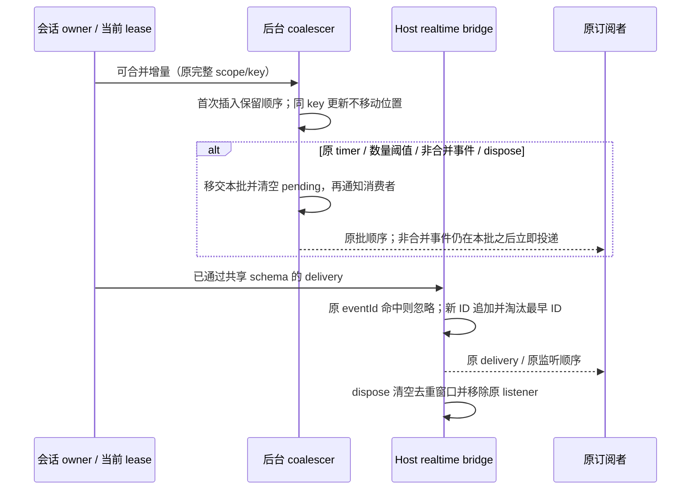

# 调度、文件摘要与实时查找的线性工作量

## 范围与产品规则

本次性能扫描确认四处重复工作：CLI 工具拓扑排序对每个出队项扫描全部剩余项；UI 批量文件摘要为每个路径重新查找全部结构化 diff；后台会话摘要按 key 线性查找待投递项；Desktop Host 的实时 eventId 窗口每次淘汰都移动其余数组项。

只替换内部查找和 FIFO 表达，保持公开接口、结果值与顺序、错误、并发组、时间预算、默认配置和生命周期。保留本轮开始前所有本地改动。调查与验证阶段不构建、安装、提交、推送或触发 Actions；不访问真实 Agent、模型 API 或用户业务数据。用户完成后另行授权本地提交，见文末提交边界。

## 唯一所有者与边界

- `ToolScheduler` 仍拥有本次调度结果；反向依赖索引和游标队列仅在同步拓扑排序调用内存在，不成为第二份已接受任务队列。scheduler 的安全元数据、并发组、最大并发和循环拒绝规则不变。
- `readRawToolCallFileSummaries` 仍只派生 UI 摘要。每次调用临时建立 path → 首个结构化 diff 的索引；展示、路径解析、变更来源优先级、统计和 patch 仍走原有函数，不读取文件、不缓存跨调用结果。
- 后台会话 coalescer 的 pending 集合仍是唯一待发摘要；用单一有序 Map 代替数组，不保留平行状态。timer、flush 边界、完整 delta、最新 progress/recovery 和结构化事件立即投递规则不变。
- `taskRealtimeBridge` 仍拥有 Host 实例内的 eventId 去重窗口。保留原 Set 成员索引与 ID 顺序数组，数组以环形游标表达淘汰顺序，覆盖最早槽位时立即解除旧 ID 引用；不增加第二条写入路径。默认窗口仍为 1000，不跨 Host/连接共享或刷新重复 ID 的寿命。单 Set 迭代淘汰的候选在同机微基准中更慢，因此不采用。
- 不新增跨包入口、依赖、协议字段、持久化或业务状态所有者。相关模块为现有 `zcode-cli`、`ui`、`services`、`desktop`。

## 事件顺序与不变量

### 工具调度

1. 入队和出队顺序与旧实现一致；依赖解除时依次访问原 remaining Map 中的工具顺序。
2. 保留缺失依赖、自依赖、循环、重复依赖和重复 toolCallId 的既有结果及错误。反向索引对同一 dependent 的同一依赖只登记一次，但 indegree 仍按原 dependencies 长度计数，不顺带放宽输入。
3. 不修改输入 tools/dependencies。失败时 remaining 键的顺序与错误上下文保持。
4. dependency level 使用顺序 max 计算，结果与原 `Math.max(...map(...))` 一致，避免临时数组和参数展开。

### 文件摘要

1. orderedPaths 仍按结构化 diff、direct changes、rawInput changes、rawOutput changes 的首次出现顺序构造。
2. 同路径多个 diff 继续使用第一个；change 仍按 rawOutput → rawInput → direct 优先级读取，字段值和 operationKind 不变。
3. display file_diff/file_diffs、非写工具过滤、fallback 和无路径/无效 diff 行为不变。Windows/POSIX 路径不额外规范化、不折叠大小写。

### 实时集合

1. coalescer Map 更新既有 key 不改变首次插入顺序；flush 前脱离旧集合，保留同步消费者重入 accept 的原行为。默认 1500ms 和 96 项不变。
2. 相同 scope 的 text/reasoning/tool-input delta 仍按接收顺序串接；progress/recovery 仍保留最新事件。权限、终态、结果和其他服务事件仍先 flush 再投递。
3. Host 去重对重复 eventId 不续期；达到原容量后只淘汰最早首次接收的 ID。已淘汰的旧 ID 再到达仍会重新投递。容量判断沿用原 `追加后 length > limit` 语义，内部配置为小数、Infinity 或 NaN 时不顺带规范化或改变行为。
4. owner/lease、workspaceIdentity fallback、remoteSessionId、stale run 检查、跨 Host 路由、deliveryKind/deliveryPurpose 不变。Desktop continuous 与 mobile replayable 的现有 V4 状态机不改，不把旧 mirror 总线当作手机快照链路。
5. 不增加 debounce、超时、重试或全局缓存。dispose、listener 和 pending request 释放继续按原路径执行。

## 验收

- 修改前固化实际源码作为测试 oracle，并对冻结的合成输入比较完整结果和错误；oracle 不依赖优化提交后的 HEAD。
- scheduler 覆盖独立工具、链、菱形、多根 DAG、各类安全元数据、并发上限、缺失/重复/循环依赖、重复 ID、同实例多次调用。稳定工作量断言在旧实现失败、修改后通过。
- 文件摘要覆盖重复路径、多个来源、display 优先级、空与畸形输入、非写工具、Windows/Unicode 路径、增加/更新/删除及真实 patch/统计，另验证大批 diff 的查找工作预算。
- coalescer 比较完整 emitted event 顺序和值，覆盖 scope 隔离、Unicode delta、progress/recovery、数量/时间边界、手动 flush、dispose、消费者重入；使用合成事件与 fake timer，不访问真实连接。
- bridge 通过公开 HostInit 入口及运行时 schema，覆盖 desktop_window/relay_bridge 两种既有 Host deliveryKind，以及现有 V4 continuous/replayable 回归；验证 1000 项窗口淘汰、重复不续期、重新到达、无效帧、监听取消、dispose 和实例隔离。原 pending lease/owner command 边界不变。
- 对同环境合成输入交替预热/采样，只报告局部耗时及稳定工作量，不推算整体应用、macOS 或实体手机提升。
- 执行相关回归、根 `corepack pnpm typecheck`、`corepack pnpm lint`、`corepack pnpm architecture:check --changed` 和改动文件格式/空白检查。验证使用 `corepack pnpm --use-node-version=24.14.0` 匹配 `mise.toml`。

## 扫描与实施结果（2026-10-21）

扫描以实际热路径、现有性能规格与测试为依据，覆盖 UI 消息派生/查找/指令解析、工具和 diff 展示、文件树/终端/Git、CLI 历史/工具调度/持久化、services 文件/Git/会话摘要以及 RPC/Host 实时窗口。没有把既有索引、结构共享、连接回收、异步扫描或本轮开始前的修复重复计为新优化，也不将关键词扫描描述为逐字审核全仓。

五个只读调查子任务均因模型服务临时封锁中断，随后由当前会话直接完成调查和实现，未切换模型。没有从中断任务获得完整审计结论。

### 功能与工作预算

先固化四个未修改生产文件的源码和 SHA-256。首轮新增测试发现夹具包含多余 `traceId`/`runId`、patch 行序假设和 Array.shift spy 递归问题；这些是测试问题，未改产品协议、实际 patch 或超时来通过。纠正夹具后，旧实现的 33 项测试为 27 项功能/对照通过、6 项重复工作预算失败：

- 1500 个独立/链式工具的依赖读取分别为 2,259,000 / 3,395,242 次，高于线性预算。
- 1200 个独立工具进行 1200 次 ready queue `shift`。
- 500 个文件摘要读取 diff path 126,750 次，高于 4000 次预算。
- 95 个待发 key 下追加 1000 个同 key 事件，执行 1000 次数组 `find`。
- 满 1000 项的 Host 窗口追加 2000 个事件，执行 2000 次数组 `shift`。

修改后六项预算均通过，完整结果与固定旧实现一致。随后追加 1000 组含重复 ID、缺失/重复依赖和循环的图，结果/错误上下文仍完全一致，最终新增回归共 34 项通过。测试 oracle 通过异步读取只加载固定样本及显式依赖，不创建生产缓存或运行真实 IO。

生产源码只改四个文件，合计 +52 / -42、净增 10 行；状态所有者、公开接口和协议不变。CI 仅在现有手动 `desktop.yml` 增加一行测试命令，保留开始前已有 CI 改动，不触发工作流。

### 局部测量

同机 Windows / Node 24.14.0，预热 4 次后前后交替采样 15 次取中位数。固定旧源码与当前源码使用相同依赖；没有设基于快慢的 CI 断言。

| 合成输入                                         | 旧实现 / ms | 优化后 / ms |
| ------------------------------------------------ | ----------: | ----------: |
| 1500 个独立工具调度                              |       27.98 |        0.65 |
| 1500 个链式工具调度                              |       29.98 |        1.05 |
| 2000 个文件 diff 摘要                            |       17.70 |       11.82 |
| 20000 个后台事件 / 95 个 key                     |       10.36 |        7.59 |
| 20000 个经 schema 校验的 Host 事件 / 1000 项窗口 |       39.33 |       37.83 |

扩大回归与最终定向复测同样观察到收益，但数值存在运行/JIT 波动；8 文件的小输入摘要差值接近噪声，不宣称所有调用都明显更快。原始各次采样汇总保存于 `packages/ui/test/fixtures/performance-linear-baseline/measurements.json`。这些是局部计算证据，不能换算整体应用提速或整机 CPU/内存降幅。

去重窗口候选另用 200000 个合成 ID 比较：原数组 24.28ms、单 Set 最早迭代淘汰 48.89ms、环形数组 12.69ms。实际采用环形数组，未保留更慢的单 Set 方案。

### 验证与边界

- 扩大 Vitest：77 文件 / 609 项通过，覆盖全部现有 `packages/ui/test/performance*.test.ts`、行共享、RPC 生命周期/字节队列、task realtime schema、共享 V4 以及手机重连/恢复。追加非法图测试后最终四文件 34 项单独复验通过；不把重跑计为新增用例。
- Core 原生入口：12 文件 / 54 项 `node:test` 通过，覆盖恢复、上下文、子代理准备和工具结果等；没有启动真实 Agent 或访问模型 API。
- Desktop CI 平台契约：6 项通过，手动触发规则及 Windows/macOS 范围不变。
- 浏览器使用官方可用的 IAB 与临时 loopback Vite：通过实际 `readRawToolCallFileSummaries` 与生产 file chip/diff count 组件，验证首个重复 diff、2002 项批次、中文/Unicode、Windows→POSIX 路径切换、主题切换、390px 窄屏、只读过滤与切回恢复。未触碰真实工作区、真实文件读取或系统剪贴板。保留 HTML/TSX 夹具供复现，浏览器标签与临时服务/缓存随后关闭清理。
- 根 typecheck 和额外 Core typecheck 均通过。根最终 Lint 为 3126 文件、0 warning / 0 error；包含根忽略 CLI 的 10 文件定向 Lint 也为 0 / 0。首轮夹具中的一个多余字符串转义 warning 已修正，没有放宽规则。
- 架构复检 violations / baseline / new 为 0 / 0 / 0；没有更新 baseline。改动文件格式和全工作区 diff 空白检查通过。

验证未覆盖 macOS、实体手机、真实已安装桌面长会话或整机内存循环；不宣称全仓不存在其他性能问题。原有本地改动全部保留。

## 完成后的提交边界

用户在本轮完成后明确授权本地提交。提交只包含上述四个生产文件、本规格、新增回归与固定源码样本、浏览器夹具以及 `desktop.yml` 中本轮新增的四文件测试命令。工作流内其他既有修改按原样留在工作区，不纳入本次提交。

提交前展示中文文案，在本地独立分支复验类型、Lint、架构和定向回归。此次授权不包含推送、安装包构建或触发 Actions；不把提交后分支号或提交号写入长期规则。
