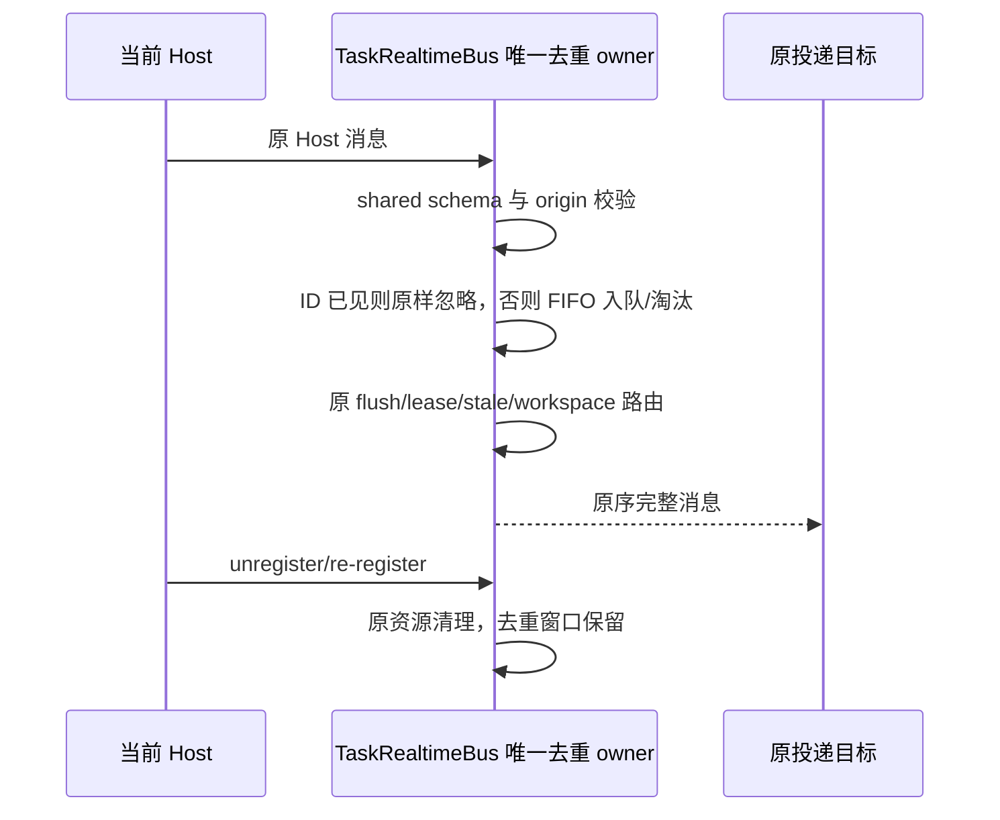
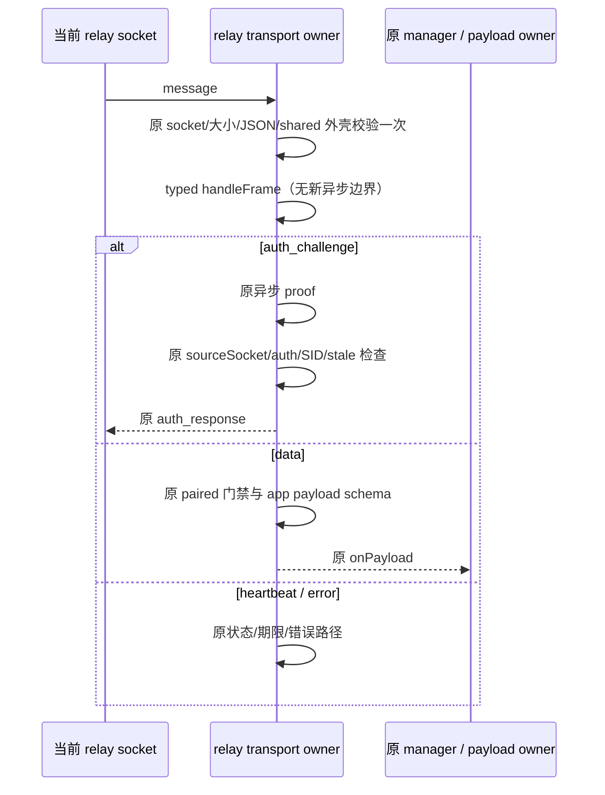

# Main 去重与 relay 入站校验的重复工作消除

本规格是 [保持语义性能扫描](./performance-preserve-semantics-scan.md) 的 Desktop 子任务。只修改 Main `taskRealtimeBus.ts` 与 `webRemoteControl/relayTransport.ts`，复用 shared 的契约与公开类型；已有 dirty 修复、Host 去重 ring 和其它传输实现不在范围内。

## 产品不变量与唯一所有者

### Main eventId FIFO

- `TaskRealtimeBus` 的 `seenEventIds` 与有序窗口共同表达同一份已见 ID；Bus 是唯一 owner。去重继续跨该 Bus 的所有 Host 生效，不能改为按 Host 或 workspace 分表。
- 新 ID 首次出现才入队，重复 ID 不投递、不续期。超限只淘汰最早 ID；重新收到已淘汰 ID仍按原路径投递。
- 默认窗口仍为 1000；`seenEventLimit` 保持原值与原比较条件，不新增 clamp、校验、公开 helper 或配置。0、小于 1、小数、Infinity、NaN 的现有结果必须保持；负容量原先会在空队列上持续淘汰，本次不改变这条无效输入行为。
- Host unregister/re-register 不清空去重窗口。原 owner/lease、stale run、跨 Host 路由、workspaceIdentity 与事件校验顺序不变。
- HEAD Host ring 依赖 Host 已有的最小容量 clamp，不能直接移植到没有 clamp 的 Main。Main 使用本地队首游标 FIFO，沿用原逻辑长度的 while 淘汰；消费立即将槽位置空，空队列清空 backing array，只有废弃前缀达到固定下限且不小于剩余后缀时才整理。整理量摊销线性，不产生第二份缓存。
- 不改 mirror coalesce、flush、精确长度核算、replay/gap、terminal、Host 注销及消息发送时序。

### relay 单次外壳校验

- 当前 relay socket 及其入站回调是 wire 输入边界；仍先检查 disposed/sourceSocket、物理长度、JSON 与 shared endpoint frame schema，再调用私有 `handleFrame`。
- `handleFrame` 唯一调用方只传首次校验成功的 plain object，调用前无 await 或外部回调。使用公开 `WebRemoteControlEndpointToClientFrame` 类型，不复制字段契约。
- endpoint schema 中 SID/nonce 的 trim 对首次解析结果幂等；data.payload 为 unknown。只删除同一已校验外壳的第二次 safeParse，不删除首次 wire 校验或独立 app payload 校验。
- 状态切换、注册回调、HMAC proof、AUTH_FAILED 清档顺序、sourceSocket/auth/SID 的异步 stale 检查、KICKED、心跳期限与 jitter、重连退避、错误和丢弃规则均保持。
- 不复用序列化结果、不修改 toJSON 调用次数或字节所有权，不新增重试、延时或跨调用缓存。

## 事件顺序

Desktop `desktop-continuous` 与手机 `web-remote-replayable` 仍各走既有交付契约；不改变 accepted-input、CommandInbox、attachment、快照、ACK 或业务 owner。

## 验收与计量

1. 先补测试，在未修改的生产实现运行：功能断言通过；Main 满窗口的数组操作预算与 relay 每入站帧一次外壳校验预算失败，才改实现。
2. Main 以原 push/shift 算法作确定性 oracle，比较完整外部消息与日志，不只比较内部 ID。覆盖重复不续期、淘汰后重收、跨 Host 同 ID、scope 隔离、两种 delivery kind、非法帧、unregister/re-register 与容量边界；保留已有 size/lease/stale/run/replay/gap/terminal 回归。
3. 用真实 Bus 公共消息入口输入，计数实际 backing array 数字索引写入及 shift；消费引用立即释放，背板占用有界、整理工作摊销线性。预热窗口 1000 后输入 2000 个新 ID，旧实现每个 shift 搬移 1000 个逻辑槽位；不把逻辑操作量写成 V8 内存写入或整机收益。
4. relay 使用测试自建 loopback WebSocket，完成真实注册/challenge/proof/鉴权。验证 SID/nonce trim、原入站顺序、waiting 禁发、matched 恢复、非法 JSON/外壳/应用载荷丢弃；计数 N 条合法端点帧外壳 safeParse 为 N 而非 2N，app payload 校验仍存在。
5. 执行相关真实 WS、connection generation、Main size、shared RPC 与手机回归。测试不访问现用桌面、真实模型、用户业务数据或公网。
6. 读取固定 HEAD 的两份旧完整源码，与当前源码使用相同依赖进行临时完整事件差分和少量前后交替 benchmark；不为 wall-clock 设 CI 阈值，不推算端到端提升。
7. 使用 pwsh 与 `corepack pnpm --use-node-version=24.14.0`。只格式化本轮文件；执行定点测试、格式与架构复检。根 typecheck/lint 和最终 baseline 隔离由主代理统一验证；不提交、推送、构建或修改 desktop.yml。

## 开工基线

- HEAD `bcdb14b1c9d68b4a156484c2e44055138e392da8`，目标 spec 与两个新测试文件均不存在，两处生产文件 clean。
- 本子任务开始前架构 violations / baseline / new 为 0 / 0 / 0；Desktop 阅读包为当前 legacy 模块，未新增依赖或 public entrypoint。

## 实施与定向验证

两处 production 与测试由主代理接手完成；只读审计及子任务曾因上游服务不可用/空响应中断，不能把中断期间未执行的工作写成通过。

- 新增 Main 真实公共入口测试，先在旧实现得到 16 项语义通过、1 项工作预算失败。满 1000-ID 窗口后追加 2000 条事件：Proxy 计量数字索引写入 2,002,000 次、shift 2000 次；修改后索引写入 4000、整理复制 1000 槽、shift 0。整理后替换的背板同样重新附加计量，未漏计后续操作。
- Main 采用单一游标 FIFO，消费立即置空，废弃前缀达 1024 且占背板至少一半时 slice 整理。零/正小数/NaN/Infinity、默认窗口、跨 Host 重复不续期、Host unregister/re-register、非法帧与完整消息/日志差分保持。负容量原来持续 while 的无效输入未规范化、未挂死测试。
- Main 新增 17 项与既有 size/replay/lease/终态 11 项共 28 项通过；包括两种 Host delivery-kind。没有改 replay 字节、gap、顺序或释放语义。
- relay 新增完整 schema 幂等和实际 loopback WS 注册/auth/配对/入站测试。旧实现所有状态、proof、字段、payload 与错误断言通过，仅工作预算失败：28 条合法帧加 1 条非法外壳共校验 57 次，预期一次入口为 29 次（非法 JSON 不进 schema）。生产移除私有 handleFrame 的二次校验，改用共享已校验联合类型；初始 wire 与 app payload 校验、sourceSocket 和异步 proof stale 防护保持。
- relay 新工作量回归 2 项、既有真实 WS 生命周期 7 项及 generation/stale socket 4 项共 **13/13 通过**。工作量实测为 29 次外壳校验；非法应用载荷仍被原 app schema 丢弃。根 typecheck 曾发现新测试 logger 参数 `unknown` 不能直接写入字符串数组，只把测试改为 `String(message)`；复验通过，不改生产日志或类型契约。
- shared、Desktop RPC/service pipe/Host bridge 与 mobile 协议和生命周期相关回归 **7 文件、109/109 通过**；没有把两种交付语义合并，也没有修改这些协议文件。
- 固定 `bcdb14b1` 的完整 Main 源码与当前源码，同依赖比较 20,000 条经 schema 校验的消息、1000-ID 窗口，完整发送消息相等。预热后前后交替 15 次，Windows / Node 24.14.0 中位数 **35.2218 → 32.6886ms**，只代表这个局部合成路径，不是整机或远控端到端收益。
- 最终根 typecheck/lint、架构复检及格式通过。架构 violations / baseline / new 为 **0 / 0 / 0**；本规格两处生产改动合计 **+21 / -16，净增 5 行**。开始前 67 个已有变更文件的哈希均保持；没有 commit/push/build 或 Actions 变更。
