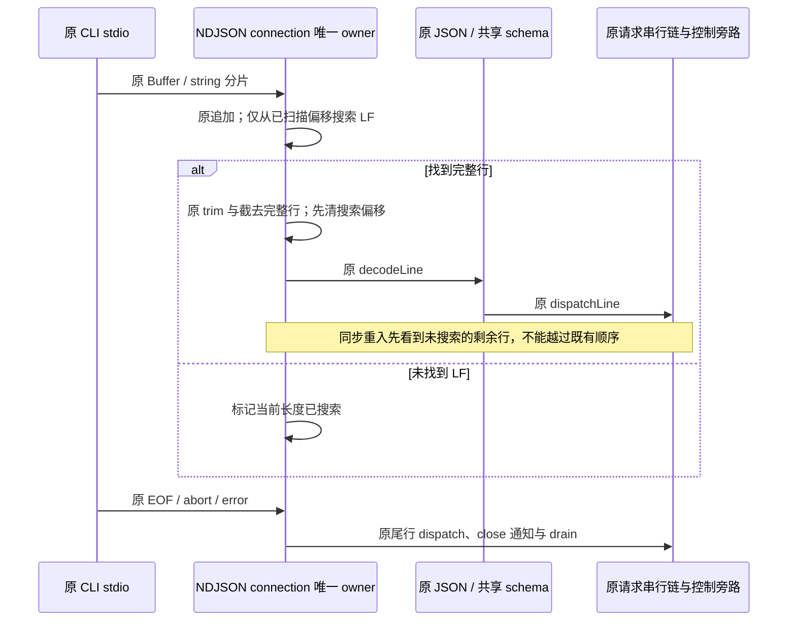
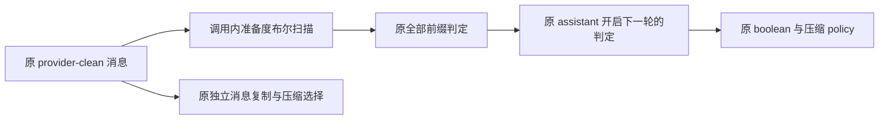

# 性能扫描：NDJSON 前缀搜索与压缩准备度分配

## 产品规则与范围

在当前检出的 ZCodium 中，消除两个已证实的重复工作：CLI NDJSON 连接每次分片都从头搜索尚未结束的长行；自动压缩准备度检查复制全部非前缀消息并建立分组数组，但只返回布尔值。

只修改现有 `zcode-cli` 模块的内部算法，不改变公开协议、结果、错误、输入顺序、请求 admission、取消、EOF drain、压缩阈值或保留轮次。开始前 135 个本地改动文件记录内容 SHA-256，全部保留；已有性能修复不计为本轮成果。不提交、推送、打包、安装、触发 Actions 或访问真实模型及用户业务数据。

## 唯一所有者与边界

- `ZCodeProtocolNdjsonConnection` 仍独占当前连接的未完成行和串行处理链。新增的搜索偏移只是该字符串内已确认没有 LF 的位置，不缓存解码结果、不持有第二份队列，不跨连接复用。
- 每次 Buffer 分片仍按原 `toString("utf8")` 解码，每行仍按原 `trim`、JSON.parse、共享 schema 校验及 dispatch；本轮不顺带修改分片 UTF-8 的既有行为。
- `hasEnoughMessagesToCompact` 只读原输入，布尔扫描在本次调用内存在。真实消息历史、压缩选择、克隆、持久化和 provider 投影仍由既有组件拥有；不引入跨调用缓存或新状态。
- 不修改接口、依赖边界、CommandInbox、Host owner/lease、workspaceIdentity 或 remoteSessionId。Desktop `desktop-continuous` 与手机 `web-remote-replayable` 保持原订阅及恢复语义。

## 不变量

### NDJSON 搜索

1. 每次没有 LF 的已搜索前缀无需重新搜索；找到 LF 并截去行后，偏移立即归零，再调用可能同步重入的 decode/dispatch 路径。
2. 多行、空行、CRLF、尾部不完整行、EOF 无 LF、JSON/schema 错误及响应输出保持逐字节与原顺序。行内转义 `\\n` 不等同真实 LF。
3. 偏移属于当前 buffer。同步重入输入时仍先解析已有的未搜索剩余行；不能跳过行或重复投递。
4. 普通请求保持串行；取消、MCP App 控制与反向 response 保留原旁路、started barrier、post-response batch 与 commit 顺序。
5. 只减少 newline 搜索范围。本次不修改字符串追加或 V8 flatten，不宣称整个接收路径变成线性时间或消除了全部长行复制。

### 压缩准备度

1. 前缀定义不变：system，或正文去左空白后以 `<system-reminder>` 开头的 user；相同 helper 继续处理结构化正文和 reasoning。
2. 相邻 assistant 也开启新的轮次；首条可总结消息若为 assistant，它自己不能证明有两轮。首条可总结消息之后遇到任意 assistant 才满足原条件。
3. 保留整个输入的前缀判定，不因已满足准备度而提前跳过尾部错误；正常输入不读取与布尔结果无关的工具参数、media source 或其它扩展字段。
4. 返回值、输入不可变、重复消息引用、稀疏数组跳过缺席槽位和公开 `getMessagesToSummarize` 的克隆契约保持。布尔扫描使用原数组迭代语义，不将缺席槽位解释为 undefined 消息。不得删除或改写该公开入口的复制行为。
5. 自动压缩 token 估算、disabled/circuit-breaker/threshold 及 manual compact 行为不变。

## 验收与计量

先固化当前算法为测试 oracle，并在生产修改前执行功能对照与工作预算。功能对照应在两版都通过；重复搜索及无用克隆预算应先红后绿。

- 新建 Bootstrap 原生 node:test：通过真实 connection、内存 streams 和合成合法请求，覆盖 string/Buffer、多行与分片、CRLF/空白/Unicode、EOF、错误、取消/反向 response、同步重入、原响应/notification/commit、abort/close。spy 只计实际 `indexOf` 调用的搜索窗口，不计为实际 CPU 指令或堆字节。
- 新建 Core 原生 node:test：独立旧准备度 oracle 比较角色/前缀/结构化正文/空输入/重复引用/固定随机序列；冻结输入并通过无关字段的访问计数证明不再浅克隆。比较 `shouldAutoCompact` 的完整决策及原内容错误。
- 局部基准使用同机 Node 24.14.0、固定合成输入、预热并交替采样取中位数；不设置耗时 CI 门槛，不换算整机、模型、macOS 或手机提升。
- 执行真实包测试、已有 Bootstrap transport Vitest、两种交付 profile 的 V4 回归、根 typecheck/lint、CLI typecheck/lint、架构复检及本轮格式和 diff 空白检查。逐项记录真实结果；不刷新架构 baseline。

## 开始前基线

- `perf/linear-hotpaths` 相对缓存的 `origin/main` ahead 1 / behind 0；freshness 通过，无远端跟踪分支。
- 架构 violations / baseline / new 为 0 / 0 / 0。
- 根 typecheck 与 lint 通过，lint 3143 文件、0 warning / 0 error。
- PowerShell 7、corepack pnpm 10.33.2；验证入口 `corepack pnpm --use-node-version=24.14.0` 与 mise.toml 一致。

## 实施与验证结果

### 功能等价与工作预算

- 修改生产前新增两文件共 27 项：22 项功能/对照通过、3 项工作预算失败、2 项 benchmark 默认跳过。NDJSON 两项预算确认原算法反复搜索前缀，compact 一项预算确认原准备度复制了无关字段。没有通过放宽时间或改变输出让测试通过。
- 最终新增两文件为 **26 项通过、0 失败、2 项 benchmark 默认跳过**。包含全部角色/结构化前缀组合、1000 个固定种子历史、完整 policy 决策、输入冻结、重复引用、尾部错误、string/Buffer 分片、同步重入、EOF、控制旁路、反向响应与 response/notification/commit 顺序。
- 复核发现最初 `for...of` 候选没有保留原 `filter` 跳过稀疏空槽的行为。先增加独立回归复现该退化，再使用同样跳空槽的 `forEach` 布尔扫描修复；已复验通过，不保留有语义差异的候选。
- 262,189 码元的合成 NDJSON 帧、每片约 1024 码元：newline 搜索窗口总量 **34,209,881 → 262,189 码元**。两版 `indexOf` 调用均 259 次，只减少实际参数表达的搜索范围；不宣称字符串追加/flatten 已消除。
- 2000 条合成消息：原准备度浅克隆读取无关工具/扩展字段 **4000 → 0 次**，不再为此布尔结果建立消息副本和轮次数组。真实 `getMessagesToSummarize` 的公开浅克隆行为仍原样。

### 局部基准

Windows / Node 24.14.0；预热后前后交替 15 对采样取中位数，无耗时通过阈值。newline 基准只比较固定前后截行计算算法，不含 JSON/schema/handler；compact 基准调用实际前后准备度函数。不能将这些值换算为完整应用、模型或跨端延迟。

| 合成局部场景                       | 旧算法 ms | 当前算法 ms |
| ---------------------------------- | --------: | ----------: |
| 256 个 1024 码元分片，newline 计算 |   12.2526 |     10.8111 |
| 1024 个同规模分片，newline 计算    |  169.9856 |    136.6914 |
| 16 条消息，compact 准备度          |  0.000495 |    0.000091 |
| 1000 条消息，同准备度              |  0.038420 |    0.005168 |
| 10,000 条消息，同准备度            |  0.376980 |    0.054290 |

### 验证与真实限制

- Core 原生包测试最终 **102 项通过、0 失败、4 项 benchmark 默认跳过**；本轮新增用例与全集重叠，不重复相加。两项新增 benchmark 曾通过标准 `--test-name-pattern=benchmark` 单独执行；compact 在最终 `forEach` 版本上另外复测通过。
- Bootstrap 官方包测试最初为 **62 通过、3 失败、1 benchmark 跳过**；三个失败均为真实 sandbox 测试 finally 删除临时 cwd 时的 Windows `EBUSY`。独立重跑同样失败，未放宽 timeout 或加删除重试。
- 已确认 Bootstrap 按包公开入口加载的 `dynamic-workflow-runtime/dist/harness.js` 仍直接 kill 后 resolve，而开始前已有的 `src/harness.ts` 修复会等待 child close。没有改写、构建或覆盖这些已有源文件/产物；用仅测试进程生效的临时 resolver 让该公开包入口指向当前源码，四项目标回归 **4/4 通过**，Bootstrap 同一原生全集 **65 通过、0 失败、1 benchmark 跳过**。
- 当前源码回归的可重现方式为 `node --import tsx --import <临时 resolver 的 file URL> --test --test-isolation=none 'apps/zcode-cli/packages/bootstrap/test/*.test.ts'`。resolver 使用 Node `registerHooks`，仅把 `@zcode/dynamic-workflow-runtime` 映射为当前 `src/index.ts`；不改仓库配置、package exports、用户环境或生产加载。
- 完整 CLI 官方 typecheck 已通过；该入口本身会运行既有 TUI / dynamic-workflow 的依赖构建准备，不等同桌面打包或发布。CLI 完整 lint 为 **56 warning / 79 error**，集中于既有超长文件、未使用变量/导入等，不将其写成通过或顺带修改。四个本轮 CLI 文件定向 lint、严格新测试类型检查均为 **0 warning / 0 error**。
- 根最终 typecheck、lint、architecture 均通过；根 lint **3147 文件、0 warning / 0 error**，架构 violations / baseline / new **0 / 0 / 0**。全仓格式检查 **3643 个匹配文件通过**，CLI 本轮四文件另用其自己的格式配置检查通过，`git diff --check` 通过。
- 性能 / V4 / RPC / Server / mobile 整合回归 **91 文件、707 项全部通过**，包含新标题索引和 ACK 及旧传输控制回归。旧沙箱编译产物失败和源码复验区别如上，不由整合回归掩盖。
- 本轮全部六个原本 clean 的生产文件合计 **+43 / -24，净增 19 行**；本规格的 CLI 两文件 **+15 / -12，净增 3 行**。开始前 **135 个本地改动 SHA-256 全部保持**，未更新架构 baseline、未改 CI、未提交/推送/安装/触发 Actions。完成后已逐项检查并清理六个本轮失败测试留下的合成 sandbox 临时目录，以及本轮哈希快照、测试 resolver 和测量辅助文件；未清理任何用户目录或其他会话资源。
- 未运行真实已安装 Electron、macOS、实体手机、真实 LAN/relay、浏览器 GUI 或用户长会话 CPU/heap 采样。纯派生与传输内部等价修改没有界面交互/布局变化，不宣称完整 GUI E2E 已验收。独立审查子代理受模型服务吞吐限制中断，最终差异与边界由主代理直接复核；不能声称通过了完整独立审计。
