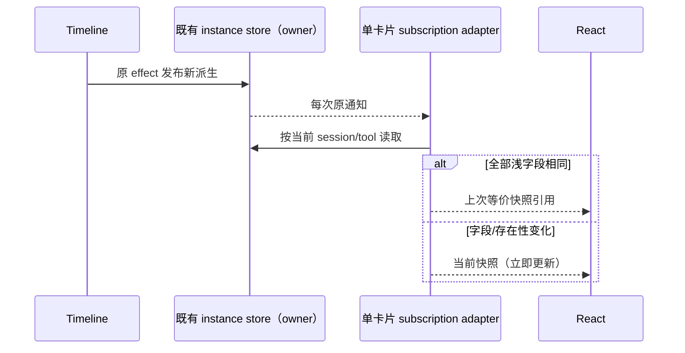

# 插件卡片展示裁决订阅性能

## 成本与边界

会话裁决的发布/回收改由 Timeline 发布者句柄管理，见 [生命周期补充](performance-followup-lifecycle-fixes.md)；单个卡片仍只读订阅，保留 useShallow 稳定快照和原展示裁决。

`ConversationTimeline` 每次 rows 更新派生 `deriveLogicalUiInstances` 并在原 effect 发布到 `pluginUiInstanceStore`。每条插件行的裁决对象都会新建。`usePluginUiToolCallModel` 的 `useSyncExternalStore` 直接返回该对象；普通正文续写即使不改变 key/superseded/autoExpand/forcedInline，也会引起所有订阅卡片更新。

唯一展示裁决 owner 仍是既有 store，通知次数、通知顺序、派生规则和输入对象均不变。新增模块内 adapter hook 将既有订阅集中为可隔离验证的入口，使用已安装 Zustand 的 `useShallow` 稳定浅字段完全相同的快照。仅在单个已挂载 hook 内保留上次读值；不建立跨会话缓存、不存旧历史、不改变沙箱/Host 状态。

- 所有裁决字段均为 primitive，浅比较包含全部自身字段；任一值改变、添加/删除裁决都立即返回新快照。不能仅比较部分布尔值而遗漏逻辑 key。
- scope 参数仍来自原 sessionId/toolId，切换后立即读新 scope；服务、工具结果、手动 pin、side-pane、主题及权限仍由原独立订阅处理。
- 保留现有 subscribe/get/store 实现及所有通知；减少的是 React 对相同快照的订阅更新，不丢弃必要事件。
- 保留最近三回合自动展开、成功替代、running/error/isError 资格、showInline、手动 pin、guest 保活和侧栏规则。无协议、owner/lease、workspace identity 或 continuous/replayable 更改。
- adapter 只访问本模块 app 层，不改公开接口、模块依赖、contract owner 或 UI 布局。

## 验收

先抽取原订阅并运行隔离浏览器 React 夹具，在旧行为下测量 30 次正文更新 × 12 张卡的额外 render 次数；同时对照真实纯派生和 store 输出。优化后相同输入应为 0 次由裁决订阅导致的额外 render。测试不宣称整个时间线不渲染。

夹具执行真实 adapter hook、React、derive/store，使用隔离无头 Edge 和随机 loopback Vite 开发服务器（不打包）；不加载真实插件或 Agent。浏览器覆盖两种 viewport、逐字段变化、成功替代、回合 aging、删除/重加、切换 session、卸载后更新/重挂、手动 pin 独立订阅。错误日志必须为空。保留现有 domain/contract 回归，根 typecheck/lint/架构和定点格式检查。

当前 agent-browser CLI 不在 PATH，使用仓库现有 Playwright/Vite 测试入口模式作为工具回退，不安装依赖。完整应用/Electron guest E2E 未运行，夹具只验证展示裁决到 React 的边界。
