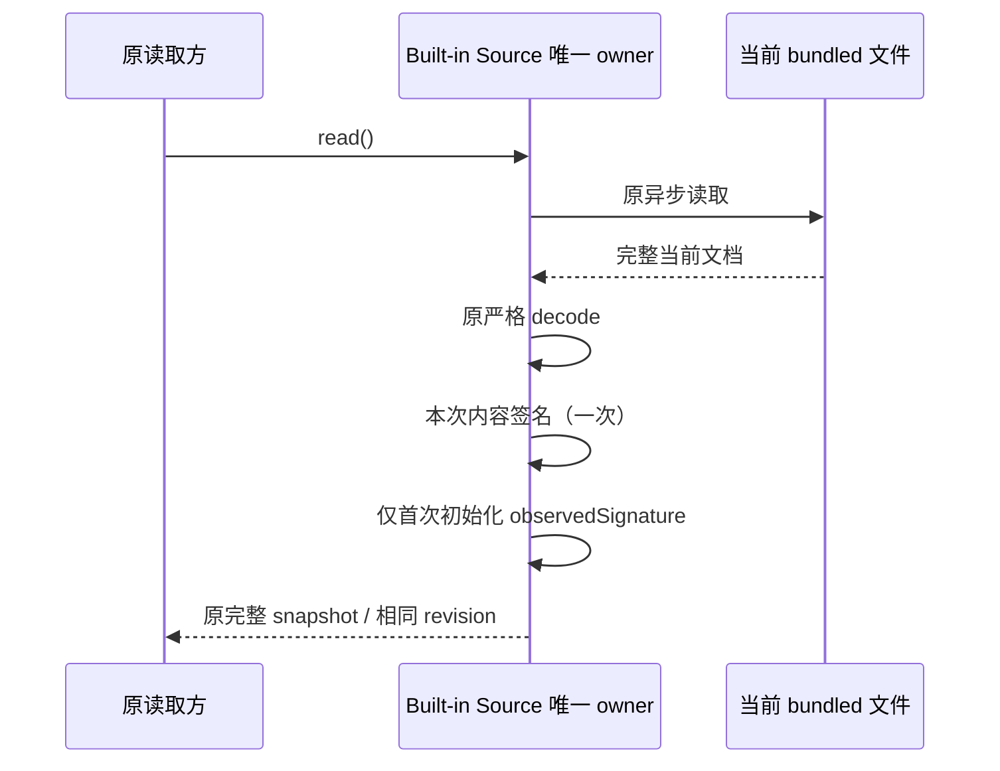

# 性能扫描：保持行为等价的重复工作消除

## 产品规则与范围

本轮检查当前检出的 ZCodium，目标是消除已证实的重复计算、重复查找和无效资源工作，不改变功能逻辑。先检查基线、架构和现有变更，再沿 UI、Services、CLI、Host/传输及 Provider 的实际调用链审读实现与测试。未确认的热点不因关键词匹配直接修改。

- 保留本轮开始前的 67 个已改动文件；已有工具调度、文件摘要、会话合并和 Host eventId 窗口优化不重复计为本轮成果。
- 不改变公开接口、输出内容及顺序、错误与拒绝规则、默认配置、节流时间、并发、持久化格式或迁移边界。
- 不添加跨调用永久缓存、第二份业务事实或新的重试/延时，不削弱 workspace identity、owner/lease、stale run 或跨 Host 路由检查。
- Desktop `desktop-continuous` 和手机 `web-remote-replayable` 保留各自投递、快照、恢复及 ACK 语义。
- 不访问真实模型服务、用户业务数据或现用桌面进程；不提交、推送、打包、安装或触发 Actions。

## 已确认问题、唯一所有者与等价约束

### Provider 成员名单归一化

`ProviderConfigService.savePersonalProviderOverlay` 在当前 Personal Repository 事务内归一化已有成员。局部 `uniqueInOrder` 对每个模型 ID 使用 `result.includes`，即使所有 ID 不同也从头扫描，Built-in/Personal 大名单各产生平方工作量。

- ProviderConfigService 继续负责领域规则，Personal Repository 的原子 update 仍是唯一已保存配置写入路径。
- 用调用内的 Set 表达同一首次出现去重，不缓存结果；结果仍按原输入顺序 push 到数组。
- 字符串保持精确匹配，不新增大小写折叠、路径/Unicode 归一化或空值处理。名单仍由现有 ProviderConfig 构造器校验与 trim。
- Built-in 优先成员归属、模型排序、名称唯一性、已删除 Provider 拒绝、revision/current membership 校验、默认模型选择与其他配置字段保持不变。
- 不抽出新的公开入口，也不顺带改写现有 resolver/owned-order 已有的线性实现。

### Built-in 配置首次读取的重复指纹

`NodeZCodeBuiltinProviderConfigSource.read` 首次读取同一个已解析 Release 时，分别为 observedSignature 与快照 revision 序列化/哈希同一内容两次。后续每次 read 仍重新读取、严格解析真实文件，不复用跨调用文件内容。

- Source 仍独占 watcher 与 observedSignature；单次读取只计算一次签名，并交给原快照构造函数。
- observedSignature 仍仅首次初始化。显式 read 不抢先推进 watcher 的已观察版本，保留原 `file-changed` 通知边界。
- revision 的 release number、路径 sourceKey、内容签名及分隔格式逐字节相同；同路径 Host/Worker 对齐、不同路径隔离、相同序号新内容失效、非法文件拒绝均不变。
- watcher 调度、通知数量、错误处理、dispose 和异步读取顺序不变；不新增锁、延时或重复状态。

## 验收与证据

1. 先补回归，再改生产实现；性能预算应在修改前失败、修改后通过，功能断言在两版都通过。
2. Provider 通过公开保存入口测试重复模型、Built-in/Personal 重叠、排序缺省/null/已保存排序、精确字符串键、成员字段不能由普通保存改写、模板与继承 Provider、revision/名称/删除拒绝以及默认选择保留。冻结输入，验证一次原事务与原事件。
3. Built-in Source 使用测试自己的临时文件，验证完全相同的 revision 与内容、重复读取/改写、同路径两实例、不同路径、非法文件及释放；通过实际序列化调用数证实首读从两次降为一次。既有 watcher/Host/Worker 本地配置回归实际执行。
4. 后续扫描确认的其它候选必须先在本规格补充所有者、边界和验收，再写代码。
5. 同环境合成输入的局部测量只用于说明对应计算路径，采用固定旧源码或独立参考算法；不设易波动的 wall-clock CI 断言，不推算整体应用或所有平台提升。
6. 验证使用 `corepack pnpm --use-node-version=24.14.0` 匹配 `mise.toml`；执行相关测试、根 typecheck/lint、CLI 目标检查（若改 CLI）、架构复检、改动文件格式及 diff 空白检查。
7. 区分已执行测试、环境限制和未覆盖场景；比对开始前文件哈希，确认无关变更未被覆盖。架构 baseline 不自动更新。

## 开始前基线

- 分支 `perf/linear-hotpaths`，freshness 对 `origin/main` 为 ahead 1 / behind 0；该分支没有远端跟踪分支。
- 开始前架构 violations / baseline / new 为 0 / 0 / 0。
- 开始前根 typecheck 通过，根 lint 为 3126 文件、0 warning / 0 error。
- Shell 使用 PowerShell 7；系统 Node 为 24.18.0，后续验证入口已确认可使用固定 24.14.0。

## 实施与最终验证

### 已完成的 Provider 修复

- 只修改 ProviderConfigService 的调用内去重和 Built-in Source 的单次签名传递，两个生产文件合计 +13 / -4，净增 9 行。
- 新增 `packages/services/test/performanceProviderNormalization.test.ts`。首轮合成 Release 夹具误用了不属于 Built-in schema 的 group 和规则键；纠正夹具后，旧实现为 5 项功能通过、2 项工作预算失败。1200 个不同 Built-in 与 1200 个不同 Personal 模型产生 1,438,800 个数组候选槽访问；Built-in 首读序列化 2 次。修复后 7 项全部通过，追加 80 组重复/重叠名单及再次保存的独立归一化对照后共 8 项通过，数组反复扫描为 0，首读序列化为 1 次。
- 既有 Node 原生 `local-provider-runtime`、`bundled-provider-config`、`personal-provider-provisioning` 共 18 项通过，包含实际临时文件、watcher、Host/Worker 对齐、创建/编辑/删除、跨环境导入、并发编辑和失败回滚；不运行真实模型或用户配置。
- 固定修改前两个生产文件的内容与 SHA-256，加载同一依赖进行前后交替局部采样，预热 4 次、采样 15 次取中位数，Windows / Node 24.14.0。Provider 保存各 1200 个 ID 为 3.0043 → 0.3649ms，各 5000 个为 92.0646 → 2.3372ms。各 8 个为 0.00802 → 0.00854ms，差值接近噪声；不声称每次小名单保存都会更快。
- Built-in 首读 1200 个模型的整体样本为 1.0420 → 1.0761ms，没有可证实的墙钟收益；仅确认消除了重复序列化和哈希。临时测量脚本首次因 Windows ESM 绝对路径形式失败，改用 file URL 后完成，不影响产品代码或验证断言。
- 本阶段根 typecheck、lint、architecture 检查均通过；lint 为 3127 文件、0 warning / 0 error，架构 violations / baseline / new 为 0 / 0 / 0。初始 67 个已有变更文件的内容哈希全部保持。

### 已完成的其它修复

| 范围                | 本轮消除的重复工作                                  | 已执行的关键证据                                                                                                     |
| ------------------- | --------------------------------------------------- | -------------------------------------------------------------------------------------------------------------------- |
| Main eventId 窗口   | 满窗口逐帧 shift 改为同 owner 的游标 FIFO           | 2000 个新 ID 的 shift 2000 → 0；索引写入 2,002,000 → 4000，另有 1000 槽摊销整理；完整外部消息与日志相同              |
| relay 入站          | 删除私有 handleFrame 对已校验外壳的第二次 safeParse | 28 条合法帧和 1 条非法外壳，57 → 29 次校验；wire 与 app payload 仍各在原边界校验                                     |
| Services readdir    | 普通 Dirent 不再逐项 async/await                    | 10,000 个普通条目的 Promise 40,007 → 5；链接 stat 启动顺序、等待、失败降级及排序不变                                 |
| Services task index | metadata 与无搜索 SELECT 不再把未使用正文取到 JS    | 64 × 200,000 字符，metadata/automation 正文返回量 12,800,000 → 0；搜索仍取完整正文，84 组真实 SQLite 查询深度相等    |
| CLI 通知出队        | 同数组稳定压缩代替交错批次逐项 splice               | 2000 项交错命令，splice 1000 → 0、逻辑保留槽搬移 500,500 → 0；3000 次固定随机操作的结果与引用相同                    |
| CLI 字节截断        | 原全文码点展开与二分拼接改为预算边界扫描            | 2,000,000 个 ASCII 码元、4096 字节预算，0 全文展开/全量计量、4097 次边界读取；UTF-16、数字及 suffix 与固定旧算法一致 |
| UI 命令中心         | 两个原列表 hook 在关闭态使用已有 enabled 门禁       | 关闭时两条隐藏订阅归零，背景消费者继续接收；打开、搜索及选择回调保持身份                                             |

详细规则、所有者、事件图和回归见 [Main/relay](./performance-main-relay-work.md)、[Services](./performance-services-read-projections.md)、[CLI](./performance-cli-bounded-work.md) 和 [Command Center](./performance-command-center-closed.md)。全部修复复用现有 owner 和写入/通知路径，不修改公开协议、节流、持久化或 admission。

最终复核还发现最初的截断候选会拖慢大但仍可容纳的 ASCII：先补预算红测，再仅在原文长度不超过预算时恢复原生字节计量快路。20,000/49,990 码元的局部耗时恢复到旧快路误差范围，没有只保留超大输出的收益而忽略普通输入退化。最终局部基准中 1 MiB ASCII/head 截断为 **27.392 → 0.056ms**，5000 对交错通知的出队为 **2.945 → 0.411ms**；这些仅是同机合成计算路径，不表示整机、模型或远端提速比例。

### 最终验证与变更隔离

- 最终生产改动为 **9 个文件，+130 / -66，净增 64 行**，分布于 Provider、provider-node、Desktop Main、Services、CLI Core 和 UI Command Center。没有新增模块依赖、公开接口、业务 owner 或架构 baseline。
- 共新增 7 个自动回归文件、2 个浏览器夹具文件、5 个规格文件；扩展 2 个原本 clean 的目录回归文件。开始前的 **67 个已有 changed 文件内容 SHA-256 全部保持**，这些既有改动不计入本轮成果。
- 最终性能回归采用现有 UI Vitest 配置串行运行：**68 文件、465/465 通过**，包含所有现有 performance 回归与本轮 Provider、SQL、Main/relay 新测。此前一轮并行执行时，既有 `performanceAuditDifferential` 的 deleted-rows 微基准超过原 5000ms 测试期限；单文件重跑和最终串行全集均通过，未放宽 timeout、未改基准或产品节流。
- Core 原生 package test：**72 项通过、0 失败、2 项 benchmark 默认跳过**。两个新增文件单跑为 18 项通过、2 项默认跳过；两项 benchmark 最后单独运行 **2/2 通过**。这些结果与全集重叠，不重复相加。
- 相关定向回归分别通过：Provider 实际本地配置/Host/Worker/watcher **18/18**，Services 目标 **26/26 + 11/11**，Main size/lease/replay/终态 **28/28**，relay WS/generation/auth **13/13**，shared/Desktop/mobile 协议生命周期 **7 文件、109/109**，Core 内联 Vitest **5 文件、22/22**，bootstrap admission/双交付 **4/4**。
- 最终根 `typecheck` 通过；根 `lint` **3132 文件、0 warning / 0 error**；CLI Core `tsc --noEmit` 与四文件定向 lint 通过。根 UI/Core 工程排除部分测试，额外严格检查了新测试；最新 Command Center TSX 夹具使用合法共享任务模式，UI 生产源及两个新增测试/夹具额外检查 **0 类型错误**。
- 最终架构检查 **violations / baseline / new = 0 / 0 / 0**。全仓 `fmt:check` 通过（3614 个匹配文件），`git diff --check` 通过；仅格式化本轮文件，未修整无关本地改动。
- 浏览器隔离夹具验证关闭订阅、打开显示当前任务、任务 scope 搜索、鼠标选项事件回调及 390px 内容。宿主高层 click 曾超时，使用已观察 locator 的页面 click 完成组件事件；Enter 未确认选择，Escape 被取消，不能报告完整键盘 E2E 通过。之后不重开被取消页面，也不切换浏览器。
- 本轮 Vite 服务通过自己的停止标记正常退出，独立缓存已确认删除；三个早期 stdin 退出留下的明确 Vite 临时标记逐项检查后清理。没有停止现用桌面、用户 Host 或浏览器进程。

### 覆盖边界

没有运行真实 Electron、macOS、实体手机、付费模型、用户业务数据或整机 CPU/heap 测量，也没有构建、安装、提交、推送或触发 Actions。当前官方 CUA frame-pair resolver 为 stub，未把普通媒体回归说成官方原子媒体对实机验收。

其它候选（隐藏分享派生、手机任务分组、长行/流式解码、ACK replay 分配、Emitter 快路及跨消费者缓存等）未取得完整边界等价证据，本轮不修改。此次扫描确认并修复了上述九处问题，不宣称逐行穷尽全仓或不存在其它性能空间。
