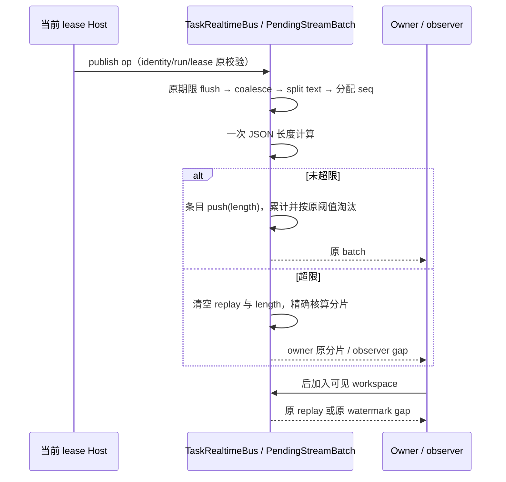

# 实时总线精确长度核算

## 当前成本和范围

Desktop Main `TaskRealtimeBus` 由 `index.ts` 实例化，Host `index.ts` 的 stream publish 经 `taskRealtimeBridge` 上送。每次 flush 先序列化整批检查大小，再在 replay admission 中反复序列化整个窗口；oversized 分片对每个新增 op 复制并序列化整个 pending 前缀。

只减少长度核算的重复工作；不改变 Main/Host 现有责任，不把此旧兼容总线扩展到其他链路，也不新增业务状态或持久化。唯一所有者仍是 Bus 内的 PendingStreamBatch；长度只为不可变已发布事件的局部派生元数据，随原有 replay 条目淘汰/清空。

## 不变量与设计

- JSON 大小继续用 `JSON.stringify(value).length`，是 UTF-16 字符数，不能在性能任务中改为 UTF-8 字节数。512 KiB 命名阈值、60 批窗口、1000ms flush、128 Ki 字符正文切分均保持。
- flush size gate 的序列化结果长度直接用于 replay 条目；条目同时持有 event 和 length，窗口累计长度随 push/shift 更新。先按数量再按长度淘汰的结果保持；oversized fallback 同时清空条目与总量。
- 分片长度是空 ops envelope 的序列化长度 + 每个 op 的准确 JSON 长度 + op 之间逗号数。envelope 使用实际 fromSeq/toSeq/batchSeq/eventId/terminal，不能用固定开销估计。正文、转义、孤立代理项、字段缺省等按 JSON 原规则计算。
- 单个超大 op 仍按原规则发送；只有已有 pending 且追加后超限才 flush。首次 gate 已消耗的 batchSeq、分片 eventId、终态清理、snapshot invalidation 顺序不变。
- 保留 coalesce/splitLargeTextOps、owner/lease、stale run 拒绝、workspaceIdentity、跨 Host 路由、deliveryPurpose、gap watermark、late subscriber 和 replay 初始化判断。
- Desktop continuous 与 mobile replayable 继续由各自 V4 transport 契约处理；不得把旧 mirror replay 当成手机快照链路。验证同时覆盖现有双 delivery-kind 回归。
- 没有 API/schema、状态 owner、默认配置、UI DOM/交互、数据迁移变化，无新增交互 E2E 场景。

## 验收

先保留旧核算/分片函数作为测试 oracle，旧实现运行正确性测试并记录序列化工作量。真实 Bus + 合成 EventEmitter Host 走运行时 schema，验证数量和大小边界、不同内容长度、转义 Unicode、多个 run/workspace、非法与 stale publish、终态、oversized 后继续、Host 重注册/退出。用 oracle 比较分片完整输出和 replay/gap 的外部投递，不用只断言内部字段代替行为。

新增优化预算断言须在旧实现失败、改后通过；计数 JSON 序列化输入中的 op 数量作为稳定工作量证据，不把它解释为实际 IPC 数量变化。最终执行相关现有回归、根 typecheck/lint/架构、定点格式与 diff 检查。
