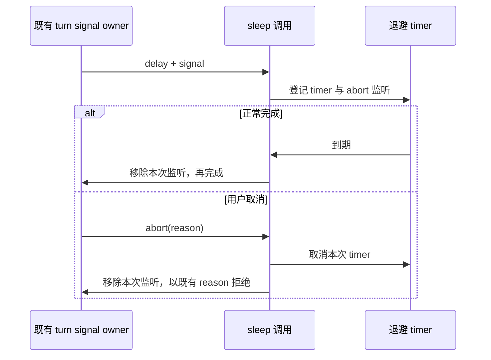
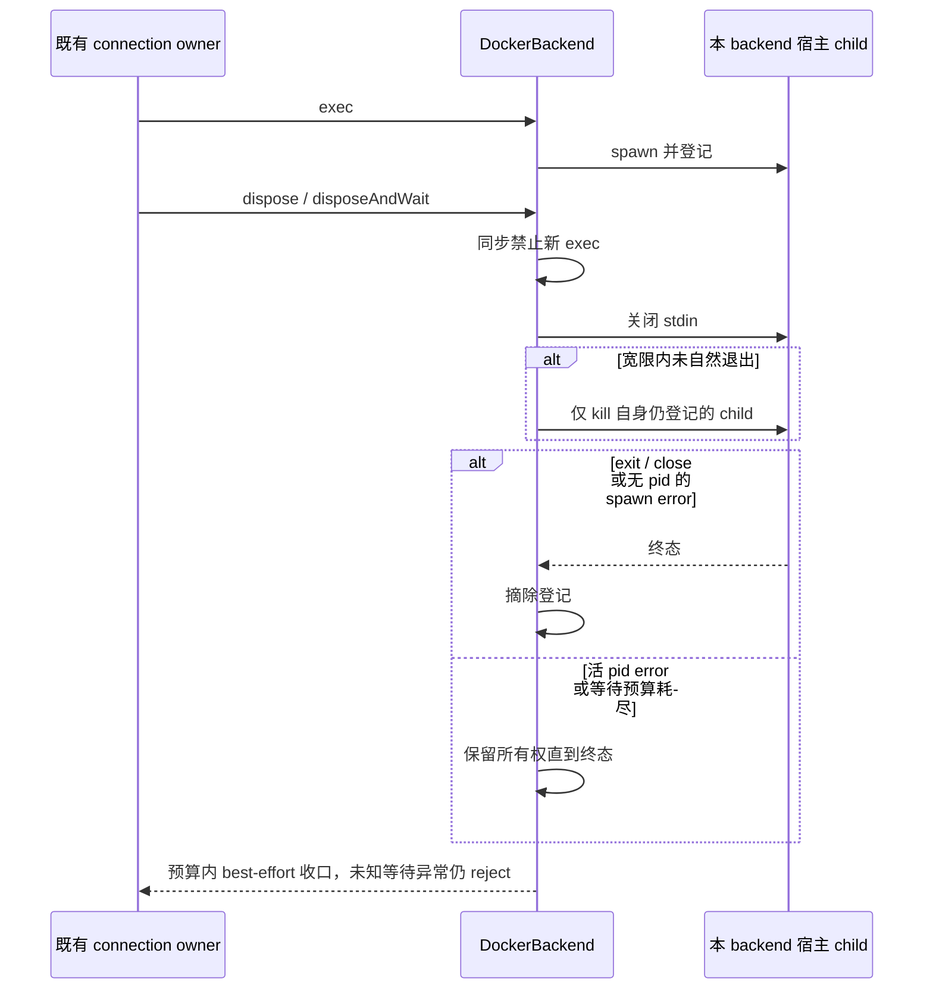

# 2026-10-31 性能与正确性再扫描

## 范围与约束

基于当前检出的 ZCodium 工作树进行再次扫描，只修复能通过当前源码和回归验证确认的问题。扫描不等于全项目、全平台或真实模型的完整验收。

- 保留开始时已有的 103 个未提交文件，使用项目内内容指纹验证它们未被覆盖。
- 不提交、不推送、不手动触发构建、不打安装包，不改产品版本和依赖。
- 既有功能、排序/文本/错误规则、工作区隔离、权限和审计边界保持不变。
- 不恢复官方遥测、账号、云依赖、更新源或 Linux 桌面资源。
- 不改变 Main/Host/CLI 的业务状态所有权、CommandInbox admission、owner/lease 和 stale-run 防护。
- Desktop continuous 与 mobile replayable 各自沿用现有顺序和恢复契约；不引入另一份已接纳队列、缓存事实或持久化状态。
- 改动前明确问题所在的唯一 owner、公开接口、失效/失败语义及验收场景；不把无法证明的猜测写成已修复问题。

## 修复选择与验收规则

1. 先更新具体行为规则和回归场景，再补测试，最后修改实现。
2. Bug 用当前旧实现的失败用例确认，保留未受影响路径的成功断言。
3. 纯性能优化以输入/输出等价、不可变性和工作次数预算确认，不虚构整机耗时收益。
4. 异步资源仍由原组件唯一拥有；同一个终结出口保证取消、成功、失败和释放正确配对，不新增计时兜底掩盖同步问题。
5. 优先局部修复，不扩大为状态迁移、数据库 schema 变化、平台差异重写或交互改版。需要产品决策的设计缺陷仅记录证据，不擅自改变语义。
6. 根 typecheck、lint、架构检查和新增回归必须实际执行；原有失败/警告与本次新增问题分别报告。

## 验证环境

使用项目内已有的 Node 24.14.0、Corepack 和 pnpm 10.33.2，不下载或安装工具。

复用 [项目内测试隔离工具](../../scripts/ci/project-test-sandbox.mjs)：测试 HOME、USERPROFILE、APPDATA、TEMP、缓存、业务数据、数据库和日志全部绑定本工作树内的新隔离目录；创建前核对真实路径、拒绝符号链接/junction 越界。禁用遥测、后台资源采样和隐式工具下载。

Node 写入白名单是附加防护，不代表对 native addon 或任意子进程的完整系统沙箱。执行测试前仍审查目标、导入副作用及子进程；不能证明写入范围的测试不执行。

## 开始时基线

- main 与 origin/main 同步，新鲜度检查通过。
- architecture check --changed：violations 0、baseline 0、new 0。
- 根 typecheck：exit 0。
- 根 lint：exit 0，0 errors、4 个原有 warnings；不为了清零警告修改原有文件。
- 原有扫描窗口、Worker settlement、扫描启动代纪与 SSH alias 单飞的 4 个回归入口通过，共实际执行 39 项源测试。

## 已确认问题与实施边界

### 模型重试退避的监听生命周期

已确认 [模型退避 sleep](../../apps/zcode-cli/packages/adapters/src/model/runner-retry.ts) 在 timer 正常完成时只 resolve，不移除 abort 监听。turn 级 signal 被同轮多个模型 step 复用，正常睡满的重试会保留已失效的闭包。

- 唯一 owner 是本次 sleep 调用，signal 仍由既有 turn 管理。timer 正常完成或 abort 拒绝后，调用所登记的监听均释放。
- 不改变函数接口、退避时长、重试上限、abort reason 和零/负延迟规则。
- 先新增真实生产函数回归：同一 signal 多次正常完成后的监听预算为 0，取消/pre-aborted/无 signal/零延迟行为保持。

### Docker streaming exec 的宿主进程生命周期

已确认 [Docker backend](../../packages/server/src/remote/docker-backend.ts) 的 dispose 为空，而 exec 返回的是可长驻的 stdio 流。断连仅关闭 stdin，不保证该 backend 自己创建的宿主 docker exec 已退出。

- 唯一 owner 是创建 child 的 DockerBackend；只登记并回收自身 exec 产物，不操作共享容器或其他 backend。
- 使用既有 IRemoteBackend.disposeAndWait 契约：同步标记释放并关闭 stdin，按既有宽限预算等待，必要时仅 kill 自己仍在登记的 child，再有界等待。
- 成功/失败/自然关闭均摘除登记，重复释放幂等。exec 在异步准备恢复后复核已释放状态，不允许迟到 spawn。
- 不改 detect/upload/command 参数、stdio/onClose、部署协议、Host owner/lease、Desktop/mobile delivery profile 或一次性 execFile 的职责。
- 使用 fake child 对真实 backend 做失败→成功回归，不连接真实 Docker。kill 宿主客户端不等于已证实容器内 server 立即终结，后者不列为本轮成果。

### 模型取消的迟到结算

在真实 `runGenerateText` 启动状态发布窗口取消时，底层 Promise 可能在 helper 入场前已经存在而 signal 已取消。结算观察先于任何早退；取消仍立即完成，迟到拒绝不升级成未处理拒绝。runtime、重试分类与 CommandInbox 归属不变。见 [取消结算 spec](model-generate-abort-settlement.md)。

### 终端陈旧动态订阅

未知或已回收的终端事件工厂返回运行时 `Event.None`，避免 RPC 分派中同步抛出；写入与 resize 的未知 id 错误仍保留。既有 PTY、owner/lease、路由与协议不变，不添加事件重放。见 [终端订阅 spec](terminal-dynamic-event-lifecycle.md)。

### 浏览器 Session 下载监听

下载监听挂在捕获的 Electron Session 上，guest 销毁后仍对同一 Session 解绑自己的 listener。正常下载、完成通知、其它 guest 与共享 Session 隔离不变。见 [下载监听 spec](browser-download-listener-lifecycle.md)。

### 文件搜索单次评分

公开 [shared 评分入口](../../packages/shared/src/workspaceFileSearch.ts) 提供每次搜索独有的增量 selector，[Host 搜索](../../packages/services/src/file/workspaceFileSearch.ts) 每 2048 项追加一次并让出事件循环。保持原 scorer、comparator、全局 tie index、只读输入、新快照与旧 limit/空 query 语义，不改变索引 owner、workspaceIdentity 或失效逻辑。shared 仍是现有 unmanaged/unassigned 模块，不新增 module.ts、不改架构 baseline；公共子路径契约见 [搜索 spec](workspace-file-search-single-pass.md)。

同一 40,000 候选、limit=1000 夹具：59,000 → 40,000 次评分，去掉 19,000 次重复工作（32.2%），结果仍与旧排名一致。这不是墙钟耗时或帧率指标。

### 首启设置引导的陈旧 discovery

已确认 [首启设置同步 hook](../../packages/ui/src/hooks/useSettingsSync.ts) 的 effect 在首个 await 后检查取消，但随后 detect 的响应提交脱离该边界。Root 级 hook 随 workspace/identity 变化重跑，不会强制重挂载；旧结果可能覆盖当前引导，旧空结果还会标记 app 级首启提示已处理。

- 状态 owner 仍是当前 hook 实例；首次 effect 自己拥有取消闸门，workspace/identity 变化或卸载使旧响应无效。
- 在 detect 完成后、空结果标记之前/之后、异常出口之前复核闸门。陈旧返回不更新 UI、不发新的 handled 标记、不记录陈旧失败。
- 不改变有效请求的设置发现/导入协议、持久化、权限、手动 reopen 的空欢迎页行为或工作区身份构造。
- 真实 hook 回归覆盖旧非空/空/异常返回、同 path 换 identity、卸载及正常首启/手动重开。已在当前有效 scope 发出的 app 级 mark 不回滚，不另外复制首启事实。

## 最终验证

已完成以下最终验收。全部命令使用已核实的 Node 24.14.0、pnpm 10.33.2；HOME/cache/data/temp/log/output 位于已检查的项目树。Node 白名单只作为附加防护，不宣称已审计系统所有 native/子进程写入。

| 门禁                            | 最终实际结果                                                      |
| ------------------------------- | ----------------------------------------------------------------- |
| 七项修复 + 四组既有生命周期回归 | 11 个入口 / 113 项真实源码用例全部通过；各嵌套日志核实无失败/跳过 |
| 根正式 typecheck                | exit 0                                                            |
| CLI 正式 typecheck              | 在根 typecheck 完成后串行执行，exit 0                             |
| 根 lint                         | exit 0，4 warnings / 0 errors，与开始时相同                       |
| CLI lint                        | **未通过：exit 1，55 warnings / 79 errors**；不得写成绿灯         |
| architecture:check --changed    | exit 0，violations 0 / baseline 0 / new 0                         |
| 原有工作树保护                  | 103 项原始内容哈希与状态保持；HEAD 未变；最终格式收口后已复核通过 |

新增行为组的源码用例数量分别为：sleep 9、generate 6、terminal 14（含既有 shutdown 6）、Docker 14、browser 13（含原有 6）、settings 9、search 9，共 74；另保留 resource-manager 10、Worker 12、scan-start 7、SSH alias 10，共 39。不是全仓单测或 E2E 总数。

修复映射：

- [sleep 生命周期](model-retry-sleep-listener-lifecycle.md)
- [generate 取消结算](model-generate-abort-settlement.md)
- [Docker 宿主子进程生命周期](docker-backend-process-lifecycle.md)：零预算不等待、重入共享 Promise、未知等待异常仍传播；只承诺宿主 child best-effort，不承诺容器内进程终结。
- [终端动态事件](terminal-dynamic-event-lifecycle.md)
- [下载 Session listener](browser-download-listener-lifecycle.md)
- [首启设置发现](settings-sync-discovery-lifecycle.md)：有效的 app 级 mark 不回滚；mark 后旧状态不覆盖新 scope；force 调试开关为 false，激活分支未实测。
- [增量文件评分](workspace-file-search-single-pass.md)

最终门禁覆盖最终生产源码。早先 root/CLI 并行 emitting 与写入白名单不足的 services 检查不作为验收依据；TS5033 是隔离配置错误，兄弟实现中途的类型错误不是既有债。针对 HEAD 原文和当前源码的同二进制/同配置定点 lint 均只有 max-lines 一项：有效行 522 > 400，0 warnings / 1 error；本轮未新增该文件的诊断类别。这不等于已证明其余 78 条 CLI 错误全部先存。大文件超限仍是开放欠账，不在本次生命周期修复中大拆源文件，不降低 lint 规则。

未执行真实 Electron、真实 Docker/远端、实体手机、真实 Provider API 或浏览器 E2E；没有测量长会话内存或端到端延迟。不对这些层面的效果作保证。未提交、未推送、未触发产品打包或下载。
