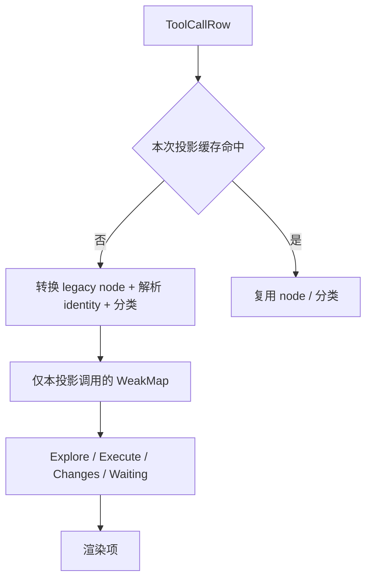

# Assistant 工作项投影的单次分类缓存

## 规则、所有者与边界

`buildAssistantWorkRenderItems`（`packages/ui/src/v4/conversationAssistantWorkItems.ts`）是助手工作区的纯派生投影。它拥有本次投影内的工具行分类派生数据；输入 rows、行身份和渲染项事实仍由上游 conversation turn 投影拥有。本规则只允许投影函数内部复用派生结果，不引入跨调用缓存、第二事实来源、异步状态或跨包新入口。

对进入 Explore、Execute、Changes 或“等待命令的 streaming/running shell”分类判定的每个 `ToolCallRow`，同一次投影最多转换一次 `toolCallRowToLegacyNode`，最多解析一次 `resolveToolCallIdentity`。分类结果和普通分组子节点必须复用该派生结果。CUA 分组继续由 `prepareCuaGroups` 拥有自己的节点转换，本规则不改变其所有权。输入行不被修改，结果对象不得跨投影复用。

分类语义保持不变：

1. Explore 与 Execute 的判定沿用 `isExploreToolCall` / `isExecuteToolCall` 的现词表和命令解析；
2. Execute 仍然等价于 shell 且不等待命令且不是 Explore；
3. Changes 仍然等价于 identity family 为 `file-write`；
4. CUA 分组、Agent/subagent 配对、reasoning 可见性和阶段尾状态保持原事件顺序；
5. 分类结果只决定渲染项形状，不改变渲染项 key、子行顺序、状态映射或节点字段。

## 修复依据

旧实现对同一行在 Explore 判定、Execute 判定和等待命令判定中分别重新转换 legacy node；`isExecuteToolCall` 还会再次解析身份，并在内部调用 waiting 和 Explore 判定时继续重复解析。流式期间每帧重建投影，重复推导按行数和帧数线性放大。改为单次投影内的派生缓存后，18 个非分组 execute 行的 legacy 转换实测从 36 次收敛到 18 次，身份解析实测从 72 次收敛到 18 次。

## 验收

1. `packages/ui/test/performanceAssistantWorkRowConversion.test.ts` 用冻结旧算法作 oracle，在结构化场景和 seeded 随机负载上逐项等价。
2. 同一回归锁定 18 行预算负载的转换与身份解析上限；修复前实测 36 次转换和 72 次身份解析并失败。
3. 专用入口 `scripts/ci/ui-assistant-work-row-conversion-regression.test.mjs` 在 project sandbox 内运行真实 Vitest，并断言 14 项全部执行、无 skipped。
4. 修复后对派生 helper、投影接线、分类函数、回归及新增 spec 做定点检查；根 typecheck、lint、架构与格式由主代理统一执行。

## 验证边界

回归是纯内存派生，不读写用户数据、不联网、不触碰真实 `.zcodium`。操作数量是确定性计数，不换算整机或浏览器收益。未执行 Electron、真实浏览器或移动端验收。
