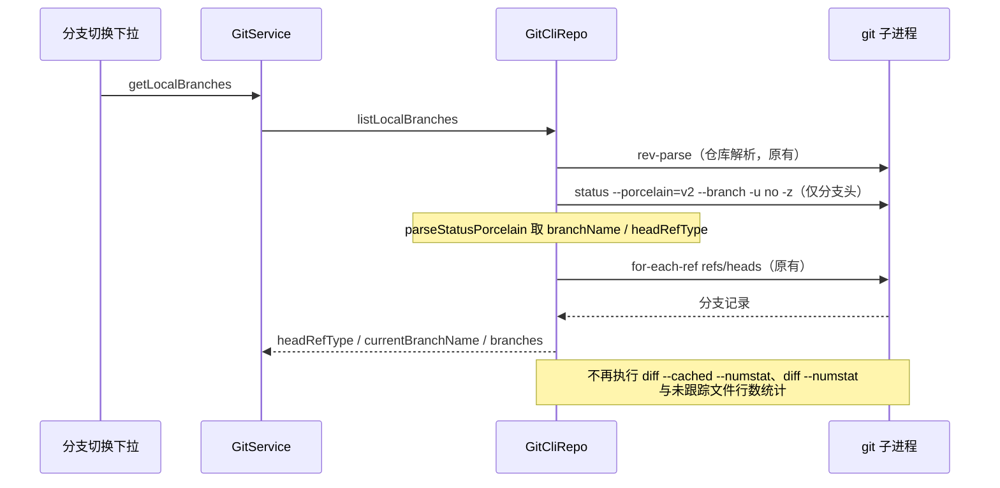

# 文件服务重扫：分支列表停止复用全量状态快照

## 范围与基线

继续 `packages/services/src` 文件系统 / Git / workspace 服务的性能重扫；保留既有未提交改动，不修改 automation / session / model-provider 相关文件，不提交、不推送、不打包，不启动应用或真实 Agent，不调用模型 API，不使用真实用户数据。

freshness 与 `corepack pnpm architecture:check --changed` 由父代理执行（main 与 origin/main 同步，0 违规）。已生成并读取 `services` 与 `source-server-workspace` 受控上下文，通读 `file` / `fs` / `fileWatcher` / `git` 服务及既有 spec 与回归。Node 使用父代理固定的项目内 24.14.0（`.run-logs/project-only-validation/main-toolchain-6g2BTX/node-v24.14.0-win-x64/node.exe`），不更改环境。

本轮只改 Git 仓库层一个内部方法，不改变任何对外接口、状态所有者或跨模块依赖。

## 已确认代码路径

`GitCliRepo.listLocalBranches`（`packages/services/src/git/repo/gitCliRepo.ts`）为了取得 `summary.headRefType` 与 `summary.branchName`（后者仅用于给 `parseBranchRefRecords` 标注当前分支），调用了完整 `getStatus`。`getStatus` 一次刷新包含：

1. `git rev-parse --show-toplevel --show-prefix --absolute-git-dir --git-common-dir`（仓库解析）；
2. `git status --porcelain=v2 --branch --untracked-files=all -z`；
3. `git diff --cached --numstat -z --find-renames --`；
4. `git diff --numstat -z --find-renames --`；
5. `buildUntrackedStats`：按并发 4 逐个 `stat` + 限量读取所有未跟踪文件（单文件至多 1 MiB）只为数行数。

其中 3、4、5 的结果（stagedStats / unstagedStats / untrackedStats）从不进入 `GitLocalBranchListResult`。调用方是分支切换下拉（`useGitBranchSwitcher.loadBranches` → `gitService.getLocalBranches`）：用户每打开一次分支列表，就重复付出两次全仓 numstat diff 与全量未跟踪文件读取。注意 `reuseInFlightRequest` 只在请求在途时合并，完成后即删除，因此不存在跨调用的结果缓存可以辩解这些开销。

这是可复现的多余 IO，不声称真实仓库的端到端耗时或整机提速比例；本轮只证明命令序列与文件读取路径被消除。

## 设计与不变量

- 唯一所有者不变：`GitCliRepo` 仍是仓库状态与分支列表的唯一生产者；不新增缓存、队列、后台任务或第二条状态路径。
- `listLocalBranches` 只读取 HEAD 分支名与类型：复用同一条 `git status --porcelain=v2 --branch` 分支头命令，但显式 `--untracked-files=no`，再由既有 `parseStatusPorcelain` 解析。分支头记录（`# branch.head` / `# branch.oid`）与未跟踪模式无关，解析结果与全量 status 的分支字段逐位一致。
- 非仓库与 Git 不可用是两种不同降级，命令计数不同：非仓库（`rev-parse` 判定 not a repository）只执行仓库解析一条命令后早退；Git 二进制不可用（`resolveGitBinary` 返回 null）在仓库解析前就降级，**不执行任何命令**；`resolveGitBinary` 抛出时错误原样向上传播，不吞成空列表。三者早退形状均保持 `{ headRefType: "branch", currentBranchName: null, branches: [] }`（抛出除外）。
- `git for-each-ref refs/heads` 及其格式、当前分支标注规则（`headRefType === "branch"` 时才传分支名）、错误语义（`ensureGitCommandSucceeded`）不变。
- 不触碰 `runGitStatus` 的目录折叠降级（`collapsedUntrackedRepoRoots`）：轻量读取固定 `-u no`，永不触发折叠记忆，也不消费该记忆。
- 不改变 `getStatus` / `refresh` / checkpoint / diff / 提交 / 推送等任何其它路径的命令序列；桌面 continuous 与手机 replayable 链路、RPC 接口与 UI 交互均不变。



## 验收方案

先添加回归（node:test + 假 `GitCommandProvider` 记录命令序列，测试全程 hermetic，不写文件系统、不启动真实 git）：

- 旧实现：`listLocalBranches` 会执行 `diff --cached --numstat` 与 `diff --numstat`，且 status 携带 `--untracked-files=all`——回归必须因此失败。
- 修复后：命令序列恰好为 `rev-parse` → `status`（`--untracked-files=no`）→ `for-each-ref`；无任何 `diff` 命令。
- 行为不变：分支、当前分支标注、detached HEAD、非仓库降级的返回值与旧实现一致（同一夹具下对比期望值）。
- 公开边界（合成夹具，不启动真实 git）：unborn HEAD（`# branch.oid (initial)` 且有 `# branch.head`，for-each-ref 空输出）返回分支名与空分支列表；Git 二进制不可用（`resolveGitBinary` 返回 null 或抛出原错误）分别降级为空列表与原样拒绝；`status` 或 `for-each-ref` 失败必须拒绝，不吞错误、不返回半成品。

回归经 `scripts/ci/source-test-runner.mjs`（`runSourceTests` + `createProjectTestSandbox`）在项目内 Node 24.14.0 下执行；沙箱把 HOME/TEMP/APPDATA 等全部重定向到 `.run-logs/project-only-validation/<label>-*` 并以 `--permission --allow-fs-write=<sandbox>` 限制写入，本测试不产生任何写入。随后执行 `corepack pnpm architecture:check --changed`。全量 typecheck / lint / 格式检查由父代理统一执行。

## 复现与修复结果

- 旧实现新增回归 **2 失败 / 1 通过**：主用例实测命令序列为 `rev-parse → status → diff → diff → for-each-ref`（两次全仓 numstat diff），detached 用例同样实测 2 次 diff；非仓库降级用例通过（只执行 `rev-parse`）。失败均来自多余 IO 断言，返回值断言在旧实现下即通过，证明行为未变。
- 修复后回归 **3/3 通过**：命令序列恰好 `rev-parse → status(--untracked-files=no) → for-each-ref`，无任何 `diff` 命令；分支、当前分支标注、detached HEAD、非仓库降级返回值与旧实现逐字段一致。补齐 3 项公开边界（unborn HEAD、Git 二进制不可用、status / for-each-ref 失败拒绝）后共 **6/6 通过**，回归入口以确切计数 6 断言。
- 操作计数：打开一次分支列表的 git 子进程由 **5 → 3**（消除 `diff --cached --numstat`、`diff --numstat`），且不再按未跟踪条目逐个 `stat`/限量读文件（旧路径经 `buildUntrackedStats`，单文件至多 1 MiB、并发 4）。这里只计命令与读取路径，不测量真实仓库耗时。
- 既有 Git 回归未受影响：`gitCommitPathMembership` + `gitCommandTimeoutCleanup` 共 **20/20 通过**。
- 架构复检 `corepack pnpm architecture:check --changed`：violations / baseline / new = **0 / 0 / 0**。
- 唯一生产文件为 `packages/services/src/git/repo/gitCliRepo.ts`，**新增 33 行 / 删除 9 行**；另新增本 spec、`packages/services/test/gitLocalBranchListIo.test.ts` 与 `scripts/ci/git-local-branch-list-io.test.mjs`。无状态所有者、跨模块依赖、公共接口或持久化变更。
- 主代理整合后实际执行全量 corepack pnpm typecheck 与 corepack pnpm lint：类型检查通过，Lint 为 0 错误及 2 条开工前已有警告；架构检查为 0 违规。
- 未验证限制：未在真实仓库上测量端到端耗时或未跟踪文件读取字节数；未启动真实 git / 桌面应用 / Agent；不将合成夹具的命令计数换算为真机耗时收益。

可重跑命令（仓库根目录，项目内 Node 24.14.0）：

```powershell
.run-logs/project-only-validation/main-toolchain-6g2BTX/node-v24.14.0-win-x64/node.exe --test scripts/ci/git-local-branch-list-io.test.mjs
corepack pnpm exec vitest run --config packages/ui/vitest.config.ts --maxWorkers=1 packages/services/test/gitCommitPathMembership.test.ts packages/services/test/gitCommandTimeoutCleanup.test.ts
corepack pnpm architecture:check --changed
```
