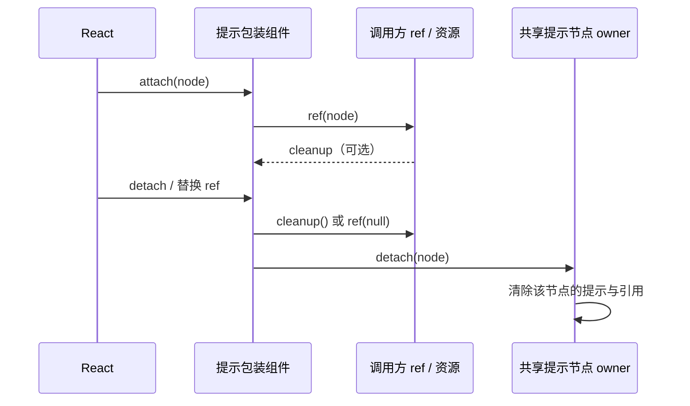

# 多轮性能优化的正确性复核

## 范围

接续第 1–14 轮优化及此前中断的审查，检查性能收益是否保留原有语义、资源回收和桌面/手机边界。保留其他本地改动；只运行隔离本地测试，不打安装包、不启动已安装应用或真实 Agent、不访问付费 API，不提交或推送。

基线检查：main 与 origin/main 同步；architecture violations / baseline / new 均为 0。读取 ui 受控上下文、React 性能技能和 DESIGN.md。Node 当前为 24.18.0，与 mise.toml 的 24.14.0 有差异，不安装或修改本机运行时。

## 提示组件的 ref 生命周期

已发现 `CodeBlockControlHint` 和 `ControlHintTooltip` 转发 callback ref 时忽略返回值，丢失 React 19 的清理函数。静态渲染测试不能覆盖此问题。

- React 继续唯一拥有 DOM ref 的挂载、替换和卸载顺序。组件只组合已有 ref，不复制资源状态。
- 返回清理函数的 ref 在 detach 时调用该函数；不再对该 ref 额外调用 `ref(null)`。
- 未返回清理函数的 callback ref 仍收到 `null`；object ref 仍清空 `.current`。混合使用时各自遵守对应规则。
- 原 ref 不变时包装组件的组合 ref 身份稳定；共享提示路径的普通 rerender 和提示打开/关闭不能反复注册按钮资源。独立 Radix asChild 路径在当前依赖实现中会重新组合最终 DOM ref，必须正确配对清理，不把这类合法 detach 当作泄漏。
- 共享提示的 detach 同步清理自身节点引用；原按钮回调抛错时也执行该清理，异常继续交给 React。
- StrictMode 的 attach → cleanup → attach 可重入；最终卸载后活跃资源为 0。
- 共享提示保留原按钮事件、preventDefault 的打开抑制、键盘焦点、既有 aria-describedby，以及每个作用域至多一个提示根的预算。
- 状态所有者仍是 `CodeBlockTooltipScope`；组合 ref 工具位于 ui/lib，仅处理 React ref，不持有跨组件缓存或新增订阅。不改变 service、协议或 desktop-continuous / web-remote-replayable 的传递边界。

## 验收

1. 先对旧实现运行浏览器失败回归：共享提示、无作用域的兼容路径和通用提示，覆盖 callback cleanup、旧 callback、object ref、混合 ref、StrictMode、ref 替换与卸载。
2. 真实 React/DOM/Radix 验证事件与焦点；只使用合成按钮和资源计数，随机 loopback 端口、独立临时浏览器 profile，阻止外站页面请求，结束关闭并清理自己的资源。
3. 复跑现有性能单测及浏览器回归，核对原有工作预算、缓存失效、取消和连接释放断言。执行根 typecheck、lint、架构和定点格式检查，记录真实失败与未验证范围。

## 浏览器回归启动隔离

四个 Vite 浏览器入口（`performance-find-browser`、`performance-round11-find-browser`、`performance-round14-output-browser`、`performance-search-browser`）曾在 `page.goto` 阶段超时。故障与自动依赖发现和共享缓存的启动过程相关；组合启用显式依赖并隔离缓存后复测通过，未单独分离各因素。不得通过提高导航超时或更改产品交互断言处理，也不将此测试启动故障归为产品缺陷。

- 按各 HTML/TSX fixture 的依赖图显式配置 `optimizeDeps.noDiscovery: true` 与 include：`react`、`react-dom`、`react-dom/client`、`react/jsx-runtime`、`react/jsx-dev-runtime`。新增 fixture 依赖时，先检查依赖图并同步更新 include。
- 每次入口运行以 `mkdtemp` 在系统临时目录下创建独立根目录，Vite `cacheDir` 放在该根目录内；如测试创建持久浏览器 profile，也放在该根目录内。服务继续绑定随机 loopback 端口。
- 外层 `finally` 负责关闭浏览器与 Vite server，并在递归删除前核对解析后的临时根直接位于系统临时目录且具有该测试专用前缀。即使 server、浏览器启动或断言抛错，也执行同一路径校验和清理。
- 页面导航超时、产品功能与原有断言保持不变；只隔离测试启动依赖和缓存。

## 结果

旧实现的 30 个生命周期组合中，14 个涉及 cleanup ref 的场景失败；普通 callback/object ref 的 16 个场景通过。修复后 30/30 通过，覆盖共享提示、独立兼容提示、通用提示，普通/StrictMode、child/trigger 混合 ref、同节点换 ref、重渲染和卸载。另在 390 / 1280 像素宽度验证真实鼠标/键盘交互、原事件、preventDefault、aria-describedby 清理及单提示根预算。pageerror / 外站页面请求均为 0。

两个组件统一使用 ui/lib 的 `composeRefs`，同时删除原来重复的 `setRef` 实现。共享提示的节点随 React cleanup 释放，减少一个保存已挂载节点的 ref。没有改变业务状态所有权、协议、依赖和后台计时器。相对此次续接时的源码，生产改动共 3 文件，净增 10 行。

两项单测额外检查一方 cleanup 抛错时另一方仍释放，且异常向上传递。测试夹具首跑曾遇到 Vite 自动依赖优化产生不匹配模块导出，改为夹具的显式依赖列表后完成旧实现复现；该夹具故障不计为产品缺陷。当前 Radix Slot 的合法 ref 重挂载与共享提示的稳定 ref 分开断言，未修改依赖以掩盖这一区别。

## 复核覆盖

| 改动类别                     | 本次重点核对的边界与证据                                                                                               |
| ---------------------------- | ---------------------------------------------------------------------------------------------------------------------- |
| RPC 请求、订阅与连接生命周期 | requests 单一登记、同步取消/释放重入、迟到服务结果、订阅失败、WebSocket/stdio 关闭顺序；内存协议和连接回归             |
| 二进制队列与编码             | FIFO 消费释放、跨 chunk 游标、ACK 重放、序列化失败本地终结；字节一致性与复制预算回归                                   |
| 会话增量、分组与问题目录     | 冻结输入与参考归约对照、双 delivery profile、rewind/epoch 失效、同 rowId 替换、插件 pin 与时钟锚点、目录不扩张正文窗口 |
| 查找、分享和派生缓存         | 空查询、重复命中、正文替换、注释投影、主题/内容变化、原顺序及输出指纹对照                                              |
| 文件索引和 Office 预览       | 规则指纹、identity/Host 切换、取消后停止后续分块、真实 Worker、二进制字节一致与文件变化检测                            |
| 设置、技能、进程和桌面资源   | 服务/平台订阅隔离、引用计数、有限 IO、深进程链与祖先归属、图标缓存、guest listener 释放                                |
| 终端与后台输出               | 关闭后不启动迟到 shell、共享握手完成后不读取过期目标、桌面/手机两种握手模式                                            |
| 聊天代码片段                 | 240 围栏、复制/折行、稳定原文与 Range、可见性订阅、离屏释放、共享提示与原生 ref 生命周期                               |

除上述两处 ref 清理缺陷外，未在这些复核和已执行回归中确认新的行为错误。测试范围为受控本地场景，不据此宣称不存在其他缺陷。

## 验证记录

- 串行整合 Vitest：67 文件 / 401 项通过。包含全部 `packages/ui/test/performance*.test.ts`、投影行引用共享、ref/可见性、terminal/Git、rpc/server、client、桌面 guest/dialog/servicePipe、手机协议与生命周期、远控清单转换。
- 补充 `packages/ui/src/v4/useConversationProjection.test.ts`：1 文件 / 2 项通过，验证同 sessionId 跨 Host 和失效 prewarm 代际；本次合计 68 文件 / 403 项 Vitest 通过。
- 根 `corepack pnpm typecheck` 通过；根 `corepack pnpm lint` 为 3044 文件、0 warning / 0 error。架构 violations / baseline / new 均为 0；未更新 baseline。
- 根 lint 默认忽略 ai-elements，因此还用只扩展根配置、清空 ignorePatterns 的现有 `apps/zcode-cli/oxlint.config.json` 定点检查 3 个生产文件：0 warning / 0 error。没有修改 lint 配置。
- 新增 `performance-review-hints-browser.test.mjs`：1/1 通过，包含上述 30 个生命周期组合与两种视口交互。
- 既有 9 个浏览器入口全部通过：`performance-browser`、`performance-chat-code-browser`、`performance-fetch-browser`、`performance-search-browser`、`performance-find-browser`、`performance-round11-find-browser`、`performance-round12-subagents-browser`、`performance-round13-settings-browser`、`performance-round14-output-browser`（均在 scripts/ci，后缀 `.test.mjs`）。与新增入口合计 10 个浏览器回归入口通过。
- 240 围栏检查：完整原文保留，文件查看器/Shadow DOM/离屏高亮均为 0；500 个查找命中创建 500 个 Range；长正文补页时规范化 3 次；子任务卸载后后续分页 RPC 为 0；后台输出 16 个握手取消组合中，过期查询为 0。
- `application-icon-cache.test.mjs`：5/5 通过，fake Electron，不启动桌面应用。
- `corepack pnpm --dir apps/zcode-cli/packages/bootstrap typecheck` 本次通过。额外 TypeScript CompilerHost 对照：当前与将 4 个待审 CLI 生产文件替换为 HEAD 内容的内存基线均为 0 诊断；没有修改磁盘上的源码。
- Desktop Main 独立类型检查仍未通过：当前 60 / 同依赖下 3 个待审 Main 文件的 HEAD 内存基线 60，按文件、错误码和消息多重集比较，忽略行列变化，新增 0 / 移除 0。根 typecheck 不包含 Main，不能把根通过写成 Main 通过。
- `corepack pnpm --dir apps/zcode-cli lint` 未通过：1433 文件、58 warning / 80 error。四个待审旧文件加新增目录文件定点对照为基线 3 error / 5 warning，当前同为 3 / 5；新增文件无诊断。错误均为原先已超过 400 行的文件：HEAD server 883 行、publisher 907 行、gateway 2872 行，当前分别 885 / 933 / 2886 行。除行数数值和位置外规则与消息一致；其他 CLI 文件未被性能改动修改。没有为通过 lint 拆分这些已有大型模块或放宽规则。

较早浏览器脚本默认共享开发用 Vite cache；本次执行临时副本只注入独立临时 cacheDir 和随机 loopback 端口，断言与产品入口保持原样。测试完成后成功删除 5 份副本和本次缓存。已有独立缓存的脚本直接执行原文件。基线 lint 的临时源码副本也已清理，未回滚工作区进行对照。

没有启动已安装 ZCodium、真实 Agent 或付费 API，没有读取用户业务数据、打安装包、触发 Actions、提交或推送。没有做真实长会话整机 CPU/内存对照、macOS 或实体手机测试，不给出整体提速比例。Node 24.18.0 与仓库固定 24.14.0 的差异仍保留在验证边界中。

## 2026-10-18 全量待提交变更复核

本节接续以上历史记录，复核基线为 `82ab95f`，范围为全部待提交源码、规格、测试与性能证据。用户本轮授权在审查、修复和验证后提交并推送到 `No-ni/ZCodium`；不触发安装包构建或 Actions。三个 Luna 6 Max 子代理分别检查 RPC、services、UI/Web，主代理交叉核对 CLI、shared、desktop、接口与验证结果。

改动有明确的局部用途：限制重复扫描和复制、减少长会话派生及渲染工作、正确释放连接和监听资源，以及恢复手机远控历史链路。默认上下文、WebFetch 与合同场景的提示调整属于独立产品规则，不计为性能收益。测量报告保留当时的数据与实现状态，补充后续规格链接；四份证据 JSON 仅格式化，解析值前后相等。没有足够依据宣称全部路径或整机性能都得到提升。

本轮补齐两处手机远控边界，并先更新远控规格及失败回归：

- 最后 workspace 关闭后发送空 workspace/task 清单，IPC scope 来自当前远控 status snapshot；Hook 只保存一份完整状态。Edge 浏览器先在新增空清单断言处失败，修复后通过，且验证 path 与 identity 均来自 status scope。
- 旧 Claude 历史缺失 session 的回退及空快照回填都透传同一 `remoteSessionId`。新增用例在旧实现上得到两次 `undefined`，修复后恢复测试 3/3 通过。

同时移除 `resumeTask` 新增但无消费者的 `clientMode`：恢复只处理已有会话，后续订阅选择 replayable，发送输入继续携带原有 client mode。协议回归先失败后通过；未增加路由状态或回退分支。文件搜索规格另明确旧 Host 忽略 `matchMode: "terms"` 时可能漏项或保留旧排序，需要升级 Host 才能满足完整规则。

最终验证与已知限制：

- 根 `corepack pnpm typecheck`、`corepack pnpm lint`、`corepack pnpm architecture:check --changed` 及 `corepack pnpm verify:pre-push` 通过；根 Lint 为 3065 文件、0 warning / 0 error，架构 violations / baseline / new 均为 0。
- 整合 Vitest 为 91 文件 / 654 项，653 项通过，唯一失败为 Windows 下既有 `sharedConfigMutations.test.ts` 技能开关路径问题；写入路径与 HEAD 相同，未改动该缺陷。全部新增/修改的 Vitest 用例通过；移除无效恢复参数后，手机协议、会话生命周期与清单转换的 3 文件 / 32 项另行复验通过。
- Node test 共 26 项通过：上下文与 WebFetch 15 项、图标缓存 5 项、消息协议映射 3 项、导入历史恢复 3 项。
- 14 个浏览器回归入口的功能断言通过，包含手机真实入口与 LAN/Channel RPC 夹具、窗口清单同步、长会话、查找、代码片段、Shiki、设置和取消时序。四个首次导航超时的 Vite 入口已按上文隔离启动配置，修改后的原始脚本复验通过。其余早期共享开发缓存的入口使用仅注入独立缓存和随机 loopback 端口的临时副本，保留产品代码和断言；副本及本轮缓存已清理。
- CLI 全包 `typecheck` 仍因缺少 `@zcode/tui` 声明等失败；CLI package 当前与 HEAD 内存基线均为 68 诊断，新增 0。Desktop Main 独立类型检查当前与 HEAD 均为 60 诊断，新增 0；根检查不包含 Main。
- CLI 全包 Lint 仍为 58 warning / 80 error；11 个待审 TypeScript 文件的定点基线与当前均为 3 error / 5 warning，除行数与位置外相同。没有放宽规则或拆分无关旧模块以隐藏失败。
- 改动文件格式检查与源码空白检查通过。留存的 `source-comparison.patch` 中七处空行上下文按 unified diff 格式保留前导空格，单独解析验证通过，不将这些证据格式当作源码尾随空白清除。Node 实际为 24.18.0，仓库固定 24.14.0；未验证 macOS、实体手机或已安装桌面程序，也未重做整机性能 A/B。

修复后未确认新增阻塞问题。以上结论限于本次源码审查、基线对照和受控回归，不把既有失败或未执行的实机验证记为通过。
