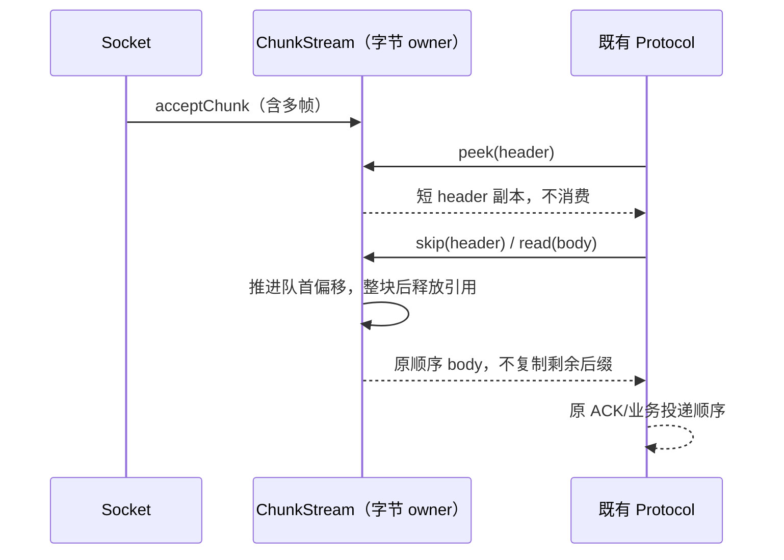

# 第十轮：RPC 粘包消费的复制工作量

## 规则与所有者

ChunkStream 是 socket 输入字节队列的唯一所有者。acceptChunk 追加字节，peek 不消费，read/skip 只消费指定前缀；不足时不改变队列。零字节操作是空操作，空输入不占队列项。不得为了消费短前缀而复制整个未消费后缀，skip 不需要复制丢弃的数据。总复制工作量随实际读取/预览的字节数增长。

使用队首偏移记录部分消费，整块消费后一次清除块前缀。原始块完整读取仍返回原 VSBuffer；部分读取与 peek 返回独立字节副本，调用方修改输出不污染剩余队列。VSBuffer.slice 的公开复制语义保持。输入块进入 transport 后由队列持有，在消费前外部不得修改其字节；不引入跨连接缓存。

SocketProtocol/PersistentProtocol 仍只在完整 header/body 到齐后消费，空 body、粘包、分片、ACK 和重连顺序保持。desktop-continuous 和 web-remote-replayable 继续使用原帧/恢复契约，业务 owner、workspaceIdentity、lease、CommandInbox 均不变化。

## 验收

先在旧实现通过观测 Uint8Array.slice/set 实际请求复制的字节数复现失败：一个块中至少 1,024 条小消息依次 read；SocketProtocol/PersistentProtocol 真实解析同样粘包。复制预算应为输入大小的常数倍，不能随消息数再乘一倍。另覆盖跨块且已有偏移的 peek/read/skip、失败读取不推进、完整块引用、部分结果修改隔离和已消费块释放。运行既有第七轮 RPC 队列/分片/ACK 回归、移动协议回归和根 typecheck/lint/architecture。

字节预算是合成负载下实际 slice/set 复制请求量，不换算整机提速。此项无 UI 交互改动，不新增 UI E2E；协议回归使用受控 socket，不代表真实手机或完整 Electron 长会话测量。

## 实施与证据

- 原生产代码六项回归中五项失败：32 KiB 块按 32 字节读取 1,024 次共复制 16,793,568 字节；两个协议解析 1,024 个 17 字节帧各复制 17,843,196 字节；64 KiB 块 skip 1,024 个 32 字节前缀复制 50,348,032 字节；1,000 个空输入保留 1,000 项。字节内容与输出隔离场景原实现通过。
- 修复后 read 复制预算不超过 32,768 字节，两个协议各不超过 34,816 字节，skip 复制为零，空块不保留。原完整块读取引用保持，部分读取和预览仍给独立副本；只在块完整消费后释放原输入引用，因此部分消费时保留原块直到其余字节被消费。
- 目标六项加第七轮队列/ACK/分片八项共十四项通过；既有确定性混合字节队列模型涵盖随机跨块 peek/read/skip。没有修改 VSBuffer 的公开 slice 语义或协议帧字段。
- 本轮相对开工快照仅 `protocol.ts` 新增 30 行、删除 28 行，净增 2 行，保留原第七轮批量前缀清理。review 与根检查统一记录于本轮总规格。
