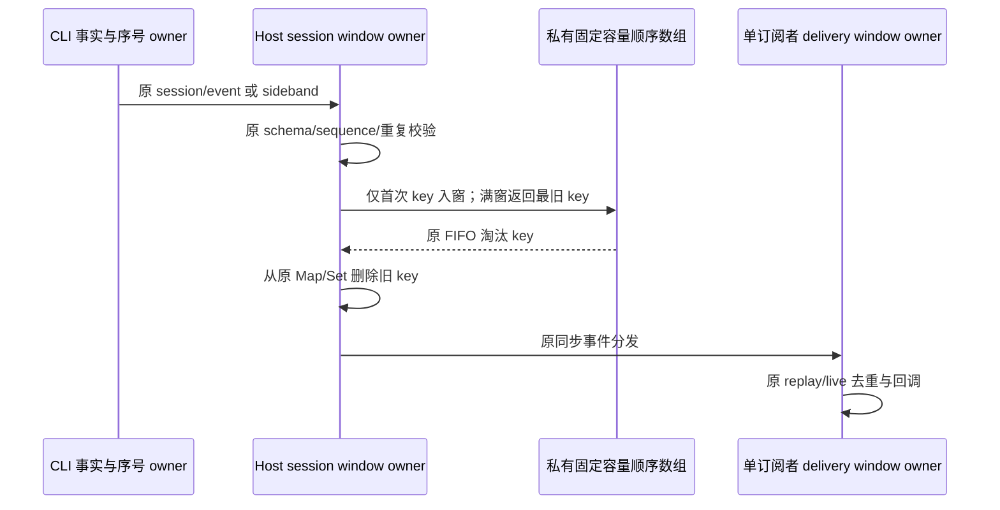

# 第十轮：事件去重窗口的常量成本淘汰

## 规则与所有者

Host 的 `zcodeAgentService` 继续唯一拥有按 workspace/session 隔离的兼容补号和 live 去重窗口；每个订阅者拥有自己的 replay/live 去重窗口。`cuaOperationTurnTracker` 继续唯一拥有 sideband 已见事件与已结束 turn。CLI 的序号、会话事实及持久化不变。

当前窗口已满后，三条 session 路径每个新事件对 10,000 项顺序数组执行 `shift`；CUA 已见事件和已结束 turn 分别对 8,192/2,048 项执行同类操作。把顺序存储换成同 services 模块内部的固定容量环形数组，每次满窗只覆盖最旧槽位并前进游标，再从现有 Set/Map 删除对应 key。该 helper 仅持有淘汰顺序，不保存第二份会话事实，不新增公开服务接口。

- 精确保留各窗口容量、首次插入 FIFO 和重复 ID 不刷新顺序；淘汰后同 ID 可再次接收。兼容 seq=0 的重复 ID 保留已分配序号；正序号仍更新单调基线。
- CUA workspace 清理按环形数组的逻辑顺序重建保留项，仅移除目标 workspace 的 key；全清重置数组与游标。保留事件去重、迟到事件和 retired turn 防复活规则。
- session/subscribe replay 仍按 seq/timestamp 排序且只投递给当前订阅者；建立订阅前的 live 缓冲、释放时序、dispose、Host restart、owner/lease 和远端 identity 防护不变。
- Desktop continuous 和 mobile replayable 复用原服务入口，未增加缓存 TTL、定时器、异步批处理、持久化或协议。

## 验收

先用真实 tracker 和 service 入口输入超过窗口容量的事件，对命中特定 event key 的 `Array.shift` 次数设置零预算，在旧实现证明失败。计量只表示生产算法调用次数，不将 JavaScript 数组语义推断为 V8 的实际引用移动或整机耗时。

验证多个环绕后的精确 FIFO、重复不刷新、窗口边界、兼容补号与正序号基线、两个订阅者 replay 隔离和 live 去重、不同 workspace/session 隔离、workspace 清理后保留项顺序和全清后重新接收。helper 另对独立朴素 FIFO 模型进行确定性序列对照。执行目标 Vitest、定点 lint/格式与架构检查；主代理统一执行根 typecheck/lint。不提交、推送或打包。

## 实施证据与限制

- 回归夹具先补齐 process manager 的 `getClient`，随后在未修改的生产源码上正式基线为 2 失败：10,000 个 CUA 完成事件调用 `shift` 9,760 次；12,000 个 seq=0 session 事件在兼容补号、live 和单订阅者窗口共调用 6,000 次。环形顺序数组下两项均为 0。
- Node 24.14.0 下新回归 8/8，通过 1/2/7/29 容量、各 1,500 次确定性 push/remove/clear 的独立 FIFO 对照；真实入口覆盖 10,000/8,192/2,048 的精确容量、重复不刷新、多个环绕、按 workspace 清理后的保留顺序、全清、seq=0 与正序号窗口差异、replay 订阅隔离及 live 缓冲去重。旧 schema 要求 eventId 非空，淘汰判断改为 undefined 与这一约束一致。
- 定点 lint 0 warning/error，目标格式化通过，架构 baseline 0/new 0。本轮服务源码相对开工快照净增 21 行（新增 helper 37 行，service 净减 5 行、tracker 净减 11 行）。此前未提交改动保留，快照位于临时目录，未提交或推送。
- 作为跨项只读 review，同时检查 RPC headOffset/consume 与 VSBuffer.slice 的部分输出隔离、整块引用、跨块偏移、失败不消费与释放语义，未发现新增问题；独立执行本轮 services、RPC copies 与第七轮 RPC 目标回归，22/22 通过。完整 typecheck/lint 由主代理统一执行。
- 没有新用户交互，不增加交互 E2E。本机未运行真实长会话或 Desktop/mobile 整机基准；service 测试替换进程与数据库边界，驱动真实服务事件分发和 tracker。调用次数用于证明消除生产算法里的逐事件 shift，不表示实际 CPU 指令、引用搬移字节、堆峰值或用户延迟比例。
