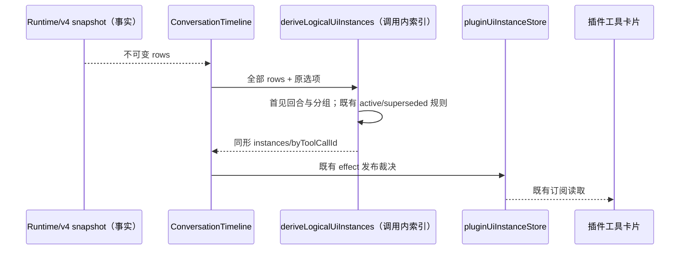

# 第十轮 UI 性能：插件卡片的回合与替代成员查询

## 规则、所有者与边界

`ConversationTimeline` 对每次不可变 rows 更新调用 `deriveLogicalUiInstances`，包括没有插件卡片的普通流式会话。原函数用数组 `includes` 对全部行的 turnId 去重；同一逻辑 surface 的成功工具越多，每行对 superseded IDs 的成员查询也越多。两者都会随历史规模产生平方级扫描。

- Runtime/v4 snapshot 仍拥有会话事实；Timeline 的既有 memo/effect 与 `pluginUiInstanceStore` 仍负责派生裁决和发布。仅修改 `plugin-ui/domain` 的纯函数，不新增状态 owner、跨调用缓存、IO 或公开接口。
- 全部行（含没有插件卡片的回合）按首次出现顺序建立 turnOrder。最近回合继续使用原 `slice(-(autoExpandTurns ?? 3))`，保留零、负值、小数、NaN 和 Infinity 的既有转换语义。
- 分组仍使用原 `resolvePluginUiLogicalScope`，保留 plugin/server/resource/surface/widgetSessionId/权限范围隔离、首组顺序及组内行顺序。默认按 toolCallId 独立的调用不能合并。
- active 仍为最后一次成功且非 isError 的行；无成功时为最后一行。superseded 数组仍只含其他成功行并保留顺序、重复 ID 及重复对象的原身份比较语义。running/error/cancelled/isError 不替代成功结果；同 ID 的原成员判断也保持一致。
- 回合、最近回合和 superseded 成员查询改用仅活于本次调用的无原型字符串索引，避免随数组长度重复扫描；输出数组和普通对象的形状不变。特殊字符串键不得碰撞对象原型；`byToolCallId` 对 `__proto__` 也必须建立可枚举、可写、可配置的自有属性，不得触发原型 setter 或丢失该行裁决。输入不可修改，后续调用必须重新从本次 rows/选项派生。
- 没有沙箱生命周期、手动固定、失败展示资格、owner/lease、identity、协议或 Desktop continuous / mobile replayable 变化；没有新增交互规则。

## 事件顺序

## 验收

1. 在未改生产代码时新增工作量回归：2,000 个不同普通回合、同一 surface 的 1,000 个成功工具、以及 `autoExpandTurns: Infinity`。测试仅在同步函数调用期间给目标字符串的原 `Array.includes` 接收者套计数 Proxy，统计真实数字索引读取；以线性预算证明旧算法失败，不使用耗时断言。
2. 使用原算法生成完整输出黄金快照，覆盖混合行/状态、首次回合顺序与交错回合、默认与非常规选项、显式 surface、widget 权限隔离、独立调用、重复 ID/对象、特殊字符串 ID 与无插件/空输入。
3. 冻结输入及选项，核对完整输出和成员裁决；替换 rows、改变状态、撤回旧行或追加新回合后重新派生，不能保留旧结果。
4. 运行目标 Vitest 与现有 plugin-ui 相关回归，定点格式/lint/架构检查；根 typecheck/lint 由主任务统一执行。纯计算等价优化不增加交互 E2E；工作量和微基准不宣称 Electron 整机加速。

## 上游无插件快速返回增量（32ad025b）

- fork 已包含线性回合去重、recentTurns 与 superseded 成员索引，本次不重复替换这些算法。仅先筛出既有 `isPluginUiToolRow` 定义的候选行：没有候选时返回新的同形空结果，不读取任何 turnId，不建立全部回合目录；有候选时仍按全部 rows 的首见回合顺序裁决，并只对候选执行既有分组。
- 判定仍是 `toolCall + mcp_tool + ui !== undefined`；无效／空 ui 仍由既有后续门禁排除，不重定义资格。返回值不复用可变全局 EMPTY 对象，保持调用间独立。
- domain 保持纯函数、调用内数组／无原型索引和既有公开契约；不新增 cache、IO、状态 owner、插件发布路径或沙箱生命周期。原事件顺序、手动固定、错误门禁、替代插件与所有 `slice` 数值选项语义保持。
- 先补 guard getter 工作量测试：2,000 行无插件混合投影只读取一次必要的 kind/display/ui，不触碰 turnId/text；原代码应失败。另用访问计数验证候选路径不对普通行执行第二遍插件判定，并与原完整黄金快照及替换／撤回／状态回归合跑。不用耗时阈值或重复宣称此前线性收益。

## 实施与验证

- Node 24.14.0 下先运行原生产代码：目标 6 项中 3 项兼容性通过、3 项工作量失败。普通 2,000 回合、同 surface 1,000 次成功及 1,000 个全展开的独立插件回合，native includes 的实际数组元素读取分别为 1,999,000 / 502,498 / 1,000,000；修复后这三类重复扫描均为 0，线性预算通过。
- 原算法生成的完整输出黄金快照覆盖 10 组选项与混合行；修复后逐项不变。冻结输入、特殊字符串、重复对象与 ID、错误/取消/isError、widget 权限、替换快照和撤回行均通过。目标套件与现有 domain/contract 共 4 文件、17 项通过；主代理独立扩大到全部 plugin-ui 与本轮 RPC/UI，10 文件、42 项通过。
- 普通对象微基准在同机 Node 24.14.0、预热 10 次、30 组交替执行原/新算法后取单次中位数：500 / 2,000 / 10,000 个普通回合由 0.100 / 5.309 / 170.909 ms 降至 0.018 / 0.087 / 0.570 ms；同 surface 的 1,000 次成功由 1.272 降至 0.608 ms，30 次成功由 0.034 降至 0.029 ms。1,000 个独立插件回合全部展开由 19.297 降至 1.278 ms。每组执行次数分别为 30/5/1/10/100/3，全部输入先核对原/新完整 JSON 一致；这是纯函数合成输入测量。
- 定点 oxlint 0 警告/0 错误，定点 oxfmt 与生产 diff whitespace 检查通过；架构 0 基线/0 新增违规。生产仅原本 clean 的 `pluginUiInstancePolicy.ts` 新增 13 行、删除 4 行，净增 9 行。其余新增为本规格、6 项目标回归与旧输出快照，没有修改前九轮脏文件。
- 主代理只读交叉 review 未发现新增可操作问题；自 review 核对首见回合次序、原 slice 数值转换、特殊键、成功筛选及重复对象身份语义。新索引只活于本次函数调用，不改变 Timeline 发布顺序、沙箱实例 owner 或两种交付语义。

未测量 Electron 整机时延或真实堆占用；根 typecheck/lint 由主任务报告真实结果。
