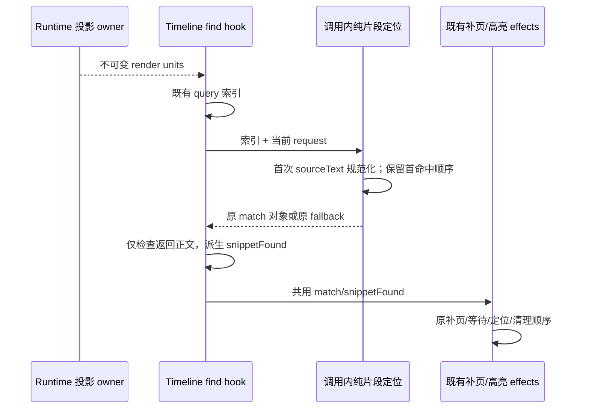

# 第十一轮：搜索结果片段定位的重复正文处理

## 规则、所有者与边界

`useConversationTimelineFind` 对已有投影构造搜索索引，Runtime 继续拥有会话事实。索引中同一正文可对应大量命中；片段定位和两个 effect 原先按每个命中重复执行正文空白规范化与大小写转换，未找到片段时尤其明显。

- 保持原片段规范化规则：去掉首尾三个点、合并空白、trim，再按 locale 转小写；空片段与规范化后空片段保留原有不同处理。
- `resolveSearchResultHighlightMatch` 每次调用对相同 `sourceText` 只处理一次，使用调用内 Set，不按 rowId 推断正文相同，不保留跨调用缓存。匹配时仍返回原 matches 顺序中的第一个对象。
- 未命中仍按 `snippetIndex ?? 0` 取原对象，越界继续回退首项，空索引为 null。新快照、正文替换、请求与语言变化重新执行原算法。
- hook 只按索引与请求 memo 已有 resolver 的结果。因为 resolver 有片段命中时必定优先返回该项，对返回项的一次片段检查即可决定“任一命中正文是否包含片段”；两个 effect 共用该派生结果，不再分别回扫全部 matches。
- 保留稳定阶段限制、自动补页上限、每个 request/window 的一次补页、异步补页等待、定位、DOM 高亮和三秒清理。无协议、持久化、业务状态 owner、identity、lease 或 desktop/mobile 交付变化。

## 验收

1. 在旧代码对真实 resolver 输入同一正文的 1,000 个命中，统计 `toLocaleLowerCase` 实际处理字符量，先证明预算失败。修复后预算与不同正文总长度有关，不乘同一正文命中数。
2. 与独立保留的原规则比较首命中对象、重复文本/相同 rowId 不同正文、空片段、三点、空白、大小写、缺省/越界 fallback、无命中和新快照。
3. 真实浏览器受控 hook 夹具验证长正文片段缺失时的工作预算、补页到达后定位、重新请求、补页耗尽后 fallback、streaming 阶段不定位；不启动 Agent 或真实模型，不使用用户 profile/数据。
4. 运行既有 find/browser 回归及根 typecheck/lint/architecture。字符处理预算不表示 Electron 整机提速比例。

## 同一正文的 DOM Range 构造

`applyConversationFindHighlights` 对每个索引命中调用 DOM 扫描，原扫描会构造该行全部命中的 Range 后才挑选其中一项；同一行 M 个命中会创建 M² 个 Range。将扫描结果限制在一次同步 apply 调用内按 rowId 复用，query 规范化一次。普通高亮与 active 高亮共享 Range；独立的搜索结果高亮仍单次扫描。

DOM 仍为渲染层事实，不跨帧缓存。下一次 apply 必须重读当前挂载行与文本；不存在的行只在本次返回空，不能阻止后续挂载。保留 matches 顺序、rowMatchIndex、被忽略控件、分文本节点匹配、active 不在 matches 的情况及 CSS Highlight 优先级。真实浏览器先在旧实现统计 500 个命中的 `document.createRange` 次数，修复预算不超过 500；随后替换同 rowId DOM、补挂缺失行、空 query 与忽略控件均回归。

## 实施证据与复核

- 旧 resolver 目标 3 项中兼容性 2 项通过、工作量 1 项失败：7,000 字符正文包含 1,000 个命中，缺失片段时 `toLocaleLowerCase` 处理字符总数为 7,013,000；修复后同输入为 7,013。选择对象和 fallback 的 50 组选项对照原规则，包含同 rowId 不同正文和新输入，全部通过。
- 原浏览器 hook 路径缺失片段时对长正文执行 5,001 次大小写规范化；修复后实测 3 次，两个 effect 共用已定位对象。通过自动补页一次、补页结果到达后定位与 CSS 高亮、耗尽后的 snippetIndex fallback、三秒清理、running 暂停与回到终态恢复的真实浏览器场景。
- 原 DOM 高亮对 500 个同段命中创建 250,500 个 Range；修复后只创建 500 个。按每次 apply 建立索引，普通与 active Highlight 共用 Range，保持优先级 0/1。验证同 rowId 文本替换、缺失后重新挂载、重复 DOM rowId 取首个、active 不在 matches、分文本节点不跨节点匹配、忽略 button 和空 query。
- transport 子代理只读对照三个开工快照，复核首命中/fallback 推论、补页等待/门控、缓存不跨 apply、active 不在 matches 与 CSS 优先级，未发现可操作回归；独立运行目标 snippet Vitest 3/3。浏览器补齐其指出的上述覆盖缺口。

计量为受控输入下的大小写转换字符数、调用数和真实 DOM Range 构造数，不等于 Electron 整机耗时比例。没有修改 Markdown streaming/static 或 live-tail 渲染边界。
