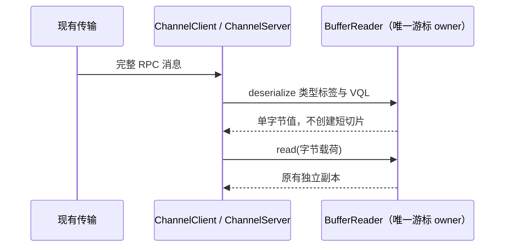

# 第十一轮：RPC 解码中的单字节复制

## 问题与范围

`BufferReader.read(1)` 为每个字节建立一个复制切片。`deserialize` 读取每个值的类型标签，并通过 VQL 读取整数和数组长度；对包含大量小整数的 RPC 数组，这会为标签和长度字节反复分配短命的 `Uint8Array`。ChannelClient 与 ChannelServer 都在真实消息入口调用该 decoder。

BufferReader 继续独占读取位置。新增的可选单字节读取能力只供 decoder 避免短切片；只实现原 `IReader.read()` 的 reader 继续通过原路径工作。`BufferReader.read()` 仍复制实际可读字节，截断读取按实际取得的长度推进；EOF 空读取不推进游标。帧格式、序列化结果、数组顺序和二进制值语义不变。

不改变 ChannelClient/Server 请求所有权、传输关闭顺序、desktop-continuous 实时交付、web-remote-replayable 快照恢复、owner/lease、workspaceIdentity、remoteSessionId 或 stale-run 防护。

## 验收

先新增回归并在未修改的生产实现上观察失败。用公开 ChannelClient/ChannelServer 直连往返 1,024 个单字节编码整数，统计 decoder 中 `Uint8Array.slice` 实际复制字节；复制量应保持固定的小开销，不随数组长度增长。该预算只度量已选中的复制字节，不推断墙钟提速或整机收益。

兼容覆盖：只有 `read()` 的通用 IReader、`BufferReader.read()` 的复制隔离与 EOF 游标、截断 VQL 的现有结果、0/最大有符号整数/JSON 大整数、根 Uint8Array、VSBuffer 与对象嵌套 Uint8Array。目标定点 Vitest、Lint 与格式检查；根检查由主任务统一执行。未进行 Electron、真实移动设备、网络服务或长期堆测量。

## 实施证据

- 旧实现真实 ChannelClient → ChannelServer → ChannelClient 往返 1,024 个单字节整数时，decoder 的 `Uint8Array.slice` 共复制 4,130 字节；兼容对照结果正确。改用 BufferReader 单字节读取后，同一回归的复制字节预算不超过 256，结果仍逐项相等。
- 只有 `read()` 的自定义 IReader 仍使用原来的一字节读取路径。BufferReader 的公开 `read()` 继续返回独立副本，EOF 空读取不推进；根空消息、截断和超长 VQL 保持旧结果。0、VQL 正整数、有符号边界、JSON 大整数、根 Uint8Array、VSBuffer 与嵌套 Uint8Array 往返通过。
- 定点 Vitest 5 文件 40/40 通过，oxlint 0 警告/错误，oxfmt 检查通过；`architecture:check --changed` 报告 baseline 0、new 0。完整根 typecheck 与 lint 由主任务统一执行。本测量是 decoder 切片复制字节，不代表真实连接吞吐或墙钟提速。
