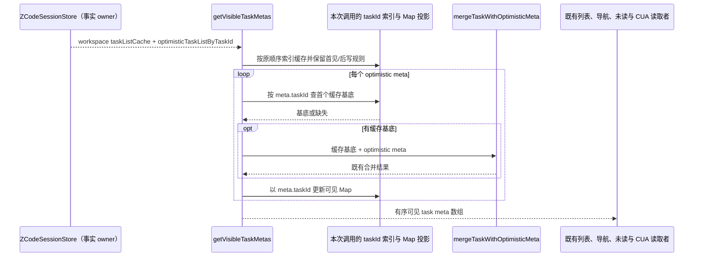

# 第十一轮 UI 性能：可见任务元数据合并

## 规则、所有者与边界

`getVisibleTaskMetas` 是多个 UI 读取路径共用的任务列表投影。它先把 `taskListCache` 放入按 taskId 索引的 Map，再逐个用 optimistic 元数据覆盖；目前每次覆盖都会调用 `getTaskMeta`，重新线性扫描同一份缓存。

- `ZCodeSessionStore` 继续唯一拥有 workspace task cache 与 optimistic task meta；选择器只派生返回值，不新增 store 状态、跨调用缓存、公开入口或异步流程。
- 选择器按输入顺序遍历缓存和 `Object.values(optimisticTaskListByTaskId)`，以 task meta 自身的 `taskId` 写可见 Map；每项的 optimistic 查找仍沿用 `getTaskMeta` 按 taskId 访问 keyed record 的规则。
- 可见列表仍用 Map 合并：缓存重复 taskId 的位置由首次出现决定，值由最后一次 `Map.set` 决定；optimistic 项覆盖时不改变该位置，首次出现的新 ID 仍追加在末尾。
- 与 `getTaskMeta` 一致，optimistic task 合并时仍使用缓存中 `find` 的首个同 ID 项作为基底；即使可见 Map 因重复 ID 已保存后项，也不能改成后项参与合并。optimistic map 按 taskId 存储，`Object.values` 遍历顺序及同 ID 覆盖时的 Map 位置均不得改变。
- 复用 `mergeTaskWithOptimisticMeta` 的既有字段选择、状态回退及标题规则。输入及缓存对象不修改；缺失缓存或 optimistic map 仍按原默认值处理。
- 仅在一次 `getVisibleTaskMetas` 调用内建立缓存索引，使缓存 taskId 读取与 optimistic 项数线性相关。身份隔离仍由调用方传入已解析的 workspace state 负责；不合并 workspace/path 桶。
- 不改变 task 持久化、query cache、workspace identity、交互、协议、owner/lease 或 Desktop continuous / mobile replayable 语义。

## 读取顺序

## 验收

1. 先新增工作量回归，在未改生产代码时运行：512 条缓存、覆盖最后 256 条的 256 个 optimistic meta。通过对真实缓存 `taskId` getter 计数，旧实现应超过 1,536 次预算并失败；该规模按当前 `.find()` 次序实测产生 98,944 次缓存 taskId 读取。
2. 以小型固定输入核对完整数组顺序及既有 merge helper 的完整输出：缓存重复 ID 的后项可见、optimistic 合并取重复缓存 ID 的首项、较旧 optimistic 字段回退、缺缓存 optimistic 原对象引用、输入未修改。相同 taskId 在不同 workspace state 的调用不得共享输出或索引。
3. 修复后工作量回归实测缓存 taskId 恰好读取 512 次，并保持上述兼容断言。新输入每次独立派生；不添加新的持久化、store owner 或接口。
4. 执行目标 Vitest、定点 Oxlint/Oxfmt 与改动文件 whitespace 检查；架构 changed 检查由主流程运行。纯选择器等价优化不改变交互，不增加 E2E 场景。根 typecheck/lint 由主代理统一执行。

## 验证记录

- Node 24.14.0 下先运行旧生产代码：语义测试通过，工作量测试按 512 条缓存和 256 个覆盖读取 `taskId` 共 98,944 次，超过 1,536 次预算并失败。修复后同一 workload 恰好读取缓存 `taskId` 512 次，目标文件 3 项通过。
- 定点 Oxlint 0 warning / 0 error；Oxfmt 检查通过；`architecture:check --changed` 为 0 基线 / 0 新增违规；生产文件 `git diff --check` 通过。
- 变更限于本规格、`getVisibleTaskMetas` 调用内索引和独立回归测试；未运行根 typecheck/lint，按主代理统一验证安排处理。操作计数是合成 selector 输入，不代表 Electron 整机时延或堆占用。
