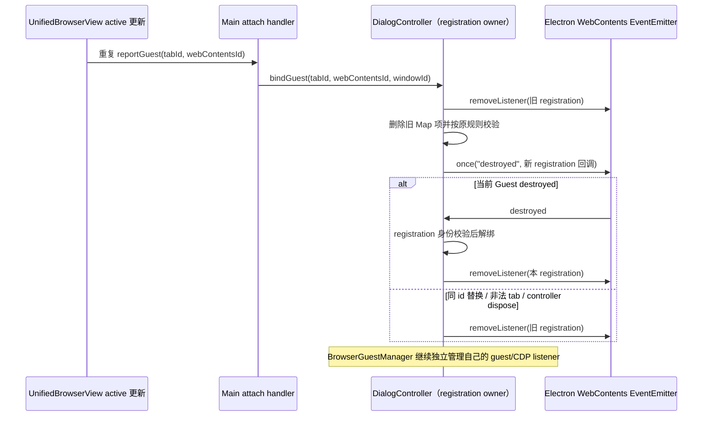

# 第十二轮：Browser JavaScript Dialog guest 监听生命周期

## 问题与范围

用户 Browser 的 active 状态更新会重复上报同一 guest。Main 在每次成功 attach 后调用 `EmbeddedBrowserJavaScriptDialogController.bindGuest`。controller 每次重绑会从 Map 删除旧记录，但旧 `destroyed` once listener 仍留在 guest 的 EventEmitter 上；反复切换 active 状态会让同一 guest 积累监听闭包。controller dispose 也只清 Map，当前 guest 上的监听仍存活。

`EmbeddedBrowserJavaScriptDialogController` 是 dialog 注册表和它所添加的每个 `destroyed` listener 的唯一 owner。`BrowserGuestManager` 独立拥有其 guest/CDP 生命周期监听；本改动只管理 dialog controller 添加的 listener，不接管或重建 guest、CDP 或 UI 状态。

## 行为与不变量

- 每个已注册的 `webContentsId` 最多有一条 dialog registration 和一条 controller-owned `destroyed` listener。
- `bindGuest` 先解绑同 id 的旧 registration，并移除旧 guest 上对应 listener；随后按原顺序校验 tab id、guest 存在性、销毁状态和类型。非法绑定会清掉旧句柄但不会建立新 registration。
- `destroyed` 回调只解绑它所属的当前 registration。旧 Guest 的迟到事件不得删除同 id 新 Guest 的 registration。
- guest 销毁、同 id 重绑、非法 tab 绑定和 controller dispose 都会移除 controller-owned listener；dispose 后不会保留本 controller 对 guest 的事件引用。
- `handleDialogRequest` 的来源解析、alert/confirm 文案、native dialog、automation passthrough、重复弹窗保护和失败 fallback 均保持现有语义。BrowserGuestManager 的独立 destroyed listener 不在本 controller 的计数范围内。

## 验收

使用 mock Electron API 与真实 Node `EventEmitter` guest，在不启动 Electron、BrowserWindow 或真实服务的情况下验证：同一 guest bind 100 次仍恰有一条 controller listener；dispose 后 listener 数为零；同 id 替换 Guest 清掉旧实例句柄；非法 tab bind 清掉当前句柄；旧 Guest 的迟到 destroyed 不影响新 registration；当前合法 registration 仍能调用 mock native dialog；当前 guest destroyed 后 registration 与 listener 均释放。

先运行新回归并确认旧实现失败，再修改 controller。定点执行新增测试及 `scripts/ci/browser-without-payment.test.mjs`；根 typecheck/lint 与架构检查由主任务统一执行。无协议、IPC、BrowserGuestManager 或 UI 行为变更，也不启动真实 Electron、Agent 或外部服务。

## 验证记录

旧实现四条回归中三条失败，包括 100 次重绑留下 100 条 listener，以及替换和非法重绑后旧 listener 未释放。修复版四条全部通过，增强后直接调用替换前捕获的旧回调，确认新 registration 仍能处理 dialog；dispose 和 unbind 保留其他 owner 的 listener。既有 `browser-without-payment.test.mjs` 一条通过。
