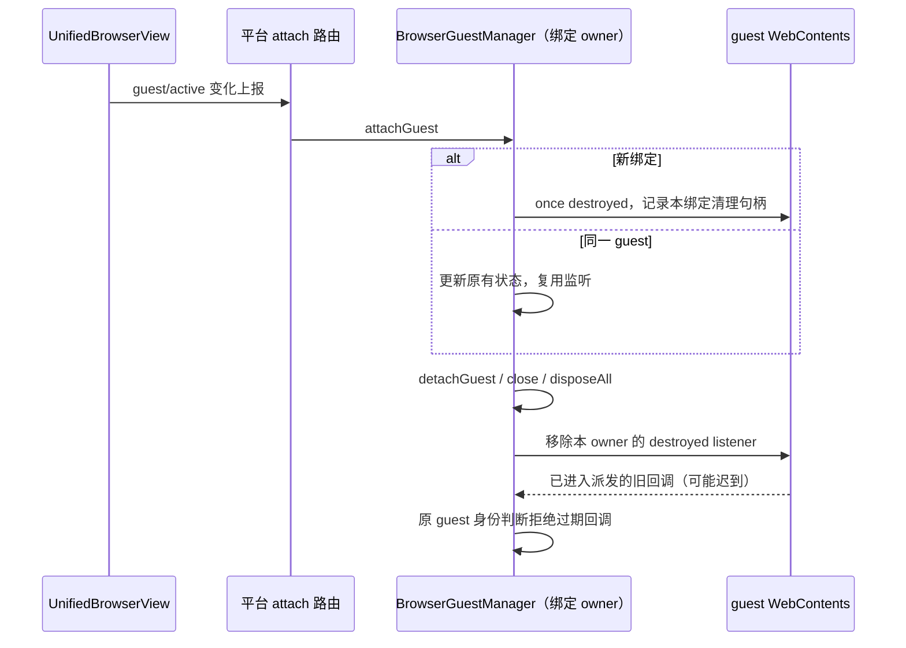

# Browser guest 重复 attach 的监听生命周期

## 已确认路径与规则

`UnifiedBrowserView` 在 guest 或 active 状态变化时经平台接口上报 attach；Main 转交 `BrowserGuestManager.attachGuest`。同一个 guest 切换前后台会再次 attach。现有方法对 CDP、dialog、download、activity 接线已有 `isSameGuest` 约束，但销毁监听每次都登记一个新的 `once`，使监听数随切换次数增长。

- `BrowserGuestManager` 继续唯一拥有 tab 与 guest 绑定；每个当前绑定只拥有一个自己的 destroyed listener。其他 controller 在同一 guest 的监听由各自 owner 管理。
- 同 guest 的重复 attach 更新原有 active、viewport、residency 等事实，不重新登记销毁监听。
- 真正换 guest 前通过既有 `detachGuest` 清理旧监听；显式 detach、关闭、`disposeAll` 也复用同一清理入口，不让仍存活的旧 guest 引用 manager。
- 保持原 destroyed 回调的 `current.guest === guest` 防护；旧回调即使已被事件派发捕获，也不能拆掉替代 guest。
- 所有权、scope/generation 校验、CDP/native detach 次序、自动恢复与 UAF 防护不改变；不新建连接 owner、协议字段、计时器或持久状态。

## 验收

使用真实 EventEmitter 和受控 Electron/CDP 对象驱动真实 `attachGuest`，不打开应用窗口、启动 Agent、调用模型或读写用户目录。先运行旧实现，复现多次 active 切换后监听数超过一个；修复后重复 attach 100 次仍只有一个 listener。换 guest、显式 detach、dispose 清理旧 listener，并保持正常销毁的自动重绑通知和迟到旧回调防护。模拟本次监听移除抛错，验证仍完成原有 native CDP detach 和其余监听清理。该测试验证本地资源预算，不声称整机提速比例。根 typecheck/lint、桌面 Main 独立类型检查与架构检查另行执行。

## 验证记录

旧实现的前两条回归按预期失败：第二次 attach 已有两个监听，替换 guest 后旧监听仍在。修复版五条测试全部通过，包含前后台切换预算、替换与迟到旧回调、显式 detach 保留其他 owner、render-process-gone 的 native CDP 防护、监听移除抛错时继续收口。

独立 Main 类型检查仍有 60 个既有错误。以 TypeScript CompilerHost 只在内存中将本轮两个 Main 生产文件替换为 HEAD，再与当前实现按文件、错误码和消息做多重集比较：基线 60 / 当前 60，新增 0、移除 0、新测试诊断 0。没有改写磁盘源码或扩大修复范围。
