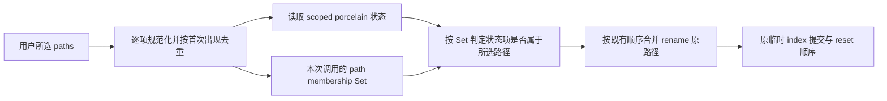

# 第十二轮：所选提交路径的线性成员查询

## 规则与所有者

`GitCliRepo.commit` 是提交命令和临时 index 操作的唯一所有者。Git Action Menu 会把用户选中的全部唯一文件路径交给该入口；`stagedOnly` 提交先读取所选路径的 porcelain 状态，再把 rename 的原路径并入临时 index 清理计划。

- `paths` 仍逐项规范化到仓库相对路径；重复的输入路径仍在规范化后按首次出现顺序去重。
- `stagedOnly` 分支从 `repoPaths` 建立本次调用私有的成员集合。状态项只用其规范化后的 `entry.path` 查询成员资格；匹配项的 `originalPath` 仍按 Git 返回顺序并入清理集合。
- `cleanupRepoPaths` 仍先保留全部 `repoPaths`，再按状态项顺序追加匹配 rename 的原路径，并按首次出现去重。集合只服务本次调用，不跨 workspace、请求或提交缓存。
- 普通提交、空路径提交、路径规范化、Git 命令及其顺序、错误传播、临时 index 生命周期与提交后的状态失效均不改变。

## 验收

- 通过公开 `GitCliRepo.commit` 和 mock `GitCommandProvider` 驱动 `stagedOnly` 路径；输入大批唯一路径及对应 scoped status entries，旧实现的成员比较预算失败，新实现通过。
- 对照 mock 命令记录和最终提交结果，保持所选路径、重复输入、路径规范化、rename 原路径、删除项、普通提交及空路径提交的行为和命令顺序。
- 所有路径只使用测试创建的临时目录；不调用系统 Git、不读取用户仓库、不触发真实提交。测试覆盖实际公开方法，不只测试独立 membership helper。
- 修改范围限于 `GitCliRepo.commit` 的本次调用成员查询；不增加服务接口、共享缓存、第二份业务状态或新的提交路径。
- 执行目标回归、定点 lint/格式和 `architecture:check --changed`。根 typecheck/lint 由主代理统一执行。不提交、推送或构建。

## 验证记录

旧实现对 256 个所选路径产生 32,896 次线性成员比较，仅预算断言失败；Git 命令顺序、rename 原路径和删除项断言已通过。修复版两条公开入口回归全部通过，覆盖 staged-only 大批路径，以及普通提交的规范化、去重和空路径提交。定点 lint、格式与架构检查通过。
