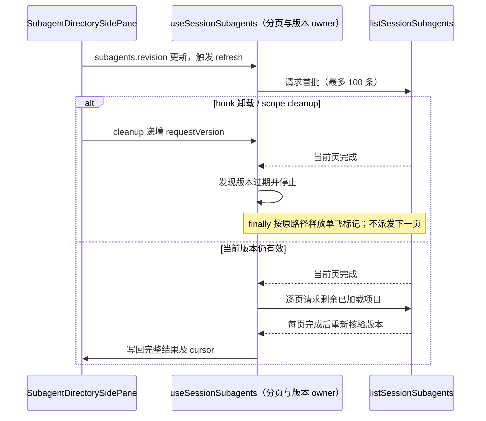

# 第十二轮：子智能体目录失效分页收口

## 已确认路径与所有权

`SubagentDirectorySidePane` 将 v4 projection 的 `subagents.revision` 作为 `useSessionSubagents` 的 refresh key。用户通过“再显示 20 个”可以把已加载 ended 项目扩展到 100 条以上；此后 revision 更新会触发 `refresh()`，它先取最多 100 条，再串行补齐此前已加载的数量。关闭目录 tab 会卸载 hook，scope effect cleanup 递增 `requestVersion`，但当前实现只在全部补页后检查版本。

`useSessionSubagents` 继续独占本地请求、分页和失效版本。`requestVersion` 是唯一的失效标记；本修复不增加 AbortController、缓存、owner 或第二套 generation，也不改变 `requestInFlightRef` 的单飞语义。

## 行为与不变量

- `refresh()` 首个分页 await 完成后立即检查捕获的版本；版本已变化时不计算或派发历史补页。
- refresh 的每个历史分页 await 完成后都立即检查版本；旧目录只允许当前已派发 RPC 自然完成，不再继续派发后续页，也不写回结果或错误状态。
- scope/unmount cleanup 仍只递增 `requestVersion`，不提前清 busy 标记。原 `finally` 在当前请求链结束时释放 `requestInFlightRef`；single-flight 保证不会有新请求在此前启动。
- 正常 refresh 的结果、条目顺序、去重、cursor、revision、错误处理与请求次序不变；`loadMore()` 语义不变。
- 不承诺取消已发出的 RPC，只约束失效后后续分页 RPC 数量为零。

## 验收

使用 mock service 和合成目录，在独立 Edge 临时 profile、loopback 随机端口下验证已加载至少 120 条时：首个 refresh 页 pending 后卸载，resolve 后不得派发第二页；第二页 pending 时卸载，resolve 后不得派发第三页。另验证正常的 loadMore、refresh 结果顺序与 cursor 保持一致。原实现的浏览器回归已确认首批页 pending 后卸载会再派发 2 个 RPC，第二页 pending 后卸载会再派发 1 个 RPC；同轮正常 140 条结果顺序、cursor 与 refresh 请求页序断言先通过。Node fetch fixture 返回 HTTP 200。无需启动已安装应用、用户 Agent 或真实模型/API；所有创建的浏览器、profile 和服务在 finally 中清理。

## 验证记录

修复版 Edge E2E 一条通过：首批与第二页等待时卸载，当前页完成后追加 RPC 均为 0；正常 140 条 ID 顺序、cursor=140 和 100/20/20 刷新页序通过。脚本通过临时 socket 选择随机 loopback 端口，并以 strictPort 启动 Vite；显式选择优化入口，cacheDir 与 Edge profile 位于本轮临时目录。页面请求均来自本次服务，context、server、临时目录在嵌套 finally 中清理，探测 socket 也在其 finally 中关闭。
