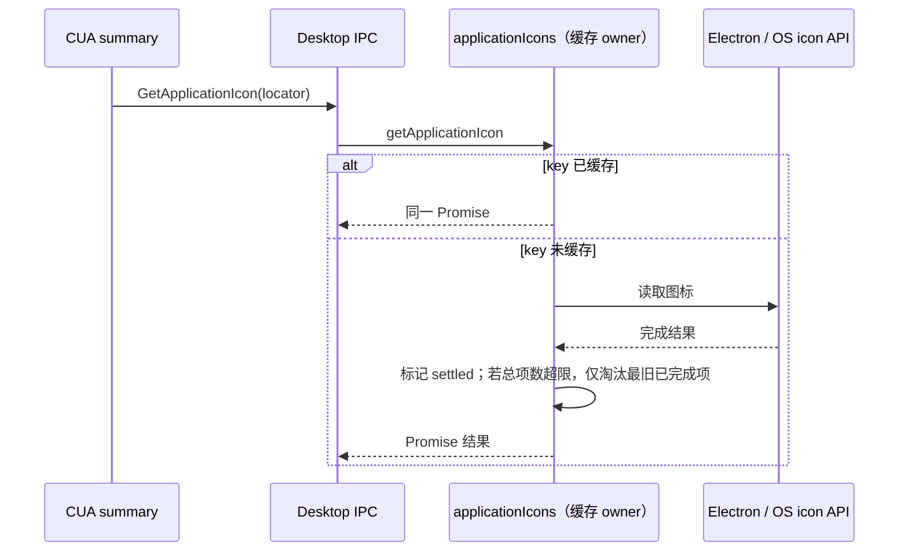

# 第十三轮 Desktop Main 性能扫描

## 范围与证据

本轮扫描 `packages/desktop/src/main` 的轮询、监听器生命周期与缓存，跳过 `browserGuestManager` 和 `embeddedBrowserJavaScriptDialog`。架构初检 `architecture:check --changed` 为 0 violation；`desktop` 当前是未托管模块，没有直接契约文件。

CUA 工具结果的 `targetApp.iconLocators` 经 UI summary 传给 Desktop 的 `GetApplicationIcon` IPC。Windows locator 包含 executable path，bundle id/AUMID 也由每条工具结果动态提供；协议只限制单次最多 3 项，没有限制应用标识的全局种类数。`applicationIcons.ts` 的模块级 Map 按 locator key 保存 `Promise<ApplicationIconInfo | null>`，成功结果会持有 base64 图标 data URL，且进程退出前不淘汰已完成项。长时间查看包含不同应用的历史 CUA 结果会持续增加该缓存。

## 行为与所有权

- `applicationIcons.ts` 是图标读取与其派生缓存的唯一 owner；IPC、共享类型、UI 请求语义不变。
- 缓存目标总容量为 128 项（pending 与已完成项都计入），并按最近访问顺序淘汰最旧的已完成项。128 是本地派生数据的容量边界，不是产品数据上限；超出后再次请求被淘汰项会重新读取系统图标。
- pending 请求参与同 key 合并，但容量清理不得淘汰它们。若同时有超过 128 个不同 key 的读取尚未完成，缓存可暂时超过 128；pending 项完成后，只淘汰最旧的已完成项，直到总项数回到 128。若已完成项不足以收敛，缓存仍会暂时超限，直到有更多 pending 项完成。这样容量管理不会使相同 key 的在途请求重复执行系统 IO。
- LRU 次序只由请求命中/插入更新，异步完成顺序不改变访问次序；慢请求完成不能因此变成最新访问项。
- 被拒绝的 Promise 不留在缓存；清理只在当前 key 仍指向该 Promise entry 时进行，避免过期完成删除新 entry。现有 loader 将常见的系统图标读取异常转成 `null`，这一既有 fallback 保持不变；`null` 作为已完成结果同样受容量限制。
- 命中缓存继续返回同一 Promise，保持并发去重及原有结果类型。

## 验收

使用纯 mock loader 验证：默认容量 128、命中复用和 LRU 淘汰；超过容量时不淘汰 pending key，完成后收敛至上限；被拒绝的加载可重试。另用 fake Electron 验证真实 `getApplicationIcon` 入口在 129 个不同 Windows path 下仍将 settled cache 控制在 128，并保持相同 key 命中。拒绝/完成回调按 entry 身份检查；容量清理不替换 pending 项，因此不引入未被产品调用的 clear/invalidation API。不启动 Electron、Agent、用户应用或外部服务，不读取 `.zcodium`。
